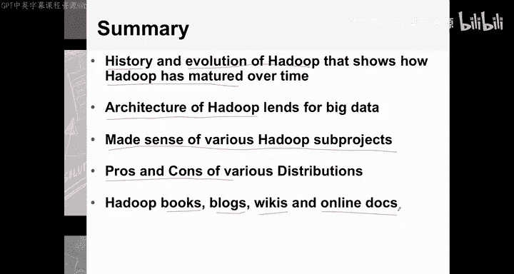

# 016：Apache Hadoop架构与生态系统总结 🏗️

在本节课中，我们将回顾Apache Hadoop的架构与生态系统。我们将总结Hadoop的发展历程、核心架构原则、关键子项目、市场发行版以及进一步学习的资源。

---

## 概述

本节将对整个模块的内容进行总结。我们回顾了Hadoop的历史演变、其核心架构、丰富的生态系统项目、不同的商业发行版，并指明了获取更多信息的途径。

---

## Hadoop的历史与演变

上一节我们介绍了Hadoop的背景，本节我们来总结其发展历程。我们看到了Hadoop如何随着时间的推移而成熟，以适应现代大数据处理的需求。其演变过程展示了从最初的设计到如今强大生态系统的成长路径。

---

## Hadoop架构与核心原则

我们探讨了Hadoop的架构及其关键原则。正是这些原则使得Hadoop在今天的大数据处理中如此出色。

其核心设计基于以下理念：
*   **分布式存储**：数据被分割并存储在集群的多个节点上。
*   **分布式计算**：计算任务被分发到存储数据的节点附近执行。
*   **容错性**：系统能够自动处理节点故障，确保任务完成。

一个简单的MapReduce思想可以表示为：
**输入数据 -> Map阶段（处理）-> Shuffle & Sort -> Reduce阶段（汇总）-> 输出结果**

---

## Hadoop生态系统与子项目

我们审视了Hadoop的各种子项目，并对它们进行了梳理和归类，以理解其生态系统。

以下是主要的项目分组：

*   **数据存储**：如HDFS（Hadoop Distributed File System）。
*   **数据处理**：如MapReduce、Spark。
*   **数据查询**：如Hive、Pig。
*   **协调与管理**：如ZooKeeper、YARN。
*   **数据摄取与传输**：如Flume、Sqoop。
*   **数据库**：如HBase。

---

## Hadoop发行版

我们了解了市场上存在的各种Hadoop发行版，并分析了每个发行版的优缺点。

主要的发行版包括：
*   **Apache Hadoop**：社区原版，完全开源。
*   **Cloudera Distribution (CDH)**：集成度高，企业功能丰富。
*   **Hortonworks Data Platform (HDP)**：完全开源，强调社区兼容性。
*   **MapR**：提供替代性文件系统，强调性能和可靠性。

---

## 进一步学习资源

最后，我们学习了在哪里可以找到关于Hadoop的更多信息。

获取知识的渠道包括：
*   **书籍**：系统学习理论与最佳实践。
*   **博客与社区**：获取最新动态、技术文章和问题解答。
*   **Wiki与官方文档**：查阅最权威的API和配置指南。
*   **在线课程与教程**：进行实践性的学习。

---

## 总结

在本节课中，我们一起学习了Apache Hadoop的全貌。我们总结了其历史演变，理解了其分布式架构的核心原则，梳理了庞大的生态系统项目，比较了不同的商业发行版，并掌握了继续深入学习的资源路径。这为后续实际使用和深入研究Hadoop奠定了坚实的基础。