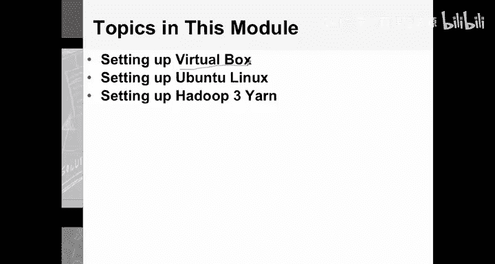
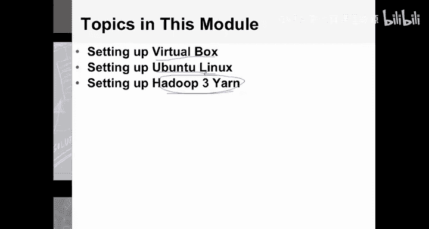

# 017：Hadoop环境配置与运行导论 🚀

在本节课中，我们将学习如何在虚拟化环境中安装、配置并运行Hadoop。具体来说，我们会使用VirtualBox虚拟化软件，在其上运行Ubuntu Linux操作系统，并以伪分布式模式部署Hadoop 3 YARN。本模块将以动手演示为主，引导你完成本课程所需的所有环境设置。

## 模块概述 📋

我们将按顺序完成以下几个主要步骤：

1.  设置VirtualBox虚拟化管理器。
2.  在VirtualBox上安装并运行Ubuntu Linux操作系统。
3.  在Ubuntu系统上安装和配置Hadoop 3 YARN。

其中，Hadoop 3的安装与配置是本模块的重点，我们将花费最多时间在此部分。

## 模块目标 🎯

虽然本模块会涉及VirtualBox和Ubuntu操作系统的设置，但我们的核心目标是**在VirtualBox虚拟环境中完成Hadoop的安装、配置与运行**。

在安装过程中，我会尽力解释每个步骤，但关于Hadoop架构、HDFS及Hadoop内部原理的许多细节，可能需要后续多个模块的学习才能完全清晰。目前，我们首要任务是学会在桌面环境上搭建并运行Hadoop。

---



上一节我们明确了本模块的学习路径和目标，接下来，我们开始第一步：设置虚拟化环境。

## 1. 设置VirtualBox 🖥️

VirtualBox是一款功能强大的虚拟化软件，它允许我们在现有操作系统（如Windows或macOS）上创建和运行虚拟机。

以下是安装VirtualBox的基本步骤：

1.  访问VirtualBox官方网站。
2.  下载适用于你当前桌面操作系统的安装程序。
3.  运行安装程序，并遵循向导完成安装。

安装完成后，你便可以在VirtualBox中创建新的虚拟机。

---

成功安装VirtualBox后，我们需要一个操作系统来运行Hadoop。接下来，我们将在虚拟机中安装Ubuntu Linux。



## 2. 设置与运行Ubuntu Linux 🐧


Ubuntu是一种流行的Linux操作系统发行版。我们将使用Ubuntu 20.04 LTS版本，并将其安装在VirtualBox虚拟机中。

以下是获取和安装Ubuntu的步骤：

1.  从Ubuntu官网下载Ubuntu 20.04 LTS的ISO镜像文件。
2.  在VirtualBox中创建一台新的虚拟机。
3.  在虚拟机设置中，指定刚才下载的Ubuntu ISO镜像作为启动盘。
4.  启动虚拟机，并按照屏幕提示完成Ubuntu操作系统的安装。

安装完成后，你将拥有一个运行在VirtualBox中的完整Ubuntu Linux系统。

---

现在，我们已经在VirtualBox上成功运行了Ubuntu Linux操作系统。接下来进入本模块的核心环节：安装和配置Hadoop。

## 3. 在Ubuntu上设置Hadoop 3 YARN ⚙️

这是本模块最重要的部分。我们将在Ubuntu系统中安装Hadoop 3，并以伪分布式模式进行配置。在这种模式下，Hadoop的所有守护进程（如NameNode, DataNode, ResourceManager）都运行在单个节点上，模拟一个分布式集群，非常适合学习和测试。

以下是配置Hadoop 3 YARN的关键步骤概述：

1.  **安装Java**：Hadoop依赖Java运行环境。使用以下命令安装OpenJDK：
    ```bash
    sudo apt update
    sudo apt install openjdk-11-jdk
    ```
2.  **下载并解压Hadoop**：从Apache官网下载Hadoop 3.x的二进制包，并解压到指定目录，例如 `/usr/local/hadoop`。
3.  **配置环境变量**：编辑 `~/.bashrc` 文件，添加JAVA_HOME和HADOOP_HOME等环境变量。
    ```bash
    export JAVA_HOME=/usr/lib/jvm/java-11-openjdk-amd64
    export HADOOP_HOME=/usr/local/hadoop
    export PATH=$PATH:$HADOOP_HOME/bin:$HADOOP_HOME/sbin
    ```
4.  **修改Hadoop配置文件**：主要配置 `etc/hadoop/` 目录下的核心文件，如 `core-site.xml`, `hdfs-site.xml`, `mapred-site.xml`, `yarn-site.xml`，设置本地文件系统路径、副本数等参数。
5.  **设置SSH免密登录**：Hadoop脚本需要SSH权限来管理守护进程。生成SSH密钥并添加到授权列表。
    ```bash
    ssh-keygen -t rsa -P '' -f ~/.ssh/id_rsa
    cat ~/.ssh/id_rsa.pub >> ~/.ssh/authorized_keys
    ```
6.  **格式化HDFS**：首次启动前，需要格式化Hadoop分布式文件系统。
    ```bash
    hdfs namenode -format
    ```
7.  **启动Hadoop集群**：使用Hadoop自带的脚本启动所有服务。
    ```bash
    start-dfs.sh
    start-yarn.sh
    ```
8.  **验证安装**：使用 `jps` 命令查看运行的Java进程，并通过Web界面（如 `http://localhost:9870` 访问HDFS）确认服务正常运行。

---

## 总结 📝


本节课中，我们一起学习了搭建Hadoop开发环境的完整流程。我们从安装VirtualBox虚拟化软件开始，接着在其上部署了Ubuntu Linux操作系统，最后完成了Hadoop 3 YARN在伪分布式模式下的安装与基础配置。通过本模块的实践，你已经拥有了一个可以运行和测试Hadoop程序的本地环境，为后续深入学习大数据处理打下了坚实的基础。