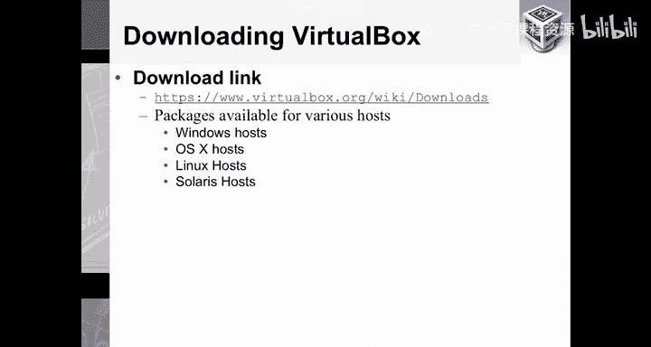
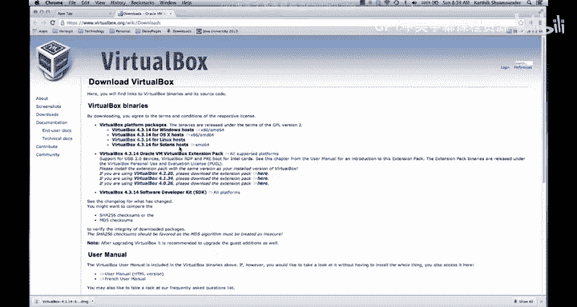
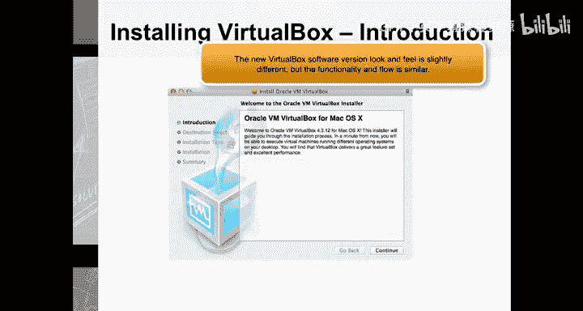
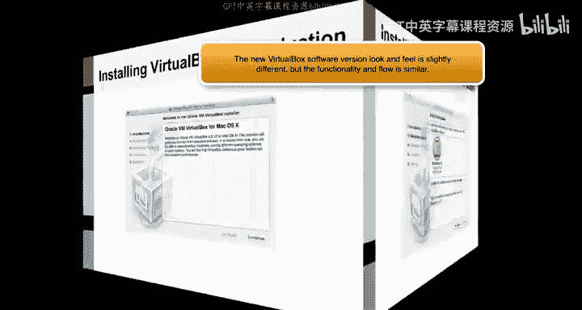
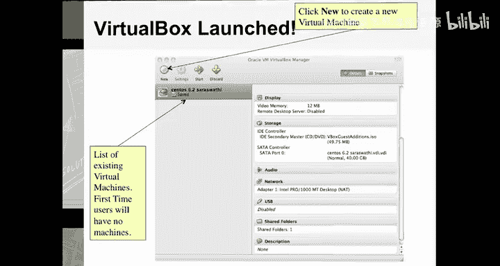

# 018：VirtualBox安装与配置指南 🖥️

在本节课中，我们将学习虚拟化的基本概念，了解为何在Hadoop学习中需要虚拟化技术，并详细介绍如何下载、安装和初步配置Oracle VirtualBox软件，以便为后续安装Linux和Hadoop做好准备。

---

## 什么是虚拟化？

虚拟化是指创建IT基础设施的虚拟版本，而非物理实体。这意味着你可以拥有虚拟化的服务器，而非物理服务器实例。你的存储设备（如硬盘）和网络设备（如防火墙和路由器）都可以被虚拟化。更酷的是，你的操作系统也可以被虚拟化，这意味着你可以在Windows操作系统之上运行一个虚拟化的Linux操作系统。

虚拟化已成为IT行业的一大趋势，特别是在数据中心整合、维护、管理和监控方面。

---

## 为何在本课程中需要虚拟化？

我们关心虚拟化是因为我们想要运行Hadoop。虽然Hortonworks和Microsoft在Windows平台上运行Hadoop做得相当不错，但Hadoop在Linux平台上运行得最好。

由于大家的笔记本电脑或PC可能拥有不同的硬件和操作系统，我们希望通过虚拟化方式运行Linux，这样在我们进行项目和作业时，就能有一个统一的标准环境。

基本思路是：在你的PC或笔记本电脑硬件之上，可能已安装有Windows等操作系统。我们将在此之上安装一种虚拟化软件（例如VirtualBox），然后在VirtualBox之上安装虚拟化的Linux（如CentOS Linux），最后在Linux之上安装Hadoop。这样，我们就可以运行Hadoop守护进程，并使用Hadoop进行大数据处理。

---

## 市场上有哪些虚拟化软件？

市场上有VMware和Parallels等付费版本的虚拟化软件。此外，Oracle提供了一个开源版本的虚拟化软件，名为**Oracle VirtualBox**。这正是我们本课程将要使用的软件。

---

## 什么是VirtualBox？

VirtualBox是一款跨平台的虚拟化软件。这意味着它可以在Windows、Mac OS X、Linux甚至Solaris平台上使用。你可以为特定的操作系统下载相应版本的VirtualBox软件，安装后即可在该系统之上运行虚拟化的操作系统。

它可以安装在任何基于Intel或AMD的计算机上（大多数同学的电脑都符合此条件）。当然，它是Oracle提供的免费开源软件，我们非常喜欢这一点。

VirtualBox的一大优点是，你可以同时运行多个操作系统。例如，你可以在Mac上运行Linux，或在Linux服务器上运行Windows Server 2008，也可以在Windows PC上运行Linux。但在本课程中，我们将在你的现有操作系统（无论是什么）之上运行Linux。

---

## 关键VirtualBox术语

在继续之前，我们需要了解一些关键的VirtualBox术语。

*   **主机操作系统**：指你物理计算机（PC、笔记本电脑或服务器）上安装的操作系统。
*   **客户机操作系统**：指将在虚拟机内部、运行于你现有操作系统之上的虚拟化操作系统。
*   **虚拟机**：指VirtualBox（或任何虚拟化软件）为客机操作系统创建的特殊运行环境。你甚至可以创建虚拟化网络，让所有虚拟机在该特定网络内通信。
*   **增强功能**：这是一个需要安装在虚拟机内部的特殊软件，是VirtualBox的一个独特概念。在客机操作系统中安装增强功能可以提升其性能，并提供一些额外功能，例如端口转发和共享USB驱动器。

---

## VirtualBox的主要功能

以下是VirtualBox的一些关键功能：

*   **共享文件夹**：允许在客机和主机操作系统之间共享文件夹。
*   **端口转发**：意味着你可以从主机操作系统连接到客机操作系统中的端口，反之亦然。
*   **64位仿真**：支持64位系统。
*   **USB设备支持**：你可以将USB驱动器插入主机计算机，并在客机操作系统中识别和使用该硬件。

VirtualBox提供了许多很酷的功能。

---

## 下载VirtualBox

如果你想下载并安装VirtualBox，可以访问 `virtualbox.org` 网站。

如图所示，你可以获取适用于大多数主流操作系统的VirtualBox版本，包括Windows、OS X、Linux和Solaris。

当然，我将下载适用于OS X的版本（实际上我已经完成下载并安装了）。本课程我们将使用VirtualBox 4.3版本，如果有更新的版本，你也可以使用。

有些同学可能已经安装了Linux，可能会问为什么需要在Linux之上再通过虚拟化软件运行Linux。其实并非必须如此。如果你对Linux相当熟悉，可以直接在你的Linux系统上运行Hadoop。但在虚拟化环境中运行的优势在于，这是一个受控的环境。我将展示你需要安装的不同软件，这样你就能与班上其他同学保持环境一致。这是使用虚拟化的唯一优势。但如果你确实不想安装VirtualBox和虚拟机，而想直接运行Linux，也是可以的。

---

## 安装VirtualBox

下载VirtualBox后，你可以双击安装文件（在Mac上是DMG文件）。只需双击下载的软件，然后按照安装过程进行操作。

安装程序会显示一个介绍窗口，说明VirtualBox的版本。然后，它会显示你的硬盘信息。接着点击继续，在安装位置处，我通常保持默认设置，这样它就会安装在常规位置（无论是Windows、Linux还是Mac操作系统）。然后开始安装VirtualBox，整个过程只需几秒钟即可完成。整个安装过程应该不超过几分钟。

安装完成后，你的桌面上应该会出现一个VirtualBox图标。双击该图标即可启动VirtualBox。

启动VirtualBox后，你会看到应用程序界面。顶部会显示创建新虚拟机的方式，也可以更改虚拟机的设置。左侧窗格会列出已有的虚拟机。如果是全新安装VirtualBox且尚未创建任何虚拟机，这个列表将是空的。图中显示的“CentOS”虚拟机是我已经安装好的，所以你才会看到它。

---

## 总结

在本节课中，我们一起学习了虚拟化的概念，包括一些关键术语，如主机操作系统、客机操作系统和虚拟机。由于本课程将使用VirtualBox，我们学习了如何在你的主机计算机上下载和安装VirtualBox，以便为后续安装和配置客机Linux操作系统、运行Hadoop做好准备。