# 019：在VirtualBox中部署Ubuntu Linux虚拟机 🖥️

在本节课中，我们将学习如何在VirtualBox虚拟化软件上，下载、安装并配置Ubuntu Linux操作系统。由于Hadoop在Linux系统上运行效果最佳，因此我们需要一个Linux发行版来运行Hadoop。

## 概述

我们将分步完成在VirtualBox上创建并配置Ubuntu Linux虚拟机的全过程。这包括下载系统镜像、创建虚拟机、分配资源、安装系统以及安装增强功能。

## 选择Linux发行版

市场上有多种Linux发行版可供选择。例如，有免费的CentOS发行版，也有另一个免费开源的Ubuntu发行版，还有需要授权的Red Hat发行版。本课程将使用免费的Ubuntu版本。

在之前的课程中，我曾使用过CentOS。因此，在未来的某些模块中，您可能会看到部分章节是在CentOS上完成的。但两者的基本命令是相同的，只是图形用户界面有所不同。

关于Ubuntu的一个有趣事实是，它的命名源于非洲的“Ubuntu”哲学，意为“人道待人”，蕴含着“我因你而存在”的寓意。

## 下载Ubuntu

Ubuntu的官方网站是 `ubuntu.com`。访问该网站，点击“下载”进入下载页面，然后下载64位版本的Ubuntu LTS软件。这是一个大约2.88 GB的ISO文件，下载后即可用于安装。

接下来，我将先讲解理论步骤，稍后进行实际操作演示。

## 安装Ubuntu的六个步骤

以下是安装Ubuntu的六个核心步骤。我们将先通过截图讲解理论，然后进行实际操作演示。

1.  **在VirtualBox中创建新的虚拟机**（即基本配置）。
2.  **挂载从 `ubuntu.com` 下载的ISO镜像文件**。
3.  **为虚拟机分配更多CPU资源**。由于我们是在宿主机操作系统上运行客户机操作系统，需要为Ubuntu分配足够的CPU，以确保其运行流畅，便于进行大数据处理。
4.  **从CD启动虚拟机**。
5.  **安装客户机操作系统**，即实际安装Ubuntu。
6.  **安装VirtualBox增强功能**。这能实现一些实用功能，例如共享文件夹、全屏窗口或端口转发等。

### 第一步：创建新虚拟机

启动VirtualBox，点击“新建”图标。在弹出的对话框中：
*   在“名称”栏输入：`HD server`（这是我们虚拟机的名称）。
*   在“类型”下拉列表中选择：`Linux`。
*   在“版本”下拉列表中选择：`Ubuntu (64-bit)`。
*   点击“继续”。

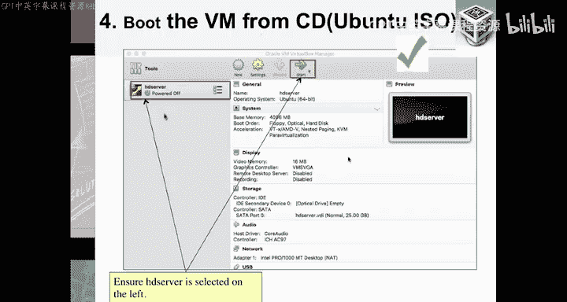

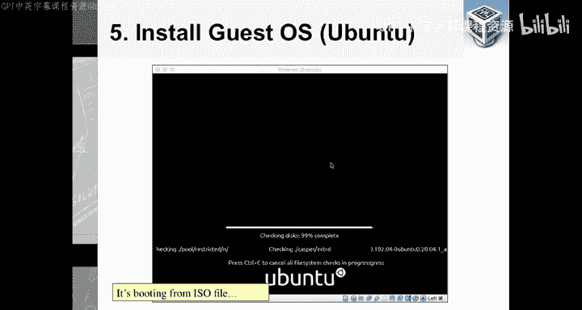

在下一个屏幕中，设置虚拟机的内存大小。默认是1024 MB，我们将其设置为 **4096 MB**，然后点击“继续”。

接下来，选择“现在创建虚拟硬盘”，点击“创建”。选择虚拟硬盘文件类型为 **VDI**，点击“继续”。选择“动态分配”存储方式，点击“继续”。设置硬盘大小，默认是10 GB，我们将其改为 **25 GB**，然后点击“创建”。

至此，一个基础的虚拟机（尚未安装操作系统）就创建完成了，列表中会出现名为“HD server”的条目。

### 第二步：挂载ISO镜像

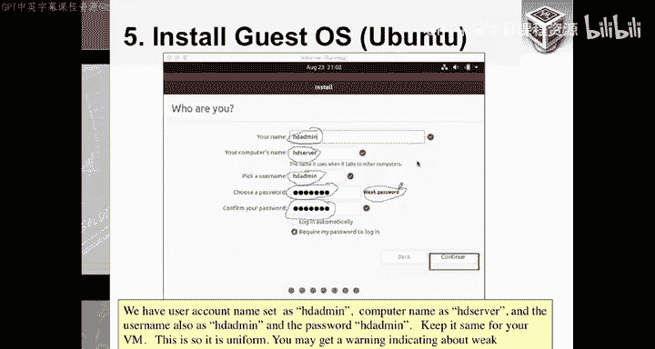

确保“HD server”条目被选中（通常默认已选中）。右键点击它，选择“设置”。在弹出的设置窗口中，点击“存储”图标。在存储设置界面，点击“控制器：IDE”下的“空”光盘图标。然后，点击右侧属性栏中的光盘图标，选择“选择虚拟光盘文件...”，导航到您下载Ubuntu ISO文件的文件夹（通常是“下载”文件夹）并选择该文件。点击“确定”后，ISO镜像就挂载好了。

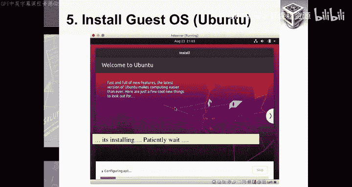

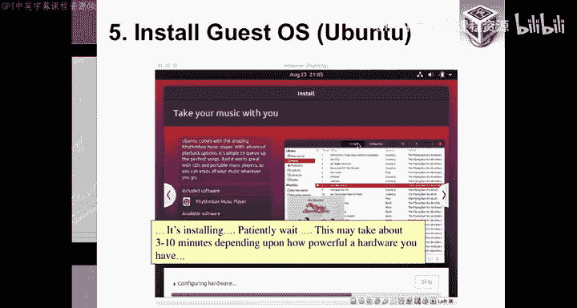

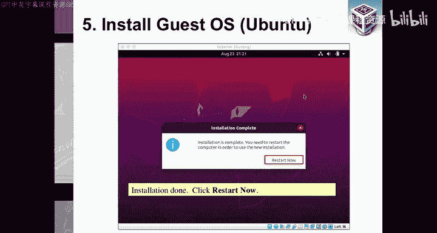

### 第三步：分配更多CPU资源

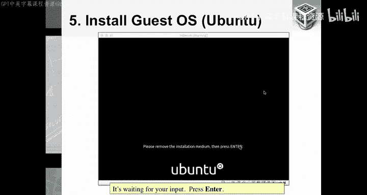

再次右键点击“HD server”并进入“设置”。点击“系统”，然后选择“处理器”选项卡。您会看到一个滑块，用于调整处理器数量。根据您宿主机的性能，尽可能将滑块向右拖动（变为绿色），为虚拟机分配足够的计算能力。完成后点击“确定”。

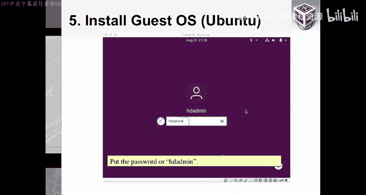

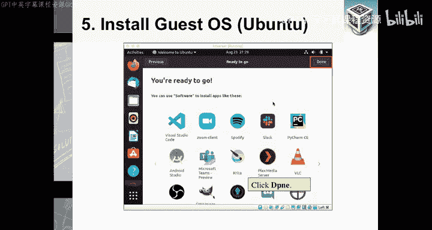

### 第四步：从CD启动并安装系统

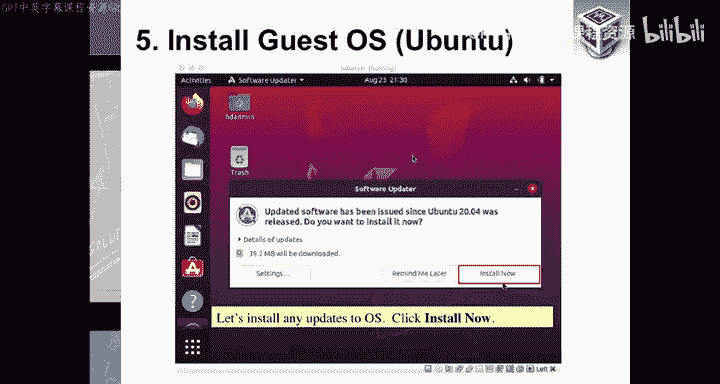

选中“HD server”，点击“启动”按钮。这将启动Ubuntu操作系统的安装过程。

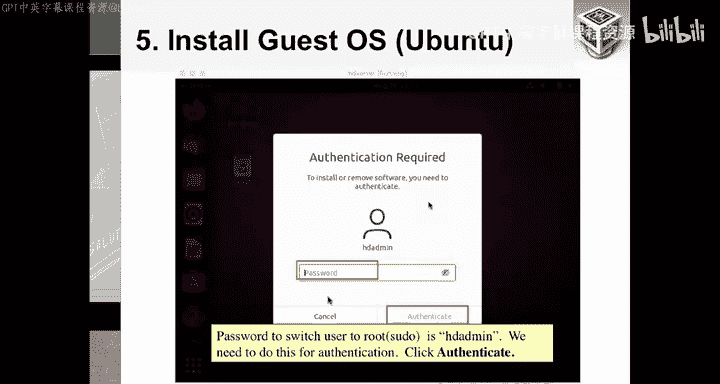

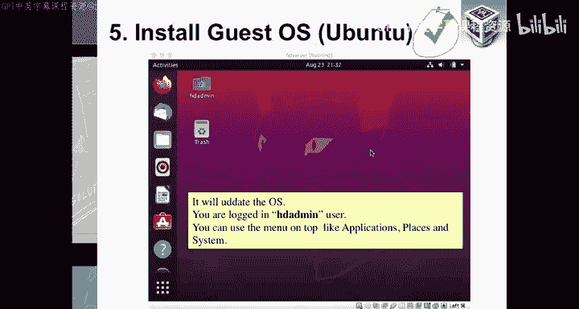

安装程序会询问语言，默认是“English”，点击“安装Ubuntu”。再次确认语言为“English”，点击“继续”。选择“正常安装”，点击“继续”。在安装类型界面，选择“清除整个磁盘并安装Ubuntu”（请放心，这只会清除虚拟磁盘，不会影响您的物理硬盘），点击“现在安装”，然后点击“继续”。

接下来设置时区，根据您的地理位置选择，例如“New York”，点击“继续”。现在需要创建登录账户：
*   您的姓名和计算机名：输入 `HD server`。
*   用户名：输入 `hdadmin`（代表Hadoop管理员）。
*   密码：输入 `hdadmin`（系统可能会提示密码强度弱，但作为本地学习环境可以接受）。
*   确认密码：再次输入 `hdadmin`。

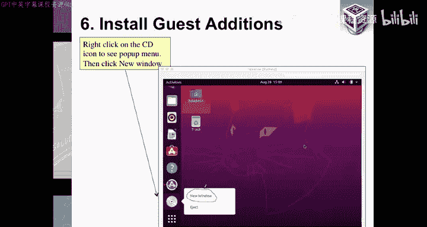

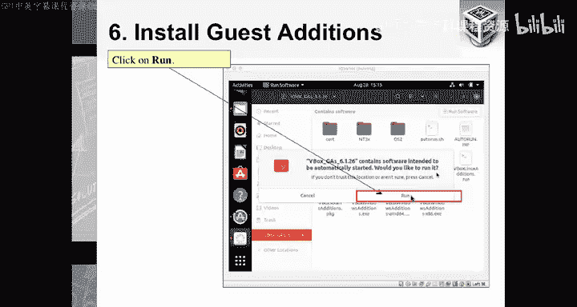

点击“继续”，安装过程正式开始。这可能需要5到10分钟，请耐心等待。

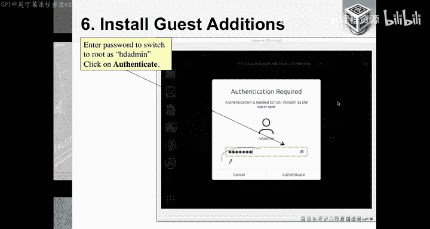

安装完成后，系统会提示重启。点击“现在重启”。虚拟机重启后，按回车键继续。在登录界面，点击用户 `hdadmin`，输入密码 `hdadmin` 即可登录。

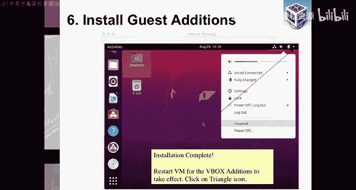

首次登录后，系统可能会询问一些初始设置，您可以点击“下一步”、“跳过”或“完成”来快速通过。

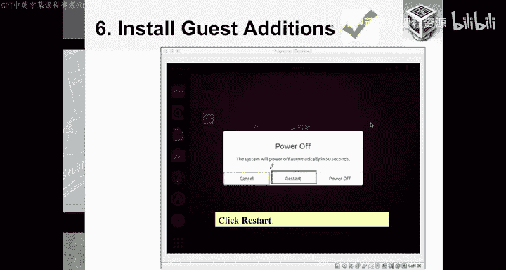

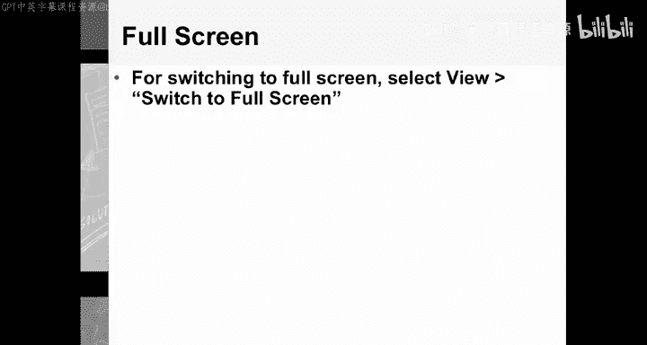

### 第五步：安装系统更新

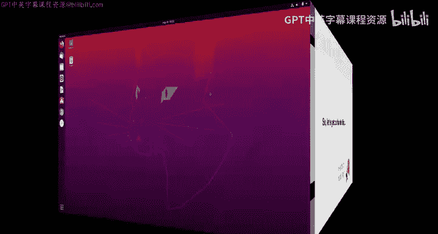

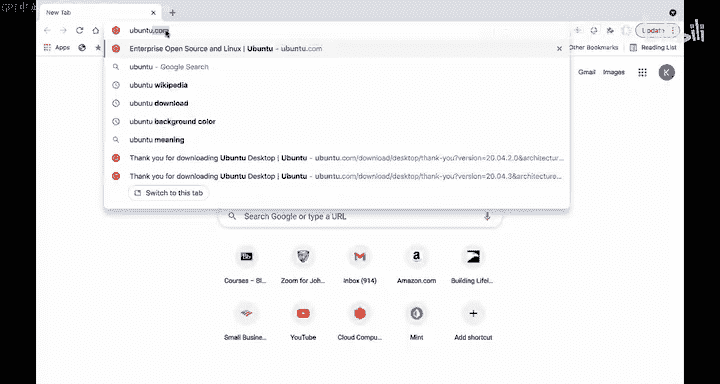

登录后，系统可能会提示有可用的软件更新。建议点击“立即安装”。系统会要求输入密码进行授权，输入 `hdadmin` 并点击“认证”。更新安装完成后，系统可能需要重启。

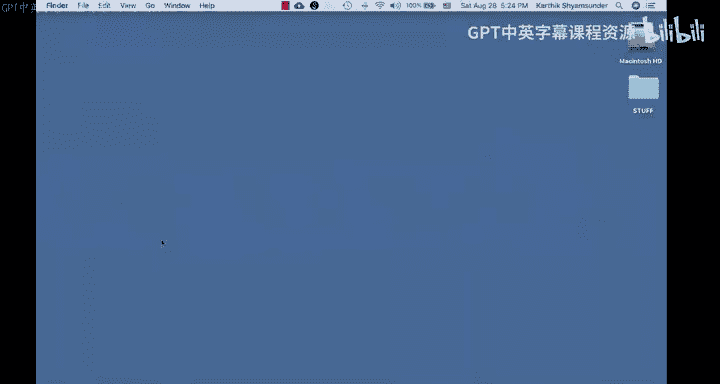

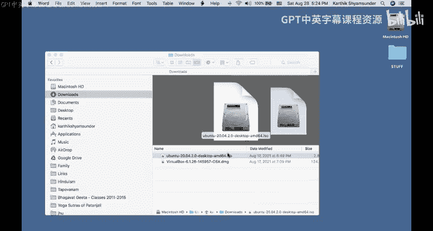

### 第六步：安装VirtualBox增强功能

要安装增强功能，请点击VirtualBox窗口顶部的菜单栏“设备”，然后选择“安装增强功能...”。

此时，在Ubuntu桌面上可能会出现一个光盘图标。点击它，系统会询问是否打开，选择“是”。这会打开一个包含增强功能安装文件的窗口。双击运行名为 `VBoxLinuxAdditions.run` 的文件（或类似名称）。系统会询问是否运行，点击“运行”。再次输入密码 `hdadmin` 进行授权。

安装完成后，终端窗口会显示“Press Return to close this window”的提示，按回车键关闭窗口。

为了使增强功能生效，需要重启虚拟机。点击屏幕右上角的三角图标，选择“关机”，然后在弹出的对话框中选择“重启”。

重启后，您就可以使用增强功能了。例如，可以点击VirtualBox窗口顶部的“视图”菜单，选择“切换至全屏模式”，让Ubuntu虚拟机充满整个屏幕。

## 实际操作演示

现在，让我们进行实际操作。

首先，访问 `ubuntu.com`，点击“下载”，选择最新的20.04 LTS版本，开始下载64位的ISO文件。

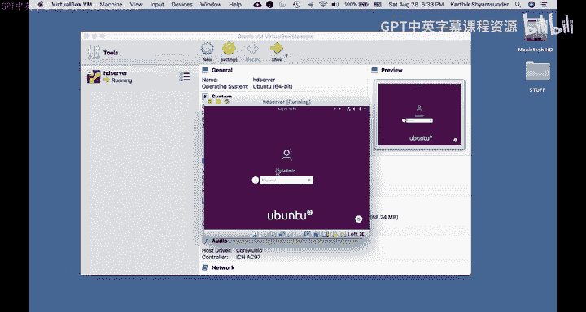

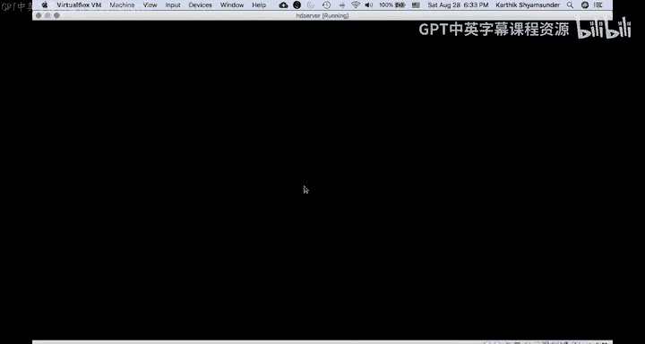

接着，打开VirtualBox，点击“新建”。输入虚拟机名称为 `HD server`，类型为 `Linux`，版本为 `Ubuntu (64-bit)`。将内存设置为 **4096 MB**。创建虚拟硬盘，选择 **VDI** 格式和“动态分配”，大小设置为 **25 GB**。

创建完成后，右键点击新虚拟机进入“设置”。在“存储”中，将下载好的Ubuntu ISO文件挂载到虚拟光驱。在“系统”->“处理器”中，为虚拟机分配更多的CPU核心。

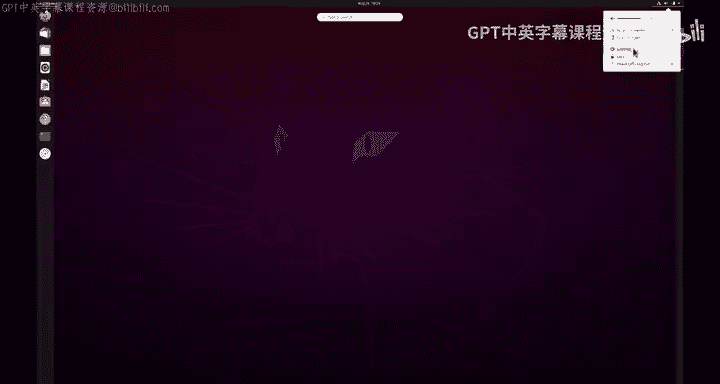

点击“启动”开始安装。按照屏幕提示选择语言、时区，创建用户 `hdadmin`（密码也为 `hdadmin`），计算机名设为 `HD server`，并完成安装。

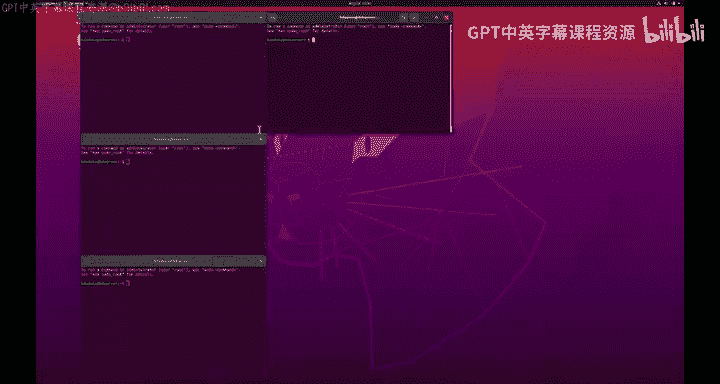

安装完成后，安装系统更新。最后，通过“设备”->“安装增强功能...”来安装VirtualBox增强工具，并重启虚拟机。

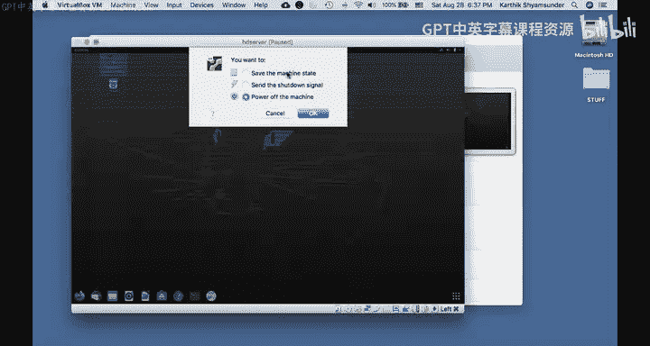

## Ubuntu使用小技巧

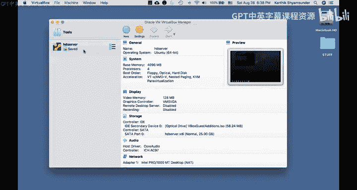

*   **启动终端**：点击屏幕左下角的“显示应用程序”（9个点图标），搜索“terminal”并打开。您还可以右键点击终端图标，选择“添加到收藏夹”，方便以后快速启动。
*   **调整任务栏位置**：进入“设置”->“外观”，可以将任务栏（Dock）的位置从左侧调整到底部。
*   **管理虚拟机状态**：您可以直接关闭VirtualBox窗口，选择“保存机器状态”，这样下次启动时虚拟机会快速恢复到关闭前的状态，无需完全重启。
*   **解决显示问题**：如果遇到全屏显示问题（如黑屏），可以尝试在虚拟机设置中，进入“显示”选项，增加“显存大小”。

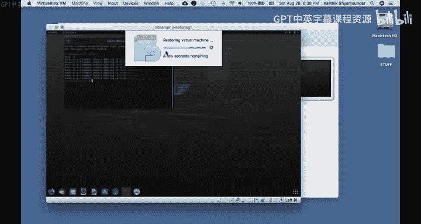

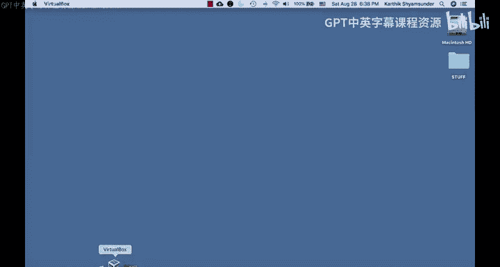

## 总结

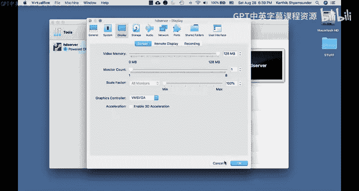

在本节课中，我们一起学习了如何在VirtualBox上逐步设置Ubuntu Linux虚拟机。我们涵盖了从下载ISO镜像、创建和配置虚拟机、安装Ubuntu操作系统，到安装VirtualBox增强功能的完整流程。现在，您已经拥有了一个可以运行Hadoop的Linux环境，为后续的大数据处理学习做好了准备。