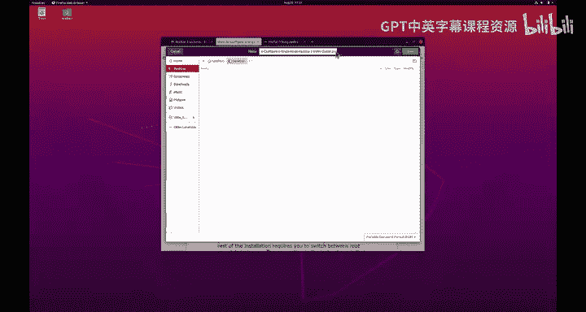
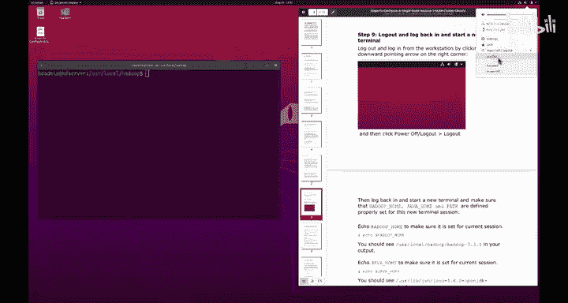
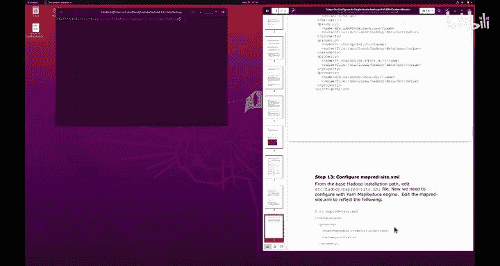
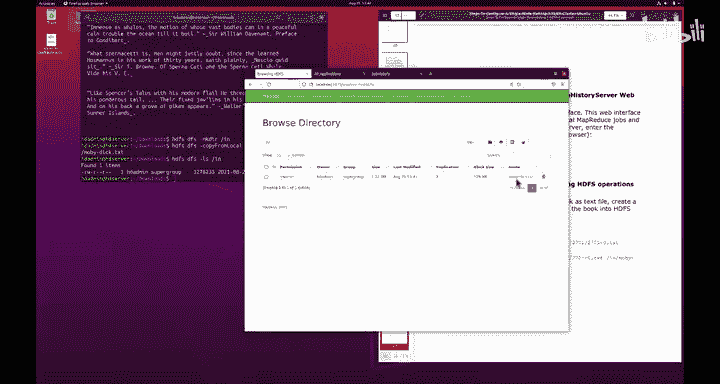
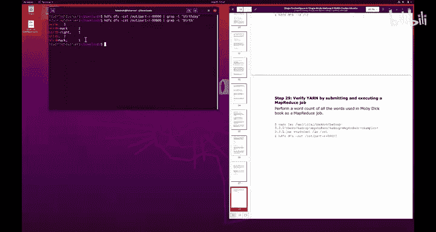
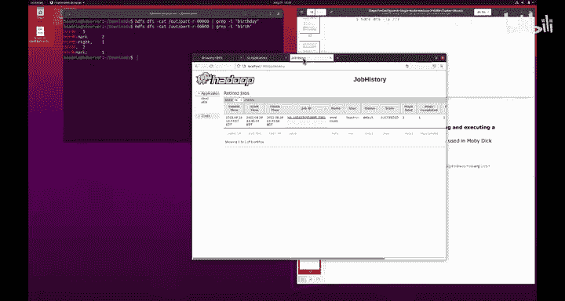
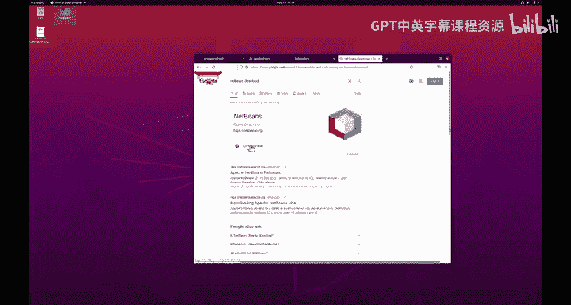
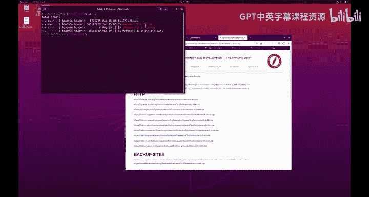
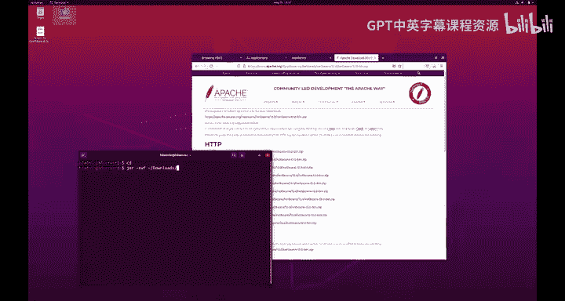
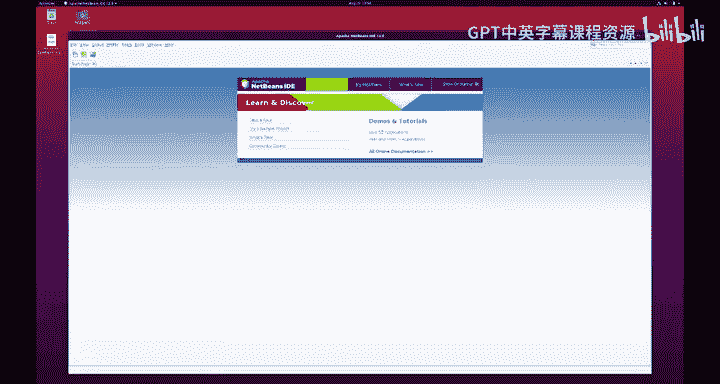

# 020：Hadoop 3 YARN环境搭建 🛠️

## 概述

在本节课中，我们将学习如何在单个虚拟机（VM）上，基于CentOS Linux系统，搭建一个伪分布式的Hadoop 3 YARN环境。我们将完成从安装、配置到启动所有核心守护进程（Daemons）的全过程，并最终通过运行一个示例程序来验证安装是否成功。

---

## 前期准备回顾

在之前的章节中，我们学习了如何安装和设置VirtualBox虚拟机。接着，我们学习了如何在VirtualBox上安装和配置Linux系统。在本节中，我们将进入核心部分——如何在该CentOS Linux机器上搭建Hadoop YARN。

我们的目标是让所有Hadoop核心组件守护进程在一台机器上启动并运行。我们也将测试安装，以确保一切设置正确。

本节教学主要通过动手演示进行。本节内容更侧重于Hadoop的操作层面，即安装过程。我会尽力描述我们在做什么。真正的目标是安装和配置，因此我可能无法详尽解释所有守护进程和配置方面的细节，但我保证我们将在后续课程中更详细地介绍其架构。

因此，当你完成本节时，可能不会透彻理解每个组件的具体功能，但这会为你打下良好基础。当我们开始讨论HDFS及其架构和内部原理、YARN及其架构和内部原理、MapReduce及其架构和内部原理时，你将开始将这些知识点串联起来。

最后，请记住本课程的目标是让你对使用Hadoop进行大数据处理有一个全面的了解，包括安装、架构、操作、编程和分析。

---


## Hadoop安装方式

为了安装Hadoop，我们不会依赖任何专有软件（如Cloudera Manager）或开源工具（如Ambari）。我们将进行纯手动的安装，一切从零开始。这将让我们更好地了解底层发生了什么，这对你来说将是一次宝贵的学习经历。



一旦安装Hadoop，需要对其进行配置。Hadoop可以配置为以下三种模式之一运行：

**1. 独立模式**
在这种模式下，没有Hadoop守护进程。所有Hadoop组件都运行在客户端的一个JVM内。这非常适合测试目的，但你无法真正了解Hadoop的内部原理和架构。

**2. 伪分布式模式**
所有守护进程都在运行，但它们运行在单个节点（即一台机器或服务器）上。其优点在于，你可以理解Hadoop架构的工作原理以及它们之间的相互关系。这是一个绝佳的学习环境。

**3. 集群或完全分布式模式**
在这种模式下，所有守护进程运行在多台主节点和从节点机器上。这是一个多机器设置或配置。这通常是生产环境中的做法。

在本课程中，因为我们想学习Hadoop内部的工作原理，所以我们将像之前所说，在伪分布式模式下安装Hadoop。这是一个学习Hadoop的好方法。

---

## Hadoop 3 YARN 核心组件

我们之前简要介绍过各种Hadoop组件。回顾一下，它们包括：

*   **NameNode**：分布式文件系统的大脑。
*   **Secondary NameNode**：一个备份进程，允许你在NameNode崩溃时从磁盘恢复和重建元数据镜像。
*   **DataNode**：NameNode的主力，负责在文件系统中存储和检索数据。
*   **ResourceManager**：管理集群中的资源（CPU、内存、存储和磁盘）。
*   **NodeManager**：ResourceManager的主力。ResourceManager向NodeManager发送信息，反之亦然，因此ResourceManager知道特定服务器内所有资源的状态。
*   **JobHistoryServer**：跟踪在MapReduce架构中运行的所有作业。

现在，让我们开始设置Hadoop，以便启动所有这些不同的守护进程。

在本周模块的课程网站上，有一份名为 **“配置单节点Hadoop 3 YARN伪分布式集群的步骤”** 的文档。我们将以此文档为基础，在单个虚拟机中安装Hadoop YARN。

---

## 动手实践：安装与配置

现在，让我们开始实际操作。

### 步骤 1：登录虚拟机

首先，登录到我们的HD Server虚拟机。用户ID是 `hdadmin`，密码也是 `hdadmin`。

登录后，虚拟机已准备就绪。现在开始安装Hadoop。

### 步骤 2：安装OpenSSH服务器

Hadoop依赖SSH来启动其各个守护进程。因此，我们需要安装OpenSSH服务器。

打开终端，执行以下命令：
```bash
sudo apt install openssh-server
```
系统会提示输入密码以获取root权限。输入密码 `hdadmin`，并在询问是否安装时输入 `yes`。

安装完成后，可以运行 `systemctl status ssh` 来检查SSH服务是否正在运行。

### 步骤 3：设置免密码SSH登录

我们需要设置SSH密钥，以便Hadoop进程可以无需密码相互通信。

1.  生成SSH密钥对：
    ```bash
    ssh-keygen -t rsa
    ```
    连续按回车键接受默认设置。

2.  将公钥添加到授权密钥文件：
    ```bash
    cat ~/.ssh/id_rsa.pub >> ~/.ssh/authorized_keys
    ```

3.  设置正确的权限：
    ```bash
    chmod 700 ~/.ssh
    chmod 600 ~/.ssh/authorized_keys
    ```



4.  将密钥添加到SSH代理并测试登录本机：
    ```bash
    ssh-add
    ssh localhost
    ```
    首次连接时会询问是否信任主机指纹，输入 `yes`。之后应能无需密码登录。输入 `exit` 退出。


5.  对主机名 `hdserver` 也进行同样操作（因为我们的机器主机名是 `hdserver`）：
    ```bash
    ssh hdserver
    ```
    同样地，首次输入 `yes` 信任。之后退出再登录，应不再需要密码。

### 步骤 4：创建Hadoop安装目录

我们需要创建一个目录来存放Hadoop及其相关项目。

1.  切换到root用户：
    ```bash
    sudo su -
    ```

2.  创建目录并设置用户组和权限：
    ```bash
    mkdir /usr/local/hadoop
    groupadd hdgroup
    chown hdadmin:hdgroup /usr/local/hadoop
    ```

3.  退出root用户：
    ```bash
    exit
    ```

### 步骤 5：下载Hadoop

有两种方式下载Hadoop：访问 [Hadoop官网](https://hadoop.apache.org) 下载，或使用 `wget` 命令。我们使用 `wget`。

1.  进入下载目录：
    ```bash
    cd ~/Downloads
    ```

2.  下载Hadoop 3.3.1 二进制包：
    ```bash
    wget https://downloads.apache.org/hadoop/common/hadoop-3.3.1/hadoop-3.3.1.tar.gz
    ```
    下载过程可能需要一些时间（约20分钟）。

### 步骤 6：安装Hadoop

下载完成后，将文件解压到我们创建的安装目录。

```bash
cd /usr/local/hadoop
tar -zxvf ~/Downloads/hadoop-3.3.1.tar.gz
```

### 步骤 7：设置Hadoop环境变量

我们需要设置 `HADOOP_HOME` 环境变量。

1.  切换到root用户：
    ```bash
    sudo su -
    ```

2.  创建环境变量配置文件：
    ```bash
    echo ‘export HADOOP_HOME=/usr/local/hadoop/hadoop-3.3.1‘ > /etc/profile.d/hadoop.sh
    echo ‘export PATH=$PATH:$HADOOP_HOME/bin:$HADOOP_HOME/sbin‘ >> /etc/profile.d/hadoop.sh
    ```

### 步骤 8：安装Java JDK

Hadoop需要Java环境，至少需要JDK 1.8。

1.  安装OpenJDK 8：
    ```bash
    apt install openjdk-8-jdk
    ```

2.  设置 `JAVA_HOME` 环境变量：
    ```bash
    echo ‘export JAVA_HOME=/usr/lib/jvm/java-8-openjdk-amd64‘ > /etc/profile.d/java.sh
    ```

3.  退出root用户并注销当前会话，使环境变量生效：
    ```bash
    exit
    logout
    ```
    然后重新登录。

### 步骤 9：验证环境变量

重新登录并打开新终端，验证环境变量是否已正确设置。

```bash
echo $HADOOP_HOME
echo $JAVA_HOME
echo $PATH
```
确保路径中包含Hadoop的 `bin` 和 `sbin` 目录。

### 步骤 10：创建HDFS数据目录

为NameNode、Secondary NameNode和DataNode创建数据存储目录。



```bash
sudo mkdir -p /usr/local/hadoop/data/nn  # NameNode
sudo mkdir -p /usr/local/hadoop/data/snn # Secondary NameNode
sudo mkdir -p /usr/local/hadoop/data/dn  # DataNode
sudo chown -R hdadmin:hdgroup /usr/local/hadoop/data
```

### 步骤 11-15：配置Hadoop文件

现在，我们需要编辑Hadoop的几个核心配置文件。所有配置文件都位于 `$HADOOP_HOME/etc/hadoop/` 目录下。

以下是需要配置的文件列表及简要说明：

1.  **`core-site.xml`**：核心Hadoop配置。
2.  **`hdfs-site.xml`**：HDFS分布式文件系统配置。
3.  **`mapred-site.xml`**：MapReduce作业配置。
4.  **`yarn-site.xml`**：YARN资源管理配置。
5.  **`hadoop-env.sh`**：Hadoop运行环境脚本。

你可以使用 `vi` 或 `gedit` 编辑器来修改这些文件。具体配置内容请严格遵循课程提供的 **“配置单节点Hadoop 3 YARN伪分布式集群的步骤”** 文档。配置完成后，可以使用 `xmlwf` 命令检查XML文件的格式是否正确。

**关键配置示例 (`hadoop-env.sh`)**：
在这个文件中，你需要找到并设置 `JAVA_HOME`，以及调整Hadoop堆内存大小等参数。

### 步骤 16：格式化HDFS文件系统

在启动HDFS之前，需要像格式化磁盘一样格式化分布式文件系统。

```bash
hdfs namenode -format
```
如果看到 “Shutting down NameNode at hdserver” 之类的成功信息，说明格式化成功。

### 步骤 17-23：启动Hadoop守护进程

现在，按顺序启动所有Hadoop守护进程。

1.  启动HDFS相关守护进程：
    ```bash
    hdfs --daemon start namenode
    hdfs --daemon start secondarynamenode
    hdfs --daemon start datanode
    ```

2.  启动YARN相关守护进程：
    ```bash
    yarn --daemon start resourcemanager
    yarn --daemon start nodemanager
    ```

3.  启动MapReduce历史服务器：
    ```bash
    mapred --daemon start historyserver
    ```

4.  使用 `jps` 命令验证所有守护进程是否都在运行：
    ```bash
    jps
    ```
    你应该能看到 `NameNode`、`DataNode`、`SecondaryNameNode`、`ResourceManager`、`NodeManager` 和 `JobHistoryServer` 进程。

如果任何守护进程启动失败，可以检查 `$HADOOP_HOME/logs/` 目录下对应的日志文件来排查问题。

### 步骤 24：访问Web管理界面

Hadoop提供了Web界面来监控集群状态。

*   **HDFS NameNode UI**：在浏览器中访问 `http://localhost:9870`。这里可以浏览HDFS文件系统，查看数据节点状态等。
*   **YARN ResourceManager UI**：访问 `http://localhost:8088`。这里可以查看和管理提交的作业。
*   **MapReduce JobHistory UI**：访问 `http://localhost:19888`。这里可以查看已完成的作业历史。

---

## 验证安装：运行示例作业

为了确保我们的Hadoop环境完全正常工作，让我们运行一个经典的MapReduce示例程序——单词计数（WordCount）。

### 步骤 1：准备测试数据

1.  下载一个文本文件（例如，古登堡计划中的《白鲸记》）：
    ```bash
    cd ~/Downloads
    wget http://www.gutenberg.org/files/2701/2701-0.txt
    ```

2.  在HDFS中创建一个输入目录，并将文件上传到HDFS：
    ```bash
    hdfs dfs -mkdir /input
    hdfs dfs -copyFromLocal ~/Downloads/2701-0.txt /input/moby-dick.txt
    ```



3.  验证文件是否已上传：
    ```bash
    hdfs dfs -ls /input
    ```
    你也可以在NameNode的Web界面 (`http://localhost:9870`) 中浏览文件系统进行确认。

### 步骤 2：运行WordCount作业

使用Hadoop自带的示例JAR包运行单词计数程序。

```bash
yarn jar $HADOOP_HOME/share/hadoop/mapreduce/hadoop-mapreduce-examples-3.3.1.jar wordcount /input /output
```
这个命令的含义是：使用YARN运行 `wordcount` 程序，处理HDFS中 `/input` 目录下的所有文件，并将结果输出到HDFS的 `/output` 目录。

作业运行过程中，你可以在YARN的Web界面 (`http://localhost:8088`) 上看到作业执行状态。

### 步骤 3：查看结果

作业完成后，查看输出结果。



```bash
hdfs dfs -cat /output/part-r-00000 | head -20
```
这将显示输出文件的前20行，内容格式为 `单词<tab>出现次数`。

你还可以查找特定单词的出现次数：
```bash
hdfs dfs -cat /output/part-r-00000 | grep -i “whale”
```

同样，你可以在NameNode的Web界面中看到新生成的 `/output` 目录及其中的结果文件。





---



## （附加）安装NetBeans IDE（可选）

为了后续编写Hadoop Java应用程序，我们可以安装一个集成开发环境（IDE）。这里演示如何安装Apache NetBeans。



1.  从 [NetBeans官网](https://netbeans.apache.org) 下载二进制ZIP包（选择LTS版本）。
2.  将ZIP包解压到主目录：
    ```bash
    cd ~
    jar -xvf ~/Downloads/apache-netbeans-*.zip
    ```
3.  进入bin目录并赋予执行权限：
    ```bash
    cd ~/netbeans/bin
    chmod +x netbeans
    ```
4.  启动NetBeans：
    ```bash
    ./netbeans
    ```
    你可以创建桌面快捷方式以便日后使用。

---



## 总结

在本节课中，我们一起完成了Hadoop 3 YARN伪分布式环境的搭建。我们深入实践，完成了以下关键步骤：

1.  **环境准备**：安装了必要的SSH服务并配置了免密码登录。
2.  **软件安装**：下载并解压了Hadoop，安装了必需的Java JDK。
3.  **系统配置**：设置了环境变量，并详细配置了Hadoop的核心XML文件和环境脚本。
4.  **HDFS初始化**：格式化了HDFS分布式文件系统。
5.  **服务启动**：按顺序成功启动了HDFS、YARN和MapReduce的所有核心守护进程。
6.  **安装验证**：通过Web界面监控集群状态，并通过运行一个完整的MapReduce单词计数示例作业，验证了整个Hadoop环境的功能完整性。

现在，你已经拥有了一个可以正常工作的Hadoop学习环境。虽然目前可能对某些配置细节和组件间交互的理解还不够深入，但这次动手实践为你后续学习HDFS架构、YARN原理和MapReduce编程模型奠定了坚实的操作基础。在接下来的课程中，我们将基于这个环境，深入探讨Hadoop各个组件的内部工作原理。