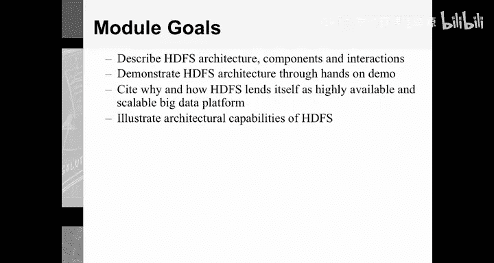

# 022：HDFS架构导论 🗂️

在本节课中，我们将学习Hadoop分布式文件系统（HDFS）的架构。我们将探讨构成HDFS的各个组件及其交互方式，从而深入理解HDFS背后的原理，包括其架构设计以及对大数据的实际适用性。我们将特别关注HDFS如何存储数据，以及如何在机架内的服务器之间进行数据复制，以提供一个高可用、可扩展的分布式文件系统。

## 课程概述 📋

本模块将涵盖以下主题：首先，我们将探讨HDFS的核心架构，包括其守护进程及其交互。接着，我们将在虚拟机中进行HDFS架构的动手演示。然后，我们会研究一些高级主题，例如如何为集群确定块大小，以及在单机架和多机架系统中的复制策略。最后，我们将从架构角度评估Hadoop。

本模块的目标是：描述HDFS的架构、组件和交互；通过动手演示展示HDFS架构；解释HDFS为何以及如何成为一个高可用、可扩展的大数据平台；并最终阐明HDFS的架构能力。

---

## HDFS核心架构 🏗️

上一节我们概述了本课程的内容，本节中我们来看看HDFS的核心架构。HDFS主要由两个关键守护进程组成：**NameNode**和**DataNode**。

NameNode是HDFS的“大脑”，负责管理文件系统的命名空间（如目录树、文件元数据）并协调客户端的访问。DataNode则是“劳动力”，负责在物理磁盘上存储实际的数据块，并执行数据块的读写操作。

以下是HDFS架构中的核心组件及其职责：

*   **NameNode**：管理文件系统元数据（如文件名、目录结构、块位置）。它不存储实际数据。
*   **DataNode**：存储和检索数据块。定期向NameNode发送心跳信号和块报告。
*   **Secondary NameNode**（注意：它不是热备份节点）：定期合并NameNode的编辑日志和文件系统镜像，以辅助NameNode工作，防止编辑日志过大。
*   **客户端**：通过与NameNode和DataNode交互来读写文件的应用程序或用户。

## HDFS架构动手演示 💻

理解了核心组件后，本节我们将在虚拟机环境中进行一个动手演示，直观地观察HDFS架构的运行。

我们将启动HDFS服务，查看NameNode和DataNode的进程状态，并通过一个简单的文件操作（如上传文件）来展示客户端、NameNode和DataNode之间的交互流程。这有助于巩固对理论知识的理解。

## 高级主题：块大小与复制策略 ⚙️

在了解了HDFS的基本运行方式后，本节我们来探讨两个影响集群性能和可靠性的高级配置：块大小和复制策略。

**块大小**决定了HDFS中文件被分割成的每个数据块的大小。默认块大小通常是128MB或256MB。选择合适的块大小需要在减少NameNode元数据开销和优化数据传输效率之间取得平衡。公式上，这通常是一个基于集群规模和典型文件大小的经验性配置。

**复制策略**确保了数据的可靠性。HDFS默认将每个数据块复制3份，存储在不同的DataNode上。在单机架环境中，复制策略相对简单。但在多机架集群中，HDFS采用**机架感知**策略来优化复制放置，通常的策略是：
*   第一个副本放在客户端所在的节点（如果客户端是集群的一部分）或随机节点。
*   第二个副本放在不同机架的一个节点上。
*   第三个副本放在与第二个副本相同机架内的另一个节点上。

这种策略在数据可靠性、读取带宽和写入带宽之间提供了良好的权衡。在代码配置中，这通常通过 `dfs.replication` 和网络拓扑脚本来实现。

## 从架构角度评估HDFS ✅

最后，基于我们之前对架构、演示和高级主题的学习，本节我们将从架构设计的角度总结评估HDFS。

HDFS的架构使其非常适合大数据处理，主要体现在：
*   **高容错性**：通过数据块多副本机制，单个节点或磁盘故障不会导致数据丢失。
*   **高吞吐量**：数据被分割成大块并并行读写，优化了批量数据处理的吞吐量。
*   **可扩展性**：可以通过简单地增加DataNode来线性扩展存储容量和计算能力。
*   **适合一次写入、多次读取的模式**：这契合了大多数数据分析场景。

然而，它也有其设计局限，例如不适合低延迟的数据访问或大量小文件的存储。

---

## 课程总结 🎯

本节课中，我们一起学习了HDFS的架构。我们从核心组件NameNode和DataNode入手，理解了它们各自的角色和交互方式。接着通过动手演示观察了架构的实际运行。然后，我们深入探讨了块大小配置和跨机架的数据复制策略这两个高级主题。最后，我们从整体上评估了HDFS架构如何使其成为一个强大、可扩展且容错的大数据存储平台。掌握这些原理是有效使用和管理Hadoop生态系统的基础。