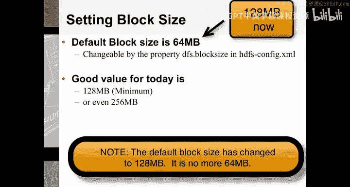
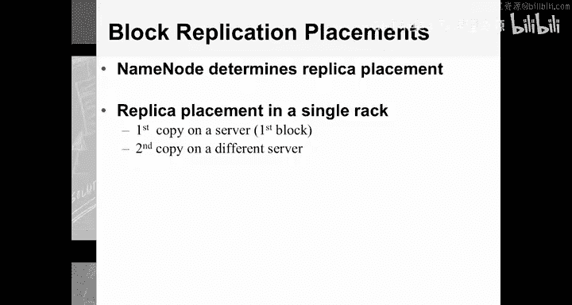
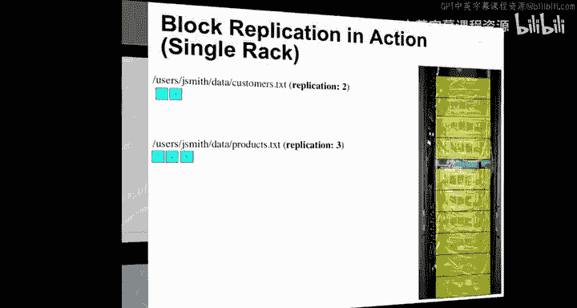
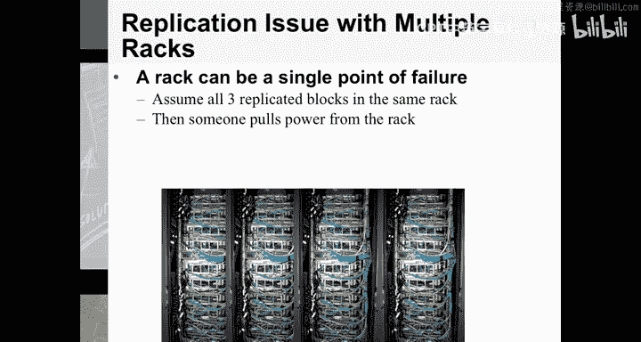
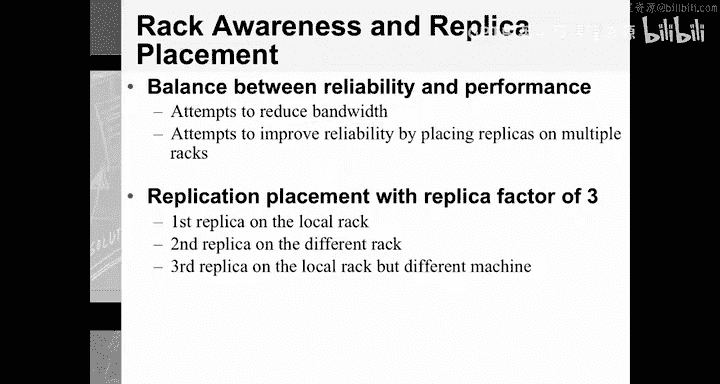

# 025：HDFS块大小、副本放置与机架感知机制 🧱

在本节课中，我们将学习如何为HDFS设置合适的块大小，理解HDFS如何放置数据副本，并探讨机架感知机制及其对副本放置策略的影响。

---

## 块大小的设定原则

上一节我们介绍了HDFS的基本架构，本节中我们来看看如何设定一个合适的块大小。为了理解这一点，我们需要回顾磁盘驱动器的性能指标。

这里需要特别关注两个概念：**寻道时间**和**数据传输率**。

*   **寻道时间**：指磁头移动到数据所在磁道所需的时间。高端服务器的平均寻道时间约为3-5毫秒，移动硬盘约为15毫秒，台式机硬盘约为9毫秒。
*   **数据传输率**：指数据在磁盘和主内存（RAM）之间移动的速率。这是吞吐量的关键，因为任何处理都必须先将数据加载到内存。目前平均数据传输率约为100 MB/s，固态硬盘可达300 MB/s。

我们的目标是**最小化寻道时间相对于数据传输时间的成本**。换句话说，我们希望数据加载到RAM的时间远大于寻道时间，理想比例接近99:1。

让我们进行一些计算：
*   假设寻道时间为10毫秒（台式机水平）。
*   假设传输速率为100 MB/s，即1000毫秒内可读取100 MB数据。
*   那么，读取100 MB数据的总时间中，寻道时间仅占约1%。

因此，为了达到寻道时间仅占传输时间1%的目标，**块大小应设为100 MB**。这是我们应该努力实现的目标。

---

## 如何设置块大小

Hadoop的默认块大小是64 MB。但所有配置都是可以通过属性修改的。

可修改的属性是 `dfs.blocksize`，它位于 `hdfs-site.xml` 配置文件中。你可以将其更改为任何你需要的值。

根据当前硬件性能，一个良好的起始值是**120 MB**。这是你在今天构建任何系统时应该设定的最低值。根据你处理的文件大小和数量，你甚至可以将其设置为256 MB或512 MB。请记住，**块越大，元数据开销就越小**。

---

## 块副本与复制因子

现在我们来谈谈块副本。HDFS的默认块复制因子是**3**。同样，这也是可以通过属性修改的。

复制因子由 `dfs.replication` 属性控制，也位于 `hdfs-site.xml` 中。回想一下我们在上一个模块中配置集群时，因为是在伪分布式模式下运行只有一台服务器，所以将此属性设置为1。

尽管默认复制因子是3，但**每个文件都可以有不同的复制因子**。你可以让一个文件的复制因子是5，另一个是7，另一个是2。目前Hadoop系统的默认值就是3。

此外，还有另一个概念叫做**默认最小块复制**，其值设置为1。这个概念的涵义是：当你写入一个块时，只要成功写入了这个最小数量的副本，HDFS就认为写入操作成功，否则视为失败。默认最小复制为1意味着，只要写入了一个块副本，操作就被认为是成功的，其余的副本由后续的复制机制来保证。

如果你的复制因子是5，你可能希望将默认最小复制因子设置为2或3。一个常用的计算方法是：`(总复制因子 / 2) + 1`。例如，复制因子为5时，`5 / 2 = 2.5`，加1等于3.5，取整数下限，即设置为3。

---

## 副本放置策略（单机架）

我们知道NameNode是HDFS的主节点，正是由它来决定副本的放置位置。

首先，让我们看看在单个机架内，当拥有多台机器时，副本是如何放置的。

以下是写入数据到HDFS时，在一个机架内的典型放置策略：
1.  第一个副本放置在某台服务器上。
2.  第二个副本放置在同一机架内的另一台不同服务器上。
3.  第三个副本再次放置在同一机架内的另一台不同服务器上。

让我们通过一个例子来看块复制是如何与复制因子结合工作的。

假设我们有两个文件：
*   `customer.txt`：复制因子为2，由块1和块3组成。
*   `product.txt`：复制因子为3，由块2、块4和块5组成。
我们有一个机架，内含多台服务器。

对于 `customer.txt`：
*   块1放置在一台服务器上，其副本放置在另一台不同的服务器上。
*   块3放置在一台服务器上，其副本放置在另一台不同的服务器上。

对于 `product.txt`：
*   块2放置在一台服务器上，第二个副本放置在另一台服务器上，第三个副本再放置在另一台不同的服务器上。
*   块4和块5也遵循同样的三副本放置逻辑。

这种策略的优势在于高可用性。例如，如果一台包含块3和块5的服务器宕机，NameNode会指示其他DataNode重新复制这些块到健康的服务器上。

---

## 机架感知与多机架副本放置

如果拥有多个机架呢？一个机架可能成为单点故障。假设所有三个副本块都在同一个机架，而有人拔掉了这个机架的电源，Hadoop会认为我们丢失了该块的所有副本。因此，复制策略需要更智能一些。

幸运的是，Hadoop可以配置为**机架感知**。我们只需要告诉Hadoop哪些服务器位于哪个机架。

这是通过向Hadoop提供一个脚本实现的。我们需要在 `core-site.xml` 中设置一个名为 `topology.script.file.name` 的属性，该属性指向一个脚本。每当有节点加入或离开HDFS时，Hadoop系统都会调用这个脚本。

其工作原理是：Hadoop调用脚本并传入服务器名称（IP或主机名），脚本则返回与该服务器关联的机架名称。Hadoop只负责调用脚本并获取结果。

通常，编写这个脚本有两种常见方法：
1.  **配置文件映射**：创建一个配置文件，其中包含服务器名到机架名的映射，脚本读取该文件并返回对应机架名。
2.  **主机名嵌入逻辑**：服务器主机名本身包含机架信息（例如，`srv1-rack1` 表示服务器`srv1`位于`rack1`）。脚本只需解析主机名即可返回机架名。

从最佳实践角度，**推荐使用主机名嵌入方法**，因为这比维护一个配置文件更简单。每次添加新机器时，你都需要设置主机名，这样逻辑就自然包含在其中了。

**重要提示**：NameNode在配置后会自动具备机架感知能力，但**HDFS中已存在的数据不会自动移动**以符合新的机架感知策略。新写入的文件会利用机架感知，而旧文件仍保留在原有机架内。因此，在使系统具备机架感知后，你可能需要手动删除并重新复制现有文件。

---

## 机架感知下的副本放置策略

机架感知下的副本放置，实际上是**可靠性与性能之间的平衡**。

*   **性能考量**：主要是带宽性能。我们希望减少机架间的带宽消耗，尽量将数据保留在同一机架内。
*   **可靠性考量**：如果将副本分散在多个机架，即使整个机架故障，数据依然可用，可靠性更高。

因此，需要在减少带宽消耗和提高可靠性之间找到平衡点。

对于典型的**三副本**情况，在具备机架感知的多机架环境中，放置策略通常如下：
1.  第一个副本放置在客户端所在的本地机架（例如Rack 1）的某台服务器上。
2.  第二个副本放置在不同机架（例如Rack 2）的某台服务器上。
3.  第三个副本再次放置回第一个副本所在的本地机架（Rack 1），但是另一台不同的服务器上。

这样，我们只利用了**两个机架**，既保证了跨机架的可靠性，又最大限度地减少了跨机架流量（只有第二个副本需要跨机架写入）。

让我们看一个在多机架环境下的实际操作例子。同样有 `customer.txt`（复制因子2）和 `product.txt`（复制因子3），以及三个各含10台服务器的机架。

对于 `customer.txt` 的块1：
*   第一个副本可能放在Rack 1的Server 1。
*   第二个副本会放在一个完全不同的机架，例如Rack 2。

对于 `product.txt` 的块2（三副本）：
*   第一个副本放在Rack 3的Server 1。
*   第二个副本放在不同机架，例如Rack 2。
*   第三个副本放回第一个副本所在的机架（Rack 3），但是另一台服务器。

其他块也遵循类似的跨机架放置逻辑，确保了数据在机架间的分布。

---

## 总结

本节课中我们一起学习了HDFS的三个核心配置与机制：
1.  **块大小的设定**：我们探讨了如何根据磁盘性能（寻道时间与传输速率）计算并设置合理的HDFS块大小（如128MB或256MB），以优化吞吐量。
2.  **副本放置策略**：我们了解了NameNode如何管理副本放置，包括默认的三副本策略，以及如何为不同文件设置不同的复制因子。
3.  **机架感知机制**：我们学习了如何通过配置使Hadoop感知网络拓扑（机架信息），以及这如何影响副本放置策略，从而在数据可靠性和网络带宽效率之间取得平衡。

理解这些概念对于设计和维护一个高效、可靠的Hadoop集群至关重要。