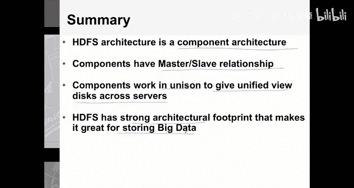

# 027：HDFS架构总结 🗂️

在本节课中，我们将总结Hadoop分布式文件系统（HDFS）的架构。我们将回顾其核心组件、它们之间的关系，以及这种架构如何为大数据存储和处理奠定基础。

---

上一节我们介绍了HDFS的各个组件，本节中我们来看看这些组件如何共同构成一个完整的系统。

HDFS架构是一种基于组件的架构。

其中，组件之间存在主从关系。

例如，名称节点（NameNode）是主节点，而数据节点（DataNode）是从属于主名称节点的从节点。

这些组件也协同工作，以提供跨服务器的统一磁盘文件系统视图。

HDFS还具有强大的架构特性，使其非常适合存储大数据。

后续我们将看到，这种强大的架构特性如何成为处理大数据的基础。

---

以下是HDFS架构的核心要点总结：

*   **组件化设计**：HDFS由多个定义清晰的组件构成。
*   **主从关系**：核心关系是 **`NameNode（主）`** 与 **`DataNode（从）`** 之间的关系。
*   **统一视图**：多个物理服务器上的磁盘被整合，对用户呈现为单一的文件系统。
*   **为大数据构建**：其架构设计（如数据块、副本机制）专门针对大规模数据存储而优化。
*   **处理的基础**：HDFS的存储架构是后续进行大数据计算（如MapReduce）的基石。

---

本节课中，我们一起学习了HDFS架构的总结。我们了解到HDFS是一个采用主从模式的组件化系统，它通过名称节点和数据节点的协作，将跨服务器的存储资源抽象为一个统一的文件系统。这种为海量数据存储而设计的强健架构，正是整个Hadoop生态系统能够高效处理大数据的关键起点。