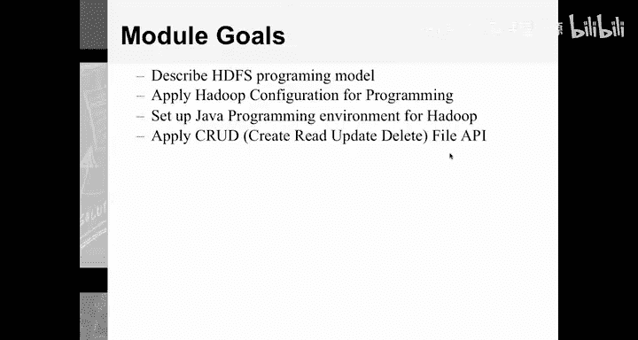

# 028：HDFS编程基础导论 🚀

在本节课中，我们将学习如何通过编程方式访问HDFS。我们将从C API的概述和一个快速演示开始，然后探讨Hadoop的配置，并学习如何为Java Hadoop编程设置IDE。接着，我们将概述用于访问HDFS的Java API，并学习如何在文件上执行CRUD（创建、读取、更新、删除）操作。

## C API概述

上一节我们介绍了课程的整体安排，本节中我们来看看C API的概述。我将展示如何编写一个小的C程序，编译并运行它。

以下是C API概述的主要内容：

*   编写一个简单的C程序。
*   编译该C程序。
*   运行编译后的程序。

## Hadoop通用配置与IDE设置

了解了C API的基本概念后，本节我们将重点讨论Hadoop的通用配置以及如何设置集成开发环境。我将展示如何实例化配置对象，这是进行任何Hadoop操作的基础对象。同时，作为本部分内容的一部分，我将演示如何设置你的IDE、配置类路径和设置，以便你能编译和运行你的Hadoop Java程序。

以下是配置与设置的主要步骤：

*   实例化Hadoop的配置对象。
*   为Java Hadoop编程设置IDE（以NetBeans为例，也可使用Eclipse或其他IDE）。
*   配置IDE的类路径和必要设置。

## Java API概述

完成了开发环境的基础配置，现在我们可以深入了解用于访问HDFS的Java API。本节我将概述各种HDFS相关的包和类，为你提供一个高层次的视角。

以下是Java API的核心组成部分：

*   HDFS相关的主要包结构。
*   关键类及其功能简介。

## 文件CRUD操作

在掌握了Java API的概貌之后，本节我们将进入实践环节，学习如何实际编写Java程序来对文件进行创建、读取、更新和删除操作。

以下是文件CRUD操作的关键方法：

*   **创建**：使用`FileSystem.create(Path)`方法创建新文件。
*   **读取**：使用`FileSystem.open(Path)`方法打开并读取文件内容。
*   **更新**：通过写入操作覆盖或追加内容到现有文件。
*   **删除**：使用`FileSystem.delete(Path, boolean)`方法删除文件或目录。

## 总结

本节课中，我们一起学习了HDFS编程的基础知识。你现在应该能够描述HDFS的编程模型，能够应用Hadoop配置对象进行编程，能够设置Java编程环境以进行Hadoop开发，并且最终能够对文件应用CRUD功能。