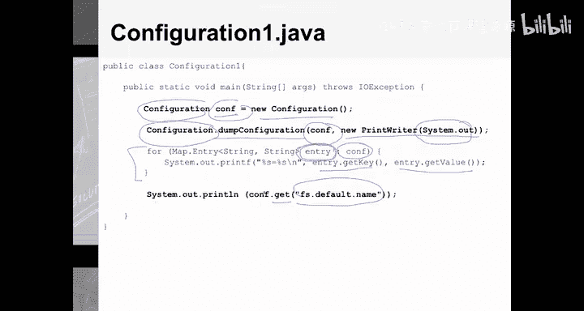
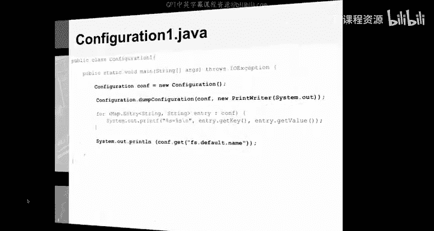
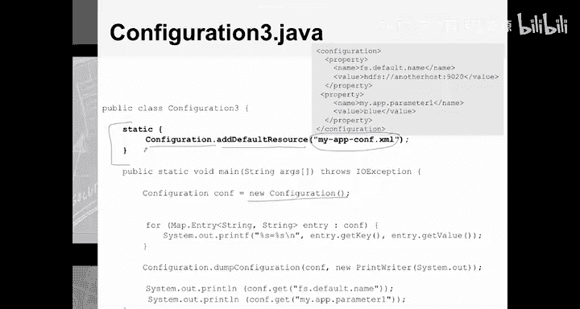
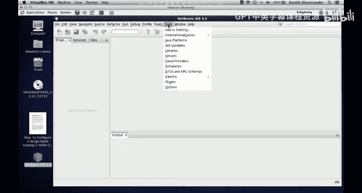
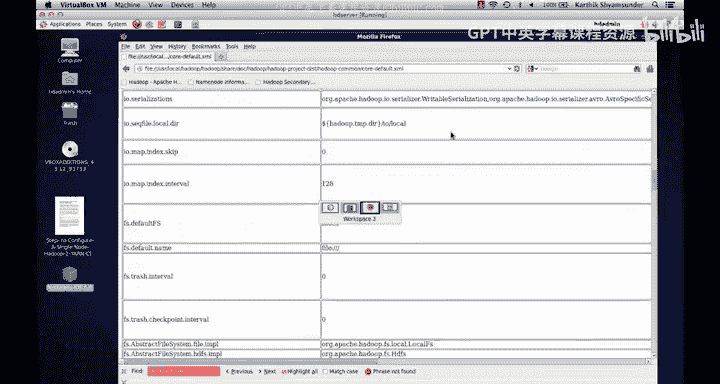
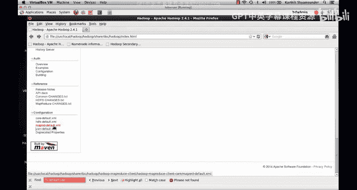

# 030：Hadoop配置API与开发环境搭建 🛠️


在本节课中，我们将学习Hadoop配置API的核心概念，并完成Hadoop开发环境的搭建。配置对象是进行任何Hadoop操作（无论是HDFS编程还是YARN MapReduce编程）时都必须实例化并传递引用的关键对象。作为演示的一部分，我们还将学习如何在NetBeans中设置开发环境，当然你也可以使用Eclipse或其他你喜欢的IDE。

## Hadoop配置概述 📋

Hadoop配置使用XML格式完成。观察一个XML配置文件，你会发现一个名为`configuration`的根元素，以及多个`property`子元素。每个`property`元素都包含一个名称-值对，即属性的名称和值。你可以在一个配置文件中定义任意多个这样的属性。

所有Hadoop配置都采用这种格式。回想安装Hadoop时，你曾修改过几个配置文件，如`core-site.xml`、`mapred-site.xml`、`yarn-site.xml`和`hdfs-site.xml`。

## 主要的Hadoop配置文件 📁

Hadoop有四个主要的配置文件，对应其内部的四个主要层次：
*   **core**：对应通用层。
*   **hdfs**：构建在通用层之上的HDFS层。
*   **yarn**：YARN层。
*   **mapred**：MapReduce层。

默认的Hadoop配置文件是`core-default.xml`、`hdfs-default.xml`、`yarn-default.xml`和`mapred-default.xml`。这四个文件是包含许多属性默认值的默认XML文件，它们位于Hadoop的JAR文件库中。

此外，系统管理员在Hadoop配置中还会进行系统范围的配置，这些配置文件位于Hadoop安装目录的`etc/hadoop`文件夹中，分别称为`core-site.xml`、`hdfs-site.xml`、`yarn-site.xml`和`mapred-site.xml`。这些文件会覆盖上述默认文件中定义的属性。你的应用程序也可以通过其关联的配置文件来覆盖这些名称-值对。

## Configuration类 🧩

Hadoop中的`Configuration`类代表了Hadoop配置。你可以通过调用`Configuration`对象的构造函数来创建一个新的配置实例，例如使用默认构造函数：`new Configuration()`，从而获得一个全新的配置对象。

在Hadoop中做任何事情几乎都需要实例化一个配置对象。当你实例化一个配置对象时，它会默认加载两个文件：从Hadoop JAR库中加载`core-default.xml`，以及如果类路径中存在则加载`core-site.xml`。

实例化配置对象后，你可以查看其中的值。一种方法是**转储配置**。你可以调用`Configuration`类中的静态方法`dumpConfiguration`，将配置对象和一个`Writer`对象传递给它。

你也可以**遍历配置对象**。因为`Configuration`类实现了`Iterable`接口，所以你可以使用循环（例如for循环）进行遍历。在遍历时，你会得到一个`Map.Entry`对象，它是一个包含字符串键和字符串值的键值对组合。

此外，你还可以通过调用配置对象的`get`方法并传递参数名，来**获取特定参数的值**，该方法会返回对应的值。





以下是演示Hadoop配置对象使用的`Configuration1.java`类：

```java
import org.apache.hadoop.conf.Configuration;
import java.io.PrintWriter;
import java.util.Map;

public class Configuration1 {
    public static void main(String[] args) throws Exception {
        // 声明并实例化一个Configuration对象
        Configuration conf = new Configuration();

        // 将配置转储到标准输出
        Configuration.dumpConfiguration(conf, new PrintWriter(System.out));

        // 遍历并打印配置中的所有键值对
        for (Map.Entry<String, String> entry : conf) {
            System.out.printf("%s = %s%n", entry.getKey(), entry.getValue());
        }

        // 获取并打印特定属性的值
        String fsDefaultName = conf.get("fs.default.name");
        System.out.println("fs.default.name = " + fsDefaultName);
    }
}
```

在这个示例中，我们声明了一个`Configuration`类型的变量`conf`并实例化了一个配置对象。然后，我们通过调用`Configuration`类的静态方法`dumpConfiguration`来转储配置，传递我们刚刚创建的配置对象和一个新的`PrintWriter`对象（它接受一个`Writer`对象作为参数，这里我们传递了代表输出流的`System.out`）。接着，我们使用一个for循环遍历配置对象中的所有值，每次迭代获取一个`Map.Entry`对象，并打印出该条目的键和值。最后，我们使用之前讨论过的`get`方法，传入属性名`"fs.default.name"`，获取并打印其字符串表示形式的值。

## 添加应用程序配置 ➕

你也可以将自己的应用程序配置添加到配置对象中。方法是调用配置对象上的`addResource`方法，并传递一个文件名。该文件是一个XML格式的应用程序自定义配置文件，但此文件必须位于类路径中才能被加载。

让我们看一个例子。这里有另一个名为`Configuration2`的示例。我实例化了一个配置对象并将其赋值给变量`conf`。这次，我想添加一个名为`myapp-conf.xml`的资源。注意，我是在配置对象上调用此方法。这里的思路是，配置对象已经加载了默认配置，而我想加载自己的配置。



以下是该文件的内容示例：

```xml
<?xml version="1.0"?>
<configuration>
  <property>
    <name>fs.default.name</name>
    <value>hdfs://anotherhost:9020</value>
  </property>
  <property>
    <name>my.app.parameter1</name>
    <value>blue</value>
  </property>
</configuration>
```

该文件包含两个属性：一个名为`fs.default.name`，值为`hdfs://anotherhost:9020`；另一个名为`my.app.parameter1`，值为`blue`。


然后，我可以转储配置，也可以通过for循环打印配置内容，现在还可以打印`fs.default.name`和`my.app.parameter1`的值，这些值都来自配置对象。

## 默认加载应用程序配置 ⚙️

默认情况下，你可以通过调用一个非常特殊的方法`addDefaultResource`，将你的配置加载到系统（JVM）中。这是`Configuration`对象的一个静态方法。思路是，如果你进行此调用并传递文件名，那么这个文件将被加载和解析（当然是从你的类路径中加载）。假设该文件将以XML格式包含你的配置。其奇妙之处在于，现在当你实例化一个配置对象时，这个文件将被自动加载，你无需显式调用`addResource`方法。

让我们看看这个。这里有一个名为`Configuration3`的程序。注意，在我的静态初始化块中，我调用了`Configuration`类的静态方法`addDefaultResource`，并传递了XML文件的名称。


```java
import org.apache.hadoop.conf.Configuration;


public class Configuration3 {
    static {
        // 在静态初始化块中注册默认资源
        Configuration.addDefaultResource("myapp-conf.xml");
    }

    public static void main(String[] args) {
        // 实例化时自动加载默认资源和myapp-conf.xml
        Configuration conf1 = new Configuration();
        // ... 使用conf1

        Configuration conf2 = new Configuration();
        // ... 使用conf2，也自动包含了myapp-conf.xml的配置
    }
}
```

现在，每当我实例化一个配置对象时，它都会自动加载默认属性，同时也会加载我的`myapp-conf.xml`属性。这样做的思路是，如果你实例化配置对象3次、4次、5次甚至10次，你无需每次都去添加资源，因为它已被加载一次并自动为你加载。通常，你会在静态初始化块中做这件事。

## 搭建Hadoop开发环境 💻



现在，让我们将所有这些付诸实践，并搭建开发环境。

我将以`hdadmin`用户身份登录到我的Hadoop服务器虚拟机。我将使用NetBeans来设置我的开发环境，所以我现在要启动NetBeans。当然，你也可以使用Eclipse或任何其他你喜欢的IDE。

为了编写程序，我自然需要Hadoop库。所以，我要做的是进入“工具”->“库”，并将Hadoop库添加到我的路径中。我将创建自己的库，NetBeans IDE（Eclipse同理）有内置库，但我要添加一个名为“Hadoop”的新库。

问题是，哪些是Hadoop相关的JAR文件？让我们看一下。进入Hadoop安装目录（在我的例子中是`/usr/local/hadoop`，其中有一个指向当前Hadoop安装目录的链接`hadoop`）。其下有一个名为`share/hadoop`的文件夹。基本上，在你的Hadoop安装目录下，都有一个名为`share/hadoop`的文件夹，其中包含几个子目录，存放着进行Hadoop编程所需的各种库。

记住，在Hadoop中，我们有通用层、HDFS层、YARN层和MapReduce层，它们彼此构建。每一层的JAR文件都位于这些不同的目录中，但情况比这稍微复杂一些。如果你进入通用层（`common`），你会看到通用层的JAR文件（有三个），但在通用层下的`lib`目录中还有依赖的JAR文件。你不仅需要添加通用库，还需要添加依赖库。对于MapReduce层也是如此，如果你进入`mapreduce`目录，这些是MapReduce的JAR文件，然后还有依赖的JAR文件（这些依赖来自其他Apache项目或Hadoop项目依赖的其他开源项目）。

我们需要为所有四个模块（common、hdfs、yarn、mapreduce）都进行此操作。

以下是添加JAR文件的步骤：

1.  添加通用层（common）的所有JAR文件及其依赖库（`lib`目录下的）。
2.  添加HDFS层的所有JAR文件及其依赖库。
3.  添加YARN层的所有JAR文件及其依赖库。（注意：这里并非所有文件都是必需的，有些是示例或测试文件，但全部添加更简单。）
4.  添加MapReduce层的所有JAR文件及其依赖库。

完成添加后，我们大致拥有了：common及common-lib、hdfs及hdfs-lib、yarn及yarn-lib、mapreduce及mapreduce-lib。

## 编写配置演示程序 ✍️

现在，我想编写一个小的Hadoop程序来展示配置概念。创建一个全新的Java应用程序项目，命名为`hadoop-config-demo`。

项目创建后，会出现`HadoopConfigDemo`类。删除一些默认内容以便查看整个程序。

首先，我想实例化一个新的配置对象：`Configuration conf = new Configuration();`。这可能会报错，提示导入`Configuration`类。我们需要的是Hadoop的`Configuration`类。它找不到该类是因为我们只添加了一个名为“Hadoop”的库，但还没有将该库添加到我们的项目中。所以，我需要右键单击我的项目，选择“添加库”，然后添加我们之前创建的包含所有Hadoop JAR文件的“Hadoop”库。

添加后，点击错误提示，它会显示多个`Configuration`类（来自Java安全、Courthouse、Jetty、Commons配置等）。我们真正需要的是`org.apache.hadoop.conf.Configuration`，选择它。

现在，我们创建了配置对象。接下来，我想转储配置。正确的方法是调用静态方法：`Configuration.dumpConfiguration(conf, new PrintWriter(System.out));`。这里，我传递配置对象引用和一个`Writer`对象（我创建了一个新的`PrintWriter`，并传入`System.out`作为输出流）。这意味着我想将配置转储到标准输出。`PrintWriter`是`Writer`基类的一个具体类。

这可能会提示导入`PrintWriter`类并处理`IOException`（因为`new PrintWriter`实例化可能抛出该异常）。我们添加`throws`子句即可。

保存并运行程序，它应该会转储配置。输出会将所有内容以一大行的形式转储，实际上它是在转储一个`Map`，其中包含键值对组合。例如，一个键是`ipc.client.fallback-to-simple-auth-allowed`，值为`false`。还有一个属性叫`final`，用于指示该特定属性是否可以被其他人覆盖。

## 遍历和获取属性值 🔍

接下来，我想编写自己的for循环来遍历配置。代码如下：



```java
for (Map.Entry<String, String> entry : conf) {
    System.out.printf("%s = %s%n", entry.getKey(), entry.getValue());
}
```

运行程序，它会打印出所有的键值对，例如`io.seqfile.compress.blocksize`、`dfs.replication`等。这些是配置对象的一部分属性。

问题是，它从哪里获取所有这些属性？正如之前提到的，有`core-default.xml`和`core-site.xml`。`core-default.xml`预定义了一堆属性，而我们在`core-site.xml`中覆盖了特定的属性。


如果你查看Hadoop文档，在左侧的“Configuration”部分有一个指向`core-default.xml`的链接。点击它，你可以看到属性的名称、默认值及其描述。我们看到的许多值都是默认值。我们在系统范围的配置（`etc/hadoop`下）中覆盖这些默认值。

例如，查看`core-site.xml`文件，你会发现`fs.default.name`的值被设置为`hdfs://localhost:9000`。而在`core-default.xml`中，它的默认值是`file:///`。

回到我们的程序，如果我们尝试打印`fs.default.name`的值：`System.out.println(conf.get("fs.default.name"));`，它打印出`file:///`。这是因为它是从`core-default.xml`获取的值。

有趣的是，当我实例化一个配置对象时，我说过它会加载`core-default.xml`和`core-site.xml`。从技术上讲，它应该从`core-site.xml`获取值并覆盖默认值。它没有这样做的原因是`core-site.xml`不在我们的类路径中。所以我们需要将其添加到类路径中。

我喜欢的方法是：进入“工具”->“库”，添加一个新库，例如命名为`HadoopConf`。在这个新库中，我添加文件夹，即放置所有配置文件的`etc/hadoop`目录。

然后，回到我的项目，添加这个`HadoopConf`库。现在，当我运行程序时，实例化配置对象会从Hadoop JAR文件加载`core-default.xml`，并从我的Hadoop配置库加载`core-site.xml`。我希望当我打印`fs.default.name`时，它会显示`core-site.xml`中的值。运行程序，确实如此。

## 创建自定义配置文件 🎨

你还可以创建自己的配置文件来覆盖`core-site.xml`中的内容。方法是创建你自己的XML文件。

例如，创建一个名为`my-app-conf.xml`的新XML文档。根元素是`configuration`，内部包含`property`元素。我们定义两个属性：

```xml
<?xml version="1.0"?>
<configuration>
  <property>
    <name>fs.default.name</name>
    <value>hdfs://anotherhost:9020</value>
  </property>
  <property>
    <name>my.app.parameter1</name>
    <value>blue</value>
  </property>
</configuration>
```

现在，我想在实例化配置对象时加载这个文件。加载自定义配置的方法是调用配置对象的`addResource`方法，并传递配置文件名。由于此文件位于一个包中，我需要给出目录路径：`conf.addResource("hadoop/config/demo/my-app-conf.xml");`。

这样，当我实例化配置对象时，它会加载`core-default.xml`、`etc/hadoop`下的`core-site.xml`，然后加载我自己的配置资源。最终，当我打印配置的`fs.default.name`时，它将从这里获取值，应该打印出`anotherhost:9020`。运行程序，确实如此。

我们还可以尝试打印我们自己的属性`my.app.parameter1`，它应该打印出`blue`。这就是你向应用程序传递参数的基本方式。你可以将其类比为Java Web应用程序编程中的`web.xml`。

## 使用addDefaultResource简化加载 🔄

最后，我想演示`addDefaultResource`的概念。想象一下，我后来实例化了第二个配置对象`Configuration conf2 = new Configuration();`，然后我想打印那些值。如果我运行程序，你会注意到第一个配置对象加载了资源`my-app-conf.xml`，但第二个配置对象没有加载该资源，因为我没有为它调用`addResource`方法。

每次实例化配置对象时，你都不希望进去调用`addResource`方法。这时`addDefaultResource`的概念就派上用场了。在我的静态初始化块中，我可以写：`Configuration.addDefaultResource("my-app-conf.xml");`，然后完全移除之前的`addResource`调用。

作为此类加载的一部分，当这个类在静态初始化块中被加载时，它会自动将此XML文件注册为默认资源。现在，当我实例化一个配置对象时，我会自动获得这个XML文件。这个思路后来被文件系统层、YARN层和MapReduce层所使用。关键是它让你更容易地实例化任意多个配置对象。

当我运行这个程序时，你会注意到它为两个配置都打印了正确的值。我确实不必为`conf`和`conf2`对象实例化并加载资源，我只需要实例化它，它就会默认加载。这就是添加默认资源作为配置的概念。

## 总结 📝

在本节中，我们深入探讨了Hadoop配置API。这显然是一个我们必须实例化并为其传递引用的对象，因为我们在Hadoop中做的几乎所有事情都会用到它，随着我们开始进行HDFS编程，我们将看到这一点。



我们还学习了如何在NetBeans中设置Hadoop开发环境。正如我提到的，我使用的是NetBeans，但如果你习惯使用Eclipse，你也可以配置你的IDE以支持Hadoop，其中有一个类似的概念可以用来添加库。

最后，回顾一下Apache Hadoop配置概念：我们有`core-default.xml`，它是你实例化配置对象时加载的一部分；还有`hdfs-default.xml`、`mapred-default.xml`和`yarn-default.xml`。这些XML文件只有在你引入与HDFS、MapReduce或YARN相关的类时才会被加载。例如，当你引入位于HDFS包中的`FileSystem`类时，它会自动加载那些默认值，并加载相应的`-site.xml`文件。你无需担心，因为它会自动完成所有这些事情。对你来说，最重要的一点是，配置对象是一个非常重要的对象，在Hadoop中做任何事情几乎都需要实例化它。现在我们知道如何做到这一点，你也知道了默认配置文件的位置以及默认值是什么。