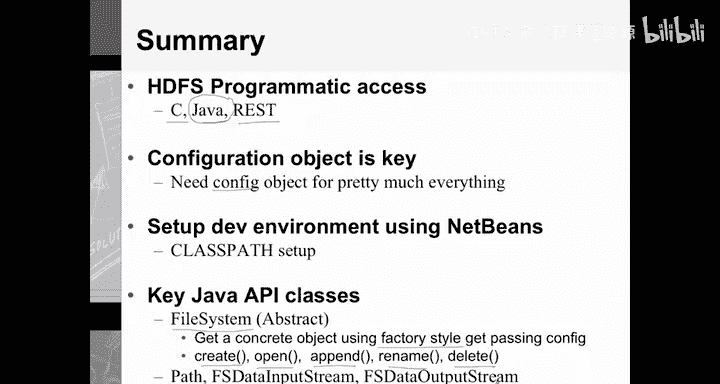

# 033：HDFS编程基础总结 🗂️

在本节课中，我们将总结HDFS编程的基础知识。我们将回顾访问HDFS的三种编程方式，重点探讨Java API的使用，并介绍配置对象、开发环境设置以及关键API类。通过本课，你将掌握使用Java进行HDFS文件操作的核心概念和步骤。

---

## 概述

在本模块中，我们学习了三种以编程方式访问HDFS的途径：C语言、Java和RE。我们快速了解了如何使用C语言编程、编译和运行程序，但大部分时间我们专注于研究Java API。我们还了解到，配置对象是进行Hadoop Java编程的关键，几乎任何操作都需要获取配置对象的实例。

## 配置对象与开发环境

上一节我们提到了配置对象的重要性，本节中我们来看看如何具体设置开发环境。

首先，我们学习了如何获取配置对象的实例。接着，我们学习了如何在集成开发环境中设置开发环境，特别是使用NetBeans IDE。我们学习了如何设置类路径和配置，以便能够编译和运行Hadoop Java程序。

## 关键Java API类

在掌握了环境配置后，我们现在来探讨HDFS编程中的一些关键Java API类。

我们看到`FileSystem`类是一个抽象类，也是一个关键类。获取`FileSystem`类实例的方法是使用工厂风格的`get`方法，并传入我们已学会创建的配置对象。

## 文件操作

一旦我们获得了`FileSystem`对象，就可以执行多种文件操作。

我们可以通过调用`create`方法来创建文件，通过调用`open`方法来打开文件进行读取，可以向文件追加内容，也可以重命名文件甚至删除文件。

## 支持类

除了核心类，HDFS编程还有几个重要的支持类。

以下是主要的支持类及其作用：

*   `Path`类：用于表示文件系统中的文件路径。
*   `FSDataInputStream`类：允许你使用流机制读取数据。
*   `FSDataOutputStream`类：允许你向文件写入数据。

---

## 总结

本节课中，我们一起学习了HDFS编程的基础总结。我们回顾了三种编程访问方式，深入探讨了Java API，理解了配置对象的核心作用，并实践了开发环境的设置。我们认识了`FileSystem`、`Path`、`FSDataInputStream`和`FSDataOutputStream`等关键类，并学会了如何利用它们进行文件的创建、读取、追加、重命名和删除等基本操作。这些知识为进行更复杂的Hadoop大数据处理编程奠定了坚实的基础。