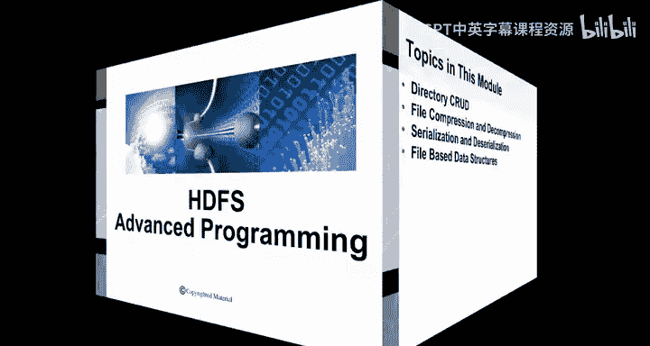
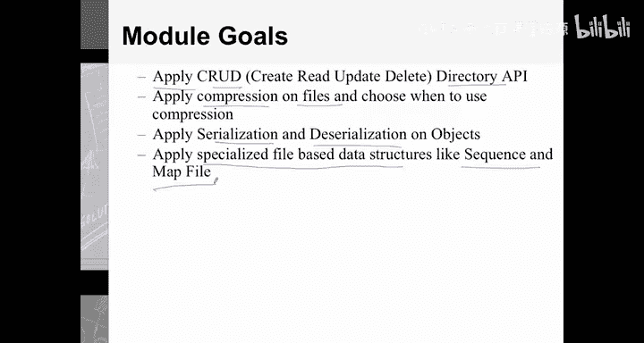

# 034：HDFS高级编程导论 🚀


在本节课中，我们将学习HDFS的一些高级编程概念。我们将从学习如何对目录执行增删改查操作开始，然后探讨压缩、序列化等概念，以及基于文件的专用数据结构，如序列文件和映射文件。

---

## 目录操作 📁

上一节我们介绍了课程概述，本节中我们来看看如何对HDFS目录执行创建、读取、更新和删除操作。

以下是目录操作的核心方法：

*   **创建目录**：使用 `FileSystem.mkdirs(Path)` 方法。
*   **检查目录/文件是否存在**：使用 `FileSystem.exists(Path)` 方法。
*   **删除目录/文件**：使用 `FileSystem.delete(Path, boolean)` 方法，其中布尔值参数表示是否递归删除。
*   **列出目录内容**：使用 `FileSystem.listStatus(Path)` 方法，它返回一个 `FileStatus` 对象数组。



---

## 文件压缩与解压 🗜️

掌握了目录操作后，我们来看看如何对HDFS文件进行压缩与解压。压缩可以有效减少存储空间和网络传输开销。

Hadoop支持多种压缩编解码器，每种都有其特点。选择编解码器时，需要在压缩速度、压缩比和是否支持分片之间权衡。

以下是Hadoop中常用的压缩编解码器：

*   **DEFLATE**：使用 `.deflate` 扩展名，压缩比和速度均衡，但不可分片。
*   **gzip**：使用 `.gz` 扩展名，基于DEFLATE，压缩比较好，但通常不可分片。
*   **bzip2**：使用 `.bz2` 扩展名，压缩比高且支持分片，但压缩速度慢。
*   **LZO**：使用 `.lzo` 扩展名，压缩速度快，支持分片（需建立索引）。
*   **Snappy**：使用 `.snappy` 扩展名，压缩速度快，但压缩比一般，且不可分片。

在MapReduce作业中启用压缩通常很简单，可以通过配置属性完成。例如，设置 `mapreduce.output.fileoutputformat.compress` 为 `true` 并指定编解码器。

---

## 序列化与反序列化 🔄

了解了文件压缩，我们接下来探讨Hadoop中的序列化机制。序列化是将对象转换为字节流以便存储或传输的过程，反序列化则是其逆过程。

Hadoop拥有自己的序列化框架，它要求序列化格式紧凑、快速且可扩展。核心接口是 `Writable`。

实现可序列化类需要遵循以下步骤：

1.  实现 `Writable` 接口。
2.  重写 `write(DataOutput out)` 方法，将对象字段写入流。
3.  重写 `readFields(DataInput in)` 方法，从流中读取字段并填充对象。

例如，一个自定义的 `MyWritable` 类结构如下：
```java
public class MyWritable implements Writable {
    private int value;
    private String text;

    @Override
    public void write(DataOutput out) throws IOException {
        out.writeInt(value);
        out.writeUTF(text);
    }

    @Override
    public void readFields(DataInput in) throws IOException {
        value = in.readInt();
        text = in.readUTF();
    }
    // 省略getter和setter方法
}
```

---

## 基于文件的数据结构 📊

最后，我们来学习Hadoop中两种重要的专用文件格式，它们常用于解决海量小文件存储效率低下的问题。

**序列文件（SequenceFile）** 是存储二进制键值对数据的文件格式。它支持三种存储格式：未压缩、记录压缩和块压缩。你可以使用 `SequenceFile.Writer` 和 `SequenceFile.Reader` 类来读写。

**映射文件（MapFile）** 是经过排序并带有索引的序列文件，它由两部分组成：数据文件（`/data`）和索引文件（`/index`）。映射文件允许基于键进行快速查找。你可以使用 `MapFile.Writer` 和 `MapFile.Reader` 类来操作。

---

## 总结 🎯



本节课中我们一起学习了HDFS的高级编程概念。我们掌握了如何操作HDFS目录，了解了文件压缩的编解码器及其应用场景，实现了Hadoop `Writable` 接口以进行序列化，并认识了序列文件和映射文件这两种用于高效处理小文件的专用数据结构。这些技能将帮助你更有效地在大数据项目中管理和处理数据。