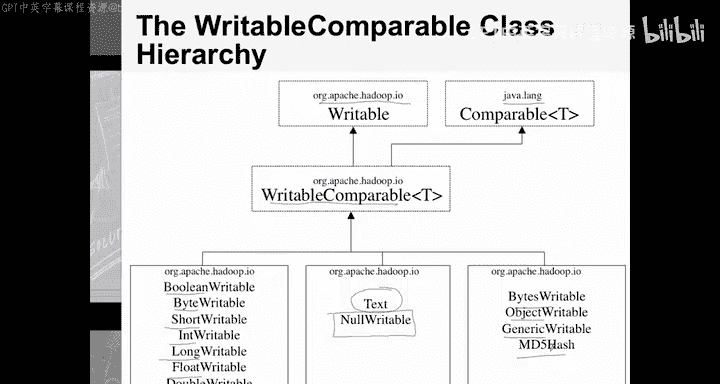
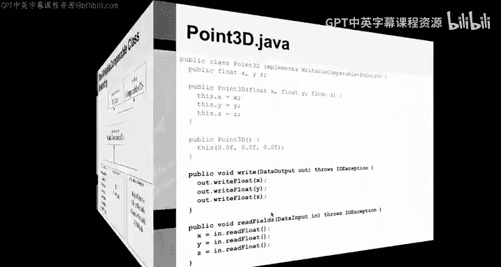
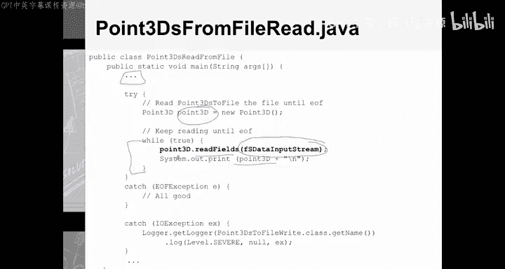
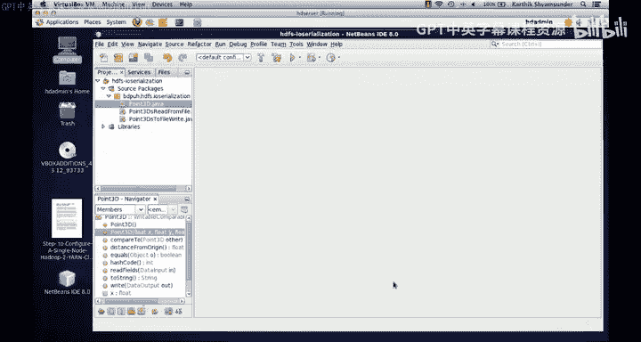
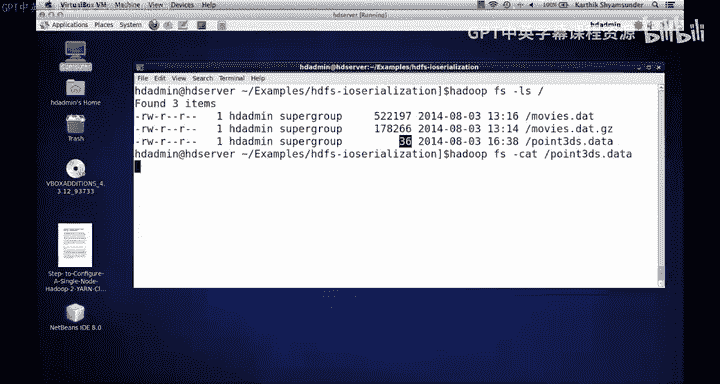

# 037：Hadoop序列化与反序列化机制 📦


在本节课中，我们将学习Hadoop核心库中的序列化与反序列化机制，并了解如何将其与HDFS文件系统结合使用。

## 概述

序列化是将结构化对象转换为字节流的过程，而反序列化则是其逆过程。Hadoop在其内部通信和MapReduce框架中广泛使用了序列化。与Java内置的序列化机制不同，Hadoop设计了自己的方案，旨在更紧凑、更高效。

## 什么是序列化与反序列化？

序列化是将内存中的结构化对象（如客户对象、员工对象、三维点对象）转换为字节流的过程。这样做的目的是为了通过网络传输对象以实现进程间通信，或者将对象持久化存储到像HDFS这样的存储系统中。

反序列化是相反的过程，即将字节流转换回内存中的结构化对象。在行业中，序列化器和反序列化器通常成对出现，称为“序列化/反序列化对”。

## Hadoop与序列化

Hadoop在其MapReduce框架中使用了序列化，我们将在后续的MapReduce编程课程中深入探讨。此外，Hadoop各组件间的内部通信也依赖于序列化。例如，当NameNode与DataNode通信，或DataNode与客户端节点通信时，所有传递的对象都会被序列化为字节流。

Hadoop没有使用Java内置的`java.io.Serializable`接口，而是发明了自己的序列化机制，认为Java原生的序列化不够紧凑且较为复杂。

## Writable接口

Hadoop序列化的基础是`Writable`接口。如果一个类实现了`Writable`接口，就意味着该类的对象可以被转换为字节流，也可以从字节流中读取并重建。

`Writable`接口包含两个核心方法：
*   `readFields(DataInput in)`: 从输入流中读取数据来填充对象字段。
*   `write(DataOutput out)`: 将对象的状态写入输出流。





以下是这两个方法的示意代码：
```java
public interface Writable {
    void write(DataOutput out) throws IOException;
    void readFields(DataInput in) throws IOException;
}
```
`IntWritable`、`LongWritable`等类都是`Writable`接口的具体实现。

## WritableComparable接口

除了序列化，Hadoop在处理数据时经常需要比较对象（例如在排序阶段）。因此，Hadoop定义了一个`WritableComparable`接口。

这个接口同时继承了`Writable`接口和Java的`Comparable<T>`接口。`Comparable`接口要求实现`compareTo(T o)`方法，用于比较两个对象：
*   如果当前对象等于参数对象，返回 `0`。
*   如果当前对象小于参数对象，返回**负值**。
*   如果当前对象大于参数对象，返回**正值**。

因此，任何实现`WritableComparable`接口的类都必须实现三个方法：`write()`、`readFields()`和`compareTo()`。

许多基础类型都有对应的`WritableComparable`实现，如`IntWritable`、`LongWritable`。`Text`类则相当于字符串的`WritableComparable`实现。其他支持类还包括`BytesWritable`、`ObjectWritable`等。

## 实践：实现一个可序列化的3D点类

上一节我们介绍了`WritableComparable`接口的理论，本节中我们来看看如何实际应用它。我们将创建一个表示三维空间点的`Point3D`类，并让它实现`WritableComparable`接口。

以下是`Point3D`类的关键实现步骤：

1.  **声明与构造器**：类包含三个浮点型坐标`x`, `y`, `z`，并提供带参数和无参数的构造器。
2.  **实现`write()`方法**：将`x`, `y`, `z`三个浮点数按顺序写入`DataOutput`输出流。
    ```java
    @Override
    public void write(DataOutput out) throws IOException {
        out.writeFloat(x);
        out.writeFloat(y);
        out.writeFloat(z);
    }
    ```
3.  **实现`readFields()`方法**：从`DataInput`输入流中按写入的相同顺序读取三个浮点数，并赋值给对象的字段。
    ```java
    @Override
    public void readFields(DataInput in) throws IOException {
        x = in.readFloat();
        y = in.readFloat();
        z = in.readFloat();
    }
    ```
4.  **实现`compareTo()`方法**：为了比较两个`Point3D`对象，我们计算每个点到原点(0,0,0)的欧几里得距离，然后比较距离。距离公式为：
    **`distance = sqrt(x² + y² + z²)`**
    在`compareTo`方法中，我们比较当前对象和参数对象的这个距离值。
5.  **辅助方法**：实现`toString()`方法用于友好显示，重写`equals()`和`hashCode()`方法也是良好实践。



## 序列化对象到HDFS文件



现在我们已经有了可序列化的`Point3D`类，接下来看看如何将它的实例写入HDFS文件。

以下是创建文件并写入对象的核心步骤：
1.  获取HDFS的`FileSystem`实例。
2.  使用`FileSystem.create()`方法在HDFS上创建文件，并获得一个`FSDataOutputStream`（它是`DataOutput`的实现）。
3.  创建几个`Point3D`对象。
4.  对每个对象调用其`write()`方法，并传入`FSDataOutputStream`，将对象状态序列化到文件中。
5.  关闭输出流。

运行此程序后，会在HDFS上生成一个二进制文件（例如`point3Ds.data`）。由于是二进制格式，用`hadoop fs -cat`命令查看会显示乱码，这证明了其存储的高效性。

## 从HDFS文件反序列化对象

最后，我们学习如何从刚才创建的HDFS文件中读取并重建`Point3D`对象。

以下是从文件读取对象的核心步骤：
1.  获取HDFS的`FileSystem`实例。
2.  使用`FileSystem.open()`方法打开HDFS上的文件，并获得一个`FSDataInputStream`（它是`DataInput`的实现）。
3.  创建一个“空”的`Point3D`对象（使用无参构造器）。
4.  在循环中，对该对象调用`readFields()`方法，并传入`FSDataInputStream`。每次调用都会从流中读取一组`x, y, z`值来填充该对象。
5.  使用对象的`toString()`方法打印出读取的内容。
6.  当到达文件末尾时，关闭输入流。



运行此程序，它将从二进制文件中读取三个点坐标，并以`(x, y, z)`的清晰格式打印出来，成功完成反序列化过程。

## 总结

本节课中我们一起学习了Hadoop的序列化与反序列化机制。我们了解到Hadoop通过`Writable`和`WritableComparable`接口提供了自己高效、紧凑的序列化方案，这与Java原生序列化不同。我们通过实现一个`Point3D`类，完整实践了如何使一个对象可序列化、可比较，并最终将其序列化到HDFS文件以及从文件中反序列化读取的全过程。这是理解Hadoop数据内部表示和传输的基础。