# 042：课程 42: YARN 核心架构能力 🏗️


在本节课中，我们将从多个架构能力的角度，深入探讨 YARN 的核心组件——资源管理器（Resource Manager）和节点管理器（Node Manager）。我们将分析其性能、可扩展性、可用性、可安装性、可配置性、可操作性、易用性、可编程性以及安全性。

## 性能 ⚡

上一节我们介绍了 YARN 的组件，本节中我们来看看它们的性能表现。

首先，资源管理器是一个被重度使用的组件。它维护着集群中所有资源的完整映射，并跟踪它们的使用情况。同时，它需要持续接收来自节点管理器和应用主进程（Application Master）的心跳信号。这意味着资源管理器在内存、CPU 和网络方面都可能面临压力。

你可以通过以下方式提升资源管理器的性能：
*   **升级硬件**：使用拥有更多内存和 CPU 的服务器。
*   **增加线程数**：通过配置文件调整线程数量。

相比之下，节点管理器是一个轻量级进程。它主要负责管理节点本身，并不执行实际的计算任务，所有实际工作都由容器（Container）完成。因此，节点管理器的性能通常不是瓶颈。如果需要，同样可以通过升级硬件和增加线程数来提升其性能。

## 可扩展性 📈

接下来，我们探讨 YARN 的可扩展性。

对于资源管理器，垂直扩展（Scale Up）不是问题，你可以使用更强大的硬件。然而，水平扩展（Scale Out）则无法实现，因为每个集群只能运行一个资源管理器。但这通常不是大问题，因为在 YARN 架构中，资源管理器的工作负载相比 Hadoop 1.0 的 JobTracker 已大幅减轻。根据雅虎的数据，一个资源管理器足以管理一个包含 40,000 个节点的集群。

对于节点管理器，你可以轻松地进行垂直和水平扩展：
*   **垂直扩展**：为节点管理器所在服务器升级硬件。
*   **水平扩展**：向集群中添加更多节点。你可以从 20 个节点开始，逐步扩展到 40、100 甚至 200 个节点，从而实现节点管理器的水平扩展。

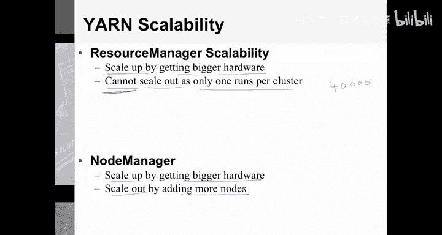

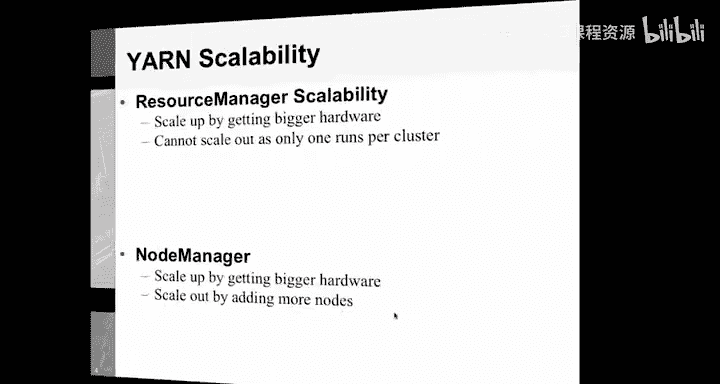

## 可用性 🛡️

现在，我们来了解 YARN 组件的可用性。

资源管理器是 YARN 中非常关键的一个进程。如果它崩溃，将无法提交新作业，现有作业也会停滞。应用主进程会尝试重新连接资源管理器，如果重试次数（可配置，默认约10次）耗尽仍无法连接，应用将会失败。

为了提高资源管理器的可用性，可以将其设置为**高可用（HA）模式**。这需要借助 ZooKeeper 来维护资源管理器的状态并进行主节点选举。你可以启动多个资源管理器实例（采用主备模式），当活动的资源管理器崩溃时，ZooKeeper 会选举出一个新的主节点来接管工作。

对于节点管理器，其可用性设计是：如果一个节点管理器崩溃，资源管理器会检测到并无法与其通信。随后，资源管理器会将该节点管理器上运行的所有容器标记为失败，并在其他健康的节点上重新启动这些容器对应的应用主进程和任务容器。

## 可安装性 🛠️

以下是关于 YARN 安装方式的说明：

对于小型集群，手动安装是可以接受的。但对于拥有数百台机器的大规模集群，手动安装则不可行。你可以使用以下工具或方法：
*   **Ambar i安装工具**：一个开源的管理工具。
*   **自定义脚本**：组织可以使用 Puppet、Chef 或 Ansible 等工具编写自动化安装脚本。
*   **云服务**：例如 Amazon Elastic MapReduce，这是一种基于虚拟机的服务。你只需在控制台指定所需节点数量和配置，服务便会自动为你启动所有虚拟机。但请注意，一些 Hadoop 专家不推荐基于虚拟机的安装方式。

## 可配置性 ⚙️

YARN 具有高度的可配置性，它采用基于 XML 的配置系统。

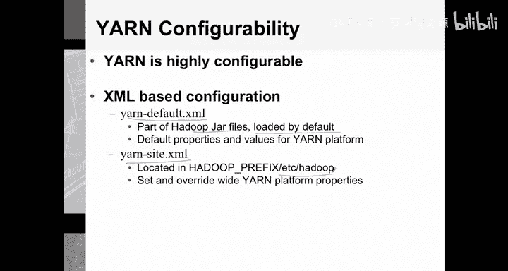

YARN 的配置主要通过两个文件管理：
*   **`yarn-default.xml`**：包含 YARN 的所有默认属性，位于 Hadoop JAR 文件中。
*   **`yarn-site.xml`**：用于覆盖默认属性，通常放置在 `$HADOOP_PREFIX/etc/hadoop/` 目录下。

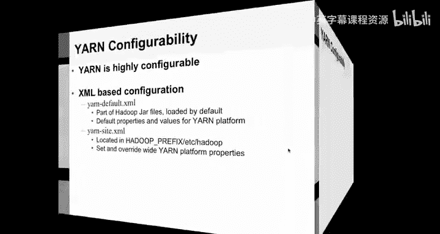

在配置文件中，资源管理器的相关属性以 `yarn.resourcemanager` 开头，节点管理器的相关属性以 `yarn.nodemanager` 开头。你可以配置内存、服务端口、应用管理器、调度器、故障转移以及我们之前提到的线程数等众多参数。

根据 Apache Hadoop 官方文档，资源管理器有近 82 个可配置属性，节点管理器有约 66 个可配置属性，这充分体现了 YARN 的高度可配置性。

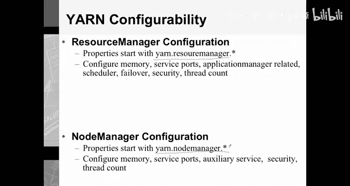

## 可操作性 🖥️

从运维操作的角度来看，YARN 提供了丰富的工具。

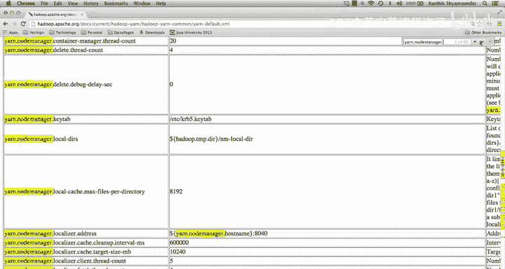

资源管理器提供了一个运行在 **8088** 端口的管理控制台。例如，如果资源管理器运行在本地，你可以通过访问 `http://localhost:8088` 来查看。此外，还有一个命令行工具 `yarn rmadmin`，系统管理员经常使用它。

节点管理器同样提供了一个管理控制台，运行在 **8042** 端口，并配有 `yarn nodemanager` 命令行工具。

同时，也有许多商业和开源运维产品可供选择，例如 Cloudera Manager、Hortonworks 的 Ambari（开源）等。

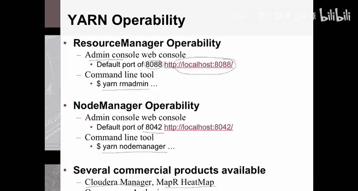

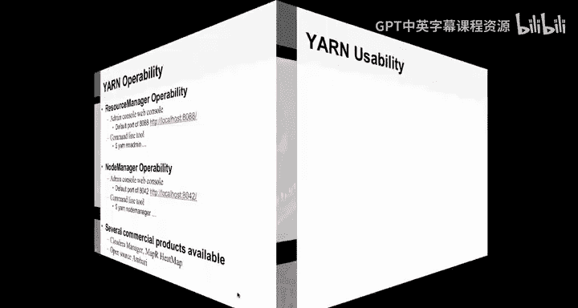

## 易用性与可编程性 💻

本节我们讨论 YARN 的易用性和可编程性。

**易用性**主要体现在作业提交上。使用 `yarn` 命令提交作业非常简单直接，基本格式为：
```bash
yarn jar <jar文件路径> [应用参数]
```

**可编程性**方面，主要涉及两类开发者：
1.  **框架开发者**：他们编写能在 YARN 上运行的框架（如 MapReduce、Spark、Giraph）。Java 是开发这些框架的主要语言。
2.  **应用开发者**：他们使用运行在 YARN 上的框架来编写具体应用。这类应用可以用多种语言编写，如 Shell、Scala、Java 等，具体取决于所使用的框架支持哪些语言。

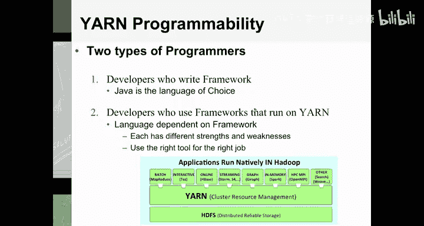

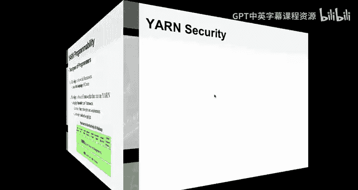

## 安全性 🔒

最后，我们来看 YARN 的安全性。

YARN 的安全性措施包括：
*   **双向认证**：YARN 框架在用户向资源管理器提交作业时对用户进行身份验证。只有经过身份验证的用户才能提交、修改或终止作业。
*   **用户身份继承**：应用程序以提交作业的用户身份运行。这意味着，如果该用户无法访问 HDFS 上的某些文件或目录，那么为其作业运行的 YARN 进程也无法访问这些数据。
*   **受保护的工作目录和日志**：YARN 使用的工作目录和生成的日志文件都受到保护，通常只有作业提交者本人可以访问。
*   **调度器防止滥用**：为了防止单个用户提交的作业独占整个集群资源，YARN 提供了调度器（如公平调度器 Fair Scheduler 和容量调度器 Capacity Scheduler）。系统管理员可以通过配置调度策略，来设定资源分配规则，例如用户或队列能使用多少容器（Container）等。

---

**本节课总结**

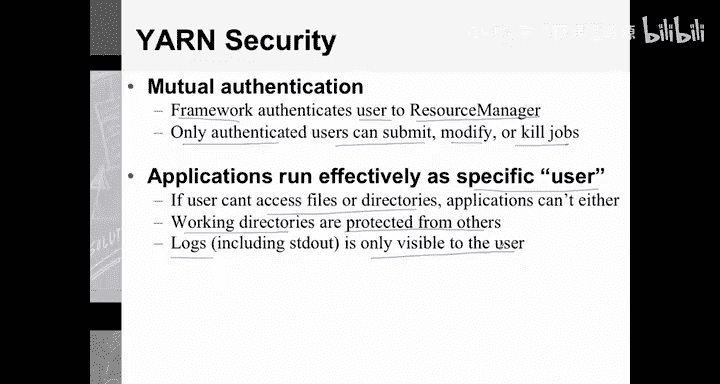

在本节课中，我们一起深入学习了 YARN 的多种核心架构能力。我们从性能、可扩展性、可用性、可安装性、可配置性、可操作性、易用性、可编程性以及安全性等方面，全面剖析了资源管理器和节点管理器。总而言之，YARN 被设计为一个高性能、高可用、可扩展、高度可配置且安全的分布式资源管理框架。