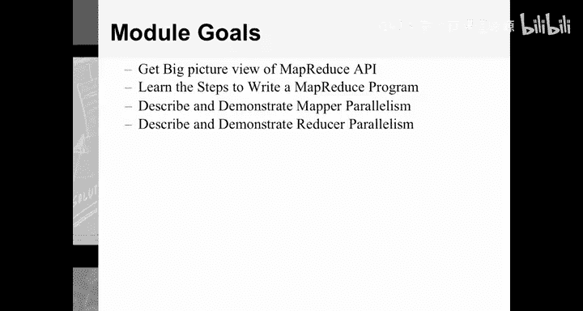

# 046：MapReduce编程基础导论 🚀

在本节课中，我们将学习MapReduce编程的基础知识，包括MapReduce API的概述、编写MapReduce程序的步骤，以及如何实现Mapper和Reducer的并行化。


---

## MapReduce编程API概览 🧭

上一节我们介绍了课程的整体目标，本节中我们来看看MapReduce编程API的核心组成部分。

MapReduce API提供了一系列关键类，用于定义和运行数据处理任务。以下是主要类的简要说明：

*   **Job类**：代表一个MapReduce作业。它用于配置作业参数、指定输入输出路径以及提交作业到集群。
*   **Mapper类**：用户需要继承这个抽象类，并重写其`map`方法来定义数据映射逻辑。其核心公式为：**`map(, )`**。
*   **Reducer类**：用户需要继承这个抽象类，并重写其`reduce`方法来定义数据归约逻辑。其核心公式为：**`reduce(, , )`**。
*   **InputFormat类**：定义了如何读取输入数据（例如，从HDFS文件），并将其分割成供多个Mapper处理的逻辑输入分片。
*   **OutputFormat类**：定义了如何将Reducer的输出写入存储系统（如HDFS）。

---

## 编写MapReduce程序的步骤 📝

了解了核心API后，本节我们将一步步学习如何编写一个完整的MapReduce程序。

编写一个MapReduce程序通常遵循以下六个主要步骤：

1.  **编写Mapper类**：继承`Mapper`类，实现`map`方法，在其中编写将输入键值对转换为中间键值对的业务逻辑。
2.  **编写Reducer类**：继承`Reducer`类，实现`reduce`方法，在其中编写对具有相同键的中间值集合进行归约处理的业务逻辑。
3.  **编写驱动程序（Driver）**：这是主程序，负责组装和配置整个MapReduce作业。
4.  **配置Job对象**：在驱动程序中，创建一个`Job`实例，并为其设置Mapper类、Reducer类、输入/输出格式、输入/输出路径等属性。
5.  **打包程序**：将编写好的Java程序及其依赖打包成一个JAR文件。
6.  **提交并运行作业**：使用Hadoop命令行工具将JAR包提交到集群上运行。

以下是一个驱动程序配置的代码示例框架：
```java
Configuration conf = new Configuration();
Job job = Job.getInstance(conf, "My MapReduce Job");
job.setJarByClass(MyDriver.class);
job.setMapperClass(MyMapper.class);
job.setReducerClass(MyReducer.class);
job.setOutputKeyClass(Text.class);
job.setOutputValueClass(IntWritable.class);
FileInputFormat.addInputPath(job, new Path(args[0]));
FileOutputFormat.setOutputPath(job, new Path(args[1]));
System.exit(job.waitForCompletion(true) ? 0 : 1);
```

---

## Mapper并行化 ⚙️

我们已经学会了如何编写程序，本节我们来探讨如何通过并行化来提升处理速度。首先看看Mapper的并行化。

Mapper的并行化是指一个MapReduce作业可以启动多个Mapper任务同时处理数据。其核心机制如下：

*   **输入分片（Input Split）**：Hadoop根据作业的输入数据（如一个大文件）和配置的`InputFormat`，自动将数据逻辑划分为多个**分片**。每个分片由一个独立的Mapper任务处理。
*   **控制Mapper数量**：Mapper的数量通常等于输入分片的数量。用户可以通过调整输入数据块的大小或直接设置最大/最小分片大小来间接影响Mapper的数量。

---

## Reducer并行化 ⚙️

理解了Mapper如何并行工作后，本节我们来看看Reducer的并行化设置。

与Mapper不同，Reducer的数量默认是1个，但用户可以显式设置以实现并行处理。以下是关键点：

*   **设置Reducer数量**：在驱动程序中，通过`job.setNumReduceTasks(int n)`方法来指定Reducer的任务数量。
*   **分区（Partitioning）**：设置多个Reducer后，Mapper产生的中间键值对需要被分发到不同的Reducer。这是通过**分区器（Partitioner）** 实现的，它根据键的哈希值（默认）将数据分配到不同的分区，每个分区对应一个Reducer任务。
*   **影响**：合理设置Reducer数量可以显著影响作业的负载均衡和最终输出文件的数量（每个Reducer产生一个输出文件）。

---

## 总结 🎯



本节课中，我们一起学习了MapReduce编程的基础知识。我们首先概览了MapReduce API的核心类，然后详细讲解了编写和提交一个MapReduce作业的六个步骤。接着，我们深入探讨了Mapper的并行化机制，了解了输入分片如何决定Mapper任务的数量。最后，我们学习了如何通过设置Reducer任务数来实现Reducer的并行化，并了解了分区在其中扮演的角色。掌握这些基础知识是进行高效大数据处理的关键。