# 048：MapReduce 程序开发步骤 📝


在本节课中，我们将学习如何编写一个完整的 MapReduce 程序。我们将通过一个经典的“词频统计”问题，一步步地讲解从问题分析、设计到代码实现、配置和运行的完整流程。

上一节我们概述了 Hadoop MapReduce API，本节中我们来看看编写一个 MapReduce 程序所需的具体步骤。

## 问题场景与设计思路

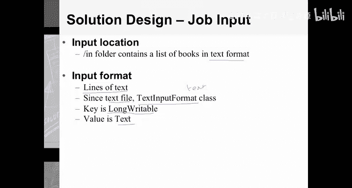


为了学习编写 MapReduce 程序的步骤，我们从一个具体的问题场景入手。

假设在 HDFS 中有一个名为 `/IN` 的目录，其中包含多本以文本文件形式存储的书籍。我们的目标是：列出所有这些书籍中出现的所有唯一单词，并统计它们各自出现的总次数。

在计算机科学中，我们通常将问题分解为输入、处理和输出三部分。对于 MapReduce 作业，输入是文本文件，输出是单词及其计数的列表，而处理过程则由 Map 和 Reduce 两个阶段完成。

因此，我们需要设计：
1.  作业的输入和输出。
2.  Mapper 的输入、处理和输出。
3.  Reducer 的输入、处理和输出。

### 作业输入与输出设计

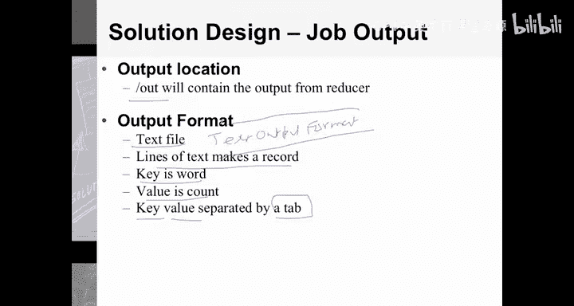

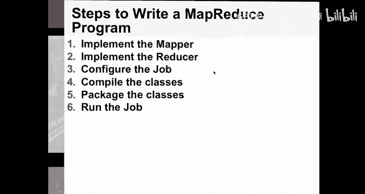

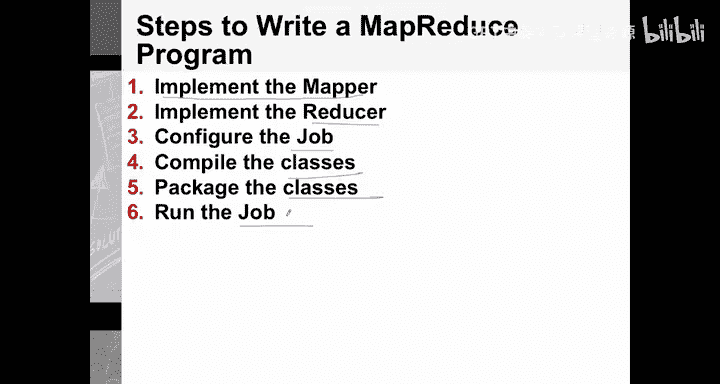

以下是作业输入与输出的设计细节：

*   **作业输入**：HDFS 中的 `/IN` 目录，包含多个文本文件。
*   **输入格式**：由于是文本文件，我们使用 `TextInputFormat` 类。它将每个文本行作为一条记录。
*   **输入键值对**：根据 `TextInputFormat`，键是文件中的字节偏移量（`LongWritable` 类型），值是文本行内容（`Text` 类型）。
*   **作业输出**：将写入一个指定的输出目录（例如 `/OUT`）。
*   **输出格式**：我们希望输出为文本文件，因此使用 `TextOutputFormat` 类。默认情况下，它会用制表符分隔键值对。

### Mapper 设计

接下来，我们设计 Mapper 部分。

*   **Mapper 输入**：键为字节偏移量（`LongWritable`），值为一行文本（`Text`）。
*   **Mapper 处理**：对于词频统计，Mapper 会忽略输入键。它解析输入的文本行，为行中的每个单词生成一个中间键值对。
*   **Mapper 输出**：键为单词（`Text` 类型），值为数字 1（`IntWritable` 类型），表示该单词出现了一次。公式可以表示为：`map(line) -> list of (word, 1)`。

### Reducer 设计

最后，我们设计 Reducer 部分。

*   **Reducer 输入**：键为单词（`Text`），值为该单词对应的所有计数 1 的列表（`Iterable<IntWritable>` 类型）。
*   **Reducer 处理**：遍历输入值列表，将所有计数相加，得到该单词的总出现次数。
*   **Reducer 输出**：键为单词（`Text`），值为该单词的总计数（`IntWritable` 类型）。公式可以表示为：`reduce(word, list[1,1,...]) -> (word, sum(list))`。

## 程序实现步骤

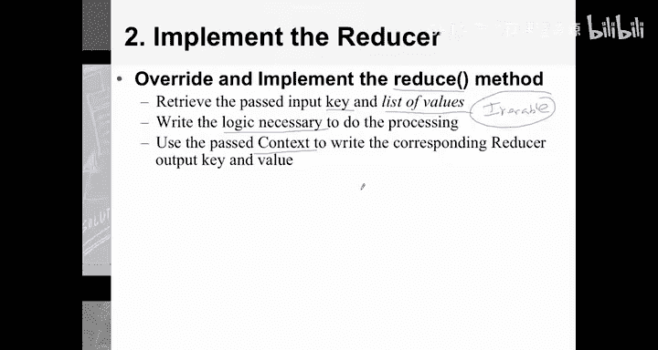

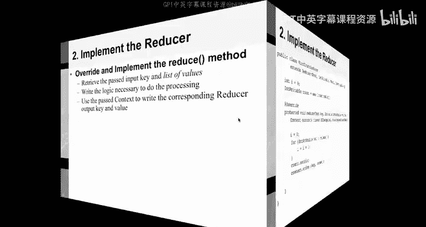

现在我们已经完成了整体设计，接下来开始实现。编写 MapReduce 程序通常包含以下六个步骤：

以下是实现 MapReduce 程序的六个核心步骤：

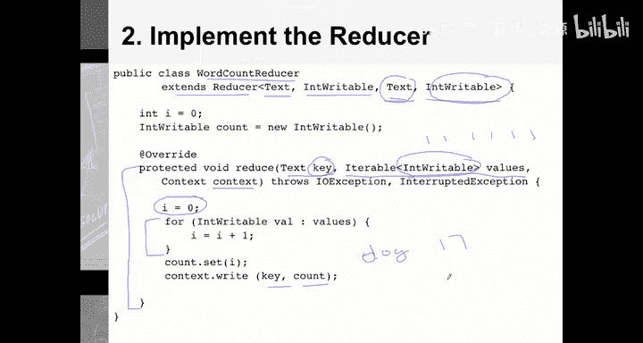

1.  **实现 Mapper 类**
2.  **实现 Reducer 类**
3.  **配置 Job 对象（驱动类）**
4.  **编译 Java 类**
5.  **打包成 JAR 文件**
6.  **运行作业**

### 步骤一：实现 Mapper 类

首先，我们需要创建一个继承自 `Mapper` 类的类。

```java
import org.apache.hadoop.io.IntWritable;
import org.apache.hadoop.io.LongWritable;
import org.apache.hadoop.io.Text;
import org.apache.hadoop.mapreduce.Mapper;
import java.util.StringTokenizer;

public class WordCountMapper extends Mapper<LongWritable, Text, Text, IntWritable> {
    // 为效率考虑，将常量 1 声明为实例变量
    private final static IntWritable one = new IntWritable(1);
    private Text word = new Text();

    @Override
    public void map(LongWritable key, Text value, Context context) throws IOException, InterruptedException {
        // 将 Text 类型的行内容转换为 String
        String line = value.toString();
        // 使用 StringTokenizer 分词（此处可替换为更复杂的分词逻辑）
        StringTokenizer tokenizer = new StringTokenizer(line);
        while (tokenizer.hasMoreTokens()) {
            word.set(tokenizer.nextToken());
            // 输出中间键值对: (单词, 1)
            context.write(word, one);
        }
    }
}
```

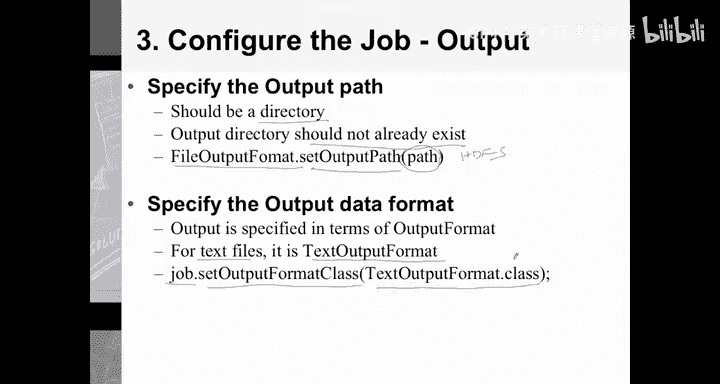

### 步骤二：实现 Reducer 类

接下来，我们实现 Reducer 类。

```java
import org.apache.hadoop.io.IntWritable;
import org.apache.hadoop.io.Text;
import org.apache.hadoop.mapreduce.Reducer;
import java.io.IOException;

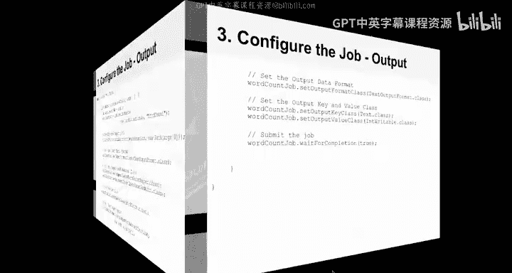

public class WordCountReducer extends Reducer<Text, IntWritable, Text, IntWritable> {
    private IntWritable result = new IntWritable();

    @Override
    public void reduce(Text key, Iterable<IntWritable> values, Context context) throws IOException, InterruptedException {
        int sum = 0;
        // 遍历所有值（都是1），求和
        for (IntWritable val : values) {
            sum += val.get();
        }
        result.set(sum);
        // 输出最终结果: (单词, 总次数)
        context.write(key, result);
    }
}
```

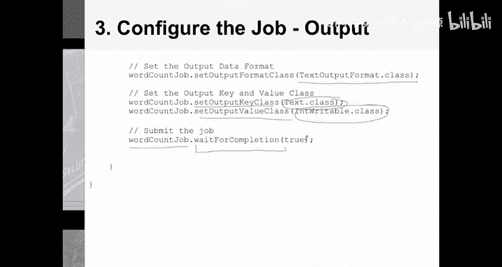

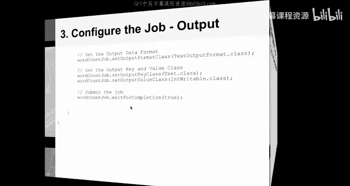

### 步骤三：配置 Job 对象（驱动类）

现在，我们需要编写一个包含 `main` 方法的驱动类来配置和提交作业。

```java
import org.apache.hadoop.conf.Configuration;
import org.apache.hadoop.fs.Path;
import org.apache.hadoop.io.IntWritable;
import org.apache.hadoop.io.Text;
import org.apache.hadoop.mapreduce.Job;
import org.apache.hadoop.mapreduce.lib.input.FileInputFormat;
import org.apache.hadoop.mapreduce.lib.input.TextInputFormat;
import org.apache.hadoop.mapreduce.lib.output.FileOutputFormat;
import org.apache.hadoop.mapreduce.lib.output.TextOutputFormat;

public class WordCount {
    public static void main(String[] args) throws Exception {
        if (args.length != 2) {
            System.err.println("Usage: WordCount <input path> <output path>");
            System.exit(-1);
        }

        // 1. 创建配置和作业实例
        Configuration conf = new Configuration();
        Job job = Job.getInstance(conf, "Word Count");

        // 2. 设置 Jar 包主类
        job.setJarByClass(WordCount.class);

        // 3. 设置 Mapper 和 Reducer 类
        job.setMapperClass(WordCountMapper.class);
        job.setReducerClass(WordCountReducer.class);

        // 4. 设置输入输出格式
        job.setInputFormatClass(TextInputFormat.class);
        job.setOutputFormatClass(TextOutputFormat.class);

        // 5. 设置输出键值类型
        job.setOutputKeyClass(Text.class);
        job.setOutputValueClass(IntWritable.class);

        // 6. 设置输入和输出路径（从命令行参数获取）
        FileInputFormat.addInputPath(job, new Path(args[0]));
        FileOutputFormat.setOutputPath(job, new Path(args[1]));

        // 7. 提交作业并等待完成
        boolean success = job.waitForCompletion(true);
        System.exit(success ? 0 : 1);
    }
}
```

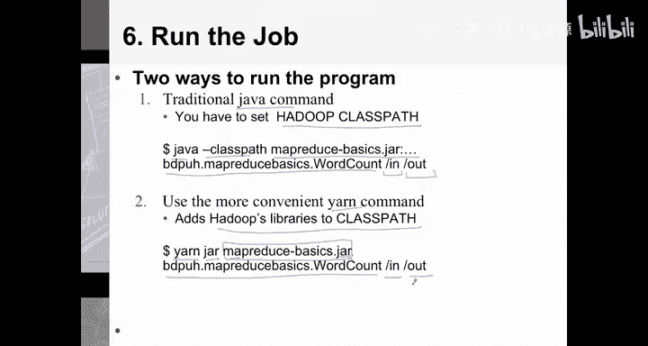


### 步骤四与五：编译与打包

完成代码编写后，需要编译并打包。

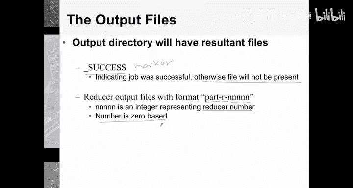

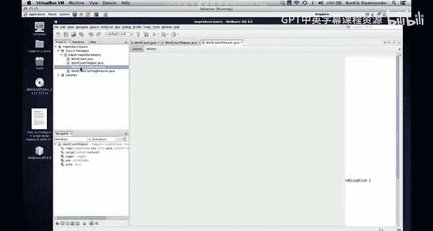

以下是编译和打包的注意事项：

*   **编译**：需要使用 Hadoop 库进行编译。需要将 Hadoop 的 JAR 文件（通常位于 `$HADOOP_HOME/share/hadoop/` 下的各个子目录中）添加到类路径。
*   **打包**：Hadoop 要求将作业的所有类文件及其依赖打包成一个单独的 JAR 文件，以便框架能将其分发到各个计算节点。可以使用 `jar` 命令或 Maven/Ant 等构建工具。

### 步骤六：运行作业

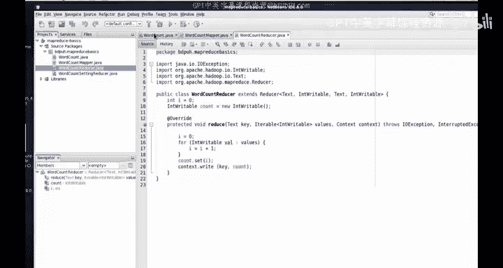

打包完成后，即可提交作业到 Hadoop 集群运行。推荐使用 `yarn` 命令，因为它会自动设置 Hadoop 所需的类路径。

```bash
# 使用 yarn 命令提交作业
yarn jar wordcount.jar WordCount /IN /OUT
```

命令解释：
*   `yarn jar`: 用于提交 MapReduce 作业的 YARN 命令。
*   `wordcount.jar`: 你打包好的 JAR 文件路径。
*   `WordCount`: 包含 `main` 方法的驱动类全限定名。
*   `/IN`: 输入目录在 HDFS 中的路径。
*   `/OUT`: 输出目录在 HDFS 中的路径（该目录必须不存在）。

## 查看运行结果

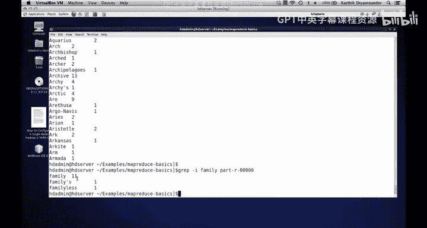

作业成功运行后，可以查看输出结果。

1.  **成功标记**：输出目录（如 `/OUT`）下会生成一个名为 `_SUCCESS` 的空文件，标志着作业成功完成。
2.  **结果文件**：实际结果保存在以 `part-r-` 开头的文件中（例如 `part-r-00000`）。文件数量等于 Reducer 的数量（默认一个）。每个文件内包含由制表符分隔的键值对（单词和计数）。

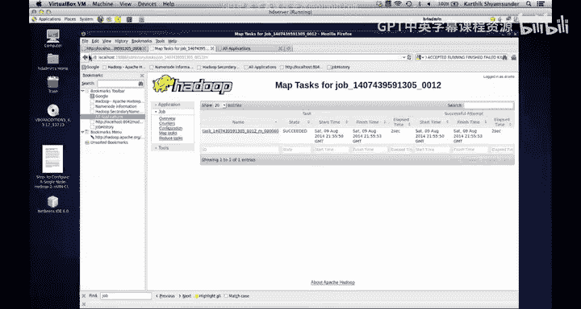

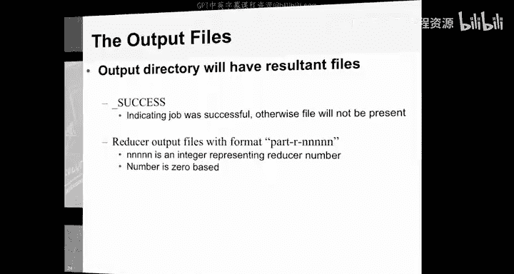

可以使用以下 HDFS 命令查看结果：

```bash
# 查看输出目录内容
hadoop fs -ls /OUT
# 查看结果文件内容
hadoop fs -cat /OUT/part-r-00000
```

## 总结

本节课中我们一起学习了编写 MapReduce 程序的完整步骤。我们通过“词频统计”这个例子，详细讲解了从问题分析、Mapper/Reducer 设计、代码实现、作业配置到编译打包和运行的整个流程。关键点在于理解数据在 Map 和 Reduce 阶段的流动与转换，并正确使用 Hadoop MapReduce API 进行实现和配置。掌握这些步骤是进行大数据处理开发的基础。