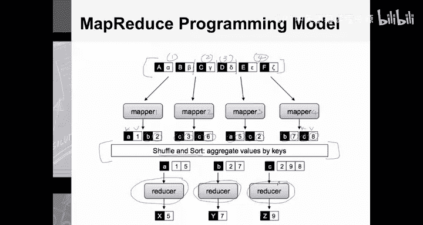
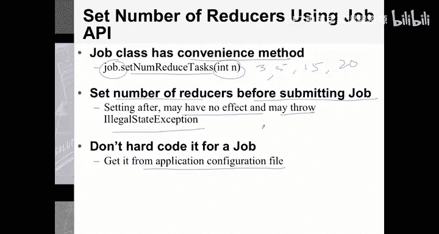
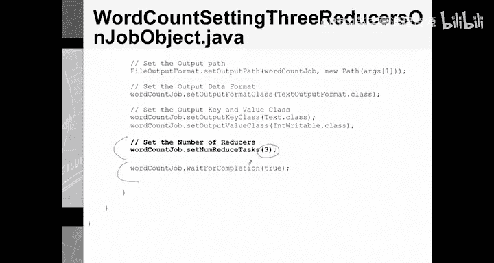
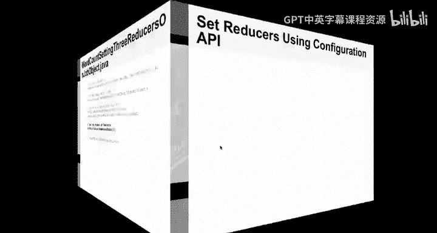
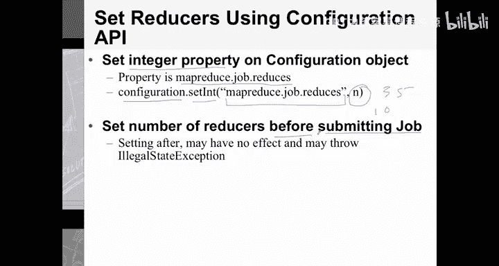
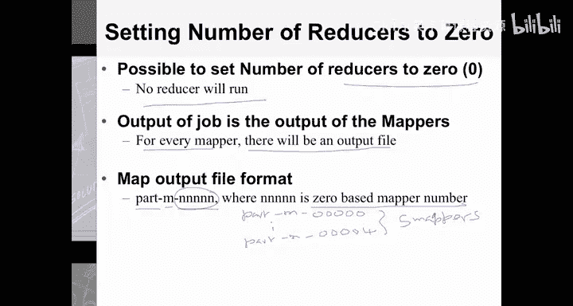
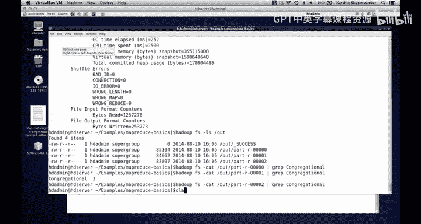
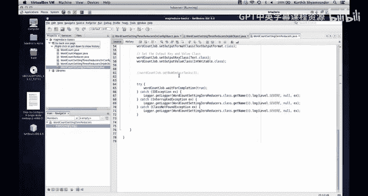
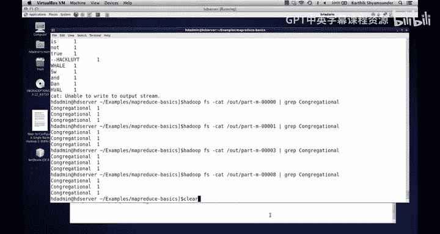

# 050：Reducer并行机制 🚀


在本节课中，我们将学习Hadoop MapReduce作业中Reducer并行性的实现与控制方式。我们将探讨如何设置多个Reducer，以及这如何影响作业的执行和输出。

## 概述



MapReduce编程模型的核心思想是将大规模数据处理任务分解为可并行执行的Map和Reduce阶段。默认情况下，一个作业只有一个Reducer。然而，通过配置，我们可以启动多个Reducer并行工作，这可以显著提高处理速度。本节将详细解释Reducer并行机制的工作原理、配置方法及其对输出的影响。

## MapReduce模型回顾

为了理解Reducer并行性，让我们先回顾一下MapReduce编程模型。

在MapReduce编程中，输入数据被分割成多个**输入分片**。假设我们有四个输入分片：1、2、3和4。每个输入分片由一个**Mapper**处理。因此，我们可能有Mapper 1、Mapper 2、Mapper 3和Mapper 4。这些Mapper可能在同一台机器上运行，也可能分布在多台机器上，它们会并行处理各自的分片，但在单个Mapper内部，数据是按顺序处理的。

假设Mapper 1生成键值对组合：键A对应值1，键B对应值2。Mapper 2生成：键C对应值3和值6。Mapper 3生成：键A对应值5，键C对应值2。Mapper 4生成：键B对应值7，键C对应值8。

每个Mapper独立生成其输出。Mapper的输出随后由框架处理，这个阶段我们称之为**Shuffle和Sort阶段**。

## Reducer并行执行

你可以配置一个、两个、十五个甚至零个Reducer。到目前为止，我们看到的例子都只有一个Reducer。现在，我们讨论如何配置多个Reducer。



如果你有多个Reducer，例如三个Reducer并行运行，Shuffle和Sort框架会保证两件事：

1.  **没有两个Reducer会看到相同的键。**
2.  **呈现给一个Reducer的所有键都是按排序顺序排列的。**





这意味着，如果你有两个Reducer，它们将看到不同的键集合。同时，当一个Reducer接收其键值对（实际上是键和对应的值列表）时，这些键是按顺序提供的。

让我们看一个并行执行的例子。假设有三个Map任务（Map Task 1, 2, 3）处理不同的分片。每个Map任务顺序处理记录并生成键值对。不同的Map任务可能生成相同的键（例如，K1）。



现在，假设我们有两个Reducer任务（Reducer Task 1和2）在运行。框架保证没有两个Reducer会看到相同的键。因此，Reducer 1可能只看到键K2、K4和K5，而Reducer 2看到键K1和K3。同时，Reducer接收到的键是按顺序排列的（例如，K2先于K4，K4先于K5）。

## 默认与设置Reducer数量

默认情况下，一个作业只有一个Reducer。我们之前的作业从未设置过Reducer数量，因此都只产生一个输出文件，其名称格式为 `part-r-00000`。

你可以为作业设置Reducer的数量，这可以通过Job API实现。

以下是设置Reducer数量的两种主要方法：

### 方法一：使用Job对象

`Job`类有一个便捷方法 `setNumReduceTasks`，它接受一个整数参数。你可以在提交作业之前，使用Job对象调用此方法来设置Reducer的数量。



```java
Job job = Job.getInstance(conf, "word count");
// ... 其他配置 ...
job.setNumReduceTasks(3); // 设置为3个Reducer
// ... 提交作业 ...
```


**重要提示**：必须在提交作业**之前**设置Reducer数量，否则可能不生效或抛出`IllegalStateException`异常。

### 方法二：使用Configuration对象

你也可以通过Configuration API来设置Reducer数量。Configuration对象有一个`setInt`方法，可以设置属性`mapreduce.job.reduces`。

```java
Configuration conf = new Configuration();
conf.setInt("mapreduce.job.reduces", 3); // 设置为3个Reducer
Job job = Job.getInstance(conf, "word count");
// ... 其他配置和提交作业 ...
```

**最佳实践**：不要在程序中硬编码Reducer数量。最好从外部配置文件（如`.properties`文件或XML配置文件）中读取这个值，以提高程序的灵活性和可维护性。

## Reducer输出

每个Reducer都会生成一个独立的输出文件。如果你有N个Reducer，就会得到N个`part`文件。输出文件的命名格式为 `part-r-xxxxx`，其中`xxxxx`是一个从0开始的Reducer编号。

例如，如果有5个Reducer，输出文件将是：
*   `part-r-00000`
*   `part-r-00001`
*   `part-r-00002`
*   `part-r-00003`
*   `part-r-00004`

## 零个Reducer的特殊情况





你也可以将Reducer的数量设置为零。这意味着作业将不运行任何Reducer。

那么，作业的输出是什么？此时，作业的输出就是Mapper的输出。如果你有M个Mapper，每个Mapper都会生成一个输出文件。Mapper输出文件的命名格式为 `part-m-xxxxx`，其中`xxxxx`是从0开始的Mapper编号。

**关键区别**：Mapper的输出**不是排序的**。因为Shuffle和Sort阶段是Reducer的一部分，当Reducer数量为零时，这个阶段不会发生。因此，Mapper的输出文件中，相同的键可能会出现多次，并且记录的顺序就是Mapper处理它们的顺序。

## 实践演示

为了巩固以上概念，我们通过三个场景进行演示：

1.  **通过Configuration对象设置3个Reducer**：运行一个WordCount作业，输出目录中会生成三个`part-r-xxx`文件。检查文件内容，可以确认键是排序的，且相同的键只出现在一个文件中。
2.  **通过Job对象设置3个Reducer**：运行另一个WordCount作业，结果与场景1相同，验证了两种设置方法效果一致。
3.  **设置0个Reducer并处理10个输入文件**：运行WordCount作业，输入目录包含10个文件（每个文件一个HDFS块）。由于没有Reducer，输出目录中会生成10个`part-m-xxx`文件（每个Mapper一个）。检查这些文件，可以发现输出内容未排序，且相同的单词（如“congregational”）分散在多个Mapper输出文件中，每个出现都计为1，尚未被累加。

## 总结

在本节课中，我们一起学习了Hadoop中Reducer并行机制的实现与控制。我们了解到：



*   默认情况下，每个作业只有一个Reducer。
*   可以通过`Job.setNumReduceTasks()`方法或`Configuration.setInt("mapreduce.job.reduces", N)`属性来设置Reducer的数量（N）。
*   必须在提交作业之前进行设置。
*   每个Reducer产生一个独立的、内部按键排序的输出文件（`part-r-xxxxx`），且框架保证不同的Reducer处理不同的键。
*   可以将Reducer数量设置为零，此时作业没有Reduce阶段，Mapper的原始输出（`part-m-xxxxx`）将直接作为最终结果，且这些输出是未排序的。
*   建议从配置文件读取Reducer数量，而非硬编码在程序中。

理解并合理配置Reducer并行度，对于优化MapReduce作业的性能至关重要。