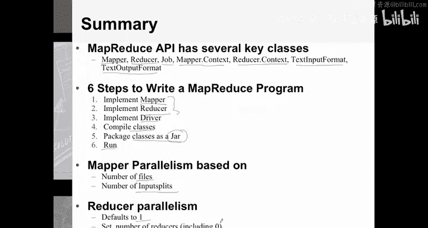

# 051：MapReduce编程基础总结 🧠

在本节课中，我们将对MapReduce编程的基础知识进行总结。我们将回顾MapReduce API中的关键类、编写MapReduce程序的六个步骤，以及Mapper和Reducer的并行度概念。

---

## MapReduce API关键类回顾

上一节我们介绍了MapReduce编程的基本流程，本节中我们来看看MapReduce API中的几个核心类。

*   **Mapper类**：这是我们需要继承并扩展以编写自定义Mapper的基类。
*   **Reducer类**：这是我们需要继承并扩展以编写自定义Reducer的基类。
*   **Job类**：我们实例化此对象，用于配置和提交一个MapReduce作业。
*   **Mapper Context与Reducer Context**：这两个对象会自动实例化，并分别传递给Mapper的`map`方法和Reducer的`reduce`方法，以便我们获取关于作业和任务的上下文信息。
*   **TextInputFormat与TextOutputFormat类**：这两个类用于表示和处理纯文本输入文件与输出文件。

---

## 编写MapReduce程序的六个步骤

理解了核心类之后，以下是编写一个MapReduce程序需要遵循的六个具体步骤。

1.  **实现Mapper类**：通过继承`Mapper`类，并重写其`map`方法。
2.  **实现Reducer类**：通过继承`Reducer`类，并重写其`reduce`方法。
3.  **实现Driver类**：在此类中实例化`Job`对象，配置作业参数，并提交作业。
4.  **编译类文件**：编译上述三个核心类以及任何依赖类。
5.  **打包为JAR文件**：将编译后的类文件打包成一个JAR文件。这是必需的，因为Hadoop需要将此文件分发到运行不同任务的各个节点上。
6.  **运行程序**：使用`yarn`命令来提交并运行打包好的JAR文件。

---

## Mapper与Reducer的并行度

在程序运行层面，我们探讨了Mapper和Reducer的并行执行机制。

**Mapper并行度**取决于两个因素：输入文件的数量和输入分片（Input Split）的数量。实际Mapper任务数是这两者的综合结果。

**Reducer并行度**的默认值为1，即每个作业默认只有一个Reducer任务。但我们可以通过配置将此数值设置为任何我们需要的值，包括0。当Reducer数量设为0时，程序将不会运行任何Reducer阶段。

---

## 总结

本节课中我们一起学习了MapReduce编程的基础总结。我们回顾了MapReduce API中的关键类，明确了编写MapReduce程序的六个标准步骤，并理解了控制Mapper和Reducer并行度的基本原理。这些知识是构建更复杂大数据处理任务的基础。