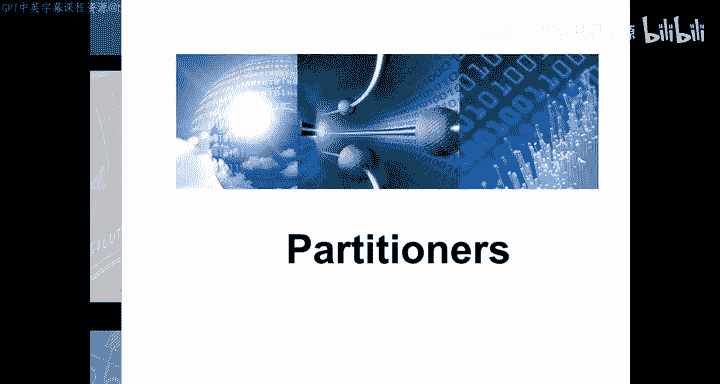
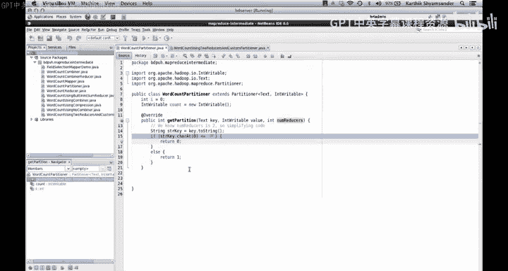
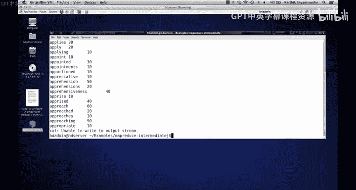
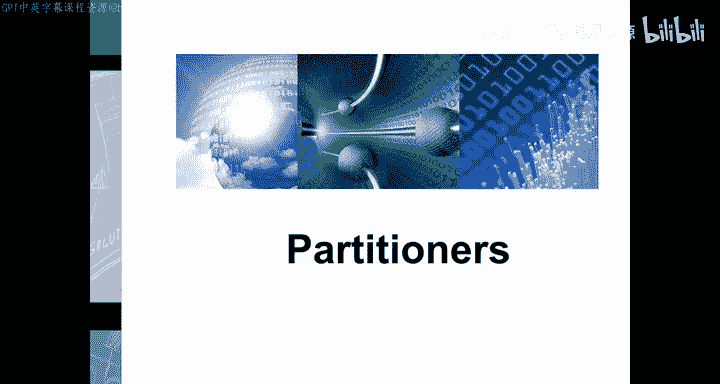

# 054：分区器实现原理 🧩




在本节课中，我们将学习MapReduce框架中的分区器。我们将了解分区器的作用、默认分区器的工作原理，以及如何编写和设置自定义分区器。

---

## 概述

分区器是MapReduce框架中的一个关键组件，它决定了每个Mapper输出的键值对应该被发送到哪个Reducer进行处理。理解分区器对于控制数据在Reducer间的分布至关重要。

---

## MapReduce流程回顾

上一节我们介绍了MapReduce的整体流程，本节中我们来看看分区器是如何介入这个流程的。

输入数据首先被分割成多个分片。每个分片由一个Mapper任务处理。Mapper处理数据后产生输出，如果作业配置了Combiner，输出会先经过Combiner进行本地聚合。之后，无论是Mapper的直接输出还是Combiner的输出，都需要经过分区器。

分区器的作用是：**为每一个输出的键值对计算一个分区号（即Reducer编号）**，从而确保具有相同键的所有记录最终都会被发送到同一个Reducer。

---

## 什么是分区器？

分区器运行在Map输出阶段（或Combiner输出阶段）。它接收一个键值对（类型为K2, V2）以及作业设置的Reducer总数作为输入，并输出一个整数，这个整数代表该键值对应被发送到的Reducer编号（从0开始）。

其核心功能可以用以下伪代码描述：
```
分区号 = 分区逻辑(键, 值, Reducer总数)
```

---

## 默认分区器：HashPartitioner

在之前的例子中，我们并没有显式设置分区器，但作业依然能正常运行。这是因为框架提供了一个默认的分区器：`HashPartitioner`。

`HashPartitioner`的工作原理基于键的哈希码。其分区逻辑的公式如下：

**`分区号 = (key.hashCode() & Integer.MAX_VALUE) % numReduceTasks`**

这个公式确保：
1.  通过 `& Integer.MAX_VALUE` 操作，将哈希码转换为一个非负整数。
2.  通过 `% numReduceTasks`（取模）操作，将结果均匀地映射到所有可用的Reducer上。

例如，假设一个键的 `hashCode()` 返回17，且 `numReduceTasks` 为5，那么计算过程为：`17 % 5 = 2`，该键值对将被发送到编号为2的Reducer。

---

## 自定义分区器

如果默认的哈希分区策略不能满足业务需求（例如，需要根据键的特定范围或属性进行分区），我们可以编写自定义分区器。

以下是实现自定义分区器的步骤：

1.  **创建类**：编写一个类，继承 `org.apache.hadoop.mapreduce.Partitioner` 类。
2.  **重写方法**：重写 `getPartition` 方法，在其中实现自定义的分区逻辑。
3.  **设置分区器**：在作业驱动程序中，使用 `Job.setPartitionerClass` 方法将自定义的分区器类设置给作业。


---

### 自定义分区器示例：按字母范围分区



假设我们有一个词频统计作业，并希望将所有首字母小于或等于‘M’的单词发送到Reducer 0，其余单词发送到Reducer 1。我们可以编写如下分区器：

```java
import org.apache.hadoop.io.IntWritable;
import org.apache.hadoop.io.Text;
import org.apache.hadoop.mapreduce.Partitioner;

public class WordCountPartitioner extends Partitioner<Text, IntWritable> {

    @Override
    public int getPartition(Text key, IntWritable value, int numReduceTasks) {
        // 将键（单词）转换为字符串并获取首字母
        String word = key.toString().toUpperCase();
        char firstLetter = word.charAt(0);

        // 自定义分区逻辑：按字母‘M’划分
        if (firstLetter <= 'M') {
            return 0; // 发送到Reducer 0
        } else {
            return 1; // 发送到Reducer 1
        }
        // 注意：此示例假设numReduceTasks为2。实际应用中应做更健壮的检查。
    }
}
```

在驱动程序中的设置方法如下：
```java
Job job = Job.getInstance(conf, "Word Count with Custom Partitioner");
// ... 其他设置（如Mapper、Reducer类等）
job.setPartitionerClass(WordCountPartitioner.class); // 设置自定义分区器
job.setNumReduceTasks(2); // 必须设置Reducer数量，且与分区逻辑匹配
```

运行此作业后，输出目录中会生成两个结果文件（`part-r-00000` 和 `part-r-00001`），分别包含了首字母为A-M和N-Z的单词统计结果。

---

## 总结

本节课中我们一起学习了MapReduce分区器的核心概念。



我们了解到，分区器负责在Shuffle阶段前，为Map或Combiner的每个输出键值对分配一个目标Reducer编号。框架默认使用 `HashPartitioner`，它根据键的哈希值进行均匀分配。当默认策略不满足需求时，我们可以通过继承 `Partitioner` 类并重写 `getPartition` 方法来实现自定义的分区逻辑，从而精确控制数据的流向。



掌握分区器是进行高效、定制化大数据处理的关键一步。