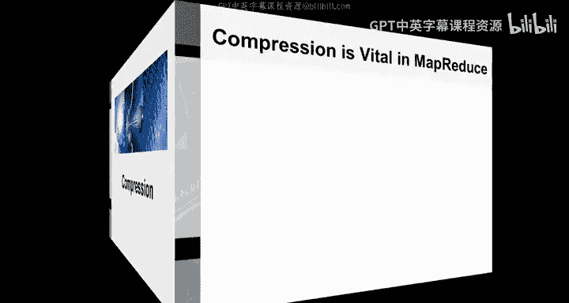
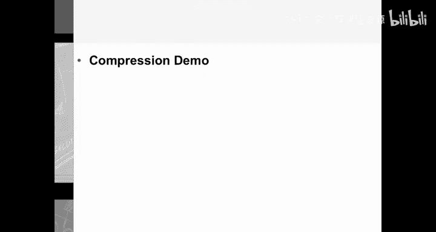
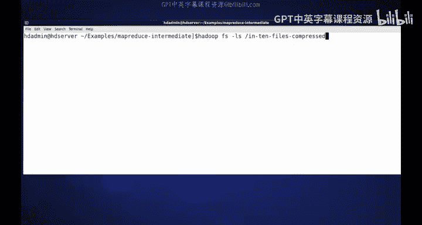
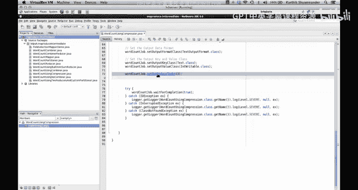
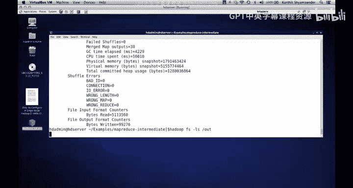
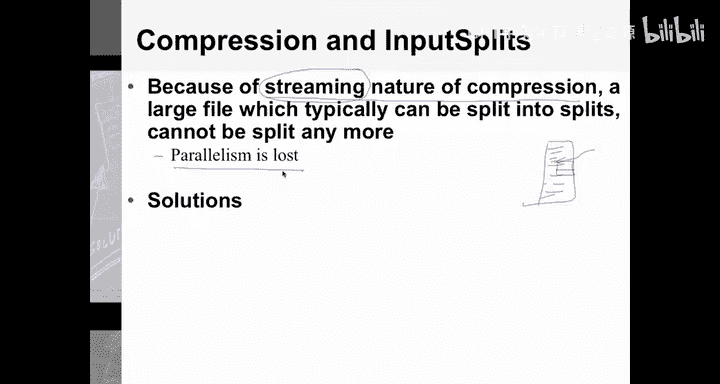
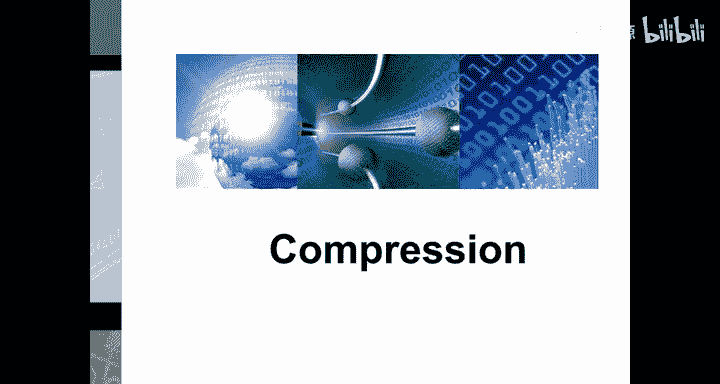

# 055：MapReduce压缩技术集成 🗜️




在本节课中，我们将学习如何在MapReduce作业中应用压缩技术。压缩对于处理海量数据的MapReduce至关重要，它能有效提升性能。我们将探讨输入压缩、输出压缩以及中间Map和Reduce阶段的压缩。

## 概述

MapReduce压缩建立在Hadoop核心模块（Common和HDFS）的压缩功能之上。它主要在三种场景下发挥作用：作业输入压缩、作业输出压缩以及中间Mapper和Reducer的压缩。理解如何配置这些压缩选项，对于优化大数据处理作业的性能和资源利用率非常关键。

## 压缩在MapReduce中的重要性

MapReduce旨在处理大量数据，因此压缩技术至关重要。MapReduce的压缩功能基于Hadoop核心模块构建，这意味着它依赖于核心Common模块的压缩功能以及支持文件压缩的Hadoop HDFS模块。

## MapReduce压缩的应用场景

MapReduce压缩在Hadoop中主要应用于以下三种情况：

以下是三种主要的压缩应用场景：

1.  **作业输入压缩**：MapReduce作业的输入文件可以是压缩文件。
2.  **作业输出压缩**：MapReduce作业运行后产生的输出文件（通常是 `part-r-00000` 等）也可以被压缩。
3.  **中间Mapper和Reducer压缩**：Mapper运行时生成的输出会写入中间临时文件，这些文件在Shuffle和Sort阶段被处理，压缩这些文件可以提升性能。

## 配置作业输入压缩

作业输入压缩由一个名为 `io.compression.codecs` 的属性管理。默认情况下，该属性在 `core-site.xml` 中定义，其值是一个逗号分隔的列表，包含了Hadoop支持的所有编解码器。

查看默认属性值，你会发现它支持所谓的默认编解码器、Gzip编解码器、Bzip2编解码器以及Snappy编解码器。因此，默认情况下，作业输入压缩可以自动处理这四种格式中的任何一种。

**核心概念**：只要输入文件是这四种格式之一，输入压缩就会自动生效。你唯一需要修改 `io.compression.codecs` 属性的情况是，当你决定使用Hadoop默认不支持的压缩格式（例如LZ4压缩）时。这时，你需要引入LZ4压缩的JAR文件，并将编解码器类添加到该属性的逗号分隔列表中。

## 配置作业输出压缩

你可以通过以下两种方式之一来设置作业输出压缩：

第一种方式是通过作业配置对象设置属性。你可以设置一个布尔属性 `mapreduce.output.fileoutputformat.compress` 为 `true`，这表示你希望作业输出被压缩。你还需要设置另一个字符串属性 `mapreduce.output.fileoutputformat.compress.codec`，为其指定用于压缩和解压缩作业输出的编解码器类。

第二种方式是调用输出格式类（`OutputFormat`）上的方法。首先调用 `setCompressOutput` 静态方法，传入作业对象并将布尔参数 `compressed` 设为 `true`。接着，调用 `setOutputCompressorClass` 静态方法，传入作业对象和压缩编解码器类。调用这两个方法后，你的作业输出将被压缩，并使用你指定的编解码器。



## 配置中间Mapper和Reducer压缩

Mapper的输出被发送到文件，这些文件在传递给Reducer之前会经过Shuffle和Sort处理。你可以对这些中间Map输出文件应用压缩，以节省网络传输时间。

设置Mapper输出压缩的方法是：在配置对象中设置布尔属性 `mapreduce.map.output.compress` 为 `true`。你还可以通过设置字符串属性 `mapreduce.map.output.compress.codec` 来指定压缩编解码器，为其传入完全限定的压缩编解码器类的字符串表示形式。

## 实践示例：使用压缩的词频统计程序



下面是一个名为“使用压缩的词频统计”的程序示例，它将展示如何配置作业输入压缩、作业输出压缩以及中间Mapper和Reducer压缩。

对于作业输入压缩，实际上通常不需要做任何额外操作，因为默认情况下，只要输入文件是支持的压缩格式，作业输入压缩就会自动启用。只有在使用像LZ4这样非Hadoop框架内置的编解码器时，才需要显式设置。



作业输出压缩可以通过之前提到的两种方式实现。在下面的代码片段中，我们通过配置对象来设置：

```java
// 启用作业输出压缩
conf.setBoolean("mapreduce.output.fileoutputformat.compress", true);
// 设置输出压缩编解码器为GzipCodec
conf.set("mapreduce.output.fileoutputformat.compress.codec", "org.apache.hadoop.io.compress.GzipCodec");
```



你还可以设置中间Mapper和Reducer压缩：

```java
// 启用Mapper输出压缩
conf.setBoolean("mapreduce.map.output.compress", true);
// 设置中间文件压缩编解码器为GzipCodec
conf.set("mapreduce.map.output.compress.codec", "org.apache.hadoop.io.compress.GzipCodec");
```

你可以为应用程序的不同方面使用不同的编解码器，但在此示例中，为了简单起见，我们全部使用了Gzip编解码器。

## 压缩与输入分片

由于压缩的流式特性，压缩文件通常无法被分割。这意味着如果一个大型压缩文件不能被分割，就会失去并行处理的能力，因为整个文件只能由一个Mapper处理。

如果你希望在压缩的同时保持并行性，有几种选择：

以下是两种支持分片的压缩方案：

1.  **块压缩序列文件**：我们之前讨论过序列文件，其中一种类型是块压缩序列文件。在这种格式中，数据被写入块中，每个块单独压缩，并使用同步标记分隔。这样，文件就可以被分割成不同的部分，因为每个块是独立压缩的。
2.  **可分割的LZO压缩**：LZO压缩由于其许可证限制，不能作为Hadoop的一部分分发。但你可以自行下载安装。LZO压缩提供了“可分割的LZO压缩”功能，它通过为每个文件生成LZO索引，来记录每个块的起始和结束位置，从而实现文件的分割。



## 总结

在本节课中，我们一起学习了如何将压缩技术应用到MapReduce作业中。

我们了解了应用压缩是多么容易：可以应用输入压缩、输出压缩和中间压缩。实际上，对于输入压缩，你通常无需做任何事，因为它已经内置支持。对于输出压缩，你只需将布尔属性设置为 `true`，并设置输出编解码器类。你还可以进行中间Mapper和Reducer压缩，这样Mapper的输出会被压缩，而Reducer输入知道如何解压它，这减少了MapReduce程序占用的带宽和空间。



然而，在考虑压缩时，必须权衡空间和时间开销。总的来说，在Hadoop MapReduce编程中，应用压缩通常是一个很好的主意，但在决定之前，应根据具体的应用场景和运行频率进行考量。