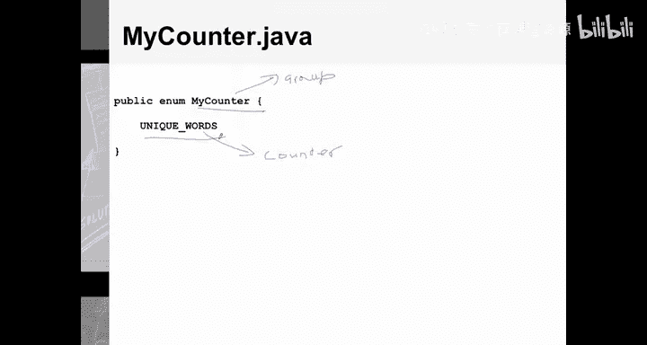
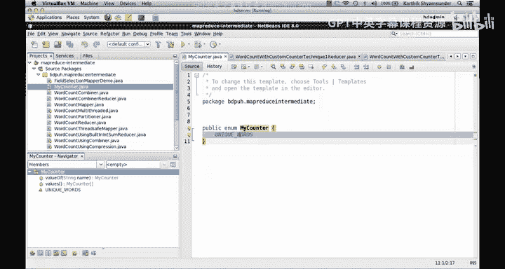
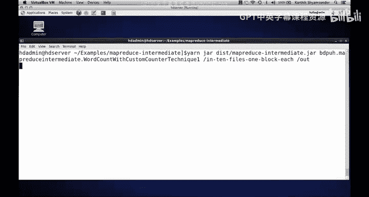
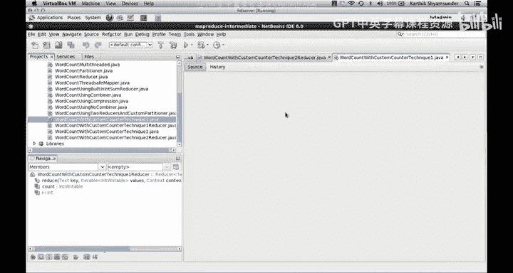
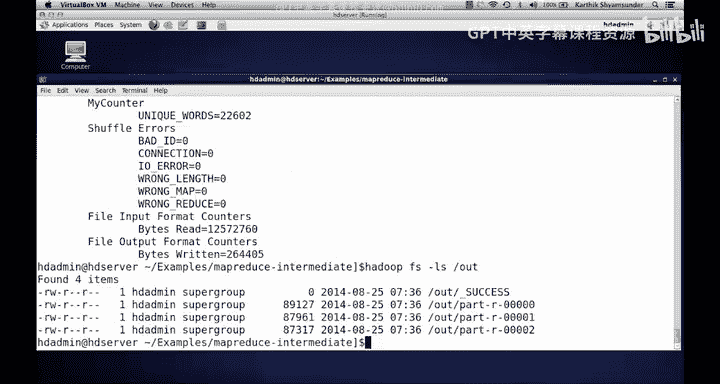

# 056：计数器机制 📊


## 概述

在本节课中，我们将要学习Hadoop MapReduce中的计数器机制。计数器是一种用于为MapReduce作业收集统计信息的工具。我们将了解什么是计数器，如何创建和设置计数器值，以及如何通过编程方式和历史服务器用户界面读取计数器值。最后，我们还将学习内置计数器组，并学习如何创建用户自定义的计数器。

---

## 什么是计数器？

计数器，简单来说，是用于维护和汇总作业计数的工具。它们用于记录作业的度量指标。这里的“作业度量指标”指的是收集关于作业的统计数据，例如，你可能想知道作业读取了多少字节、输出了多少字节、处理了多少条记录。计数器也可用于质量控制，例如确认作业是否处理了1.2亿条记录；或用于诊断，例如跟踪作业中是否出现了任何错误。

---

## 内置计数器

Hadoop框架提供了多种内置的度量指标作为计数器。例如，你可以跟踪创建的Mapper和Reducer的总数，可以跟踪作业处理的字节数和作业生成的输出字节数。你还可以创建自己的计数器，例如跟踪作业消耗的唯一记录数，或者跟踪作业中某些特定的应用程序错误或警告的数量。

计数器被划分为组，每个计数器实际上都属于一个组。系统提供了多个内置的计数器组。以下是主要的几个内置计数器组：

*   **作业计数器**：记录启动的MapReduce任务数量。
*   **文件系统计数器**：跟踪读取或写入的字节数。
*   **MapReduce框架计数器**：跟踪Mapper、Reducer和Combiner的输入/输出记录数，以及它们在不同处理阶段所花费的时间。
*   **Shuffle错误计数器**：与数据Shuffle和排序相关的错误数量。
*   **文件输入格式计数器**：读取的字节数。
*   **文件输出格式计数器**：写入的字节数。

---

## 通过历史服务器查看计数器

历史服务器的Web图形用户界面会展示这些计数器。让我们登录到一个Hadoop服务器虚拟机并查看计数器。

在历史服务器界面中，选择一个作业（例如“使用压缩的单词计数”作业），点击进入作业详情。在左侧，你会看到一个名为“计数器”的选项。点击“计数器”，你将看到所有内置计数器的列表。界面会显示计数器组以及与该组关联的具体计数器，例如文件系统计数器、作业计数器、MapReduce框架计数器等。在每个组下，你可以看到具体的计数器（如读取的字节数）及其对应的值。

---

## 创建用户自定义计数器

如果内置计数器不能满足你的应用程序需求，你可以创建自己的、特定于应用程序的计数器。使用这些自定义计数器，你可以在Mapper、Combiner和Reducer类中递增它们。框架会准确汇总各个阶段的所有计数并生成总计。例如，如果你有15个Mapper，并且在Mapper阶段添加了这些计数器，框架会确保将所有不同的Mapper计数器聚合在一起，以便在作业历史服务器中显示最终总数，或者你也可以通过API访问它。



---


## 如何实现用户自定义计数器？

以下是实现用户自定义计数器的步骤。

首先，你需要定义一个计数器。推荐使用枚举类型来定义，这是一种类型安全的方法。定义计数器后，你可以从上下文对象中检索该计数器，然后递增其值。这个过程相当直接。

### 定义计数器

定义计数器的方法是编写一个枚举类。枚举类的名称成为计数器组的名称，而枚举的状态或值则成为单个计数器的名称。

例如，定义一个名为 `MyCounter` 的枚举，其中包含一个状态 `UNIQUE_WORDS`。这样，`MyCounter` 就是组名，`UNIQUE_WORDS` 就是计数器名。我们的目标是统计作业处理的唯一单词数量（适用于单词计数应用程序）。

```java
public enum MyCounter {
    UNIQUE_WORDS
}
```

### 检索并递增计数器

为了检索计数器以便递增其值，你可以利用在 `map` 和 `reduce` 方法中作为参数传递的上下文对象。有两种方法可以从上下文对象中检索计数器。

**方法一：使用字符串名称**
这种方法涉及调用上下文对象的 `getCounter` 方法，并传入组名和计数器名的字符串。这种方法非常动态，你甚至可以即时创建新的计数器（即使没有预先定义枚举）。但这也容易出错，因为拼写错误可能会意外创建新的计数器。

**方法二：使用枚举（类型安全）**
这种方法同样调用上下文对象的 `getCounter` 方法，但直接传入枚举实例。例如，`context.getCounter(MyCounter.UNIQUE_WORDS)`。这种方法是类型安全的，可以避免拼写错误。

一旦你获得了计数器对象，就可以递增或设置其值。你可以调用计数器对象的 `increment` 方法（例如 `increment(1)`）来增加计数，或者调用 `setValue` 方法来设置一个特定的长整型数值。

---

## 示例：在Reducer中使用计数器

以下是一个在Reducer中实现计数器的示例程序，展示了两种技术。

**技术一（使用字符串）：**
```java
public class WordCountReducerWithCounterTech1 extends Reducer<Text, IntWritable, Text, IntWritable> {
    public void reduce(Text key, Iterable<IntWritable> values, Context context) throws IOException, InterruptedException {
        // ... 正常的业务处理逻辑 ...
        // 检索并递增计数器
        Counter counter = context.getCounter("MyCounter", "UNIQUE_WORDS");
        counter.increment(1);
    }
}
```


**技术二（使用枚举，类型安全）：**
```java
public class WordCountReducerWithCounterTech2 extends Reducer<Text, IntWritable, Text, IntWritable> {
    public void reduce(Text key, Iterable<IntWritable> values, Context context) throws IOException, InterruptedException {
        // ... 正常的业务处理逻辑 ...
        // 检索并递增计数器（类型安全）
        Counter counter = context.getCounter(MyCounter.UNIQUE_WORDS);
        counter.increment(1);
    }
}
```

---

## 作业完成后检索和打印计数器

作业完成后，你可以通过Java API检索计数器，例如将其打印出来或存储到数据库中。使用作业对象的 `getCounters` 方法可以获取一个包含所有计数器的 `Counters` 对象，然后遍历并打印它们。



以下是一个示例程序片段，展示了如何在作业完成后检索并打印计数器：

```java
// 提交并等待作业完成
Job wordCountJob = ... // 作业配置
boolean success = wordCountJob.waitForCompletion(true);

if (success) {
    // 获取所有计数器
    Counters counters = wordCountJob.getCounters();
    // 遍历所有计数器组
    for (CounterGroup group : counters) {
        System.out.println("计数器组: " + group.getDisplayName());
        // 遍历组内的每个计数器
        for (Counter counter : group) {
            System.out.println("  " + counter.getDisplayName() + ": " + counter.getValue());
        }
    }
}
```



---



## 演示：运行带计数器的作业

在Hadoop服务器虚拟机上，我们可以运行一个集成了计数器的单词计数作业。假设我们使用技术一的Reducer，它会在处理每个唯一单词时递增 `MyCounter.UNIQUE_WORDS` 计数器。



作业运行后，我们可以在历史服务器Web界面查看结果。在作业的“计数器”部分，我们会找到自定义的计数器组“MyCounter”，其下有一个计数器“UNIQUE_WORDS”，其值表示在输入文件中发现的唯一单词总数（例如22602个）。

---

## 总结

在本节课中，我们一起学习了Hadoop MapReduce中的计数器机制。我们了解到计数器是一种用于为MapReduce作业收集统计信息的工具。Hadoop框架本身提供了多个内置的计数器组，用于跟踪作业、文件系统、框架等方面的指标。当这些内置计数器无法满足需求时，我们可以创建用户自定义的计数器。


在访问和递增计数器方面，我们学习了两种主要技术：一种是使用字符串名称的动态方法，另一种是使用枚举的类型安全方法。计数器信息既可以通过作业历史服务器的图形界面查看，也可以通过编程方式获取。总而言之，计数器是检测和收集作业信息的强大工具。