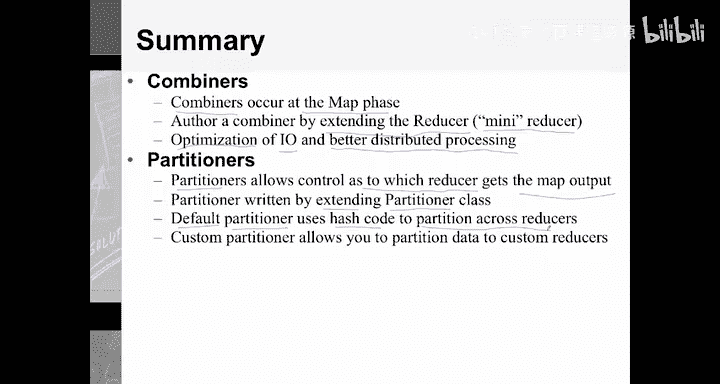

# 057：Hadoop大数据处理 - P57 🧠
## 第17讲：MapReduce中级编程总结


在本节课中，我们将对MapReduce中级编程的几个核心概念进行总结。我们将回顾Combiner、Partitioner、压缩以及计数器的作用与实现方式，帮助你巩固对MapReduce框架优化和自定义功能的理解。

---

### Combiner：Map阶段的“迷你Reducer” 🔄

上一节我们介绍了MapReduce的基本流程，本节中我们来看看如何优化Map阶段的输出。Combiner是一种在Map阶段执行的特殊函数。

Combiner通过扩展Reducer类并设置为Job的一部分来启用，因此常被称为“迷你Reducer”。它是一种优化机制，主要优化IO操作。

Combiner的作用体现在以下两个方面：
*   它减少了Map输出的数据量，因为数据在写入本地磁盘前会先在Map端进行局部聚合。
*   它减轻了Sort和Shuffle阶段的负担，因为需要排序和跨网络传输的数据变少了。

从网络IO和磁盘IO的角度看，这提升了效率。同时，由于部分Reducer的逻辑在Map阶段就已执行，这也优化了分布式处理的性能。

---

### Partitioner：控制数据流向 🗂️

理解了如何优化Map输出后，我们接下来看看如何控制这些输出的去向。Partitioner允许你控制Map输出数据由哪个Reducer处理。

编写Partitioner需要扩展Partitioner类并重写`getPartition`方法。

MapReduce提供了一个默认的Partitioner，它使用哈希码（hash code）将数据分配到不同的Reducer。以下是其逻辑的简化表示：

```java
// 默认Partitioner的核心逻辑示意
int partition = (key.hashCode() & Integer.MAX_VALUE) % numReduceTasks;
```

如果你需要自定义数据分发逻辑，可以编写自己的Partitioner，从而将特定的数据发送到指定的Reducer。

---



### 压缩：提升存储与传输效率 📦

在HDFS部分我们学习过压缩，现在我们将了解如何在MapReduce作业中应用压缩。压缩可以显著减少数据存储空间和网络传输开销。

MapReduce作业处理压缩文件非常灵活：
*   **输入压缩**：MapReduce作业可以直接读取压缩格式的文件作为输入，无需额外配置。
*   **输出压缩**：作业也可以生成压缩格式的输出文件。
*   **中间文件压缩**：Map输出在写入本地磁盘后，会经过Sort和Shuffle阶段传输到Reducer端。这个中间的Map输出文件同样可以进行压缩，以节省本地磁盘空间和网络带宽。

---

### 计数器：收集作业统计信息 📊

最后，我们来学习如何监控作业的运行状态。计数器用于收集作业的统计信息。

MapReduce提供了多种内置计数器。此外，你也可以为应用程序编写用户自定义的计数器。

创建计数器主要有两种方式：
*   使用枚举（Enum），这种方式具有强类型检查的优点。
*   使用简单的字符串作为计数器名称，然后递增其值。

---

### 总结 📝

本节课中我们一起学习了MapReduce中级编程的四个关键组件：
1.  **Combiner**：在Map端进行预聚合，优化IO和网络传输。
2.  **Partitioner**：自定义数据分发逻辑，控制Map输出由哪个Reducer处理。
3.  **压缩**：在输入、输出及中间阶段应用压缩，节省存储和带宽。
4.  **计数器**：通过内置或自定义计数器来收集和监控作业的运行时统计信息。

掌握这些概念，将使你能够编写出更高效、更可控的MapReduce程序。