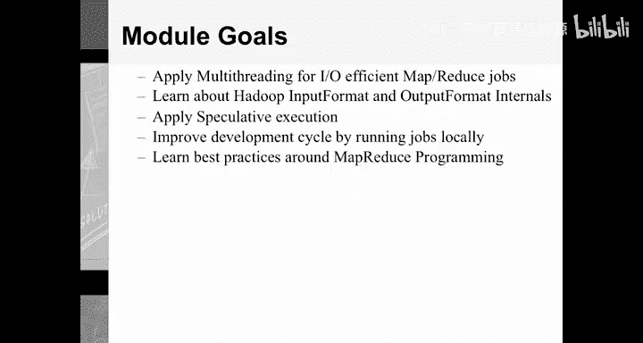

# 058：MapReduce高级编程导论 🚀

在本节课中，我们将学习MapReduce高级编程的核心概念与最佳实践。我们将探讨多线程映射器、输入输出格式的内部机制、推测执行、本地作业调试以及一系列开发中的反模式与对应策略。

---


## 多线程映射器 🧵

上一节我们介绍了本模块的概览，本节中我们来看看如何编写多线程映射器以提升I/O密集型作业的效率。

在MapReduce中，映射器（Mapper）默认是单线程运行的。然而，对于涉及大量I/O操作（如读取多个小文件）的任务，使用多线程可以显著提升处理速度。通过创建多个线程并行处理输入分片，我们可以更充分地利用计算资源。

以下是实现多线程映射器的核心代码结构：

```java
public class MultiThreadedMapper extends Mapper<KEYIN, VALUEIN, KEYOUT, VALUEOUT> {
    private ExecutorService executor;
    private List<Future> futures;

    @Override
    protected void setup(Context context) {
        int numThreads = context.getConfiguration().getInt("mapreduce.mapper.multithreaded.threads", 10);
        executor = Executors.newFixedThreadPool(numThreads);
        futures = new ArrayList<>();
    }

    @Override
    public void map(KEYIN key, VALUEIN value, Context context) {
        Future future = executor.submit(new ProcessingTask(key, value, context));
        futures.add(future);
    }

    @Override
    protected void cleanup(Context context) {
        for (Future future : futures) {
            future.get(); // 等待所有线程完成
        }
        executor.shutdown();
    }
}
```

通过上述方式，我们可以并发处理多个键值对，但需注意线程安全与上下文共享问题。

---

## 输入与输出格式内部机制 ⚙️

了解了多线程映射器后，我们进一步探讨输入格式（InputFormat）与输出格式（OutputFormat）的内部工作原理。

输入格式负责两件事：定义如何分割输入数据（生成InputSplit），以及如何读取分割后的数据（通过RecordReader）。例如，`TextInputFormat`将文件按行分割，每行作为一个记录。

输出格式则定义了如何写入作业的结果。常见的`TextOutputFormat`将键值对以制表符分隔写入文件。

以下是输入格式的关键方法：

```java
public abstract class InputFormat<K, V> {
    public abstract List<InputSplit> getSplits(JobContext context);
    public abstract RecordReader<K, V> createRecordReader(InputSplit split, TaskAttemptContext context);
}
```

理解这些内部机制有助于我们自定义格式以处理非标准数据源。

---

## 推测执行概念 🔍

接下来，我们学习一个在Hadoop MapReduce中默认启用的有趣概念——推测执行（Speculative Execution）。

推测执行旨在解决集群中某些任务节点运行缓慢的问题。当某个任务（Map或Reduce）明显慢于同阶段的其他任务时，Hadoop会在另一个节点上启动相同的任务作为备份。最先完成的任务结果将被采用，另一个任务则被终止。

推测执行可以通过以下配置启用或禁用：

```xml
<property>
    <name>mapreduce.map.speculative</name>
    <value>true</value>
</property>
<property>
    <name>mapreduce.reduce.speculative</name>
    <value>true</value>
</property>
```

虽然推测执行能提高作业的整体完成时间，但在资源紧张或任务涉及外部竞争资源（如数据库写入）时，可能需要禁用它以避免重复计算或冲突。

---

## 本地作业运行与调试 🐛

为了提升开发效率，我们可以在本地运行MapReduce作业，而无需依赖完整的Hadoop集群（如ResourceManager、NodeManager或HistoryServer）。这对于调试和快速验证逻辑至关重要。

使用Hadoop的本地运行模式，只需在配置中设置：

```java
Configuration conf = new Configuration();
conf.set("mapreduce.framework.name", "local");
conf.set("fs.defaultFS", "file:///");
```

然后，像在集群上一样提交作业。所有任务将在本地JVM中执行，日志直接输出到控制台，便于排查问题。

---

## MapReduce反模式与最佳实践 📋

最后，我们总结一系列常见的MapReduce反模式及其对应的最佳实践，以帮助编写更高效、健壮的代码。

以下是需要避免的实践及改进建议：

1.  **避免在映射器或归约器中创建大量临时对象**，这会增加GC开销。应重用对象或使用高效的数据结构。
2.  **不要忽略配置参数调优**，如`mapreduce.task.io.sort.mb`（排序内存）和`mapreduce.reduce.shuffle.parallelcopies`（并行复制数），它们对性能影响显著。
3.  **避免在单个作业中处理极度倾斜的数据**。可通过预分区（Partitioning）或使用Combiner来减少数据倾斜的影响。
4.  **不要在任务中执行阻塞式I/O操作**，这会导致任务超时。对于外部服务调用，应考虑异步方式或批量处理。
5.  **谨慎使用全局静态变量**，因为在分布式环境中，它们可能引发不可预知的行为。应通过配置或上下文传递共享数据。
6.  **避免输出大量小文件**，这会给HDFS和后续作业带来压力。可通过合并文件或使用特定输出格式（如`SequenceFileOutputFormat`）来优化。
7.  **不要硬编码路径或配置**。应使用配置管理工具或将参数通过命令行传递，以提高作业的灵活性。
8.  **忽略日志记录和监控**会使调试变得困难。确保在关键步骤添加有意义的日志，并利用Hadoop的计数器（Counter）收集指标。
9.  **避免在归约阶段进行复杂计算**，尽量将计算向映射阶段倾斜，以利用并行处理优势。
10. **不要忘记设置合理的任务超时时间**，特别是对于长时间运行的任务，防止因个别任务挂起导致整个作业停滞。
11. **避免在作业中直接依赖外部系统的最新状态**（如数据库表），这可能导致结果不一致。应考虑将所需数据快照导入HDFS再进行处理。

遵循这些最佳实践，可以显著提升MapReduce作业的性能、可维护性和可靠性。



---

本节课中我们一起学习了MapReduce高级编程的多个关键主题：通过多线程映射器提升I/O效率，深入理解了输入输出格式的内部机制，掌握了推测执行的适用场景，学会了在本地调试作业以加速开发周期，并回顾了十一个重要的反模式与最佳实践。掌握这些内容将帮助你设计出更高效、健壮的大数据处理作业。