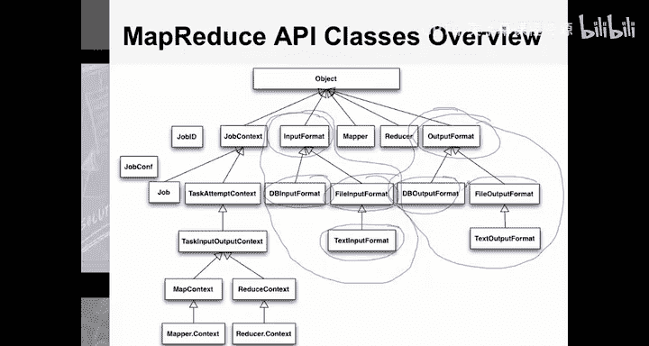
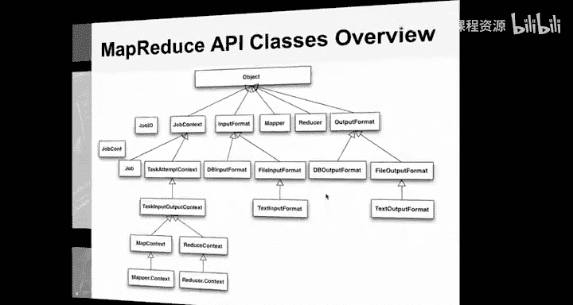
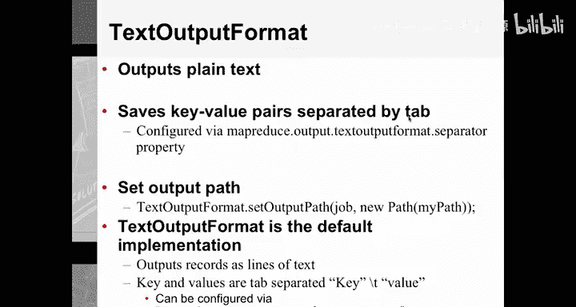

# 060：课程 20: Hadoop 输入输出格式内部机制 🔧


在本节课中，我们将学习Hadoop MapReduce作业中**输入格式**和**输出格式**的内部工作机制。理解这些概念对于掌握数据如何被读取、分割、处理以及最终写入至关重要。

---

## 输入分片概念

上一节我们介绍了MapReduce的基本流程，本节中我们来看看数据输入的第一步：**输入分片**。

MapReduce作业可以从文件或数据库获取输入。在我们之前的演示和作业中，输入通常来自纯文本文件。输入也可以来自序列文件、Map文件或数据库（如关系型数据库或HBase）。

当处理一个输入文件时，文件由多行记录组成。**输入分片**是一组逻辑上连续的记录集合。例如，一个包含100万条记录的文件可以被划分为三个分片。每个**Mapper实例**可以独立处理一个输入分片，从而实现并行处理。

输入分片通过扩展Hadoop内置的`InputSplit`类实现。通常我们不需要直接处理分片，因为这是**输入格式**类的职责。

---

## MapReduce API 中的格式类

理解了分片的概念后，我们来看看MapReduce API中负责管理它们的核心类。



以下是MapReduce API中与输入输出相关的关键类结构：
*   **`InputFormat`**：处理作业输入格式的基类。
    *   `DBInputFormat`：处理数据库输入。
    *   `FileInputFormat`：处理文件输入。
        *   `TextInputFormat`：处理文本文件输入。
*   **`OutputFormat`**：处理作业输出格式的基类。
    *   `DBOutputFormat`：输出到数据库。
    *   `FileOutputFormat`：输出到文件。
        *   `TextOutputFormat`：输出到文本文件。



`InputFormat`和`OutputFormat`都是抽象类，具体的派生类实现了其中的关键抽象方法。

---

## 输入格式详解

现在，让我们深入探讨`InputFormat`类是如何工作的。

`InputFormat`是一个高级类，它负责为作业读取数据制定规范。它的主要工作包括：
1.  从输入文件或数据库创建**输入分片**，将工作分解成块。
2.  通过提供`RecordReader`类的实现，来指定如何读取每个分片。

查看Hadoop API源码，`InputFormat`抽象类定义了关键方法：
```java
public abstract List<InputSplit> getSplits(JobContext context);
public abstract RecordReader<K,V> createRecordReader(InputSplit split, TaskAttemptContext context);
```

**框架如何使用InputFormat：**
1.  作业运行时，框架调用具体`InputFormat`（如`TextInputFormat`）的`getSplits`方法，生成输入分片列表。
2.  为每个分片，框架调用`createRecordReader`方法生成一个`RecordReader`。
3.  每个`RecordReader`被分配给一个独立的Mapper任务。
4.  Mapper通过其`RecordReader`按顺序读取分片中的每一条记录（键值对），并调用`map`方法进行处理。

Hadoop框架内置了多种`InputFormat`实现：
*   `TextInputFormat`：最常用，默认格式。
*   `NLineInputFormat`：指定每N行为一个分片。
*   `KeyValueTextInputFormat`：键值由制表符分隔的文本文件。
*   `SequenceFileInputFormat`：二进制序列文件。
*   `DBInputFormat`：关系型数据库。
*   `TableInputFormat`：HBase数据库。
*   `StreamInputFormat`：Hadoop流作业。

你可以通过以下代码为作业配置输入格式：
```java
job.setInputFormatClass(XXXInputFormat.class); // XXX可以是Text, NLine, KeyValueText等
```

---

## 文本输入格式的工作方式

由于`TextInputFormat`是最常用的格式，我们具体看看它如何处理文本文件。

假设有一个文本文件，行之间由换行符`\n`分隔。`TextInputFormat`基于HDFS的**数据块**来创建分片。

**分片、记录、键值的确定：**
*   **分片**：通常，一个HDFS数据块（如128MB）对应一个输入分片。
*   **记录**：一行文本就是一个记录，由换行符`\n`界定。
*   **键**：`LongWritable`类型，表示该行在文件中的起始字节偏移量。
*   **值**：`Text`类型，即该行的文本内容。

**处理跨块记录：**
如果一个记录开始于一个数据块的末尾，并延续到下一个数据块的开头，`TextInputFormat`的分片机制会妥善处理：
*   第一个分片（包含记录开头）的`RecordReader`会读取到下一个分片的开始位置，直到找到记录的结束符`\n`。
*   第二个分片的`RecordReader`则会跳过已由第一个分片处理的部分，从下一个完整的记录开始读取。
所有这些复杂性都由`TextInputFormat`在内部处理完毕。

---

## 输出格式详解

了解了数据如何输入后，我们再来看看数据如何输出。`OutputFormat`是`InputFormat`的对应面，负责为作业写出数据制定规范。

`OutputFormat`的主要职责包括：
1.  **验证输出规范**：例如，检查输出目录是否已存在（如果存在，默认会报错并终止作业）。
2.  **创建`RecordWriter`**：负责将Reducer（或Mapper）输出的键值对实际写入文件（即最终的`part-r-00000`等文件）。
3.  **创建`OutputCommitter`**：负责作业任务的设置和清理工作，例如创建输出目录、在作业失败时清理临时文件等。

查看`OutputFormat`接口，它定义了三个关键方法：
```java
RecordWriter<K, V> getRecordWriter(TaskAttemptContext context);
void checkOutputSpecs(JobContext context);
OutputCommitter getOutputCommitter(TaskAttemptContext context);
```

Hadoop框架同样内置了多种`OutputFormat`实现：
*   `TextOutputFormat`：最常用，默认格式，输出为文本文件。
*   `DBOutputFormat`：输出到关系型数据库。
*   `TableOutputFormat`：输出到HBase。
*   `MapFileOutputFormat`：输出为Map文件。
*   `SequenceFileOutputFormat`：输出为序列文件。
*   `NullOutputFormat`：不产生任何输出。

你可以通过以下代码配置作业的输出格式、键和值的类型：
```java
job.setOutputFormatClass(XXXOutputFormat.class); // XXX可以是Text, DB, Table等
job.setOutputKeyClass(MyKeyClass.class);
job.setOutputValueClass(MyValueClass.class);
```

---

## 文本输出格式的工作方式

最后，我们聚焦于最常用的`TextOutputFormat`。

`TextOutputFormat`是`OutputFormat`的具体实现，用于将作业输出写入文本文件。
*   默认情况下，它使用**制表符**分隔键和值，格式为：`key\tvalue`。
*   你可以通过配置属性`mapred.textoutputformat.separator`来更改分隔符。
*   输出路径通过`FileOutputFormat.setOutputPath(Job job, Path outputDir)`方法设置。

---

## 总结



本节课中，我们一起学习了Hadoop MapReduce作业中**输入输出格式的内部机制**。

我们了解到：
*   **输入格式**（`InputFormat`）负责将输入数据划分为**分片**，并为每个分片提供**记录读取器**（`RecordReader`），使Mapper能顺序处理记录。
*   **文本输入格式**基于HDFS块创建分片，并智能处理跨块的记录。
*   Hadoop提供了多种输入格式以适应不同数据源，如文本、序列文件、数据库等。
*   **输出格式**（`OutputFormat`）负责验证输出、提供**记录写入器**（`RecordWriter`）来写出数据，并通过**输出提交器**（`OutputCommitter`）管理输出目录的创建与清理。
*   **文本输出格式**是最常用的输出方式，默认以制表符分隔键值。

希望本节内容能帮助你从I/O视角更深入地理解Hadoop MapReduce作业的内部工作原理。