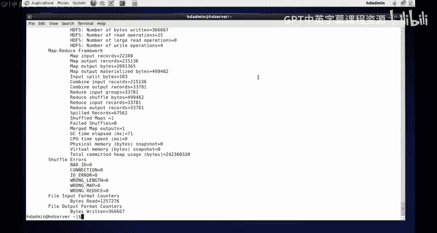

# 062：本地作业运行模式 🖥️


在本节课中，我们将学习如何在 Hadoop 客户端虚拟机中本地运行作业，而不是在 YARN 守护进程的控制下运行。这项技术在大数据程序开发和测试阶段非常有用。


## 概述

上一节我们介绍了在 YARN 集群上运行作业。本节中，我们来看看如何将 MapReduce 作业配置为在本地模式下运行，这对于开发和调试至关重要。

## 什么是本地作业运行模式？

可以本地运行一个 MapReduce 作业。这意味着整个 MapReduce 代码的执行都将在客户端进行。包含 `main` 方法的类，以及运行 `main` 方法的 JVM，MapReduce 代码也将在同一个虚拟机、同一个上下文中运行。

这项技术也被称为在**本地模式**或**独立模式**下运行 Hadoop MapReduce。

在这种情况下，无需运行所有守护进程，尤其是不需要运行 YARN 守护进程。不过，仍然需要运行 HDFS 守护进程。原因是你的 MapReduce 作业需要从 HDFS 读取数据以进行处理，并将结果写回 HDFS。但是，所有的 Mapper 和 Reducer 逻辑都将在客户端虚拟机内部运行。

这项技术极大地帮助了作业的本地开发和测试。

## 如何配置本地作业运行

有两种技术可以配置作业在本地运行。

以下是配置本地模式的第一种方法：

*   **修改配置文件**：进入 Hadoop 安装目录下的 `etc/hadoop` 文件夹，找到一个名为 `mapred-site.xml` 的文件。在这个文件中，最初有一个配置项 `mapreduce.framework.name`，其值被设置为 `yarn`。你需要将其值从 `yarn` 改为 `local`。完成此修改后，你就可以在本地模式下运行 Hadoop 了。

以下是配置本地模式的第二种方法：

*   **在代码中覆盖配置**：回想一下你使用的 `Configuration` 对象。你可以在你的 `main` 方法中，通过设置属性 `mapreduce.framework.name` 的值为 `local` 来覆盖默认配置。这样做会覆盖 `mapred-site.xml` 文件中的任何值，同样可以达到目的。

你可以选择使用第一种或第二种方法。

## 本地模式的优缺点


上一节我们介绍了如何配置本地模式，本节中我们来分析一下这种模式的优缺点。

**优点**：
*   简化开发过程，尤其是在集成开发环境中。现在，你可以简单地使用调试器逐步执行代码，观察 MapReduce 程序中业务逻辑的运行情况以进行调试。

**缺点**：
*   某些功能，特别是一些 MapReduce 功能无法工作。例如，在本地模式下**不能设置超过一个 Reducer**。
*   存在一个称为**分布式缓存**的概念，它允许你动态添加 JAR 文件以便在 Mapper 或 Reducer 中运行，还可以传递一些参考文件。这类分布式缓存功能在本地模式下无法工作。
*   由于所有任务都在单台机器上运行，没有并行化发生，因此一些分布式计算相关的错误可能无法被发现。所以，它非常适合测试功能和调试逻辑，但不允许你调试分布式计算功能。

## 演示：本地运行作业

现在，让我们通过一个演示来看看如何实际操作。

首先，我们以正常模式（在 YARN 守护进程控制下）运行一个 WordCount 程序。我们使用 `yarn jar` 命令来提交作业。

```bash
yarn jar WordCount.jar /input /output
```

作业成功运行后，我们可以在 ResourceManager 和 JobHistory Server 上看到相应的作业记录（例如 job 38）。

接下来，我们切换到本地模式。我们打开 `mapred-site.xml` 文件，将 `mapreduce.framework.name` 的值从 `yarn` 改为 `local`。

```xml
<property>
    <name>mapreduce.framework.name</name>
    <value>local</value>
</property>
```

在再次运行程序之前，我们需要清理之前的输出目录。然后，我们再次运行相同的 `yarn jar` 命令。

```bash
hadoop fs -rm -r /output
yarn jar WordCount.jar /input /output
```

此时，程序将在本地运行。你会注意到，它没有与 ResourceManager 进行任何通信。所有操作都在客户端虚拟机内完成。检查 ResourceManager 和 JobHistory Server，会发现没有新的作业记录（仍然只有 job 38），这证明了作业确实是本地运行的。

如果你能在 IDE 中运行此程序，你实际上可以对此整个过程进行调试，因为它完全在客户端的 JVM 内工作。



## 总结


本节课中，我们一起学习了如何在 Hadoop 客户端虚拟机中本地运行作业，而不是在 YARN 守护进程的控制下运行。这项技术在大数据软件开发和测试阶段提供了极大的便利，允许开发者在集成开发环境中高效地进行代码调试和功能验证。