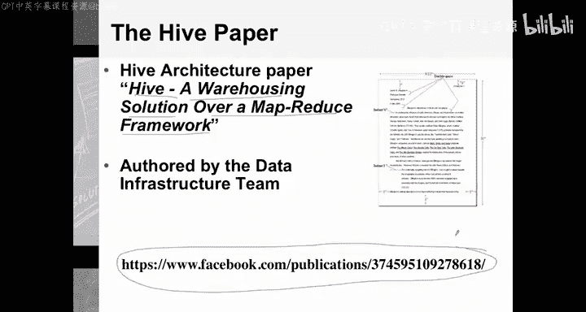
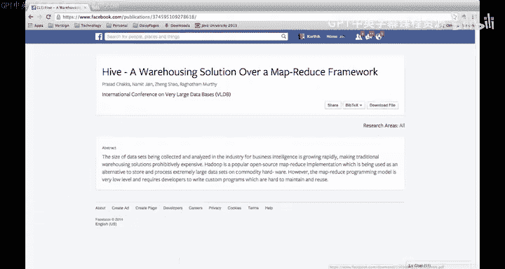
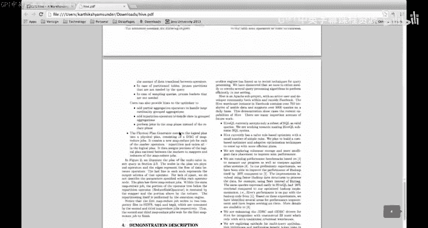
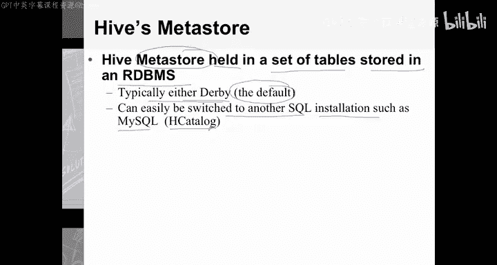
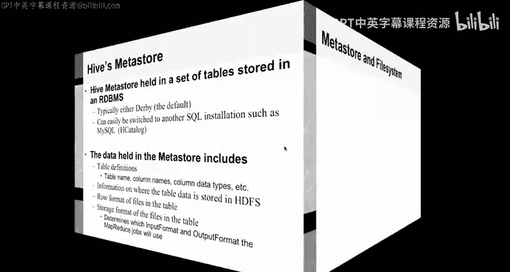
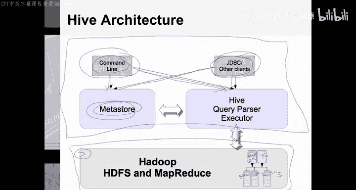

# 066：Hive 架构与核心概念 🐝

在本节课中，我们将学习 Apache Hive 的概述与架构。我们将了解 Hive 是什么、其诞生的动机、核心概念以及整体架构。

## 概述

Hive 是一个构建在 Hadoop 之上的数据仓库基础设施。它允许用户使用类似 SQL 的语言（HiveQL）进行查询处理、数据汇总和分析，从而简化了在 HDFS 上进行大数据处理的过程。

## MapReduce 的挑战

在过去的四周里，我们一直在学习 MapReduce 编程。但 MapReduce 本身存在一些挑战。

以下是 MapReduce 编程面临的主要挑战：

*   **编程难度高**：使用 Java 编写 MapReduce 程序很困难，需要开发者具备 Java 编程能力。
*   **编程范式不同**：MapReduce 的编程范式与传统结构化编程、面向对象编程或面向过程编程不同，需要理解 Map 和 Reduce 这种分布式计算模型。
*   **开发周期长**：编写 MapReduce 程序耗时较长。开发者需要使用 Hadoop API 编写代码，然后编译并运行。即使编写一个简单的计数程序（如单词计数），也需要数百行代码。

## Hive 的起源

上一节我们介绍了 MapReduce 的挑战，本节我们来看看 Facebook 如何应对这些挑战。

Facebook 需要一种方法，让非 Java 程序员（如数据科学家和数据分析师）能够访问 HDFS 中的数据以进行大数据分析。他们的目标用户是那些不懂 Java 编程语言的数据科学家和数据分析师。

为此，Facebook 开发了 Hive。Hive 是一种旨在满足数据分析师需求的语言。其核心理念是创建一种基于 SQL 的语言，因为数据科学家和数据分析师通常对传统数据仓库和 SQL 语言非常熟悉。这样，学习成本更低，使用更便捷，使得集群上的数据更容易访问和处理。如今，Facebook 和其他许多组织都广泛使用 Hive 进行数据分析。

## 什么是 Hive？

Hive 是一个构建在 Hadoop 之上的数据仓库基础设施。

它允许您进行查询处理（选择记录）、数据汇总（如聚合计算）以及数据分析工作。Hive 支持使用一种类似 SQL 的声明式编程语言（称为 HiveQL，即 Hive 查询语言）来表达查询。Hive 是 Apache 软件基金会管理的一个开源项目。

## Hive 核心概念

Hive 借鉴并重新诠释了关系数据库管理系统（RDBMS）中的概念。

以下是 Hive 中的核心概念及其与文件系统的映射关系：

*   **数据库**：用于保存一组表，解决命名冲突。在 Hive 中，一个数据库映射为 HDFS 中的一个目录。
*   **表**：一组具有相同模式（列定义）的行。在 Hive 中，一个表映射为数据库目录下的一个子目录。
*   **行**：包含一组列的单个记录。在 Hive 中，一行数据对应文件中的一行内容。
*   **列**：为单个值提供值和类型。在 Hive 中，列定义了文件中数据的结构。
*   **分区**：当表变得非常大时，可以将其分解为多个分区以便于数据管理。在 Hive 中，一个分区通常映射为表目录下的一个子目录。

Hive 的有趣之处在于，数据库、表、行、列和分区等概念都被映射为 HDFS 文件系统中的目录和文件。因此，我们在 RDBMS 中拥有的所有概念，在 Hive 中都以目录、子目录、文件及其内容的形式存在。

## Hive 与 RDBMS 的区别

Hive 不是一个 RDBMS。关系数据库管理系统（RDBMS）有许多优势：响应时间快（通常在毫秒级）、能处理数千个并发用户连接、支持修改现有记录以及支持 ACID（原子性、一致性、隔离性、持久性）事务。

**请理解，Hive 并没有将 Hadoop 转变为关系数据库管理系统。** 当您开始学习 Hive 概念并编写类似 SQL 的查询时，可能会感觉它像一个数据库，但它本质上并不是数据库。虽然有些人正尝试将 Hive 打造成类似 NoSQL 的数据库，但目前 Hive 还不是一个数据库。

## Hive 的工作原理

Hive 解释器将 HiveQL 查询转换为 MapReduce 程序。因此，每当您在 Hive 中编写一个 SELECT 语句时，它都会被转换成一个 MapReduce 程序。本质上，Hive 是编写 MapReduce 程序的一个高级抽象。

在极少数情况下，Hive 会绕过 MapReduce 直接从 Hadoop 获取数据。例如，如果您执行 `SELECT * FROM table` 且没有 WHERE 子句，Hive 可能会直接读取 HDFS 中的数据并输出。

但在几乎所有情况下，它都会将您的 SQL 转换为 MapReduce 程序。即使是一个简单的 Hive 查询也可能需要数秒或更长时间才能产生结果，因为您的 Hive 查询必须被翻译成 MapReduce 程序，然后该程序需要作为一个作业提交到集群执行。

Hive 主要用于查询，但也可以进行“更新”操作，这通常是通过向现有文件追加数据或添加新文件来实现的。我们将在后面看到 Hive 数据库和表如何映射到目录和文件，因此引入数据（即更新数据）实际上就是更新文件。

## Hive 与 RDBMS 的对比

让我们从语言、更新能力、事务、延迟、索引和数据规模等方面对比 Hive 和 RDBMS。

以下是详细的对比列表：

*   **语言**：
    *   **传统数据分析 (RDBMS)**：使用 SQL 92 标准。
    *   **大数据分析 (Hive)**：使用 SQL 92 的一个子集，并有一些 Hive 特定的扩展。请注意，并非所有 SQL 92 的功能都能在 HiveQL 中实现。
*   **更新能力**：
    *   **传统数据分析 (RDBMS)**：支持 INSERT、UPDATE、DELETE 语句。
    *   **大数据分析 (Hive)**：支持 `INSERT OVERWRITE`（用新数据集覆盖整个表），没有直接的 UPDATE 或 DELETE 能力。更新可以通过添加新文件或替换现有文件来实现。
*   **事务**：
    *   **传统数据分析 (RDBMS)**：支持 ACID 事务。
    *   **大数据分析 (Hive)**：不支持事务。
*   **延迟**：
    *   **传统数据分析 (RDBMS)**：亚秒级延迟（毫秒级）。
    *   **大数据分析 (Hive)**：可能需要数秒甚至数分钟，取决于 MapReduce 作业的规模。
*   **索引**：
    *   **传统数据分析 (RDBMS)**：可以创建多个索引，对性能至关重要。
    *   **大数据分析 (Hive)**：通常没有索引概念，数据总是被扫描（当然是通过 MapReduce 任务并行扫描）。在大数据场景下，全表扫描通常比维护索引更高效。
*   **数据规模**：
    *   **传统数据分析 (RDBMS)**：可以处理 TB 级数据，但在 TB 级以上表现不佳。
    *   **大数据分析 (Hive)**：可以处理 PB 级数据。

## Hive 架构论文

正如 Google 在 2003 年发表了 GFS 论文，2004 年发表了 MapReduce 论文一样，Facebook 的数据基础设施团队也发表了一篇关于 Hive 架构的论文，名为《Hive: A Warehousing Solution Over a MapReduce Framework》。您可以通过提供的 URL 找到这篇论文。论文的主要作者是 Ashish Thusoo，他也是 Hive 的主要架构师。论文涵盖了数据模型、表、分区、桶的概念、HiveQL 查询语言、如何将 HiveQL 转换为 MapReduce、Hive 架构、元存储等核心内容。这篇论文只有四页，强烈建议您阅读。

## Hive 执行流程

如前所述，Hive 将 HiveQL 语句转换为一组 MapReduce 作业，然后在 Hadoop 集群上执行。

假设您有一个 Hadoop 集群。您只需要在客户端机器上安装 Hive，然后使用 HiveQL 创建模式（即表），并执行 SELECT 语句。这些 SELECT 语句被提交给 Hive，Hive 将其转换为 MapReduce 作业。这些作业在 Hadoop 集群上执行，结果返回给客户端。这就是 Hive 的通用架构。

## Hive 元存储

Hive 有一个元存储（Metastore），它存储在一组关系数据库管理系统的表中。

默认情况下，Hive 元存储在 Derby 数据库中，但也可以存储在其他数据库（如 MySQL）中，或者存储在 Hadoop 目录（HCatalog）中。

在使用 Hive 之前，您需要创建数据库、表、列定义以及数据位置等信息。所有这些信息都存储在 Hive 的元存储中。

元存储中保存的数据包括：

*   **表定义**：表名、列名、列数据类型、所属数据库。
*   **数据位置**：表数据在 HDFS 中的存储路径。
*   **行格式**：表示表数据的文件行格式（如逗号或制表符分隔）。
*   **存储格式**：文件的存储格式，这决定了 MapReduce 作业将使用哪种输入/输出格式。因为 Hive 查询被转换为 MapReduce 程序，它需要知道如何读写数据。

元存储在后台为您工作。重要的是要理解它的存在，并且您所有的元数据信息都存储在那里。随着本模块的进行，您将看到如何创建模式，以及这些模式如何存储在本地 Derby 数据库的元存储中。

## 元存储与文件系统映射

Hive 将数据库定义映射为一个目录。当您执行 `CREATE DATABASE MyDB` 时，这实际上是在 HDFS 中创建一个目录。

Hive 将表定义映射为一个目录。当您执行 `CREATE TABLE blog` 或 `CREATE TABLE customer` 时，这实际上是在数据库模式目录内创建另一个子目录。

存储在元存储中的表定义描述了数据文件的布局。通常，表数据是使用逗号、制表符或其他字符分隔的文本文件。但您也可以使用二进制文件，如果这样做，则需要使用自定义的序列化/反序列化器（SerDe）。因此，您可以使用纯文本文件，也可以使用带有自定义 SerDe 的专用文件。

表定义保存在 Hive 的元存储中，默认情况下存储在当前文件夹下的 Derby 数据库中。实际上，在 Hive 中，一切都是 HDFS 目录和常规文件系统目录。

## Hive 执行环境

安装 Hive 后，您可以通过几种方式执行 Hive。

以下是 Hive 的几种执行环境：

*   **命令行界面**：有一个名为 `hive` 的命令。在命令提示符下输入 `hive` 并回车，您将进入 Hive 解释器，可以在其中编写 SELECT 语句。
*   **Web 界面**：可以配置 Hive 的 Web 界面。提供的链接指向了如何创建 Hive Web 界面的文档。
*   **JDBC 接口**：您可以使用 Java 数据库连接（JDBC）接口。换句话说，您可以编写使用 Hive JDBC 驱动程序的 Java 程序，通过 Hive 语法访问 HDFS 中的内容。这也是一项很酷的技术，此处提供了相关链接。

## 整体架构图

希望此时您对 Hive 架构有了一个很好的了解。

在 Hive 架构中，Hadoop 是其基础。您拥有作为主守护进程的 NameNode、ResourceManager 和 Secondary NameNode。在从节点（Slave Nodes）上，运行着 NodeManager 和 DataNode 守护进程。当然，History Server 也会运行在其中。

当您想使用 Hadoop 时，只需在客户端机器上安装 Hive。当您运行 Hive 命令行时，它首先会查询 Hive 元存储（以确保您使用了正确的列名和类型等），然后将您的查询提交给 Hive 解析器。Hive 解析器将您的 Hive 查询转换为 MapReduce 作业并提交。

因此，您的 Hadoop 集群是服务器端，而您的客户端可以是一个命令行界面（通过 Hive 查询解析器提交作业）、一个 Java JDBC 客户端（同样通过 Hive 查询解析器提交作业），或者是一个 Web 界面。无论您做什么，每当您在 Hive 中编写 SELECT 语句时，它们都会被转换为 MapReduce 作业，并且元存储会被查询以确保引用的列存在。

## 总结

在本节课中，我们一起学习了 Hive 的概述。我们了解到 Hive 是 Facebook 开发的一种高级编程范式，旨在帮助数据科学家和数据分析师访问和处理 HDFS 中的数据，而无需自己编写 MapReduce 程序。我们还了解到 Hive 借鉴了 RDBMS 系统中的许多概念，并将数据库、表、列等概念转换为 HDFS 中的目录、子目录和文件。我们学习了 Hive 查询语言（HiveQL）实际上是 SQL 92 查询语言的一个子集，并拥有自己的扩展，因此并非所有 SQL 92 的功能都能在 HiveQL 中实现。我们明确了 Hive 不是一个关系数据库管理系统，尽管它看起来像，但它不能执行事务和亚秒级查询。最后，我们了解到 Hive 构建在 Hadoop 之上，每当您编写 Hive 语句时，这些语句会查询元存储，然后将作业提交给 Hadoop 执行，结果返回给客户端。因此，安装 Hive 实际上就是建立了一个提供元存储访问以及将查询转换为 MapReduce 作业的 Hive 编译器和查询解析器的基础设施。