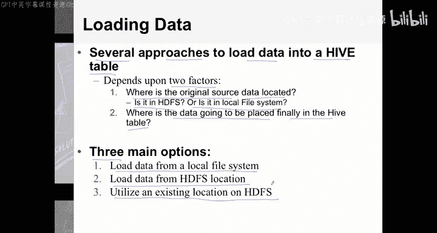
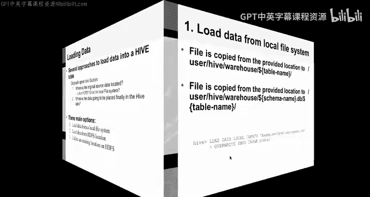
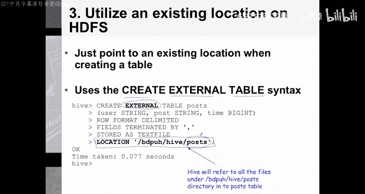
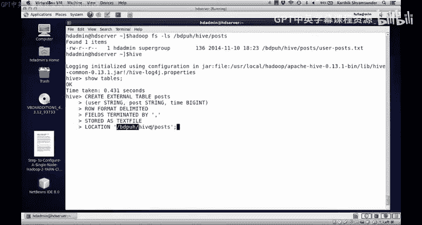
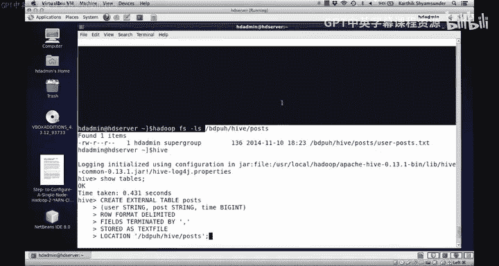
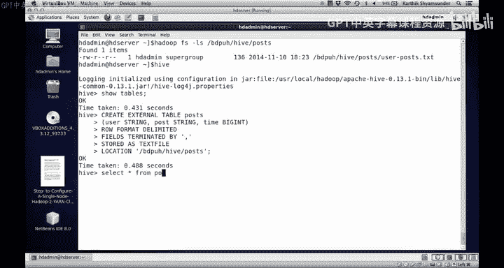

# 069：Hive 数据加载策略 🚚


在本节课中，我们将学习如何将数据加载到 Hive 表中。我们将探讨三种主要的数据加载方法，并了解每种方法适用的场景和具体操作。

数据加载到 Hive 表的方法主要取决于两个因素。第一个因素是原始数据的位置：数据文件是位于 HDFS 中，还是位于本地文件系统中。第二个因素是数据最终在 Hive 表中的存放位置。默认情况下，加载的数据会存放在 `/user/hive/warehouse/<表名>` 目录下。基于这两个考虑，我们主要有三种加载数据的选项。

---





## 选项一：从本地文件系统加载数据

首先，我们来看第一种方法：从本地文件系统加载数据。这种方法适用于数据文件最初存储在你的本地机器上。

假设数据文件位于本地文件系统的 `~/examples/hive/user_posts` 目录下。如果你想将这个文件加载到名为 `posts` 的 Hive 表中，可以使用以下语法：

```sql
LOAD DATA LOCAL INPATH ‘<input_path>’ INTO TABLE posts;
```

这里的 `LOCAL` 关键字表示源文件位于本地文件系统。`<input_path>` 可以是相对路径或绝对路径。执行此命令后，Hive 会将本地文件复制到 HDFS 的 `/user/hive/warehouse/posts` 目录下（如果表不属于任何特定数据库模式）。如果表属于某个数据库模式，则路径会变为 `/user/hive/warehouse/<schema_name>.db/<table_name>`。

---

## 选项二：从 HDFS 位置加载数据

上一节我们介绍了从本地加载数据，本节中我们来看看第二种方法：从 HDFS 位置加载数据。这种方法适用于数据已经存在于 HDFS 中的情况。

如果数据文件已经存储在 HDFS 中，例如路径为 `/bdp/hive/posts/user-posts`，你可以使用以下命令将其加载到 Hive 表：

```sql
LOAD DATA INPATH ‘<hdfs_file_path>’ INTO TABLE posts;
```

请注意，这里**没有** `LOCAL` 关键字，这表明路径指向的是 HDFS 文件。此命令会将 HDFS 中的指定文件复制到 Hive 表的仓库目录中（同样是 `/user/hive/warehouse/posts` 或相应的模式目录下）。

---

## 选项三：使用外部表指向现有数据



前面两种方法都涉及数据的复制操作。现在，我们来看第三种更高效的方法：创建外部表来指向 HDFS 中已存在的数据，而无需进行数据复制。

这种方法的核心是使用 `CREATE EXTERNAL TABLE` 语法。在创建表时，除了定义表结构，还需要指定数据在 HDFS 中的确切位置。以下是操作步骤：

1.  首先，确认数据已存在于 HDFS 的特定目录中，例如 `/bdp/hive/posts`。
2.  在 Hive 中，使用以下命令创建外部表：



```sql
CREATE EXTERNAL TABLE posts (
    -- 在这里定义你的列和数据类型
    ...
)
ROW FORMAT DELIMITED
FIELDS TERMINATED BY ‘,’ -- 根据你的数据格式修改
LOCATION ‘/bdp/hive/posts’;
```





`LOCATION` 子句指明了数据所在的 HDFS 目录。创建完成后，你可以直接查询这张表，Hive 会自动读取指定位置的数据。

使用外部表有两大优势：
*   **无需数据移动**：节省了复制数据的时间和存储开销。
*   **数据安全**：删除（`DROP`）外部表时，**只会删除表的元数据，而不会删除 HDFS 上的原始数据文件**。

相比之下，使用前两种 `LOAD DATA` 方式创建的表是内部表（Managed Table），删除内部表会同时删除表和其在 HDFS 上的数据。

为了更直观地理解，以下是一个简单的操作演示流程：

1.  登录 HDFS，查看已存在的数据目录和文件。
2.  启动 Hive。
3.  使用 `CREATE EXTERNAL TABLE` 语句创建指向该目录的表。
4.  执行 `SELECT * FROM posts;` 查询，验证可以直接访问数据。
5.  执行 `DROP TABLE posts;` 删除表。
6.  再次检查 HDFS，确认原始数据文件仍然存在。

这种方法体现了“数据湖”的一个核心思想：先将数据以原始格式组织存放在 HDFS 中，然后通过 Hive 等工具在其上创建元数据层（即外部表），从而实现通过 SQL 灵活查询，而无需改变数据本身的存储位置和格式。

---

## 总结

本节课中我们一起学习了三种将数据加载到 Hive 表的方法：
1.  **从本地文件系统加载**：使用 `LOAD DATA LOCAL ...`，数据从本地复制到 Hive 仓库。
2.  **从 HDFS 加载**：使用 `LOAD DATA ...`（无 LOCAL），数据在 HDFS 内部进行复制。
3.  **创建外部表**：使用 `CREATE EXTERNAL TABLE ... LOCATION`，直接指向 HDFS 现有数据，无需复制，且删除表时不删除数据。


理解这些策略有助于你根据数据的初始位置和管理需求，选择最高效、最安全的数据接入方式。