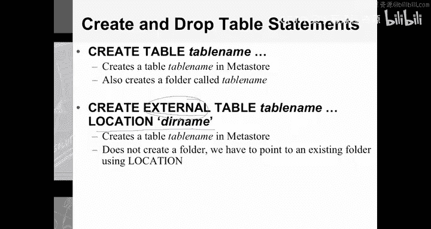
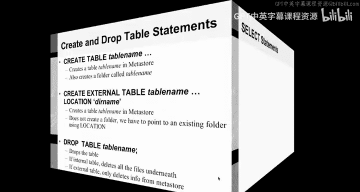
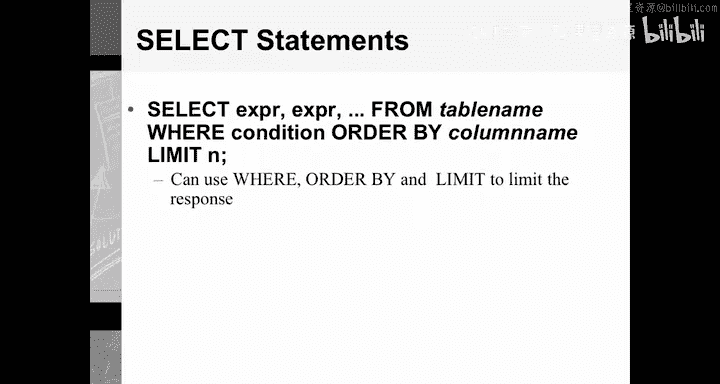
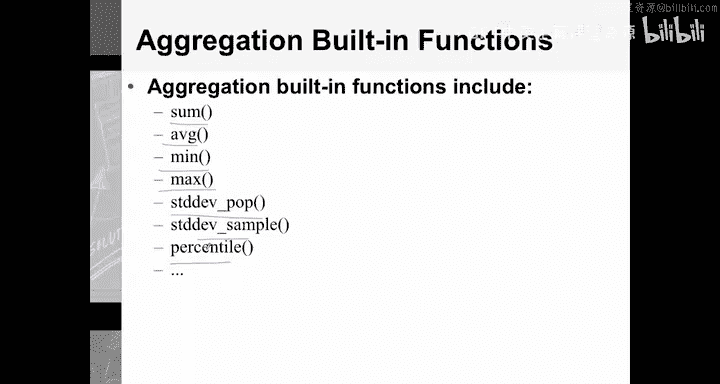
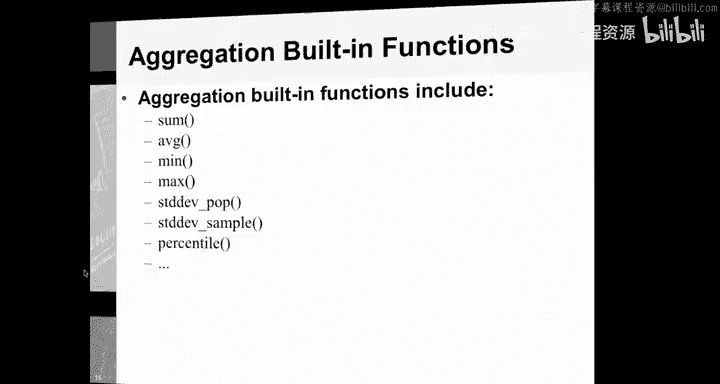

# 070：Hive语句解析 🗂️

## 概述

在本节课中，我们将学习Hive中的各种详细语句。主要内容包括如何创建和删除数据库、创建和删除表、修改表结构，以及如何使用SELECT语句和内置函数来查询Hive表。

---

## 创建与删除数据库 🗃️

就像在MySQL中可以有模式一样，在Hive中你也可以创建数据库或模式。创建数据库的方法是执行 `CREATE DATABASE` 命令，后跟数据库名称。

例如，执行 `CREATE DATABASE custDB` 会为“customer”创建一个数据库。这将在 `/user/hive/warehouse` 目录下创建一个名为 `custDB.db` 的文件夹。请注意 `.db` 的表示法，这就是数据库目录的名称。同时，也会在Derby元存储中创建一个对应名称的条目。

如果你想使用某个数据库，只需执行 `USE database_name`，这样你就进入了该特定模式或数据库的上下文中。之后，在该数据库内创建的所有表都会位于该数据库名称下的目录中。例如，如果你有一个名为 `table1` 的表，它将被创建在 `custDB.db` 目录内。

如果你没有任何数据库，Hive会使用默认数据库的概念。在这种情况下，表将直接创建在 `/user/hive/warehouse` 目录下。在前面的章节中，我有一些表但没有创建任何数据库，那时表就是直接创建在 `/user/hive/warehouse` 下的，这就是默认数据库。

你也可以删除一个数据库。执行 `DROP DATABASE` 命令会从元存储中删除数据库信息，同时也会删除对应的 `.db` 目录。但此命令只有在数据库为空时才能成功执行。换句话说，你只有在删除了数据库中的所有表之后，才能删除该数据库。这是出于保护目的。

---

## 创建与删除表 📊

你可以在Hive中创建表。我使用 `CREATE TABLE` 语法。我们在上一节已经介绍过 `CREATE TABLE` 的语法，这里只是想告诉你创建表是可行的。别忘了，你既可以创建内部表，也可以创建外部表。

在创建外部表时，你需要定义目录的位置。如果你已经以某种方式布置好了目录，并且所有文件都以特定方式出现，那么你可能希望使用外部表的方法。外部表的另一个优点是，当你删除表时，它不会删除与该表关联的文件夹。当然，正如我提到的，如果是内部表，删除表会删除其下的所有文件；如果是外部表，则只从元存储中删除信息，目录结构会得以保留。

我个人喜欢使用外部表。我将数据导入到正确的位置，然后简单地使用元存储来创建一个模式，或者在目录结构之上创建一个逻辑表，这样我就可以开始进行查询了。

---

## SELECT语句 🔍

SELECT语句用于从Hive表中查询记录，它与SQL 92标准非常相似，实际上是它的一个子集。

以下是SELECT语句的基本用法：

*   **选择特定列**：你可以使用 `SELECT expression1, expression2, expression3 FROM table_name`，其中表达式基本上是列名或列表达式。
*   **带WHERE条件**：你可以使用 `SELECT ... FROM ... WHERE ...` 来筛选记录。
*   **排序与限制**：你可以使用 `SELECT ... FROM ... WHERE ... ORDER BY ...` 进行排序。同时，由于在Hive中进行SELECT操作时，你可能要处理数百万甚至数十亿条记录，你可能只想获取前10条或前100条，这时可以使用 `LIMIT` 子句。
*   **分组**：你可以使用 `SELECT ... FROM ... GROUP BY ...` 对结果进行分组。
*   **选择所有列**：你可以使用 `SELECT * FROM table_name` 选择所有列。如果你还记得，执行 `SELECT *` 不会运行MapReduce作业，因为它认为这是一个简单的扫描操作，所以它只是扫描表并输出结果。

---

## ALTER语句 🔧

ALTER语句用于修改表定义，例如添加列、删除列，甚至更改列的类型。你可能需要查阅文档来了解如何修改表。顺便说一下，文档可以在线获取，你可以直接访问Hive网站查看所有语法。

---

## 数据类型与模式违规 ⚠️

以下是Hive中可用的不同列数据类型：

*   **整数类型**：`TINYINT`（1字节）、`SMALLINT`（2字节）、`INT`（4字节）、`BIGINT`（8字节）。你可能想用 `BIGINT` 来表示时间戳，当然也可以直接使用 `TIMESTAMP` 类型。
*   **浮点与双精度**：`FLOAT`、`DOUBLE`。
*   **字符串**：`STRING` 用于表示字符串。
*   **布尔类型**：`BOOLEAN`，取值为 `TRUE` 或 `FALSE`。

这里存在一个模式违规的问题：如果你尝试插入不符合预定义模式的数据会发生什么？考虑到在Hive中，当你向Hive表插入记录时，实际上只是将文件复制到一个目录中。而在关系数据库中插入记录时，会进行模式检查。但在Hive这里，没有进行模式检查。因此，完全有可能你定义了一个模式，但文件中的数据记录并没有真正遵循该模式。那么，当你尝试检索不遵循模式的记录时会发生什么？

这里有一个例子：我有一个表，表中的记录不一致。表中有 `userID`、`blogName` 和 `timestamp` 字段。在所有三种情况下，除了一个案例外，其他都正常。在那个异常案例中，时间戳是 `2012-01-05`，而不是使用某种Unix时间戳，它使用了 `YYYY-MM-DD` 格式，这是不正确的。

如果你对与此文件关联的 `post` 表执行 `DESCRIBE` 命令，你会注意到数据类型是 `STRING`、`STRING` 和 `BIGINT`。`timestamp` 列应该是 `BIGINT` 类型，但它不是一个 `BIGINT`，而是一个日期，所以这不是正确的列值。

但是，如果你在这种情况下执行 `SELECT * FROM post` 会发生什么？你会注意到它打印出了 `userID` 和 `blogName`，但对于 `timestamp`，它实际上打印出了 `NULL`。因此，每当模式被违反时，它实际上会在这种情况下打印 `NULL`，或者更准确地说，将其评估为 `NULL`。

我想说明的观点是，由于Hive的特性——你有一个模式，但你可以通过简单地复制坏记录来绕过模式并将记录插入表中——当你使用SELECT语句查询时，模式检查才会启动，此时它会将无效列转换为 `NULL`。

---

## 内置函数 🛠️

Hive还拥有多个内置函数。包括数值函数、字符串函数、条件函数、日期函数、聚合函数等。我用了“……”来表示还有很多种函数。

Hive还支持一种机制来提供用户定义函数。如果你不喜欢这里的任何函数，欢迎你用Java编写自己的用户定义函数，并将其作为Hive集合的一部分。

如果你有兴趣获取所有不同函数的完整列表，这里有一个链接，你可以访问它以获取所有函数的列表。

我想向你展示一些函数，以下是一些数值函数的例子：你可以进行四舍五入、取整、正弦、余弦、绝对值、平方根等，可以进行各种计算。这些函数可以应用于列。

还有字符串内置函数：获取字符串长度、连接两个字符串、转换为大写、转换为小写、修剪空格，你甚至可以进行正则表达式替换。

还有日期函数：你可以从Unix时间戳转换，转换为日期，从日期中提取年、月、日等。同样，我用了“……”表示还有更多函数。

然后是聚合函数：例如，求和、平均值、最小值、最大值、标准差、百分位数等，为数据科学活动提供了各种可用的函数。

---

## 总结

在本节中，我们学习了各种Hive详细语句，例如创建和删除数据库、创建和删除表、修改表结构。我们还学习了如何使用SELECT语句和内置函数来查询Hive表。