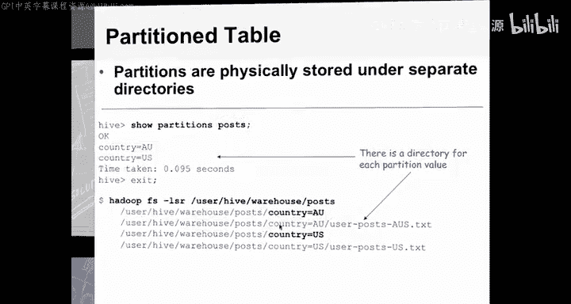

# 071：Hive 分区管理 🗂️


在本节课中，我们将学习如何在 Hive 中创建、管理以及使用分区。分区是一种优化大数据查询性能的重要技术，它通过将数据表划分为更小的、易于管理的片段来实现。

---

## 分区概述

为了提高查询性能，Hive 提供了将数据在表中进行分区的能力。分区列的值实际上将表划分为多个段，在查询时，可以忽略整个段或整个分区。这与关系数据库管理系统中的分区概念非常相似。

需要认识到，分区必须由用户正确创建。在插入数据时，必须指定数据所属的分区。在查询时，Hive 会尽可能自动过滤掉不需要的分区。

---

## 理解分区：一个示例场景

理解分区的最佳方式是通过一个场景。假设我们有一个名为 `posts` 的表，我们希望创建一个带分区的表。

以下是创建表的语句：

```sql
CREATE TABLE posts (
    user_id STRING,
    blog_post STRING,
    timestamp STRING
)
PARTITIONED BY (country STRING);
```

在 `CREATE TABLE` 语句和列定义之后，是分区部分。这里我们指定按 `country`（字符串类型）对这个表进行分区。

通常，分区是在列上创建的。虽然我们定义的列中没有名为 `country` 的列，但在 Hive 中，你可以将分区列 `country` 视为表的一个实际列。事实上，当你使用 `DESCRIBE posts;` 命令时，会看到它有 `user_id`、`blog_post`、`timestamp` 和 `country` 四个列。

如果你输入 `SHOW PARTITIONS posts;`（这是一个内置命令），会发现它没有显示任何分区。这表明我们知道它是一个分区表，但目前还没有任何分区。

---

## 向分区表插入数据

如前所述，用户在使用分区表时必须小心。当向分区表插入记录时，需要明确声明这些记录属于哪个特定分区。

例如，对于一个像 `posts` 这样的分区表，你不能简单地从本地文件系统加载数据。以下命令会报错：

```sql
LOAD DATA LOCAL INPATH '/path/to/data' INTO TABLE posts; -- 错误！
```

错误信息会提示你需要指定分区。这就是向分区表加载数据时需要特别注意的地方。

正确的方式是，你必须指定分区标识：

```sql
LOAD DATA LOCAL INPATH '/path/to/us_posts.txt'
OVERWRITE INTO TABLE posts
PARTITION (country='US');
```

这条命令表示，该特定文件中的所有记录都属于分区 `country='US'`。这里，`country` 是分区列名，`'US'` 是其值。

同样，我们可以加载另一个分区的数据：

```sql
LOAD DATA INPATH '/path/to/au_posts.txt'
OVERWRITE INTO TABLE posts
PARTITION (country='AU');
```

这样，我们就为 `posts` 表创建了另一组记录，这次是澳大利亚的博客文章。

现在，当你再次执行 `SHOW PARTITIONS posts;` 时，会看到有两个分区：`country=AU` 和 `country=US`。这正是我们通过分区加载插入的两组数据。

---

## 分区与目录的映射

一个有趣的现象是，当创建分区时，这些分区会被映射到目录中。回想一下，我们在介绍 Hive 时提到，Hive 将数据库的概念映射到目录、文件和文件内容。分区同样被映射到目录。

`posts` 表实际上是默认数据库的一部分，因此它出现在 `/user/hive/warehouse/posts` 目录下。但请注意，分区目录的名称就是“分区列名=值”的形式。

因此，数据（分区数据）所在的目录实际上是列名 `country` 等于其特定值。对于 `country='US'` 分区也是如此。我想强调的重点是：**分区本质上就是目录**，更具体地说，是你表目录下的子目录。

---

## 查询分区表



现在，当你查询分区表时，例如：

```sql
SELECT * FROM posts WHERE country='US' AND user_id='user1';
```

你的查询条件是 `country='US'`。由于我们知道 `country` 是一个分区列，这意味着包含所有美国博客文章的整个目录（及其所有文件）将在查询时被考虑。当为此作业运行 MapReduce 时，它不会将其他分区的文件作为 MapReduce 的输入。这极大地提高了查询效率，因为它避免了扫描不相关的数据。

---

## 本节总结


在本节课中，我们一起学习了 Hive 分区的核心概念。我们了解了分区如何被创建和管理为表的子文件夹，以及如何利用分区来提升大数据查询的性能。关键点包括：分区通过 `PARTITIONED BY` 子句创建，数据加载时必须指定目标分区，分区在物理上体现为 HDFS 上的目录结构，并且在查询时 Hive 可以利用分区信息进行高效的数据过滤。