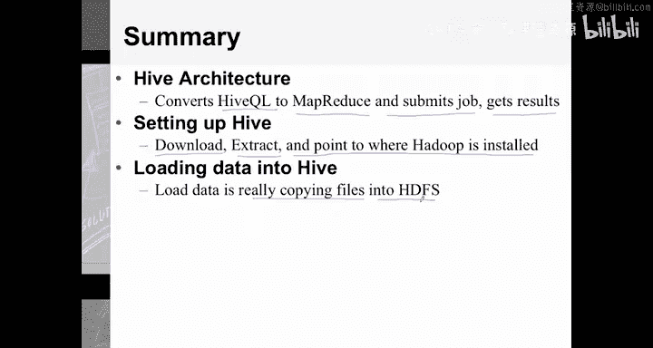

# 073：Hive模块总结 🎯


## 概述

在本节课中，我们将总结Hive的核心概念与操作。我们将回顾Hive的架构、数据加载方式、常用语句以及性能优化特性，帮助初学者系统理解Hive在大数据处理中的角色与使用方法。

---

## Hive架构概述 🏗️

上一节我们介绍了Hadoop平台的基础，本节中我们来看看Hive如何在其之上工作。

Hive架构将高级查询语言HiveQL转换为MapReduce程序，并将这些MapReduce程序作为作业提交到Hadoop集群进行处理，最终将结果返回给客户端。因此，Hive实质上是构建在Hadoop平台之上的一个数据仓库工具。

**核心转换流程**可概括为：
```
HiveQL → MapReduce程序 → Hadoop作业 → 处理结果 → 返回客户端
```

---

## Hive环境设置 ⚙️

设置Hive环境非常简单。

以下是基本步骤：
1.  下载Hive安装包。
2.  解压压缩包（tarball）。
3.  通过设置名为`HADOOP_PREFIX`的环境变量，指向Hadoop的安装目录。

**关键环境变量设置示例**：
```bash
export HADOOP_PREFIX=/path/to/your/hadoop/installation
```

---



## 数据加载到Hive 📥

将数据加载到Hive中是一个直接的过程。

主要有两种数据加载方式：
*   **从本地文件系统加载**：将文件复制到HDFS中。
*   **从HDFS直接加载**：如果数据已存在于HDFS中，可以直接指向HDFS中的数据路径，无需复制到特定文件夹。

---

## Hive语句与功能 📝

Hive提供了一系列类SQL的语句来操作数据和元数据。

以下是主要的Hive语句类型：
*   **数据库操作**：`CREATE` 和 `DROP` 语句用于创建和删除数据库。
*   **表操作**：`CREATE`、`DROP` 和 `ALTER TABLE` 语句用于创建、删除和修改表结构。
*   **数据查询**：`SELECT` 语句的多种变体，用于数据查询。虽然其功能不如SQL-92标准全面，但Hive 0.14.0版本提供了足够进行查询操作的子集。
*   **函数**：支持内置函数，也允许用户自定义函数（UDF）。
*   **表分区**：支持对表进行分区，主要出于性能优化的考虑。
*   **表连接**：支持执行内连接（INNER JOIN）和外连接（OUTER JOIN），默认的连接类型是内连接。

---

## 总结

本节课中我们一起学习了Hive模块的核心内容。我们了解到Hive是一个将HiveQL转换为MapReduce任务并在Hadoop上运行的架构。其环境配置简单，数据加载灵活。Hive提供了丰富的类SQL语句，包括数据定义、查询、函数以及分区和连接等高级功能，使得在Hadoop上进行数据分析变得更加便捷高效。