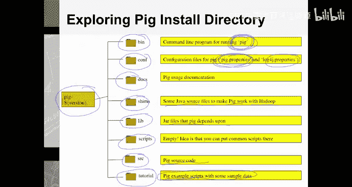
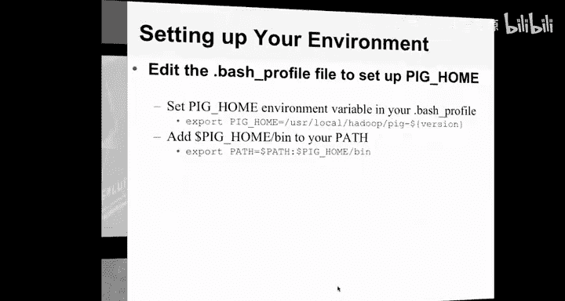
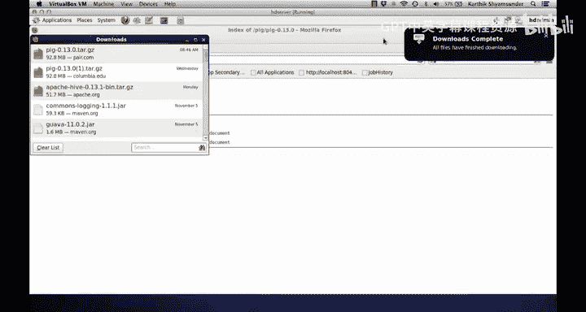
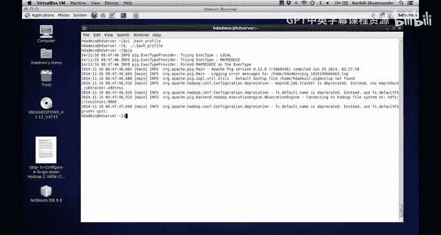

# 076：🐖 Pig环境配置教程


在本节课中，我们将学习如何下载、安装、配置并运行Apache Pig的命令行界面。Pig是一个用于分析大型数据集的高级平台，它简化了Hadoop MapReduce作业的编写过程。

---

## 🗂️ 下载Pig

首先需要下载Pig。Pig是Apache的开源项目，其官方网站是 `pig.apache.org`。

以下是下载Pig的两种主要方式：

1.  **通过官方网站下载**：
    *   访问 `pig.apache.org`。
    *   点击“Downloads”或“Releases”链接，进入下载页面。
    *   页面会引导至镜像站点，你可以从其中一个镜像站点下载最新版本的Pig。

2.  **通过Apache存档站点下载**：
    *   访问Apache存档站点 `archive.apache.org/dist/pig`。
    *   在此页面，你可以下载特定版本的Pig压缩包，例如 `pig-0.13.0.tar.gz`。版本号会随时间更新。

---

## 📦 安装Pig

安装Pig的过程非常简单，只需解压下载的压缩文件即可。

上一节我们介绍了如何下载Pig，本节中我们来看看如何安装。具体步骤如下：

1.  打开终端。
2.  切换到Hadoop的安装目录：`cd /usr/local/hadoop`。
3.  执行解压命令。假设压缩包下载在 `~/downloads` 目录下，命令如下：
    ```bash
    tar -zxvf ~/downloads/pig-0.13.0.tar.gz
    ```
    此命令会将Pig解压到 `/usr/local/hadoop/pig-0.13.0` 目录中。

---

## 🔍 探索Pig安装目录

安装完成后，建议浏览Pig的安装目录结构，以了解其组成部分。



以下是Pig安装目录下的主要文件夹及其作用：



*   **`bin/`**：包含名为 `pig` 的命令行工具，这是Pig的交互式Shell（Grunt）。
*   **`conf/`**：包含配置文件。
    *   `pig.properties`：用于配置Pig的各项属性。默认情况下，所有属性都被注释，你可以根据需要取消注释。
    *   `log4j.properties`：日志配置文件。
*   **`docs/`**：包含Pig的使用文档，对于学习Pig语言、脚本、命令和扩展类非常有帮助。
*   **`shims/`**：包含使Pig能与Hadoop协同工作的Java源代码。Pig是一种旨在与多种技术协作的数据流语言，而shims使其能够与Hadoop良好集成。
*   **`lib/`**：包含Pig Grunt Shell运行所依赖的JAR文件。
*   **`scripts/`**：初始为空。团队工程师可以将编写好的Pig脚本放在此目录，供其他人复用。
*   **`src/`**：包含Pig的源代码，可供查阅。
*   **`tutorial/`**：包含一些Pig示例脚本和样本数据，有助于更好地理解Pig语言。

---

## ⚙️ 配置环境变量

为了让系统能够识别并执行Pig命令，需要设置一些环境变量。

以下是需要配置的环境变量：

*   **`PIG_HOME`**：指向Pig的安装目录。
    ```bash
    export PIG_HOME=/usr/local/hadoop/pig-0.13.0
    ```
*   **`PATH`**：将Pig的 `bin` 目录添加到系统路径中，以便在终端直接使用 `pig` 命令。
    ```bash
    export PATH=$PATH:$PIG_HOME/bin
    ```

---

## 🔗 配置Pig与Hadoop通信


Pig脚本在底层需要与Hadoop通信以运行MapReduce作业，因此需要让Pig知道Hadoop的安装位置。

Pig主要通过以下两种方式定位Hadoop：

1.  **设置 `HADOOP_PREFIX` 环境变量**：这是推荐的方式，可以明确指定Hadoop的安装路径。Pig会据此查找Hadoop的配置文件（如 `etc/hadoop`），以确定NameNode和ResourceManager的位置。
    ```bash
    export HADOOP_PREFIX=/usr/local/hadoop
    ```
2.  **确保 `hadoop` 命令在系统路径中**：如果 `hadoop` 命令可以直接在终端执行，Pig会通过该命令的路径反向推导出Hadoop的主目录。

---



## 🖥️ 动手实践演示

现在，让我们通过一个实际的演示来巩固以上步骤。假设我们已登录到Hadoop虚拟机。

1.  **下载Pig**：访问 `pig.apache.org`，找到最新版本（如0.13.0）的 `tar.gz` 文件并下载。
2.  **安装Pig**：
    ```bash
    cd /usr/local/hadoop
    tar -zxvf ~/downloads/pig-0.13.0.tar.gz
    ```
3.  **配置环境变量**：编辑用户配置文件（如 `~/.bash_profile`），添加以下行：
    ```bash
    export PIG_HOME=/usr/local/hadoop/pig-0.13.0
    export HADOOP_PREFIX=/usr/local/hadoop
    export PATH=$PATH:$PIG_HOME/bin
    ```
    然后使配置生效：
    ```bash
    source ~/.bash_profile
    ```
4.  **验证安装**：在终端输入 `pig` 命令。如果成功，将进入Pig的Grunt Shell交互界面。输入 `quit;` 可退出。

---



## 📝 总结


本节课中我们一起学习了Apache Pig环境的完整配置流程。我们首先从官网下载了Pig安装包，然后将其解压到指定目录。接着，我们探索了Pig安装目录的结构，了解了各个文件夹的作用。之后，我们通过设置 `PIG_HOME` 和 `PATH` 环境变量使系统能够识别Pig命令。最后，我们配置了 `HADOOP_PREFIX` 环境变量，确保了Pig能够正确与Hadoop集群通信。完成这些步骤后，我们成功启动了Pig Grunt Shell，为后续编写和运行Pig脚本做好了准备。