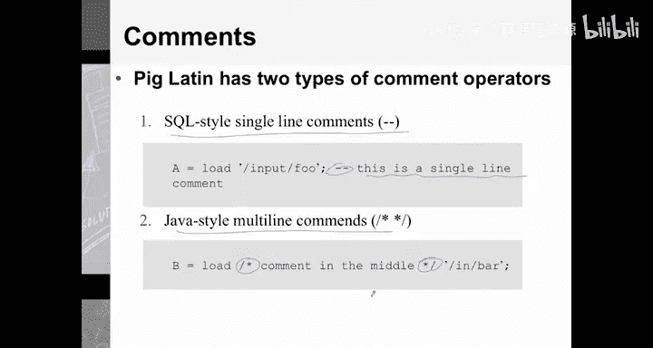
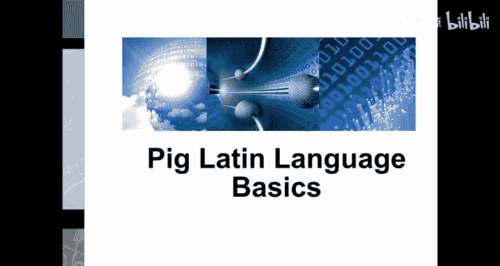

# 078：Pig Latin语言基础 🐷


在本节课中，我们将学习Pig Latin语言的基本构建块和结构。我们将重点了解其数据结构、语句、关系与字段的命名规则、注释、大小写敏感性，以及`DUMP`和`STORE`语句。


---

## 数据结构

首先，我们来了解Pig Latin的基本构建块。Pig Latin的核心数据结构包括Bag、Tuple和Field。

以下是这些概念的详细说明：

*   **Bag（包）**：Bag是元组（Tuple）的集合。你可以将其类比为数据库中的一张表。Bag用花括号 `{}` 表示。例如：`{ (tuple1), (tuple2) }`。
*   **Tuple（元组）**：Tuple是一组有序的字段（Field），类似于数据库表中的一行记录。元组用圆括号 `()` 表示。例如：`(field1, field2, field3)`。
*   **Field（字段）**：Field是数据的基本单元，可以是一个整数、浮点数、字符串或布尔值。它类似于数据库表中的一列。

Pig的数据结构与关系型数据库有相似之处，但也有一个关键区别：Bag中的不同Tuple可以包含不同数量的字段，这比要求所有行结构必须相同的传统数据库表更为灵活。

---

## 语句与命令

上一节我们介绍了数据结构，本节中我们来看看Pig Latin的语句。Pig Latin是一种数据流语言，每个处理步骤都会产生一个新的数据集，我们称之为“关系”。

关系名用于标识一个数据集，字段名则标识关系中的列。请看以下示例：

```pig
input = LOAD ‘input/data.txt’ AS (letter:chararray, age:int);
input = FILTER input BY age > 18;
```

第一条语句将文件加载到一个名为`input`的关系中，并定义了两个字段`letter`和`age`。第二条语句对`input`关系进行过滤，并将结果重新赋值给同一个关系名`input`。

需要注意的是，虽然可以重用关系名，但最佳实践是为每个新的关系使用不同的名称（例如`adults`），以提高代码的可读性。

---

## 关系名与字段名的命名规则

在编写Pig Latin语句时，为关系和字段命名需要遵循特定规则。

以下是命名时必须遵守的规则：



*   名称必须以字母开头。
*   后续字符可以是零个或多个字母、数字或下划线（`_`）。
*   所有字符必须是ASCII字符。

这与其他编程语言中变量名的命名规则非常相似。

---

## 注释

为了代码的可读性和维护性，在Pig Latin中添加注释是一个好习惯。

Pig Latin支持两种注释风格：

*   **SQL风格单行注释**：使用双连字符 `--`，其后的内容直到行尾都会被视作注释。
*   **Java风格多行注释**：使用 `/*` 和 `*/` 包裹注释内容，注释可以跨越多行。

---

## 大小写敏感性

在Pig Latin中，不同元素对大小写的敏感性不同，理解这一点很重要。

以下是关于大小写敏感性的具体规则：

*   **关键字不区分大小写**：例如`LOAD`、`USING`、`AS`、`GROUP BY`、`FOREACH`、`GENERATE`等关键字，无论使用大写还是小写都可以。但通常我们约定俗成使用大写形式。
*   **关系名区分大小写**：例如`A`、`B`、`C`作为关系名时，`A`和`a`是不同的。
*   **字段名区分大小写**：例如`F1`、`F2`作为字段名时，`F1`和`f1`是不同的。
*   **函数名区分大小写**：例如内置函数`PigStorage()`和`COUNT()`，必须按照正确的大小写形式书写。

---

## DUMP与STORE语句

我们之前学习了如何定义数据处理步骤，但Pig Latin具有“惰性执行”的特性。这意味着，直到遇到`DUMP`或`STORE`这类“动作语句”时，真正的MapReduce作业才会被触发和执行。

`DUMP`命令用于将关系的内容输出到屏幕，通常用于调试和查看小规模样本数据。为了避免输出过多数据，可以结合`LIMIT`操作符使用。

```pig
records = LOAD ‘input/data.txt’ AS (name:chararray, age:int);
limited_records = LIMIT records 5;
DUMP limited_records; -- 只打印前5条记录
```

`STORE`命令用于将最终结果持久化存储到HDFS或HBase等系统中，这是处理大规模数据时的标准做法。当执行`STORE`命令时，Pig会构建一个“有向无环图”（DAG）来优化整个处理流程，生成并提交相应的MapReduce作业。

---

## 总结

本节课中，我们一起学习了Pig Latin语言的基础知识。

我们首先了解了其核心数据结构：**Bag**（元组的集合，类似表）、**Tuple**（有序字段集，类似行）和**Field**（数据单元，类似列）。接着，我们学习了Pig Latin的语句和命令，以及关系名和字段名必须遵循的命名规则。我们还知道了如何添加注释，并明确了关键字不区分大小写，而关系名、字段名和函数名区分大小写。最后，我们探讨了`DUMP`和`STORE`这两个关键的动作语句，正是它们触发了Pig作业的实际执行，将逻辑计划转化为物理的MapReduce任务。



掌握这些基础知识，是后续编写复杂Pig Latin脚本进行大数据处理的必要前提。