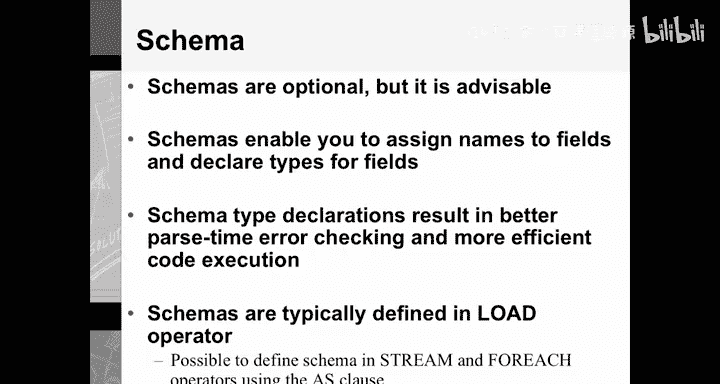
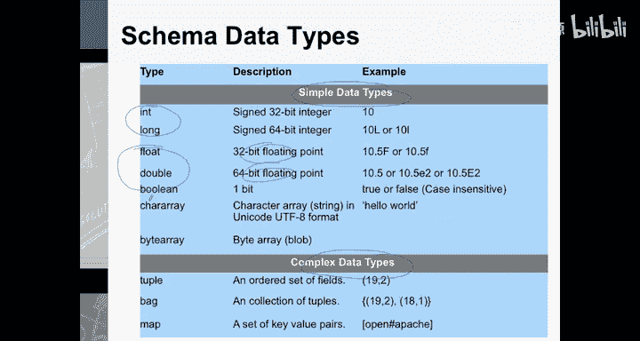
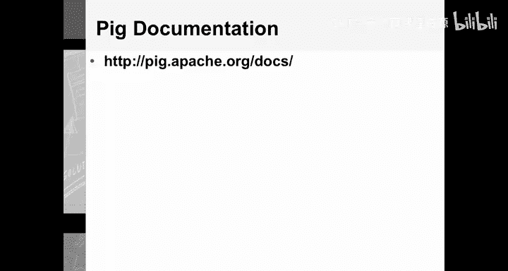
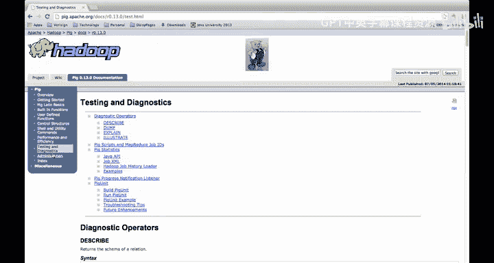

# 079：Hadoop大数据处理｜Big Data Processing Using Hadoop
## 课程编号：P79
## 章节标题：Pig数据类型与模式定义 📚


在本节课中，我们将要学习Apache Pig中的数据类型与模式定义。我们将了解Pig支持的各种简单和复杂数据类型，以及如何为数据定义模式。虽然模式在Pig中是可选的，但定义模式有助于更高效、更准确地进行数据处理。

### 模式概述



上一节我们介绍了Pig的基本概念，本节中我们来看看Pig中的模式定义。模式在Pig中是可选的，但建议使用。模式允许你为字段分配名称，并为每个字段声明类型，从而让你能够通过应用适当的函数来操作数据。



模式类型声明实际上能带来更好的运行时错误检查，因为当你拥有模式类型时，就可以验证某些值和数据。此外，始终将数据作为整数使用比作为字符串使用效率更高。模式通常在加载操作符中定义。你也可以在流中（即文件本身内）定义模式，或者使用`FOREACH`操作符的`AS`子句动态定义模式，但最常见的是在加载操作符中定义模式。

### 简单数据类型

以下是Pig支持的简单数据类型：

*   **整型**：`int`（4字节）和`long`（8字节）。
*   **浮点型**：`float`（4字节）和`double`（8字节）。
*   **布尔型**：`boolean`（1位）。
*   **字符数组**：`chararray`，即字符串。
*   **字节数组**：`bytearray`，用于表示二进制大对象（BLOB），如图像数据或其他二进制数据。

### 复杂数据类型

在简单数据类型的基础上，Pig还支持三种复杂数据类型：

*   **元组**：类似于记录，用括号`()`表示，字段间用逗号分隔。
*   **包**：元组的集合，用花括号`{}`表示，包内的元组用逗号分隔。
*   **映射**：键值对的组合，用方括号`[]`表示，键值对格式为`键#值`，对之间用逗号分隔。

### 数据类型示例

让我们通过一个简单的示例来理解如何定义模式。假设有一个名为`sfields.dat`的文件，内容如下（字段间以制表符分隔）：

```
James Bond    1950    200000.0    true
Inor Gadget   1960    123.0       false
```

我们可以使用以下Pig Latin语句加载数据并定义模式：

```pig
A = LOAD 'sfields.dat' AS (name:chararray, year:int, salary:float, married:boolean);
```

在这个例子中，我们为四个字段分别定义了名称和类型：`name`是字符串，`year`是整数，`salary`是浮点数，`married`是布尔值。加载后，关系`A`中的每条记录都是一个元组。

### 常量表示

Pig中的常量表示如下：

*   **整型常量**：例如 `19`
*   **长整型常量**：例如 `19L`
*   **浮点数/双精度常量**：例如 `19.5` 或 `19.5F`、`19.5D`
*   **字符数组（字符串）常量**：用单引号表示，例如 `'hello'`
*   **字节数组常量**：例如 `0xFF`
*   **布尔常量**：`true` 或 `false`
*   **元组常量**：`(‘John’, 25)`
*   **包常量**：`{(‘John’, 25), (‘Jane’, 30)}`
*   **映射常量**：`[‘name’#‘John’, ‘age’#25]`

### 内置函数

Pig提供了丰富的内置函数库，可以方便地对数据进行处理。以下是主要的内置函数类别：

*   **数学函数**：例如 `ABS`（绝对值）、`COS`（余弦）、`SIN`（正弦）、`LOG`（对数）等。
*   **字符串函数**：例如 `UPPER`（转大写）、`LOWER`（转小写）、`SUBSTRING`（取子串）、`TRIM`（去除空格）等。
*   **评估与聚合函数**：这些函数对集合进行操作，例如 `AVG`（平均值）、`CONCAT`（连接）、`COUNT`（计数）、`MAX`（最大值）、`MIN`（最小值）、`SUM`（求和）等。
*   **加载与存储函数**：用于从文件系统加载数据或将数据存储回文件系统，例如 `PigStorage`（处理结构化文本）、`BinStorage`（二进制格式）、`JsonLoader`/`JsonStorage`（JSON格式）等。
*   **元组、映射与包函数**：例如 `TOTUPLE`、`TOMAP`、`TOBAG`等用于数据类型转换的函数。

所有内置函数的详细列表和用法可以在Apache Pig的官方文档中找到。

### 用户自定义函数



如果内置函数无法满足你的特定需求，Pig允许你创建用户自定义函数。你需要编写一个实现特定接口（如`EvalFunc`）的Java类，重写相关方法，将其编译并打包成JAR文件。然后，通过设置环境变量`PIG_CLASSPATH`指向该JAR文件，并在Pig脚本中使用`REGISTER`命令注册后，即可像使用内置函数一样使用你的自定义函数。

用户自定义函数与内置函数的主要区别在于：
1.  内置函数无需注册，Pig已知其位置。
2.  内置函数在使用时无需限定，而UDF需要先注册。

### 官方文档



Apache Pig提供了非常全面的官方文档，地址是：**https://pig.apache.org/docs/**。文档中包含了入门指南、Pig Latin语法详解、所有操作符和函数的说明、编写UDF的教程以及性能调优等信息，是学习和解决问题的重要资源。

### 总结

本节课中我们一起学习了Apache Pig的核心组成部分——数据类型与模式定义。我们了解到Pig支持包括整型、浮点型、字符串在内的简单数据类型，以及元组、包和映射这三种复杂数据类型。虽然模式定义是可选的，但它能提升代码的清晰度、执行效率和错误检查能力。此外，我们还探讨了Pig丰富的内置函数库以及如何通过编写用户自定义函数来扩展其功能。掌握这些基础知识，是编写高效、可靠的Pig Latin脚本来处理大规模数据集的关键。