# 081：Pig 中的关系型联结运算符解析 🧩


在本节课中，我们将学习如何在 Apache Pig 中执行关系型联结操作。我们将介绍两种主要的联结运算符：`JOIN` 和 `CROSS`，并详细探讨 `JOIN` 的各种类型，包括内联结和外联结。

---

## 关系型联结运算符概述

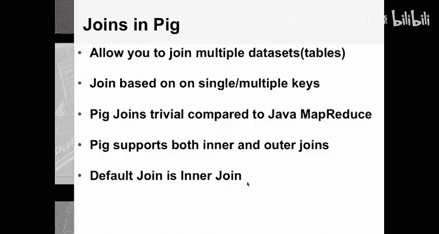

Pig 提供了两种关系型联结运算符。第一种是 `JOIN`，它类似于传统关系型数据库和 Hive 中的联结操作，允许你将两个数据集合并。你可以执行内联结或外联结，而外联结又分为左外联结、右外联结和全外联结三种变体。

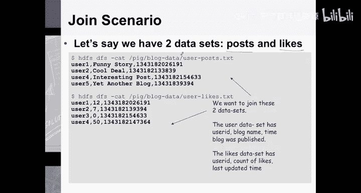

第二种运算符是 `CROSS`，它允许你在两个不同的数据集之间执行笛卡尔积，你可以将其理解为矩阵的乘法运算。

---

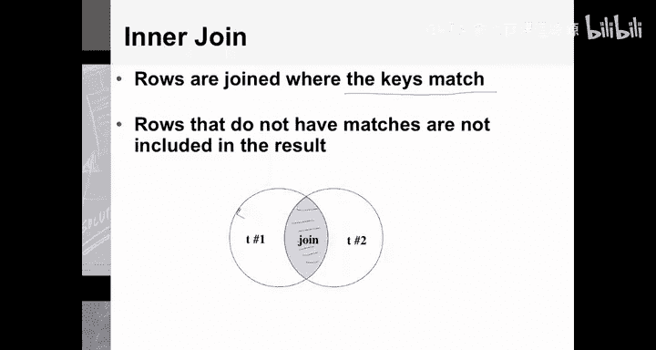

## Pig 中的 JOIN 操作

Pig 中的 `JOIN` 操作允许你联结多个数据集。在传统数据库管理系统中，我们称它们为“表”，而在 Pig 中，我们称之为“数据集”。联结可以基于单个或多个键进行，Pig 同时支持这两种概念。

与复杂的 MapReduce 联结相比，Pig 的联结操作非常简单，甚至比 Hive 的联结还要简洁。Pig 支持内联结和外联结，默认的联结类型是内联结。

### 内联结示例

让我们来看一个联结场景。假设我们有两个数据集：`posts`（帖子）和 `likes`（点赞）。`posts` 数据集包含用户ID、博客名称和发布时间。`likes` 数据集包含用户ID、点赞数和点赞的最后更新时间。

我们的目标是将这两个数据集联结起来。内联结是指只联结键值匹配的行，不匹配的行不会包含在结果集中。

以下是一个演示内联结的 Pig 脚本 `innerjoin.pig`：

```pig
-- 加载 posts 数据集
posts = LOAD '/pig/blog_data/user_posts.txt' USING PigStorage(',') AS (user:chararray, post:chararray, date:long);

-- 加载 likes 数据集
likes = LOAD '/pig/blog_data/user_likes.txt' USING PigStorage(',') AS (user:chararray, likes:int, date:long);

-- 基于 user 字段执行内联结
user_info = JOIN posts BY user, likes BY user;

-- 输出结果
DUMP user_info;
```

执行此脚本后，结果将只包含两个数据集中 `user` 字段匹配的记录（例如用户1、2、4）。结果数据集是这两个数据集字段的并集。

你可以使用 `DESCRIBE` 操作符来查看数据集的模式。例如，`DESCRIBE user_info;` 会显示新数据集的模式，其字段名会以原始关系名（如 `posts::user`）作为前缀。

### 基于多键的联结

你也可以基于多个键进行联结。在下面的例子中，我们基于 `user` 和 `date` 两个字段来联结 `posts` 和 `likes`：

```pig
user_info_multi = JOIN posts BY (user, date), likes BY (user, date);
```

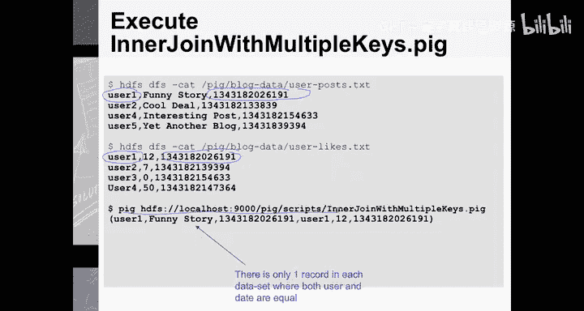

这意味着只有当两个数据集中的用户ID和日期都匹配时，记录才会被联结。根据示例数据，可能只有一条记录满足条件。


---

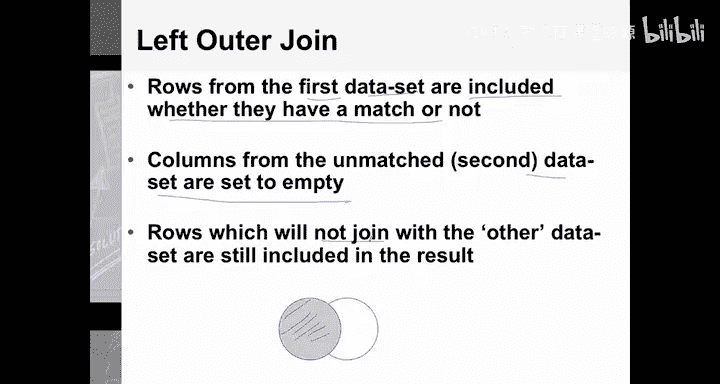

## 外联结操作

上一节我们介绍了内联结，本节中我们来看看外联结。Pig 支持三种类型的外联结：左外联结、右外联结和全外联结。

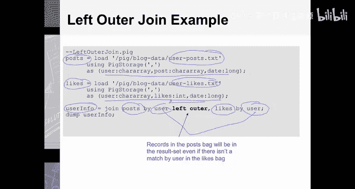

### 左外联结

在左外联结中，第一个数据集（左侧）的所有行都会被包含在结果中，无论它们在第二个数据集中是否有匹配项。对于没有匹配的行，来自第二个数据集的列将被设置为空（NULL）。

以下是左外联结的示例脚本：

```pig
user_info_left = JOIN posts BY user LEFT, likes BY user;
DUMP user_info_left;
```

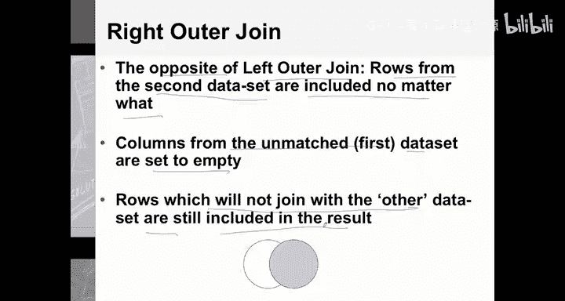

执行后，`posts` 数据集中的所有用户（1, 2, 4, 5）都会出现。用户1、2、4会与 `likes` 中的匹配记录联结，而用户5没有匹配项，其对应的 `likes` 字段将为空。

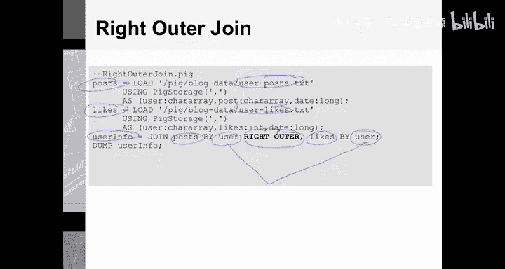

### 右外联结

右外联结与左外联结相反。第二个数据集（右侧）的所有行都会被包含在结果中，无论它们在第一个数据集中是否有匹配项。对于没有匹配的行，来自第一个数据集的列将被设置为空。

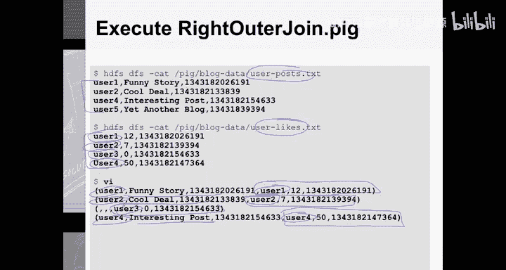

以下是右外联结的示例脚本：

```pig
user_info_right = JOIN posts BY user RIGHT, likes BY user;
DUMP user_info_right;
```

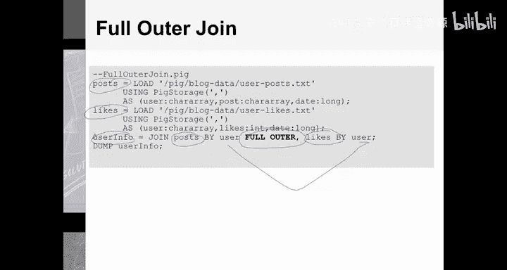

执行后，`likes` 数据集中的所有用户（1, 2, 3, 4）都会出现。用户1、2、4会与 `posts` 中的匹配记录联结，而用户3没有匹配项，其对应的 `posts` 字段将为空。

### 全外联结

全外联结会包含两个数据集中的所有行。对于匹配的行，两个数据集的数据都会显示；对于不匹配的行，来自另一个数据集的列将被设置为空。

以下是全外联结的示例脚本：

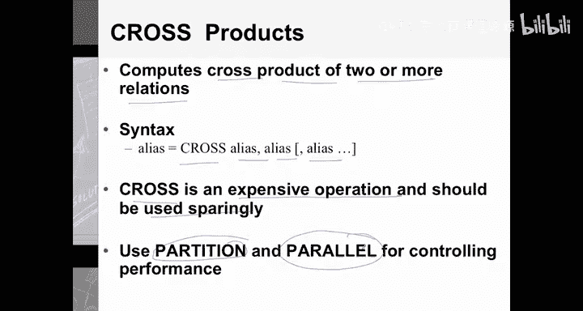

```pig
user_info_full = JOIN posts BY user FULL, likes BY user;
DUMP user_info_full;
```

执行后，结果将包含所有五个用户（1, 2, 3, 4, 5）的记录，并在没有匹配的地方填充空值。

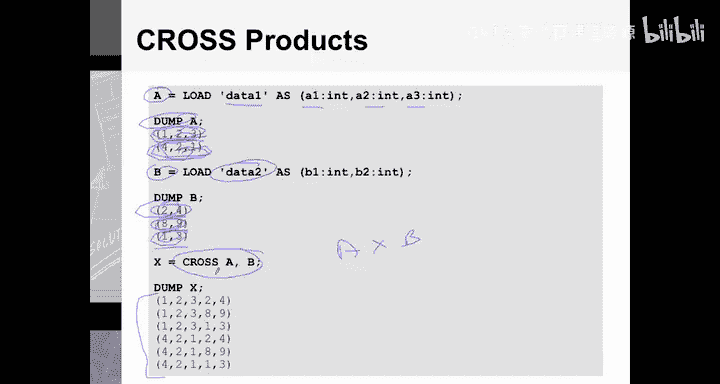


---

## CROSS 操作（笛卡尔积）

除了 `JOIN`，另一个关系型联结运算符是 `CROSS`。它计算两个或多个关系的笛卡尔积。这是一个计算开销很大的操作，应谨慎使用。

以下是 `CROSS` 操作的一个简单示例：

```pig
A = LOAD 'data1.txt' AS (a1:int, a2:int, a3:int);
B = LOAD 'data2.txt' AS (b1:int, b2:int);
X = CROSS A, B;
DUMP X;
```

假设 `A` 有记录 (1,2,3)，`B` 有记录 (2,4) 和 (8,9)，那么 `X` 将包含 `A` 中每条记录与 `B` 中每条记录组合的结果，即 (1,2,3,2,4) 和 (1,2,3,8,9)。

---

## 动手演示

现在，让我们在 Pig Grunt shell 中进行实际操作演示。首先，登录到你的 Hadoop 环境并启动 Pig。

1.  查看数据文件：
    ```bash
    hadoop fs -ls /pig/blog_data/
    hadoop fs -cat /pig/blog_data/user_posts.txt
    hadoop fs -cat /pig/blog_data/user_likes.txt
    ```

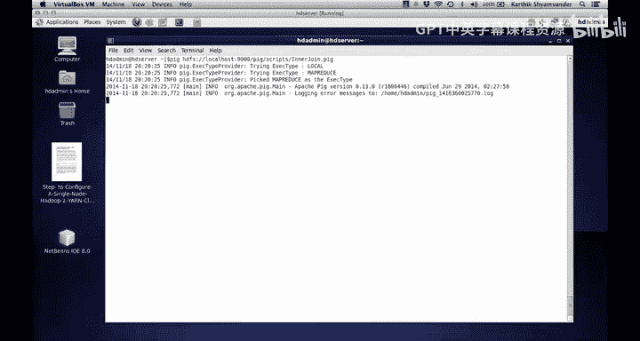

2.  进入 Pig Grunt shell：
    ```bash
    pig
    ```

3.  在 Grunt shell 中，你可以逐行输入前面章节的脚本命令来执行内联结、外联结等操作。例如，输入加载数据和执行内联结的命令。
4.  你也可以直接在命令行运行写好的 Pig 脚本文件：
    ```bash
    pig -x mapreduce hdfs://localhost:9000/pig/scripts/innerjoin.pig
    pig -x mapreduce hdfs://localhost:9000/pig/scripts/leftouterjoin.pig
    ```

通过观察不同联结操作的输出，你可以直观地理解它们之间的区别。

---

## 总结

本节课中，我们一起学习了 Apache Pig 中用于联结数据集的两个核心关系型运算符。

*   **`JOIN` 运算符**：用于基于一个或多个键合并数据集。它支持：
    *   **内联结**：默认类型，只返回键匹配的行。
    *   **外联结**：包括左外联结、右外联结和全外联结，分别用于保留左侧、右侧或两侧数据集的所有行。
*   **`CROSS` 运算符**：用于计算两个数据集的笛卡尔积，但由于其计算成本高，需谨慎使用。


Pig 的联结语法简洁高效，通过 `DESCRIBE` 命令可以清晰地查看联结后新数据集的模式。掌握这些联结操作是进行复杂数据分析的基础。