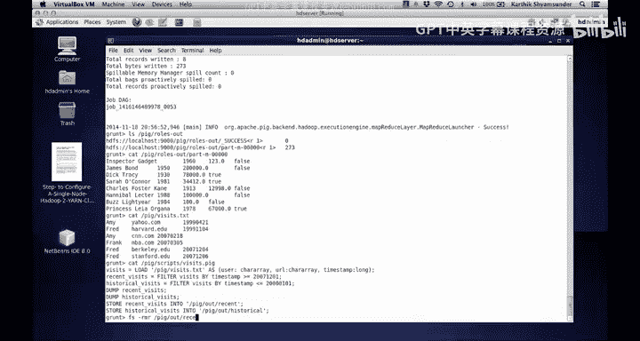

# 082：调试运算符应用 🐛


在本节课中，我们将学习Pig Latin中的四个调试运算符：`DESCRIBE`、`DUMP`、`ILLUSTRATE`和`SAMPLE`。这些工具对于开发和调试Pig脚本至关重要，能帮助你理解数据结构、查看执行流程以及在小数据集上测试程序逻辑。

---

## 概述

调试是数据处理流程中不可或缺的一环。Pig Latin提供了几个内置的调试运算符，它们能让你在不运行完整MapReduce作业的情况下，检查数据模式、查看数据样本、理解数据转换步骤。本节将详细介绍这四个运算符的用法和最佳实践。

---

## 1. DESCRIBE 运算符

`DESCRIBE` 运算符用于查看关系（Relation）的模式（Schema）。它返回关系中各个字段的名称和数据类型。

**语法**：
```pig
DESCRIBE relation_name;
```

例如，加载一个包含角色信息的文件并指定其模式：
```pig
roles = LOAD '/pig/fields.txt' AS (name:chararray, year_of_birth:int, salary:float, married:boolean);
```
执行 `DESCRIBE roles;` 后，会显示类似以下的模式信息：
```
roles: {name: chararray, year_of_birth: int, salary: float, married: boolean}
```
这有助于你确认数据加载是否正确，并了解每个字段的数据类型。有时数据文件可能关联了Avro模式，此时即使加载时不指定模式，`DESCRIBE` 也能从Avro文件中读取并显示模式信息。

---

## 2. DUMP 运算符

`DUMP` 运算符用于将关系的内容输出到屏幕。它会触发Pig脚本的执行，并运行相应的MapReduce作业来获取结果。

**语法**：
```pig
DUMP relation_name;
```

例如，执行 `DUMP roles;` 会将 `roles` 关系中的所有记录打印到控制台。

**重要注意事项**：
*   `DUMP` 主要用于交互式开发和调试。它会立即执行语句，但结果不会持久化保存。
*   在**生产脚本中应避免使用 `DUMP`**。因为它会强制Pig执行MapReduce作业来输出结果，这会破坏Pig的整体执行计划优化（如多查询执行），可能导致脚本运行变慢。如果你需要持久化输出，应该使用 `STORE` 命令将结果保存到HDFS目录中。

---

## 3. ILLUSTRATE 运算符

`ILLUSTRATE` 是一个非常强大的调试工具。它能展示一系列Pig语句的逐步执行过程。该运算符会从输入数据中抽取一个小样本，并让这个样本数据流经整个处理管道，从而让你直观地看到每一步数据转换的结果。

**语法**：
```pig
ILLUSTRATE alias; -- 对单个关系进行图示
ILLUSTRATE -script script_file.pig; -- 对整个脚本文件进行图示
```

**示例**：
假设有一个Pig脚本 `visits.pig`，其功能是根据时间戳将网站访问记录分为“近期访问”和“历史访问”两部分。
```pig
visits = LOAD '/pig/visits.txt' AS (user:chararray, site:chararray, ts:int);
recent_visits = FILTER visits BY ts >= 20071201;
historical_visits = FILTER visits BY ts < 20071201;
STORE recent_visits INTO '/pig/out/recent';
STORE historical_visits INTO '/pig/out/historical';
```
通过执行 `ILLUSTRATE -script visits.pig`，Pig会展示：
1.  从 `visits` 关系中抽取的几条样本数据。
2.  经过 `FILTER` 操作后，`recent_visits` 和 `historical_visits` 分别包含哪些样本记录。
3.  最终数据如何被 `STORE` 到不同目录。

这种方式让你能在处理海量数据前，先用极小数据集验证业务逻辑的正确性。


---

## 4. SAMPLE 运算符

`SAMPLE` 运算符用于从关系中随机抽取一定比例的数据，生成一个新的数据集。这对于从生产数据集中获取小样本进行测试和分析非常有用。

**语法**：
```pig
sampled_relation = SAMPLE relation_name size;
```
其中，`size` 是一个介于0和1之间的浮点数，代表抽样比例。

**示例**：
```pig
x = SAMPLE A 0.01;
```
这行代码会创建关系 `x`，其中包含关系 `A` 中大约1%的随机数据。

---

## 动手演示

上一节我们介绍了四个调试运算符的概念，本节我们通过一个简单的例子来实际操作一下。



以下是操作步骤的简要说明：

1.  **使用 `DESCRIBE`**：在Pig Grunt shell中加载一个带模式的文件，然后使用 `DESCRIBE` 查看其结构。
2.  **使用 `DUMP`**：对加载的关系执行 `DUMP`，将数据打印到屏幕。同时演示使用 `STORE` 命令将结果持久化到HDFS目录，并与 `DUMP` 进行对比。
3.  **使用 `ILLUSTRATE`**：首先运行一个完整的Pig脚本（例如分割访问记录的脚本），观察其输出。然后，使用 `ILLUSTRATE -script` 命令在同样的脚本上运行，观察它如何展示数据流经每个步骤的样本结果。这能清晰展示 `ILLUSTRATE` 在调试时的价值。
4.  **使用 `SAMPLE`**：从一个较大的关系中随机抽取一小部分数据创建新关系，以便进行快速测试。

---

## 总结


本节课我们一起学习了Pig Latin中四个核心的调试运算符：
*   **`DESCRIBE`**：用于获取关系的模式信息。
*   **`DUMP`**：用于将关系的内容输出到屏幕（仅限调试）。
*   **`ILLUSTRATE`**：用于可视化数据在有向无环图（DAG）中的处理流程，是理解复杂数据转换的强大工具。
*   **`SAMPLE`**：用于从大数据集中随机抽取样本数据，以便进行快速原型开发和测试。


熟练掌握这些运算符，将能极大地提升你开发和调试Pig数据处理程序的效率。