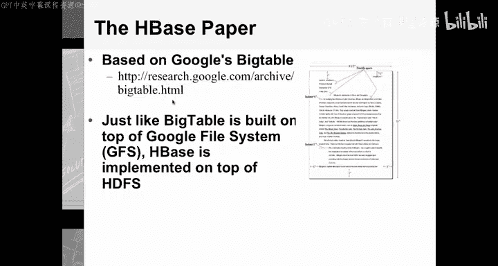
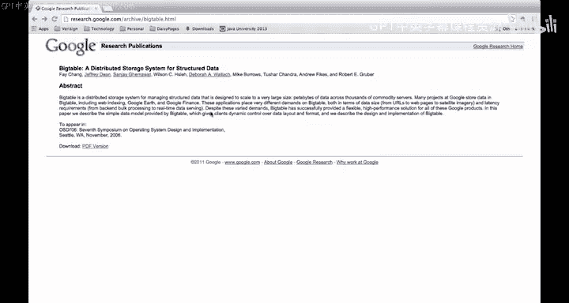
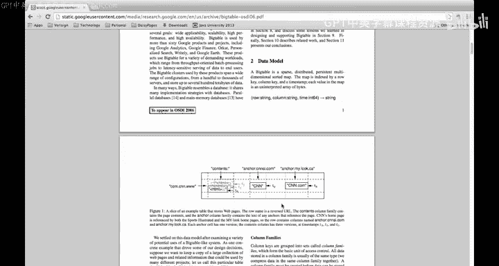
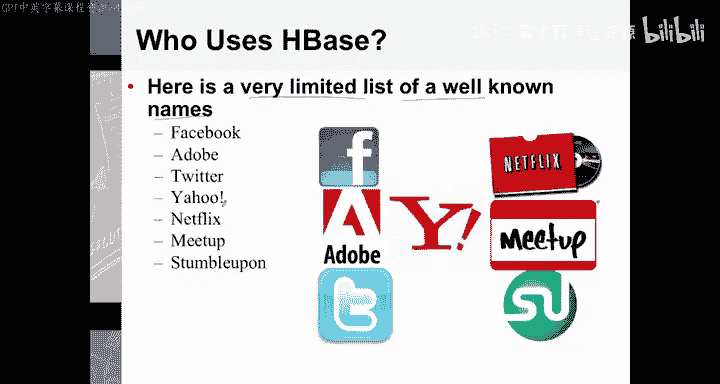
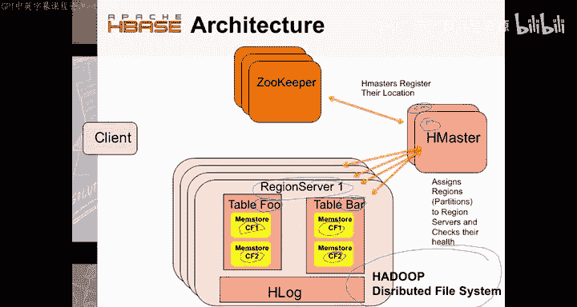
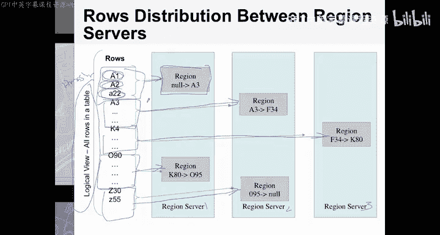
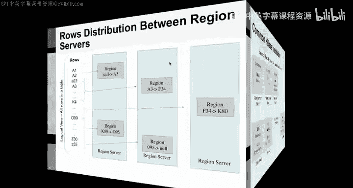
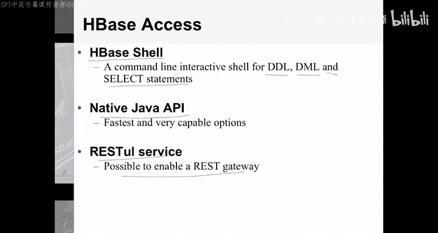

# 085：HBase架构与核心特性 🗄️

在本节课中，我们将学习HBase数据库的概述及其架构的关键细节。HBase是一个构建在Hadoop之上的开源NoSQL数据库，专为处理海量数据而设计。

## HBase概述

HBase是一个开源的NoSQL数据库。它也被称为Hadoop数据库，因为它精确地构建在Hadoop之上，具体来说是构建在HDFS之上。它当然可以与Hadoop MapReduce协同工作，但HDFS是HBase运行所需的最低要求。

HBase是分布式的，这意味着它可以在多台服务器上运行，也意味着它专为大型表设计，这些表可以包含数十亿行甚至数百万列。HBase支持随机的实时CRUD操作。

回想一下HDFS，在HDFS中你可以存储文件，但它主要用于顺序或流式读取以及MapReduce处理。在HDFS中，你存储数据，然后使用MapReduce进行顺序和流式读取与处理。而使用HBase，你可以获得随机的实时读写操作，因此可以对数据执行实时的CRUD操作。

再次回到HDFS，在HDFS中你只能追加文件，无法真正修改文件中间的内容。HBase是一个支持版本控制的数据库。这是HBase表的一个非常好的特性：当你拥有列时，这些列可以有多个版本的值。你可以有一个版本1的值，几分钟后你可能更改该值，那就是版本2的值。它实际上维护着这些版本，并且你可以指定希望为某个单元格或值保留多少个版本。

HBase运行在商用硬件集群上。因为HBase构建在Hadoop之上，运行在商用硬件集群上是必然的选择。当然，别忘了，在生产环境中，你运行在商用服务器上，可能是戴尔、IBM或惠普的服务器，而不是笔记本电脑或台式机。

HBase是水平可扩展的。当你向HBase插入记录时，它会自动进行分片。如果你有多个HBase Region Server实例，它会确保数据在多个Region Server之间进行分片。因此，分片是自动完成的，无需你进行特殊操作。

HBase是强一致性的。这是ACID属性，但HBase的ACID属性只发生在行级别。你可以在事务性方式下更新一行内的所有列，但无法跨行进行此操作。如果你想跨行更新记录并保持强一致性，那么你可能需要使用ZooKeeper进行分布式事务。

HBase具有自动故障恢复功能，这意味着当一台机器崩溃时，另一台机器会接管该特定数据，因为所有数据都在HBase中。HBase与MapReduce框架存在集成。尽管HBase运行在HDFS上，我们也知道在HDFS之上是YARN，在YARN之上是MapReduce。你实际上可以运行以HBase表作为输入的MapReduce程序，然后输出可以返回到HBase表，也可以写入文件系统。

从编程角度看，访问HBase的接口有Java API，也有REST API。此外，还有HBase命令行Shell，我们稍后会讨论。

HBase基于谷歌的Bigtable论文。以下是谷歌Bigtable论文的链接。就像HDFS基于GFS论文，MapReduce基于谷歌的MapReduce论文一样，HBase项目基于Bigtable论文。

## HBase历史

2006年，谷歌发布了Bigtable论文。有一家名为PowerSet的小公司，其开发人员阅读了Bigtable论文并深受启发，因此他们希望启动一个基于Hadoop的新项目，称为HBase。

2007年，HBase成为Hadoop的一个贡献模块。如果你回顾Hadoop的安装，你会注意到实际上有一个`contrib`文件夹，那里存放着对Hadoop的第三方贡献。Hive和Pig最初都是作为贡献模块启动，后来成为顶级项目。同样，在2007年，HBase作为Hadoop 0.15.0版本发布的一部分，开始作为贡献模块。

2008年，HBase成为Hadoop的一个子项目，因此它位于`hadoop.apache.org/hbase`下。后来它成为了所谓的顶级项目，因此变成了`hbase.apache.org`项目。

2009年，HBase 0.19和0.20版本发布，被认为是Hadoop的两个主要稳定版本。

到2010年，他们实际上将版本号改为0.89，以与Hadoop的版本号区分开来。Hadoop的版本号从0.1、0.2、0.3等开始，在某个时间点，HBase开发人员认为这个数字太低了，他们希望快速向HBase 1.0迈进，但当时尚未实现。从2010年开始，到2014年，它即将进入1.0版本。无论如何，他们将版本号移到了0.89，这就是编号从Hadoop转向其自身编号方案的方式。

然后在2011年，HBase 0.90和0.92版本发布，这是相当稳定的版本。2011年至2014年间发生了很多事情。现在我们有了HBase 0.99.x，它很快将成为1.00，最终他们将发布2.0版本。2.0版本将是与Hadoop 2更兼容的版本。1.0版本是一个包含适用于Hadoop 1和Hadoop 2的软件包的版本，而2.0版本将只适用于Hadoop 2，这是HBase目前的计划。

我想提到的关于版本的另一点是，如果你看到一个偶数版本号，如0.98或0.92，那意味着它是一个稳定版本。奇数版本号则是不稳定版本或开发版本。目前我们将使用0.99版本。我们本有机会使用0.98版本，但我决定在本课程中使用0.99版本。

## HBase的使用者

以下是一些使用HBase的知名公司名单，这是一个非常有限的列表：Facebook、Adobe、Twitter、Yahoo、Netflix、Meetup、StumbleUpon等。这些公司也在使用许多其他项目，例如Facebook启动了Cassandra项目，有些项目也使用Oracle。因此，所有这些不同的公司都混合使用了多种技术，但这里列出了一些使用HBase的大公司。

## 何时使用HBase

关于何时使用HBase，有两个众所周知的用例。

*   **海量数据或行数**：不是数百万行，而是数十亿行、数千亿行甚至数万亿行，这时HBase非常出色。
*   **大量的客户端请求**：如果你每秒有数百万次请求需要扩展，或者每秒有数百万次更新或插入，这基本上意味着每次用户登录时都有更多数据涌入，你可能希望将其记录到一个辅助系统中，而不是写入HDFS文件。你可能希望将日志事件写入HBase表，以便可以扫描、进行批量处理等。因此，每当有大量数据涌入并希望插入这些记录，或者有大量客户端请求进行读取访问时，你实际上可以使用HBase。

HBase之所以非常适合处理大量客户端请求，是因为它是一个分布式系统。这意味着如果七台机器不够好，那么将硬件翻倍，变成14台机器，现在你已经自动分区了数据库表。因此，它非常适合海量数据或数十亿条记录，也适合大量涌入的请求。

它非常适合**单个随机选择**。它非常适用于你说“这是键，请给我这条特定记录”的场景。例如，如果你有10亿用户，你不能将10亿用户放在MySQL数据库中。你可以做的是将10亿用户存储在HBase中，你可能拥有100台服务器，然后每次用户登录时，你获取作为键的用户ID，去HBase说“检索这条记录”，它会给你存储在HBase中的用户名和密码哈希，然后将其与用户输入的内容进行匹配。因此，你可以将其用于身份验证目的。这是使用HBase的一个绝佳场景。

它同样适合**范围扫描**。你也可以扫描一组记录，例如可以说“给我这个键和那个键之间的所有记录”，这也是可能的。

HBase的另一个优点是**可变模式**。在关系数据库中，你必须定义模式并坚持该特定模式：这是你为这个表定义的17列，仅此而已，并且数据类型也是固定的。而在HBase中，它们有称为列族的概念，列族是固定的，然后在列族内你可以有列，这些列甚至可以动态添加。事实上，当你插入记录时，它们会作为记录的一部分被动态添加。这些列属于一个列族，这些列名可以是动态的，你可以有数百万列，并且可以在其中存储任何你想要的数据，只要它可以序列化为字节，数据类型无关紧要。

## 何时不使用HBase

HBase不适用于传统的RDBMS系统，在这些系统中你希望进行事务性应用程序操作，需要更新多个不同的表并将其作为单个事务的一部分。使用HBase无法做到这一点，事务只能发生在单行内。

同样，对于关系分析，例如你可能希望进行一系列分组操作，或者进行连接和WHERE子句查询。它不具备这些功能。它主要支持CRUD操作，以及少量可能的扫描操作以获取一组记录。

HBase非常适合存储大量行并进行CRUD操作，但如果你想在这些数据中进行搜索，通常在关系数据库中，你会使用SELECT语句，可能使用通配符甚至进行文本搜索。在HBase中，这些功能效果不佳，因为首先它没有文本处理等功能。在关系数据库中，你可以使用SELECT语句和LIKE操作符，甚至可以进行一些文本搜索，但当涉及到像Solr和Lucene这样的真正搜索引擎时，你无法在HBase中做这些事情。HBase主要是用于记录的CRUD操作。

有一些项目正在混合使用HBase和Lucene。这里有一个由AK Kumar开发的项目，称为HBase-Lucene，它将HBase和Lucene混合在一起：在HBase中插入记录时，它也会在索引中插入一条记录。还有另一个项目叫做Lily项目，它基于Lucene构建的Solr，并将其与HBase混合。这被称为Lily项目。这些都是可用的一些开源项目，它们正在尝试这样做。我认为这是未来两到三年内你会看到很多活动的一个领域。

## HBase架构

在HBase中，你有一个由区域组成的HBase表。你可以将区域视为关系数据库中的分区。因此，区域就像存储在一起的一系列行，这就是我所说的分区，或者你可以说是一个分片。它实际上用于扩展：一个分片存储在一台机器上，另一个分片存储在另一台机器上，第三个分片存储在第三台机器上，这允许你扩展系统。

表的这种分片思想是动态完成的，并且是自动为你完成的。因此，当HBase系统发现系统中有许多其他机器时，它会自动将表分割成各种分片，并尝试将这些分片分布到这些不同的机器上。

Region Server是一个服务或守护进程，一次服务于一个或多个区域。区域是什么？它是一个分片，一个分区。因此，Region Server服务于这些分区之一。

Master Server是一个负责管理HBase集群的守护进程。因此，Master Server或HMaster是HBase系统的主节点。HBase将其数据存储到HDFS中。通常在关系数据库中，它将数据存储在文件系统中。在HBase中，它将数据存储在HDFS中。因此，考虑到HDFS具有三副本复制和容错等内置功能，HBase自动继承了所有这些特性，实际上它依赖于HDFS的高可用性和容错特性来维护HBase数据库的持久性。

HBase使用称为ZooKeeper的东西。ZooKeeper是Apache的另一个项目，用于分布式协调。HBase使用ZooKeeper来确保HMaster处于运行状态，并选举其中一个作为领导者。我们将在接下来的一两张幻灯片中讨论这个问题。这些是你应该熟悉的一些高级HBase架构术语。

现在让我们来看看HBase架构。

在最底层，你有Hadoop分布式文件系统。HBase构建在HDFS之上。在HBase中，你有一个特殊的守护进程叫做HMaster守护进程。请注意，我实际上启动了两个HMaster守护进程。你实际上可以有两个、三个、四个、五个，任意多个HMaster守护进程，但一次只能有一个处于活动状态。

还有这些称为Region Server守护进程的守护进程。Region Server守护进程是负责服务一个分片的守护进程，它们负责为表服务一个分片。因此，一个Region Server将负责服务，比如说两个表：我们有一个名为Foo的表和一个名为Bar的表，它基本上存储Foo表的一部分和Bar表的一部分。在内部，它将所有数据存储在HDFS和HLog中。这些都是它使用HFS进行的一些内部操作。还有这些称为CF1和CF2的东西，它们是该特定表的列族。这个MemStore是内存中的映射。我想说明的重点是，Region Server有一个分片的内存映射，其余数据则在数据库中。因此，这是你拥有的内存存储或内存缓存，你可以拥有任意多个Region Server。

ZooKeeper是一个负责告知HMaster在哪里的守护进程。如果你有两个HMaster，它们都会向ZooKeeper注册自己，ZooKeeper基本上会选举其中一个作为主Master。假设这个HMaster被选为主节点，第二个Master或第二个Master被保留为辅助Master，只有当第一个Master失败时，它才会成为主节点。为什么它会成为主节点？因为ZooKeeper在那一刻选举第二个HMaster作为主节点。这就是ZooKeeper的主要工作。

客户端想要进行一些操作，它想要进行一些CRUD操作。首先，客户端必须与HMaster通信。如果它必须与HMaster通信，它需要知道HMaster在哪里。这时客户端实际上首先进行查找：客户端在ZooKeeper中进行查找，询问HMaster在哪里。ZooKeeper说你应该与之通信的HMaster是这个，所以请将信息发送给这个HMaster。于是客户端去HMaster那里说“我正在寻找检索这条记录，这是该特定记录的ID”。HMaster说“哦，关于该特定记录的信息在Region Server 1中”。然后客户端去Region Server 1，基本上检索关于该记录的信息并将其返回给客户端。

我想说明的重点是：客户端总是去HMaster那里找出记录的位置，然后最终去相应的Region Server检索该特定记录。这是因为HMaster完全跟踪不同键范围放置的位置，因此基于传递给它的键，它可以告诉你哪个Region Server拥有该信息。

我还想告诉你，客户端并不总是返回HMaster获取该信息。客户端会不时地去那里。它实际上会获取关于不同区域和不同键范围位置的信息并进行缓存。这样，它就不必总是去HMaster那里。它会不时地与HMaster通信，以确保其缓存信息是最新的，但它并不总是必须去HMaster那里。第一次肯定会去。

此外，当客户端识别出ZooKeeper给出的HMaster是这个HMaster时，那么客户端将总是去这个HMaster，它不必再返回ZooKeeper询问“哦，HMaster在哪里”。客户端后续对HMaster的请求将直接发送给HMaster。如果由于某种原因HMaster死亡，那么客户端将去ZooKeeper询问“HMaster在哪里”。与此同时，ZooKeeper选举了辅助HMaster作为HMaster，然后客户端最终将去辅助HMaster那里。

总而言之，ZooKeeper的主要工作是管理HMaster守护进程：如果有多个HMaster守护进程在运行，确保其中一个被选为领导者。

客户端负责与ZooKeeper通信以找出HMaster的位置，从而获取关于分区的信息。

Region Server是服务于表的一个分片部分的守护进程。Region Server维护多个表，但它们维护多个表的记录部分。请注意，我有Region Server 1、Region Server 2、后面的3和4。这些Region Server可能运行在不同的机器上。因此，在一台机器上运行HMaster，在另一台机器上运行作为辅助HMaster的HMaster，然后在三台机器上运行ZooKeeper。这样就有五台机器了。然后你有Region Server 1、Region Server 2和Region Server 3。这是四个Region Server，也就是四台机器。因此，为了运行HBase系统，你至少需要：这里用于Region Server的4台机器，用于ZooKeeper的3台机器，总共7台，再加上两台HMaster机器，就是9台机器。所以你真的需要9台机器来拥有一个HBase的最低限度系统，然后你可以通过向HBase系统添加越来越多的Region Server机器来不断扩展。

重点是HBase要复杂得多。当然，所有这些都需要安装Hadoop。但HBase的起始机器数量要复杂得多。

对于我们在本课程中将要做的内容，我们将在同一台机器上运行所有守护进程，包括Hadoop守护进程和HBase守护进程，但通常它们是分布式的。

## HBase组件详解

这是HBase组件的另一个视图。我们有HMaster，它是HBase的大脑，负责跟踪所有分片的位置。我们有Region Server，它维护表的一个分片，它可能跨多个表拥有多个分片。

还有一个内存中的MemStore，它维护着某种内存映射，几乎就像缓存。其余信息存储在一个名为HFile的文件中，该文件位于HDFS中。还有WAL，它代表预写日志。当你向Region Server插入记录时，它首先将所有内容写入预写日志，然后替换到HFile中并合并到HFile中。因为HFile是存储记录信息的底层存储文件，并且这些信息实际上是以排序方式保存的。当我们学习HBase数据模型和HBase Shell时，会看到这一点。

因为信息在HFile中是排序的，所以信息首先被写入WAL文件（即预写日志文件）以提高速度，然后不时地排序并放入HFile中。

ZooKeeper跟踪NameNode的位置，也跟踪各个Region Server的位置。

## 数据视角下的HBase

这是从数据角度看HBase的另一个视图。假设我们有三个Region Server：Region Server 1、Region Server 2和Region Server 3。这里是行，更准确地说，是行键。它是一个键值系统，所以A1是键，A2是键，A22是键，这些是我们拥有的所有键。请注意，键总是按排序顺序存储。所有键都按排序顺序存储。

这组键存储在一个分片中，位于Region Server 1中。这组键存储在另一个分片中，位于Region Server 2中。这组键存储在另一个分片中，位于Region Server 3中。这组键存储在一个分片中，位于Region Server 1中。正如你所见，分区或分片正在发生，当然，这些信息由HMaster维护，以了解不同范围的分片放置在哪里。这就是为什么每当客户端进来并说“我想更新这条记录”或“我想删除具有这个特定键的记录”时，它确切地知道哪个Region Server、哪个分片拥有该记录，因此它引导客户端去那个特定的分片执行CRUD操作。

## HBase安装细节

我之前在HBase安装方面做了一些粗略的介绍，这里有一张更详细的幻灯片，说明HBase安装如何进行。

你可以有一台机器运行ZooKeeper，另一台机器运行ZooKeeper，第三台机器运行ZooKeeper。顺便说一下，你总是以奇数运行ZooKeeper：1、3、5、7，因为ZooKeeper用于选举目的，你希望确保它们是奇数个。如果三个ZooKeeper中有两个同意应该选举其中一个作为主节点，那么那个就会被选为主节点。如果ZooKeeper的数量是偶数，那么事情就无法正常工作。这就是为什么你保持3、5、7个ZooKeeper守护进程。

如果你有机会，你可能想了解一下ZooKeeper项目，它与大数据无关。ZooKeeper更多是关于分布式计算和分布式事务管理，碰巧HBase使用ZooKeeper来实现其高可用性特性。

在一台运行ZooKeeper的机器上，你可能想运行HBase Master，即HMaster。在一台运行ZooKeeper的守护进程机器上，你可能想运行NameNode。在一台守护进程机器上，你可能想运行Secondary NameNode。

然后你有一