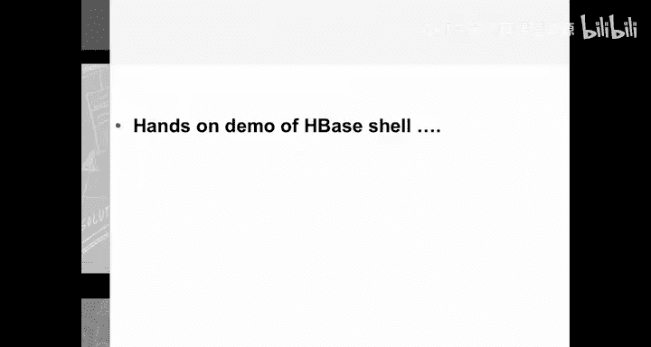
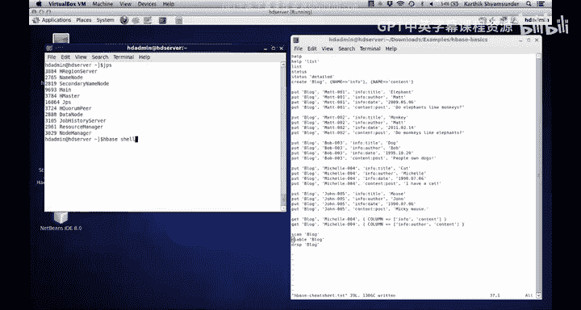

# 088：HBase终端操作 🖥️


在本节课中，我们将学习如何使用HBase的交互式Shell。HBase Shell是一个基于JRuby的命令行工具，它允许我们直接与HBase数据库进行交互，执行创建表、插入数据、查询、更新和删除等操作。通过本节的学习，你将掌握使用HBase Shell进行基本数据操作和管理的方法。

## HBase Shell简介

上一节我们介绍了HBase的基本架构，本节中我们来看看如何通过命令行与HBase进行交互。

HBase Shell是一个JRuby交互式Shell，它是一个集成了HBase命令的JRuby IRB（交互式Ruby Shell）。这意味着你可以在其中执行许多HBase命令，例如创建表、向表中插入记录、从表中删除记录、扫描整个表以及执行其他数据操作语言（DML）和管理操作。

要运行HBase Shell，你只需在命令行中输入 `hbase shell`，前提是你的系统路径中已经包含了HBase的bin目录。执行该命令后，你将进入交互式Ruby Shell环境。

## 启动与帮助命令

以下是启动HBase Shell并获取帮助信息的基本步骤。

*   在命令行中输入 `hbase shell` 启动交互式Shell。
*   输入 `help` 命令可以获取所有可用命令的列表。
*   输入 `help "命令名"`（例如 `help "get"`）可以获取特定命令的详细使用信息和示例。

请注意，在HBase Shell中，表名和列名必须用引号括起来，可以是单引号或双引号。对于二进制键值，必须使用双引号。你还可以使用Ruby哈希（Hash）来为命令指定参数，其格式为 `{key1 => 'value1', key2 => 'value2'}`。

## HBase Shell支持的命令类型

HBase Shell支持多种类型的命令，方便进行数据库操作和管理。

以下是HBase Shell支持的主要命令类别：

1.  **通用命令**：例如 `status` 和 `version`，用于获取HBase集群的状态和版本信息。
2.  **DDL命令（数据定义语言）**：用于定义数据结构，例如 `create`（创建表）、`describe`（描述表）、`disable`/`enable`（禁用/启用表）、`drop`（删除表）和 `alter`（修改表）。
3.  **DML命令（数据操作语言）**：用于操作数据，例如 `put`（插入或更新记录）、`delete`（删除记录）、`get`（获取单行记录）、`scan`（扫描多行记录）和 `count`（统计行数）。
4.  **集群管理命令**：用于HBase数据库管理员（DBA）进行集群管理，例如平衡集群、刷新内容、ZooKeeper相关命令和复制命令等。本课程不深入讨论这些管理命令。

## 检查集群状态

一旦进入HBase Shell，你可以使用 `status` 命令来获取HBase服务器的状态信息。

`status` 命令会返回集群的基本状态，例如活跃的服务器数量。而 `status 'detailed'` 命令则会提供更详细的状态信息，这些信息与我们在安装HBase时看到的HBase Web管理控制台上的信息类似。

详细状态信息包括HBase版本号、活跃的RegionServer列表、它们服务的区域和表等信息。这对于管理大型集群并希望了解其运行状况非常有用。

## 完整的DDL与DML操作流程

我们将通过一个完整的例子来演示如何使用HBase Shell命令创建表、填充数据、访问数据、编辑数据、删除记录并最终删除表。

我们将创建一个名为 `blog` 的表，其模式（Schema）如下：
*   列族（Column Family） `info`：包含 `title`、`author`、`date` 列。
*   列族 `content`：包含 `post` 列。

### 创建表

使用 `create` 命令可以创建表。你可以指定列族及其属性，例如版本数（VERSIONS）和生存时间（TTL）。

创建 `blog` 表的命令如下：
```shell
create 'blog', {NAME => 'info', VERSIONS => 3}, {NAME => 'content', VERSIONS => 3}
```
此命令创建了 `blog` 表，包含 `info` 和 `content` 两个列族，每个列族都保留每个单元格的3个版本，并且数据永久有效（默认TTL）。

### 插入数据

使用 `put` 命令可以向表中插入数据。`put` 命令用于插入单个单元格（Cell）。

插入数据的命令格式为：`put ‘表名’, ‘行键’, ‘列族:列名’, ‘值’`

例如，插入第一条博客记录的标题：
```shell
put 'blog', 'mat001', 'info:title', 'Elephants'
```
重复此过程，插入 `author`、`date` 和 `post` 等列的值，以及其余四条记录。

### 统计与查询数据

插入数据后，可以使用 `count`、`get` 和 `scan` 命令来查看数据。

*   `count ‘表名’`：统计表中的行数。对于大表，可以指定间隔参数（如 `INTERVAL => 1000`）来显示扫描进度。
*   `get ‘表名’, ‘行键’`：获取指定行的所有单元格。可以附加参数来指定列、时间戳或版本。
*   `scan ‘表名’`：扫描整个表或指定范围的行。可以使用 `STARTROW` 和 `STOPROW` 参数限定范围，`STOPROW` 是排他的。

### 更新数据

在HBase中，`put` 命令也用于更新数据。其原理是插入一个具有新时间戳的单元格。HBase会为每个列族保留指定数量的版本（如之前设置的3个）。



例如，更新 `Michelle004` 的博客日期：
```shell
put 'blog', 'Michelle004', 'info:date', '1997-07-07'
```
执行 `get` 命令时，默认返回最新版本。可以通过指定 `VERSIONS` 参数来获取多个历史版本。



### 删除数据与表

使用 `delete` 命令可以删除特定的单元格。可以指定精确的时间戳来删除特定版本。

例如，删除 `Bob003` 的日期信息：
```shell
delete 'blog', 'Bob003', 'info:date'
```
要删除整个表，必须先使用 `disable ‘表名’` 命令禁用表，然后才能使用 `drop ‘表名’` 命令删除它。使用 `list` 命令可以查看当前所有的表。

## 实战演示

现在，让我们通过一个实战演示来巩固以上知识。假设我们已经登录到HBase服务器。

1.  启动HBase Shell：在终端输入 `hbase shell`。
2.  查看帮助：输入 `help` 查看所有命令；输入 `help “list”` 查看 `list` 命令的用法。
3.  查看现有表：输入 `list`。
4.  检查状态：输入 `status` 和 `status ‘detailed’`。
5.  创建 `blog` 表：使用前面提到的 `create` 命令。
6.  插入数据：使用一系列 `put` 命令插入示例数据。
7.  查询数据：使用 `scan ‘blog’` 查看所有数据；使用 `get ‘blog’, ‘mat001’` 查看特定行。
8.  删除表：依次执行 `disable ‘blog’` 和 `drop ‘blog’`，最后用 `list` 确认表已删除。

通过这个演示，你可以清晰地看到如何使用JRuby交互式Shell与HBase进行完整的交互。

## 总结


本节课中我们一起学习了如何启动和使用HBase的JRuby交互式Shell。我们涵盖了通过Shell与HBase服务器交互的核心操作，包括创建表、插入记录、删除记录、更新记录以及扫描和获取整个表的数据。掌握这些基本命令是有效使用HBase进行大数据处理的重要一步。