# 095：Spark Core 编程模型 🚀

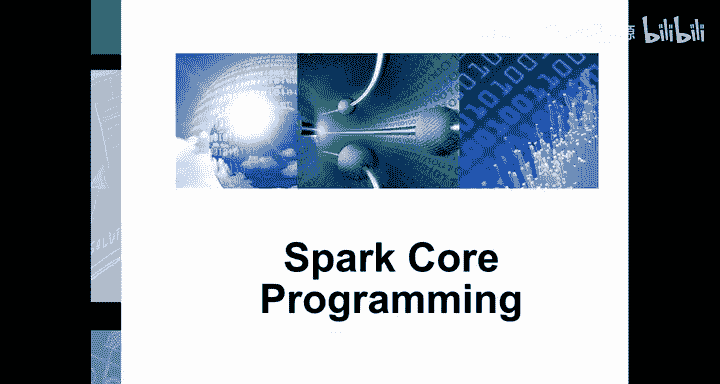

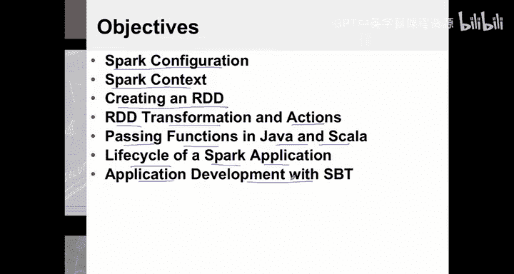

在本节课中，我们将学习 Spark Core 编程模型的核心概念，包括 Spark 配置与上下文对象、RDD 的创建、转换与行动操作，以及如何构建和运行一个 Spark 应用程序。

---

## Spark 配置对象 ⚙️

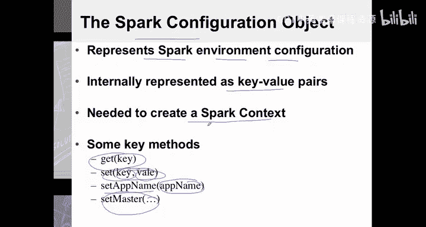

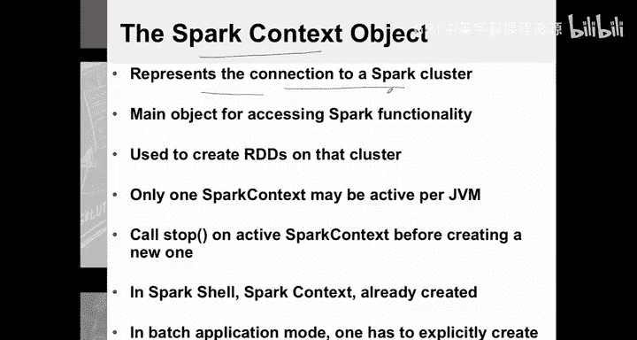

Spark 配置对象代表了 Spark 环境的配置。它类似于 Hadoop 的配置对象，在实例化时会加载所有 Spark 的配置文件（如 `spark-env.sh` 和 `spark-defaults.conf`）。

该对象内部以键值对的形式存储所有环境变量。你可以通过 `set` 方法修改配置，或通过 `get` 方法获取当前值。

以下是两个重要的专用方法：
*   **`setAppName`**：设置应用程序名称，该名称会在资源管理器中显示。
*   **`setMaster`**：设置主节点模式，例如 `local`、`yarn`、`mesos` 或 `standalone`。

**核心公式**：`SparkConf conf = new SparkConf().setAppName("MyApp").setMaster("local[*]")`

Spark 配置对象是创建 Spark 上下文对象的基础。

---

## Spark 上下文对象 🔌

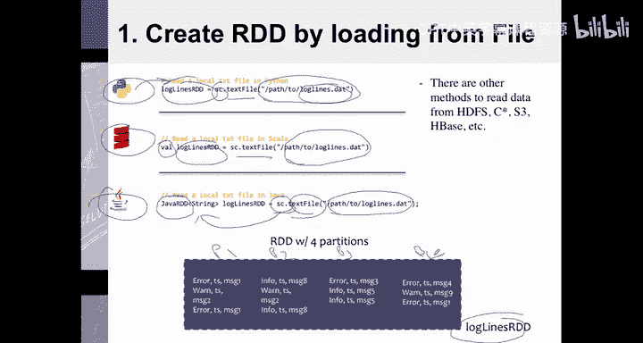

Spark 上下文对象代表了与 Spark 集群的连接。它是访问 Spark 所有功能的主要入口点，在 Spark 应用程序中进行的绝大多数操作都需要此对象。

一个关键功能是使用它来创建 RDD。例如，你可以调用 `textFile` 方法从 HDFS 文件系统读取文本文件并构建 RDD。

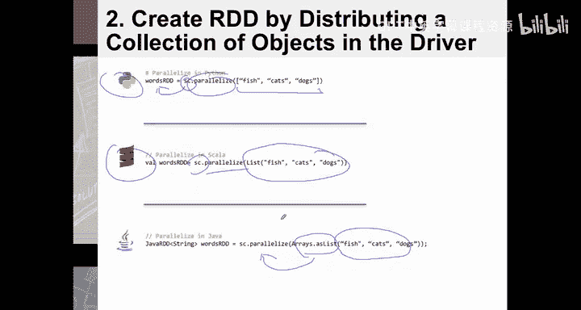

**重要限制**：每个 JVM 中只能有一个活跃的 Spark 上下文对象。如果需要创建新的，必须先调用现有上下文的 `stop` 方法。

在 Spark Shell 中，配置和上下文对象已预先创建好。但在编写批处理应用程序时，必须显式实例化它们。

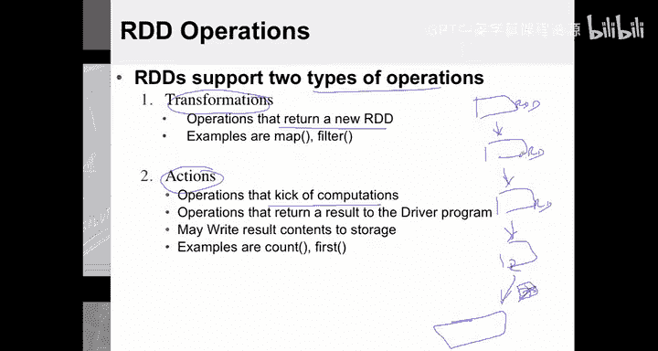

---

## 创建 RDD 📂

上一节我们介绍了 Spark 上下文对象，本节中我们来看看如何使用它来创建 RDD。

RDD 可以通过两种主要方式创建：

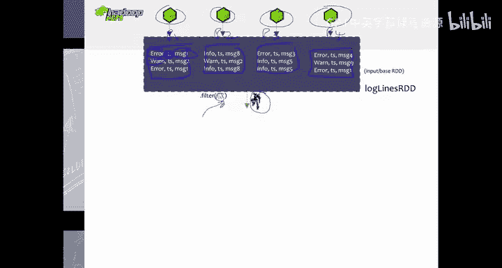

1.  **从外部数据源加载**：这是生产环境中最常见的方式。可以从 HDFS、本地文件系统或数据库（如 MySQL、Cassandra）加载数据。
    **示例代码（Scala）**：`val logLinesRDD = sc.textFile("hdfs://path/to/loglines.txt")`

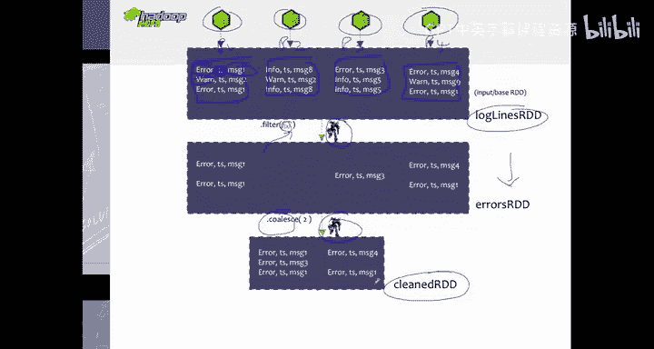

2.  **并行化驱动程序中的集合**：将驱动程序内存中的集合（如列表、数组）并行化到集群中。这种方式主要用于原型测试。
    **示例代码（Python）**：`data = ["fish", "cats", "dogs"]; rdd = sc.parallelize(data)`

第一种方法适用于处理存储在分布式系统中的海量数据，而第二种方法则便于快速测试和小规模实验。

---

## RDD 转换与行动操作 ⚡

一旦创建了 RDD，就可以对其应用两种类型的操作：**转换**和**行动**。

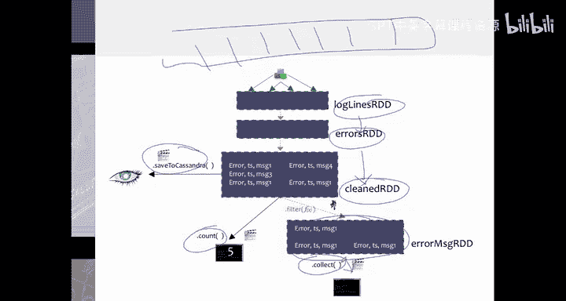

*   **转换操作**：从一个 RDD 生成一个新的 RDD。转换是**惰性**的，它们只是定义了计算逻辑，并不会立即执行。
    *   **示例**：`map`, `filter`, `flatMap`
*   **行动操作**：触发实际的计算，并返回结果给驱动程序或将结果保存到存储系统。行动操作会强制执行所有累积的转换。
    *   **示例**：`count`, `collect`, `saveAsTextFile`

**工作流程**：你通常会对初始 RDD 应用一系列转换（例如 `filter` -> `map`），最后调用一个行动操作（如 `collect`）。只有行动被调用时，Spark 才会构建一个有向无环图（DAG）并执行所有必要的计算。

---

## 向 Spark 传递函数 🧩

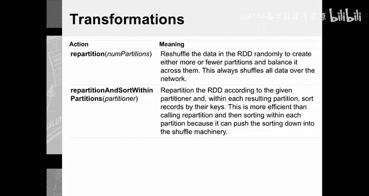

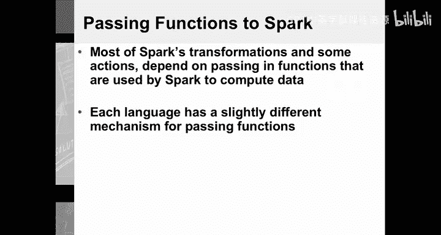

我们注意到，许多转换和行动操作（如 `filter`、`map`）需要将一个函数作为参数传入。以下是不同语言中的传递方式。

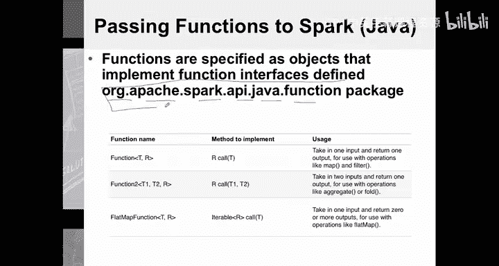

### 在 Java 中传递函数

Spark 提供了函数接口（如 `Function`, `Function2`）。你可以通过匿名内部类、具名类或 Java 8 的 Lambda 表达式来实现。

**Lambda 表达式示例（Java 8）**：
```java
JavaRDD<String> lines = ...;
JavaRDD<String> errors = lines.filter(s -> s.contains("error"));
```

### 在 Scala 中传递函数

Scala 支持 Lambda 函数，语法更简洁。

**Lambda 函数示例（Scala）**：
```scala
val inputFileRDD = sc.textFile("input.txt")
val wordsRDD = inputFileRDD.flatMap(line => line.split(" "))
val wordCountsRDD = wordsRDD.map(word => (word, 1)).reduceByKey(_ + _)
```
上面的例子演示了经典的“词频统计”逻辑：`flatMap` 将每行拆分成单词，`map` 将每个单词映射为 `(单词, 1)` 的键值对，`reduceByKey` 将相同单词的计数相加。

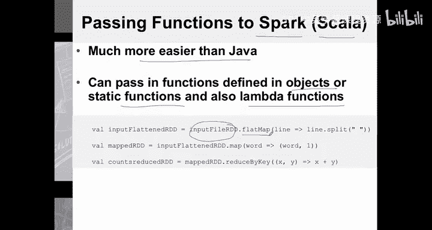

---

## Spark 应用程序的生命周期 🔄

一个典型的 Spark 应用程序遵循以下生命周期：
1.  **创建输入 RDD**：从外部数据源加载或并行化集合。
2.  **定义转换**：通过 `filter`、`map` 等转换操作定义新的 RDD。
3.  **触发行动**：调用 `count`、`collect`、`save` 等行动操作来启动计算。
4.  **输出结果**：将行动操作的结果返回给驱动程序或写入外部存储系统。

---

## 构建 Scala Spark 应用程序 🛠️

本节我们将学习如何构建一个基于 Scala 的 Spark 应用程序。以下是五个基本步骤：

1.  **创建项目结构**：建立标准的 Scala 项目目录。
2.  **编写 `build.sbt` 文件**：定义项目名称、版本、Scala 版本和 Spark 依赖。
3.  **编写 Scala 类**：创建包含 `main` 方法的应用程序主类。
4.  **构建 JAR 包**：使用 SBT 打包项目。
5.  **运行应用程序**：通过 `spark-submit` 提交 JAR 包执行。

以下是关键部分的示例：

**项目目录结构**：
```
wordcount/
├── build.sbt
└── src/
    └── main/
        └── scala/
            └── SimpleApp.scala
```

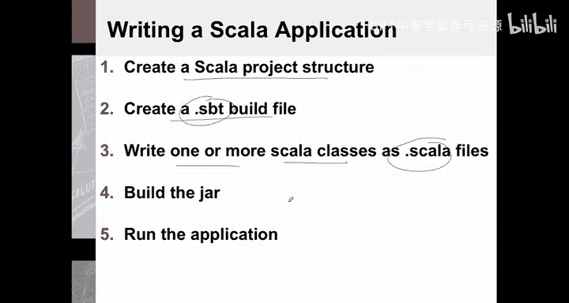

**`build.sbt` 文件内容**：
```scala
name := "Simple Spark App"
version := "1.0"
scalaVersion := "2.10.6"
libraryDependencies += "org.apache.spark" %% "spark-core" % "1.6.3"
```

**Scala 应用程序示例（词频统计）**：
```scala
import org.apache.spark.{SparkConf, SparkContext}

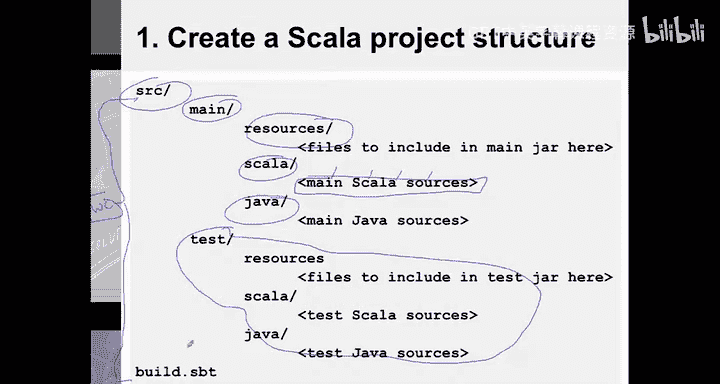

object SimpleApp {
  def main(args: Array[String]) {
    val conf = new SparkConf().setAppName("WordCount")
    val sc = new SparkContext(conf)
    val inputFile = "hdfs://.../input.txt"
    val inputRDD = sc.textFile(inputFile)
    val countsRDD = inputRDD.flatMap(line => line.split(" "))
                             .map(word => (word, 1))
                             .reduceByKey(_ + _)
    countsRDD.saveAsTextFile("hdfs://.../output")
    sc.stop()
  }
}
```

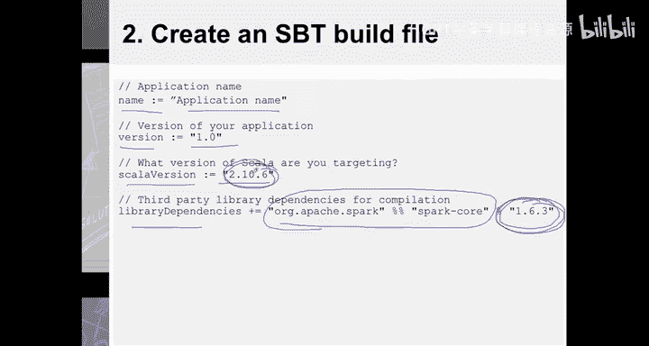

**构建命令**：在项目根目录执行 `sbt package` 生成 JAR 文件。

---

## 运行 Spark 应用程序 ▶️

构建好 JAR 包后，可以通过 `spark-submit` 以不同模式运行：

1.  **本地模式**：用于原型测试，所有组件运行在单个 JVM 中。
    **命令示例**：`spark-submit --master local[*] --class SimpleApp myapp.jar`

2.  **YARN 客户端模式**：驱动程序运行在提交任务的客户端机器上，Executor 运行在 YARN 集群中。客户端进程必须保持活跃。
    **命令示例**：`spark-submit --master yarn --deploy-mode client --num-executors 2 ... myapp.jar`

3.  **YARN 集群模式**：驱动程序也运行在 YARN 集群的 Application Master 中。客户端提交任务后即可断开。
    **命令示例**：`spark-submit --master yarn --deploy-mode cluster --num-executors 2 ... myapp.jar`

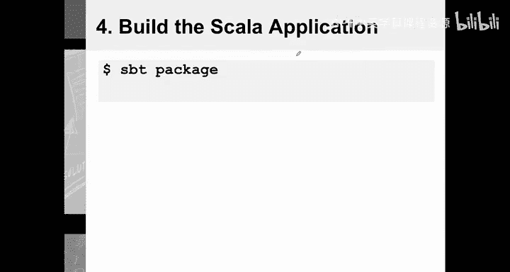

选择合适的模式取决于你的测试、调试和生产部署需求。

---

## 总结 📚

本节课中我们一起学习了 Spark Core 编程模型的核心内容：

*   **Spark 配置对象**：用于设置 Spark 环境参数。
*   **Spark 上下文对象**：连接集群的主入口，用于创建 RDD。
*   **创建 RDD**：可通过加载外部数据或并行化内存集合实现。
*   **转换与行动**：转换是惰性操作，用于定义计算；行动触发实际计算并返回结果。
*   **传递函数**：在 Java 和 Scala 中如何将函数作为参数传递给 Spark 操作。
*   **应用开发生命周期**：从创建 RDD 到转换、行动和输出的完整流程。
*   **构建与运行**：我们学习了如何搭建 Scala Spark 项目，编写 `build.sbt`，创建应用程序，打包成 JAR，并通过 `spark-submit` 以不同模式（本地、YARN 客户端、YARN 集群）运行应用程序。

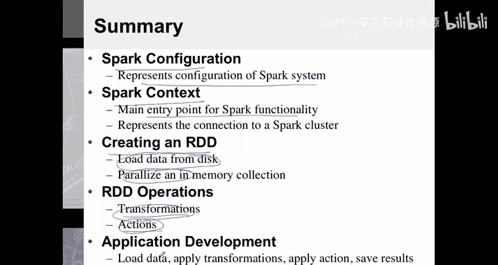

掌握这些基础知识是进行高效大数据处理和分析的关键。