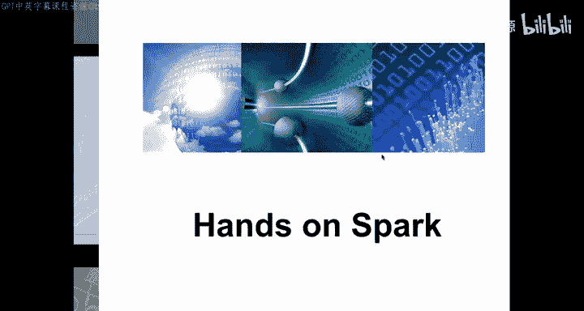

# 096：Spark实践操作 🚀


在本节课中，我们将学习如何解决一个具体的数据处理问题，并在此过程中掌握与Spark Shell交互式开发、构建Scala应用程序以及在不同模式下运行Spark作业的核心技能。

## 概述


本节课程的目标是解决一个经典的数据处理问题：计算学生的平均成绩，并将结果与学生信息合并输出。我们将通过以下步骤达成目标：
1.  学习关键的Spark转换与操作方法。
2.  使用Spark Shell进行交互式问题求解。
3.  将交互式代码整理成一个完整的Scala应用程序。
4.  使用SBT工具打包应用，并在本地模式和YARN集群模式下运行。

## 问题描述

我们有两个存储在HDFS中的输入文件：
*   **`student.dat`**：包含学生信息，字段由管道符 `|` 分隔。格式为：`学生ID | 名 | 姓 | 年级 | 年龄`。
*   **`score.dat`**：包含学生成绩，字段由逗号 `,` 分隔。格式为：`学生ID， 考试日期， 分数`。每个学生有多条成绩记录。

**任务**：为每位学生计算其所有考试的平均分，然后将平均分与学生信息合并，最终输出格式为：`学生ID， 名， 姓， 年级， 年龄， 平均分`。

## 解决方案设计

我们将编写一个Scala应用程序来解决此问题。程序的高层逻辑如下：


1.  **初始化环境**：创建Spark配置和上下文，并设置日志级别。
2.  **处理学生数据**：读取`student.dat`文件，将每行数据按 `|` 分割，并转换为 `(学生ID, (名， 姓， 年级， 年龄))` 格式的元组RDD。
3.  **处理成绩数据**：读取`score.dat`文件，将每行数据按 `,` 分割，提取`学生ID`和`分数`，并转换为 `(学生ID， 分数)` 格式的元组RDD。
4.  **计算平均分**：对成绩元组RDD按`学生ID`进行分组，然后对每个学生的分数列表计算平均值，得到 `(学生ID， 平均分)` 格式的RDD。
5.  **数据连接**：将学生信息RDD与平均分RDD通过`学生ID`进行连接。
6.  **格式化输出**：从连接后的复杂结构中提取所需字段，并格式化为最终结果。
7.  **保存结果**：将最终RDD保存到HDFS。


以下是核心处理逻辑的代码框架：


```scala
// 读取学生数据并转换为元组
val studentRDD = sc.textFile("hdfs://.../student.dat")
val studentTupleRDD = studentRDD.map(line => {
    val fields = line.split("\\|")
    (fields(0)， (fields(1)， fields(2)， fields(3)， fields(4)))
})
// 读取成绩数据并转换为(学生ID， 分数)元组
val scoreRDD = sc.textFile("hdfs://.../score.dat")
val scoreTupleRDD = scoreRDD.map(line => {
    val fields = line.split("，")
    (fields(0)， fields(2).toFloat)
})

// 按学生ID分组并计算平均分
val groupedScoreRDD = scoreTupleRDD.groupByKey()
val avgScoreRDD = groupedScoreRDD.mapValues(scores => {
    scores.sum / scores.size
})

// 连接学生信息与平均分
val joinedRDD = studentTupleRDD.join(avgScoreRDD)

// 格式化最终输出
val finalResultRDD = joinedRDD.map(record => {
    val studentID = record._1
    val studentInfo = record._2._1
    val avgScore = record._2._2
    s"$studentID， ${studentInfo._1}， ${studentInfo._2}， ${studentInfo._3}， ${studentInfo._4}， $avgScore"
})

// 保存结果
finalResultRDD.saveAsTextFile("hdfs://.../output/grade")
```


## 交互式开发与Spark Shell


上一节我们介绍了解决方案的设计思路，本节中我们来看看如何利用Spark Shell进行交互式开发，逐步验证每一步的数据转换。


首先，启动Spark Shell并设置日志级别以减少输出干扰：

```bash
spark-shell --master local
sc.setLogLevel("ERROR")
```


以下是交互式探索的关键步骤列表：

*   **加载并查看学生数据**：
    ```scala
    val studentRDD = sc.textFile("hdfs:///sgrade/student.dat")
    studentRDD.foreach(println)
    val studentTupleRDD = studentRDD.map(line => {val f=line.split("\\|"); (f(0)， (f(1)，f(2)，f(3)，f(4)))})
    studentTupleRDD.foreach(println)
    ```


*   **加载并处理成绩数据**：
    ```scala
    val scoreRDD = sc.textFile("hdfs:///sgrade/score.dat")
    val scoreTupleRDD = scoreRDD.map(line => {val f=line.split("，"); (f(0)， f(2).toFloat)})
    scoreTupleRDD.take(5).foreach(println) // 使用take查看部分数据，避免全部打印
    ```


*   **分组并计算平均分**：
    ```scala
    val groupedScoreRDD = scoreTupleRDD.groupByKey()
    groupedScoreRDD.foreach(println)
    // 定义平均函数
    def avg(values: Iterable[Float]): Double = values.sum / values.size
    val avgScoreRDD = groupedScoreRDD.mapValues(scores => avg(scores))
    avgScoreRDD.foreach(println)
    ```


*   **连接数据并格式化输出**：
    ```scala
    val joinedRDD = studentTupleRDD.join(avgScoreRDD)
    joinedRDD.foreach(println)
    val finalResultRDD = joinedRDD.map{ case (id， (info， avg)) => s"$id， ${info._1}， ${info._2}， ${info._3}， ${info._4}， $avg" }
    finalResultRDD.foreach(println)
    ```


*   **保存结果**：
    ```scala
    finalResultRDD.saveAsTextFile("hdfs:///sgrade/output")
    ```


通过这种交互式方式，我们可以即时看到每个转换步骤的输出，便于理解和调试逻辑。

## 构建与打包应用程序


交互式验证代码正确后，我们需要将其组织成一个正式的Scala应用程序。我们使用SBT（Simple Build Tool）进行项目管理、依赖解析和打包。


首先，创建项目目录结构，并编写`build.sbt`文件来定义项目信息和依赖：


```sbt
name := "grade-average-calculator"
version := "1.0"
scalaVersion := "2.11.12"
libraryDependencies += "org.apache.spark" %% "spark-core" % "2.4.8"
```


接着，在`src/main/scala`目录下创建主程序文件`GradeApp.scala`，将交互式步骤中的核心逻辑整合到`main`方法中。


最后，在项目根目录下执行打包命令：


```bash
sbt package
```


成功执行后，会在`target/scala-2.11/`目录下生成一个JAR文件，例如`grade-average-calculator_2.11-1.0.jar`。这个JAR包包含了我们的应用程序及其所有依赖（除了Spark本身）。


## 运行Spark应用程序

打包完成后，我们可以在不同的部署模式下运行应用程序。


### 1. 本地模式 (Local Mode)


在本地模式下，所有组件（Driver， Executor）都运行在单个JVM进程中，适合测试和调试。


```bash
spark-submit \
  --master local \
  --driver-memory 500m \
  target/scala-2.11/grade-average-calculator_2.11-1.0.jar
```


### 2. YARN客户端模式 (YARN Client Mode)


在YARN客户端模式下，Driver程序运行在提交作业的客户端机器上，而Executor运行在YARN集群的容器中。作业状态和输出在客户端终端可见。


```bash
spark-submit \
  --master yarn \
  --deploy-mode client \
  --num-executors 2 \
  --driver-memory 500m \
  --executor-memory 500m \
  target/scala-2.11/grade-average-calculator_2.11-1.0.jar
```


### 3. YARN集群模式 (YARN Cluster Mode)


在YARN集群模式下，Driver程序也运行在YARN集群的Application Master容器中。客户端在提交作业后即可断开连接。这是生产环境常用的模式。


```bash
spark-submit \
  --master yarn \
  --deploy-mode cluster \
  --num-executors 2 \
  --driver-memory 600m \
  --executor-memory 600m \
  target/scala-2.11/grade-average-calculator_2.11-1.0.jar
```

**注意**：在集群模式下运行时，如果遇到内存不足的错误，需要根据集群资源情况调整`--driver-memory`和`--executor-memory`参数。可以通过YARN ResourceManager的Web UI或查看容器日志来诊断失败原因。

## 总结




本节课中我们一起学习了Spark数据处理的全流程。我们从分析一个具体问题（计算学生平均成绩）入手，首先在Spark Shell中进行交互式探索和代码编写，直观地理解了RDD的转换与操作。然后，我们将验证过的逻辑整理成一个结构化的Scala应用程序，并使用SBT工具将其打包成JAR文件。最后，我们演示了如何在本地模式、YARN客户端模式和YARN集群模式下提交和运行这个Spark作业，并了解了不同模式的特点以及调试资源问题的方法。这套“交互开发 -> 打包 -> 多模式部署”的工作流，是使用Spark进行大数据应用开发的坚实基础。