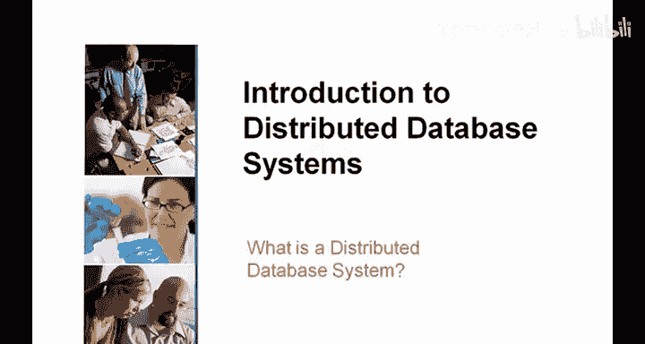
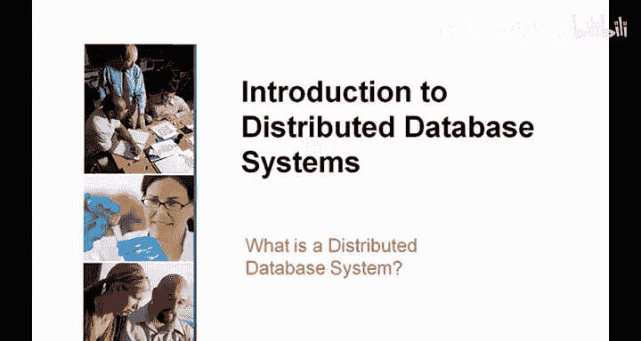
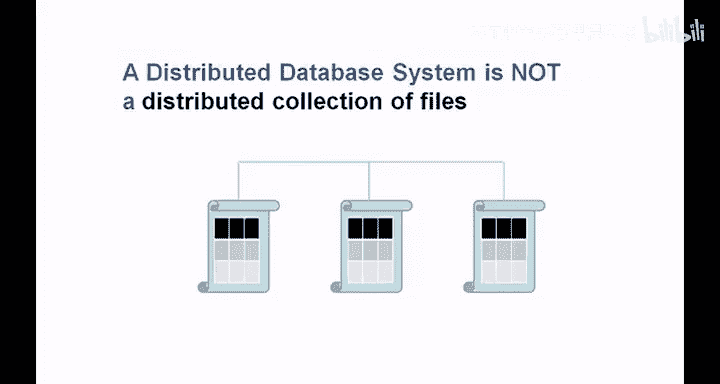
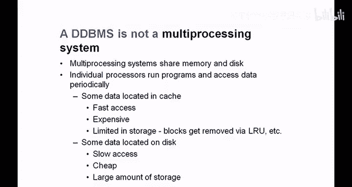
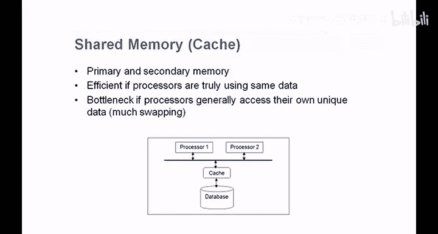
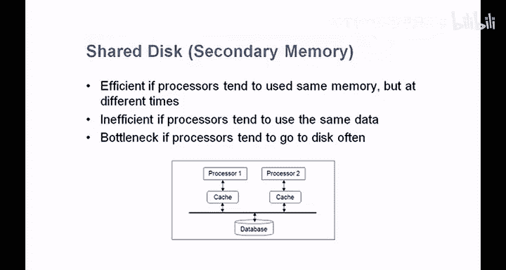
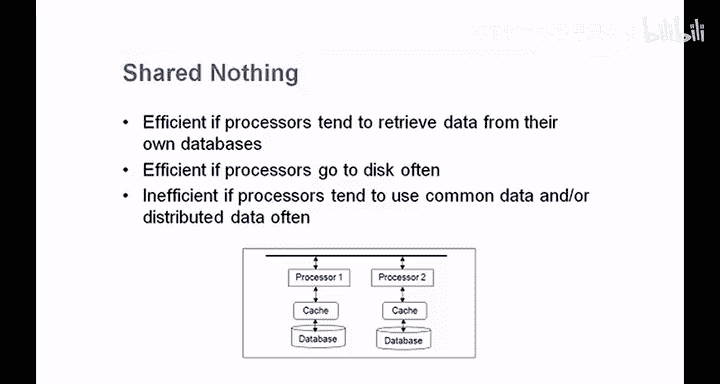
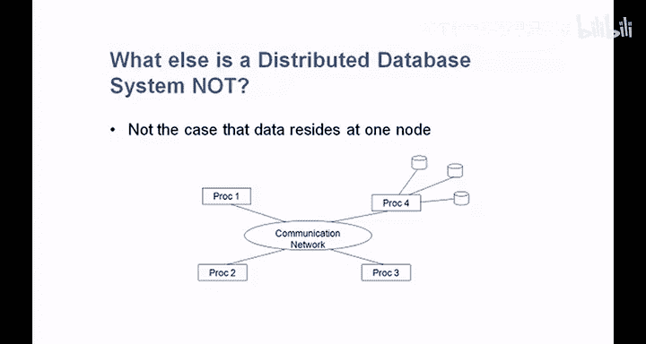
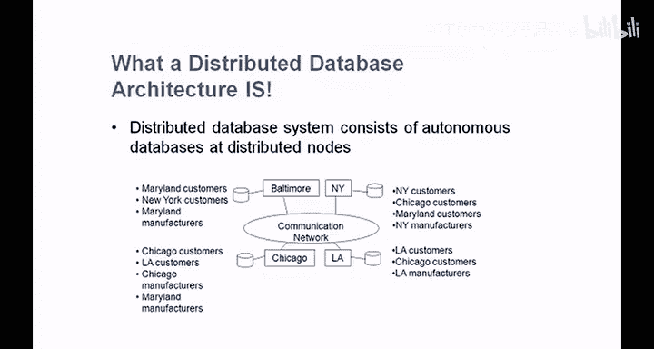

# 001：什么是分布式数据库系统？ 🗄️

在本节课中，我们将要学习**分布式数据库系统**的基本概念。我们将首先明确它“不是什么”，通过对比其他系统来清晰地定义它，最后阐述其核心特征与设计考量。

---

## 分布式数据库系统“不是什么”

为了准确定义分布式数据库系统，我们首先需要排除一些容易混淆的概念。

### 不是分布式文件集合

分布式数据库系统**不是**一个分布式文件集合。虽然存在整合文件的系统（例如搜索引擎），但为了本课程的目的，我们不将常规文件的分布视为分布式数据库系统的一部分。

要被视为分布式数据库系统，文件必须：
*   **相互关联**：文件之间需要有意义的联系。
*   **结构良好**：良好的结构能实现快速的数据集成与关联。

### 不是多处理系统

分布式数据库系统也**不是**多处理系统。多处理系统是指多个处理器访问非常相似数据的系统。虽然听起来类似，但两者有本质区别。

多处理系统主要分为以下三种架构：

**1. 共享内存系统**
在这种系统中，多个处理器共享高速缓存和数据库（即主存和辅存）。

*   **工作原理**：当一个处理器（如处理器1）从数据库请求数据（如变量A、B、C）时，系统会将这些数据从较慢的磁盘移至高速缓存。当处理器1再次需要这些数据时，可以直接从高速缓存快速获取。
*   **优点**：如果另一个处理器（处理器2）也需要相同的数据，它也能直接从高速缓存获取，无需访问数据库，效率很高。
*   **缺点**：如果两个处理器频繁访问不同的数据集，会导致数据在高速缓存和数据库之间被频繁换入换出，反而降低效率。

**2. 共享磁盘系统**
在这种系统中，每个处理器拥有自己的高速缓存，但共享一个公共数据库。

*   **工作原理**：处理器1和处理器2从同一个数据库中读取各自需要的数据块到本地缓存中进行处理。
*   **优点**：适合处理器们需要访问数据库中不同部分数据的场景。
*   **缺点**：如果它们需要频繁访问磁盘上的同一数据，可能造成瓶颈；或者如果它们总访问相同数据，则各自维护缓存会造成资源浪费。

**3. 无共享系统**
这是目前非常流行的架构，尤其适用于大型数据仓库系统。在这种系统中，每个处理器都拥有自己独立的高速缓存和数据库。

*   **工作原理**：处理器主要访问自己本地数据库中的数据。只有当需要对方数据库中的数据时，才会通过网络发送消息来获取。
*   **优点**：当处理器需要的数据差异很大时，这种架构非常高效。
*   **缺点**：如果它们需要频繁共享或访问相同的数据，效率会降低。

**重要提示**：以上所有多处理系统架构，都**不是**我们所说的分布式数据库系统。

---

## 什么才是分布式数据库系统？

上一节我们排除了容易混淆的概念，本节中我们来看看分布式数据库系统的正确定义。

一个真正的分布式数据库系统，是一个拥有大型通信网络的系统，其中处理器**地理上分布**，并且**每个处理器都挂载有自己的数据库**。

请看以下示意图：

如图所示，我们有四个地理上分布的处理器（巴尔的摩、纽约、芝加哥等），每个地点都运行着自己的数据库。

分布式数据库系统的核心特征包括：

1.  **物理分布与数据冗余**：数据表被分布在不同地点的数据库中。例如，`马里兰客户`数据既存在于巴尔的摩的数据库，也可能存在于纽约的数据库中。这种冗余非常重要，它能确保当一个节点故障时，其他节点可以继续处理请求并保存信息，保证系统的高可用性。
2.  **引用局部性**：这是分布式数据库设计的一个关键考量。例如，纽约的程序可能经常需要访问`马里兰客户`数据。如果这些数据在纽约本地有副本，那么访问速度将远快于每次都通过互联网向巴尔的摩的数据库发送请求。因此，在设计分布式数据库时，我们需要在那些最可能需要该数据的地方复制信息，这既是为了冗余备份，也是为了提供快速的本地访问。

这种地理上的分布带来了许多重要的技术挑战，例如如何从多个站点访问和聚合数据、如何处理分布式事务、以及如何应对网络和带宽问题等，这些都将是我们课程后续讨论的重点。

---

## 总结

本节课中，我们一起学习了分布式数据库系统的基础定义。我们首先明确了它**不是**简单的分布式文件集合，也**不是**共享内存、共享磁盘或无共享的多处理系统。真正的分布式数据库系统的核心在于**地理分布的处理器各自拥有独立的数据库**，并通过网络连接。其设计强调**数据冗余**以保证高可用性，并利用**引用局部性**原则来优化数据布局，从而提升访问性能。理解这些基本概念是深入学习大规模数据库系统管理、查询执行和数据集成等高级主题的基础。