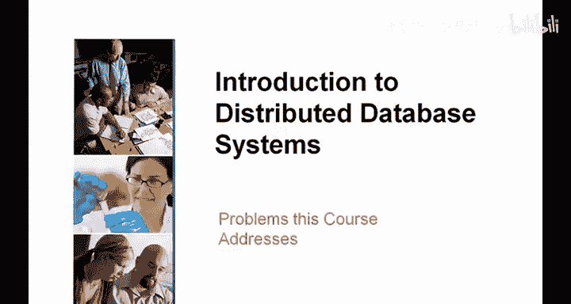
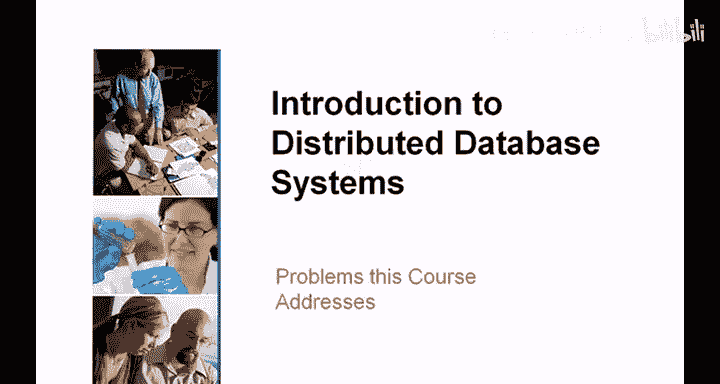
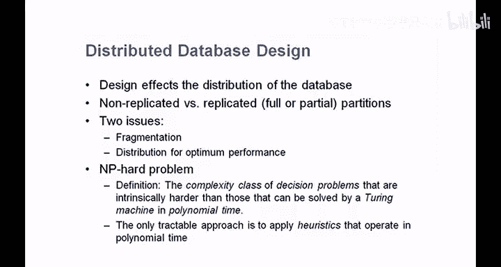
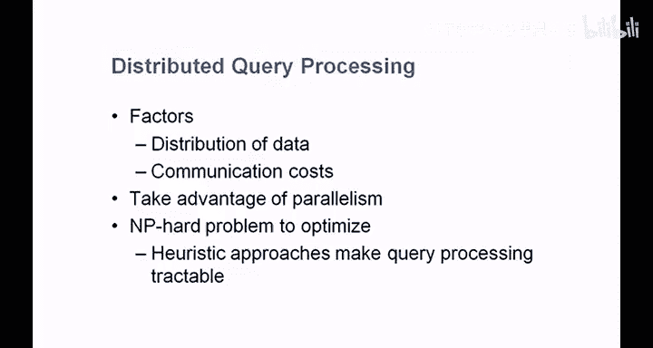
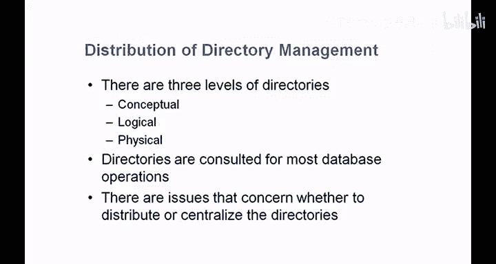
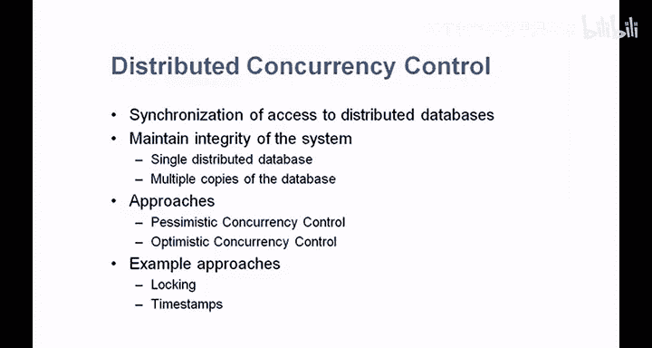
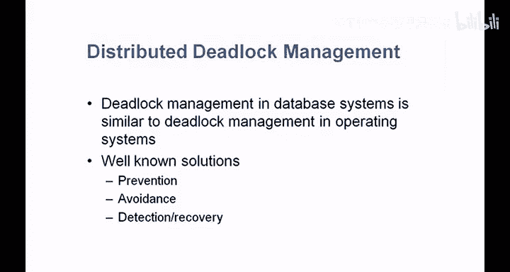
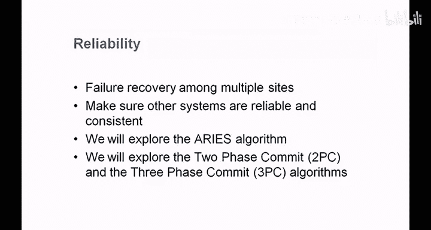

# 003：本课程将解决的核心问题 🎯

在本节课中，我们将概述《大规模数据库系统》课程将要探讨和解决的一系列核心挑战。理解这些问题，是学习后续分布式数据库设计、优化和管理技术的基础。

上一节我们介绍了课程的整体框架，本节中我们来看看课程具体要解决哪些关键问题。

## 1. 分布式数据库系统设计 🏗️

作为设计者，如何设计一个分布式数据库系统是本课程要解决的第一个问题。分布式数据库系统有多种设计方案，这些设计将直接影响查询性能和系统效率。我们将探讨如何为数据库系统选择不同的设计，并分析跨多个系统复制数据所带来的影响。

以下是设计中的两个核心问题：

*   **数据表分片**：分片意味着在某些情况下，你需要将数据表拆分。这包括水平分片（将不同的行放置在不同的地理位置）和垂直分片（将不同的列放置在不同的地理位置）。分片的最终目的是优化分布式查询。
*   **设计复杂性**：将表拆分成片段并在地理上分布，是一个计算上非常困难的问题。如果遍历所有选项，这将是一个NP难问题，意味着计算复杂度是指数级的，计算机需要很长时间才能计算出最优的分布方案。

因此，我们通常采用启发式算法。启发式算法能在多项式时间内找到一个非常好的解决方案（不一定是最优的），从而保证在合理的时间内完成数据分布。

我们将在接下来的课程中详细探讨分片与数据分布。

## 2. 分布式查询处理 🔍

一旦我们有了分布式设计，下一步就是确定如何向分布式数据库制定查询，这是本课程的主要部分。在分布式环境中制定查询可能很困难，这同样是一个NP难问题。

为分布式表或表片段找到最优的连接查询计划非常困难且耗时，因为存在大量可能的查询计划。使用指数级算法来计算最优计划，用户将无法接受其等待时间。

我们再次使用启发式方法。启发式方法能在更短的时间内找到一个良好的解决方案（不一定是最佳），使用户能在合理的时间内获得查询结果。

此外，在分布式查询处理中，我们还将利用并行化的优势，并必须考虑数据分布的位置以及制定正确查询计划时的通信成本。

## 3. 目录管理分布 📂

目录管理涉及三个层次：概念目录（应用查询所针对的全局概念模式）、逻辑目录（存在于每个数据库节点的模式）和物理目录（表在磁盘上的实际布局）。这三者相互关联，几乎任何数据库操作都需要查询这些目录。

这里的关键问题是：应该分布式管理还是集中式管理这些目录？我们将讨论分布式与集中式目录管理的权衡。

## 4. 分布式并发控制 ⚙️

当多个用户同时向数据库提交查询时，这些查询可能会相互干扰，导致数据不一致。例如，一个用户正在读取数据，而另一个用户修改了该数据，第一个用户仍基于旧值进行操作。

我们将探索分布式并发控制算法，以维护分布式数据库系统的完整性。这些算法主要分为两大类：

*   **悲观并发控制**：假设冲突经常发生，因此预先采取所有预防措施（如加锁），确保用户不会相互干扰。
*   **乐观并发控制**：假设冲突不常发生，因此允许操作进行，并在最后提交时检查是否发生了冲突。

课程后续将详细讨论这些方法，例如大家熟悉的**加锁**机制，以及可能不太熟悉的**时间戳**等方法。

## 5. 分布式死锁管理 🔗

在分布式数据库系统中，不同地理位置的资源可能会相互等待，从而导致死锁。数据库系统中的死锁管理与操作系统中的死锁管理非常相似。

当多个用户想要访问数据库中的不同数据，但彼此等待对方释放锁定的资源时，就可能发生死锁。我们将讨论几种著名的解决方案：

*   死锁预防
*   死锁避免
*   死锁检测与恢复

这些方法将在未来的课程中详细探讨。

## 6. 系统可靠性 💾

可靠性问题涉及当系统站点发生故障时会发生什么。例如，如果你向数据库写入数据，系统告诉你已写入，你便期望该数据始终存在。但如果数据库系统在数据从缓存写入磁盘前崩溃，数据就会丢失。

因此，当数据库系统向用户保证数据已持久化，并在系统从崩溃中恢复时，它必须确保这些数据确实存在。我们将探索一些算法来保证这一点，即使在系统故障导致数据丢失的情况下。

我们将首先探讨适用于单数据库系统的 **Aries算法**，然后将其扩展到多数据库系统，并讨论**两阶段提交协议**和**三阶段提交协议**。

## 7. 异构数据库系统集成 🔄

有时也称为多数据库系统。本课程的前半部分主要关注从零开始构建一个分布式数据库管理系统，即你对表、分布和数据库管理系统拥有完全控制权。

然而，在许多实际应用中，你并没有这种控制权。你可能需要集成由他人控制、已存在的数据库系统。你无法访问这些系统的统计信息或使用模式，但必须尽最大努力集成它们。

本课程中学到的许多技术将帮助我们集成那些已存在且不受我们控制的分布式数据库。我们将看到这些技术如何应用于异构数据库，以及如何在无法完全控制系统的情况下实现集成。

---

**本节课中我们一起学习了**《大规模数据库系统》课程将要解决的七大核心问题：**分布式系统设计**、**分布式查询处理**、**目录管理**、**并发控制**、**死锁管理**、**系统可靠性**以及**异构系统集成**。理解这些问题是掌握后续具体技术和算法的基础。在接下来的课程中，我们将对每个问题进行深入剖析。