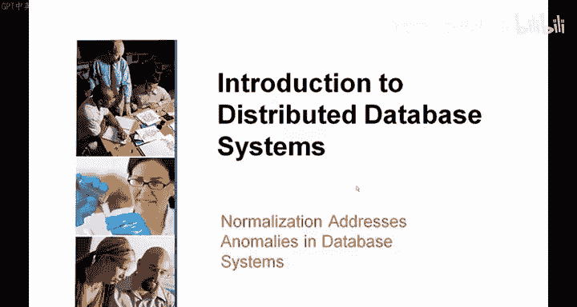
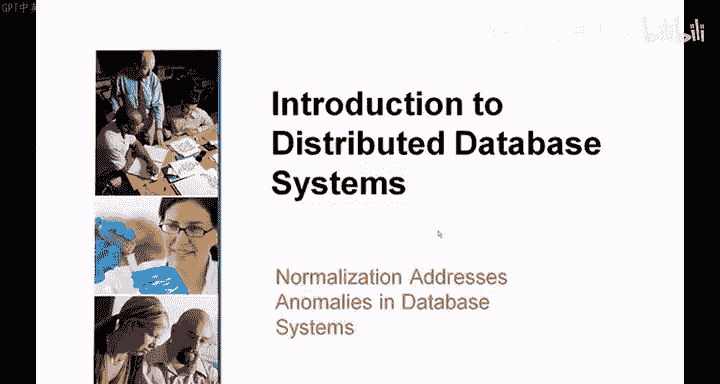
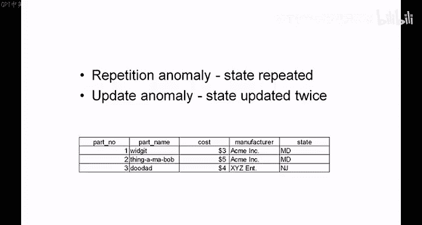
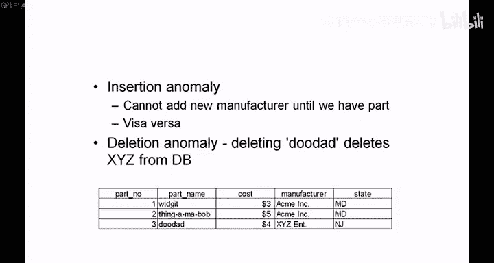

# 004：规范化解决数据库系统异常 📊

在本节课中，我们将学习数据库规范化（Normalization）的基本动机，以及如果不进行规范化，数据库设计会遇到哪些问题。我们将通过一个具体的例子，分析重复异常、更新异常、插入异常和删除异常，并理解如何通过规范化来避免这些问题。

---

## 为什么需要规范化？ 🤔

上一节我们介绍了数据库表通常由多个相互关联的表组成。本节中我们来看看，如果不进行规范化，将所有数据都放在一个“通用关系”（Universal Relation）大表中，会产生哪些问题。

假设我们有一个包含零件和制造商信息的单一表，其结构如下：

| 零件号 | 零件名称 | 成本 | 制造商 | 制造商所在州 |
| :--- | :--- | :--- | :--- | :--- |

以下是如果使用这种单一表结构会遇到的两个主要问题。

### 重复异常与更新异常 🔄

**重复异常（Repetition Anomaly）** 指的是相同的信息在表中被不必要地重复存储多次。

**更新异常（Update Anomaly）** 指的是当某个信息需要更新时，必须在所有重复出现的行中进行修改，否则会导致数据不一致。

请看示例数据：

| 零件号 | 零件名称 | 成本 | 制造商 | 制造商所在州 |
| :--- | :--- | :--- | :--- | :--- |
| P1 | 螺母 | 0.05 | Acme公司 | 马里兰州 |
| P2 | 螺栓 | 0.10 | Acme公司 | 马里兰州 |
| P3 | 面板 | 1.00 | XYZ企业 | 加利福尼亚州 |

在这个表中，“Acme公司”及其所在地“马里兰州”的信息被重复存储了两次。在实际系统中，制造商信息可能还包括地址、电话、总裁姓名等更多字段，每次新增一个Acme公司的零件时，所有这些信息都必须被重复输入一遍，这就是**重复异常**。

现在，假设Acme公司从马里兰州搬到了特拉华州。为了更新这个信息，我们必须找到并修改表中所有“制造商”为“Acme公司”的行。如果Acme公司生产了成千上万个零件，这个更新操作将非常繁琐且容易出错，这就是**更新异常**。

通过将表规范化为两个独立的表，可以解决这些问题：
*   **零件表（Parts Table）**：包含 `零件号`，`零件名称`，`成本`，`制造商ID`。
*   **制造商表（Manufacturers Table）**：包含 `制造商ID`，`制造商名称`，`所在州`，`地址`，`电话`等。

这样，制造商信息只需存储一次。零件表通过`制造商ID`外键引用制造商表。添加新零件时，只需引用已有的制造商ID，无需重复输入其详细信息。更新制造商信息时，也只需在制造商表中修改一次。

### 插入异常与删除异常 ⚠️

上一节我们讨论了重复数据带来的问题。本节我们来看看单一表结构在数据增删时引发的另外两种异常。

**插入异常（Insertion Anomaly）** 指的是无法单独插入某些必要信息。

**删除异常（Deletion Anomaly）** 指的是在删除某些数据时，会不必要地丢失其他信息。

以下是这两种异常的具体表现。

**插入异常示例**：假设一家新的制造商“Beta有限公司”成为了我们的供应商，但我们还没有从他们那里采购任何零件。在单一表结构中，由于“零件号”是主键（或不能为空），我们无法插入一条没有零件信息的记录。因此，在获得第一个Beta公司生产的零件之前，我们无法在系统中记录这家新制造商的信息。

**删除异常示例**：假设零件“面板”（P3）是数据库中唯一由“XYZ企业”生产的零件。如果我们决定删除“面板”这个零件，那么与之相关的整条记录都会被删除。这意味着“XYZ企业”的所有信息（名称、所在州等）也会从数据库中消失。我们可能希望保留制造商信息以备未来之需，但单一表结构迫使我们丢失了这些信息。

通过规范化，将数据拆分到零件表和制造商表，可以轻松解决这些异常：
*   **解决插入异常**：我们可以随时在制造商表中添加新的制造商记录，无需依赖是否有零件。
*   **解决删除异常**：当我们删除某个零件时，只会影响零件表。只要该制造商还有其他零件存在，或者即使暂时没有，其信息也会安全地保留在制造商表中。

---

## 总结 📝

本节课中，我们一起学习了数据库规范化的核心动机。我们通过一个具体的例子，分析了非规范化设计（使用单一通用关系表）会导致的四种主要异常：
1.  **重复异常**：相同信息被不必要地重复存储。
2.  **更新异常**：修改信息时需要在多行进行，易出错且低效。
3.  **插入异常**：无法独立插入某些实体（如制造商）的信息。
4.  **删除异常**：删除某个实体（如零件）时，会连带删除其他实体（如制造商）的信息。

规范化通过将数据分解到多个逻辑关联的表中，有效地消除了这些异常，从而保证了数据的一致性、完整性和操作效率。这是设计健壮、可维护的数据库系统的基石。