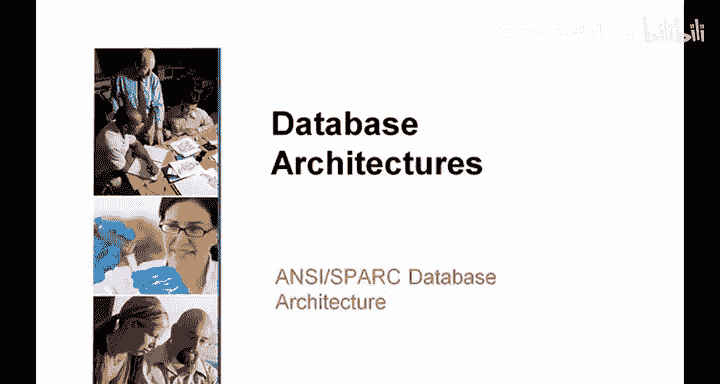
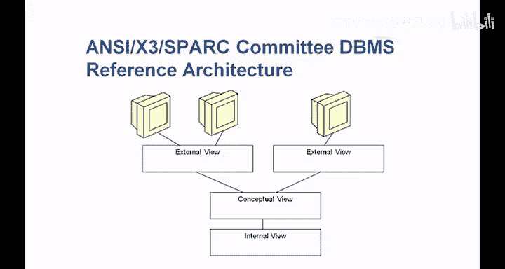
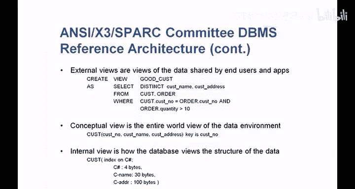
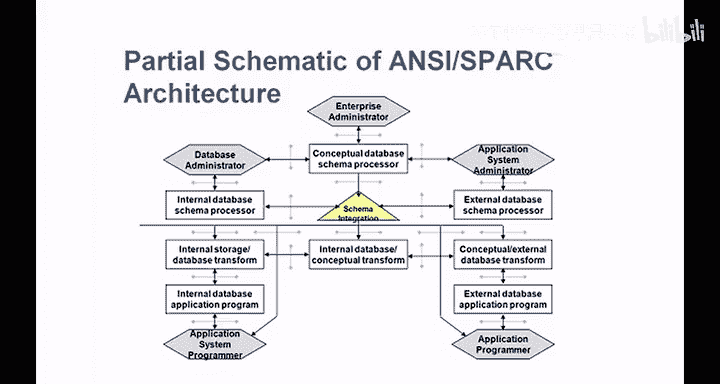

# 005：ANSI SPARC数据库架构 🗂️

## 概述

在本节课中，我们将要学习由ANSI SPARC委员会定义的数据库管理系统参考架构。这是一个非常高层级的架构，它描述了数据库系统如何组织、编目和呈现数据。我们将通过三个核心视图——外部视图、概念视图和内部视图——来理解数据在不同角色和层级间的映射关系。



---

## ANSI SPARC三层架构

上一节我们介绍了课程背景，本节中我们来看看ANSI SPARC架构的核心模型。

该架构的中心是一个代表**概念视图**的矩形。这个概念视图可能是整个系统的实体关系模型或表关系图，它由数据库管理员整合，旨在统一地理解系统中所有数据的存储需求与关联方式。



从顶层看，由计算机终端代表的各个外部应用程序或用户，并不都拥有相同的系统概念视图。

以下是不同视图的核心描述：

*   **外部视图**：每个应用程序或用户根据自身需求与数据交互的视角。他们只关心对自己重要的数据部分。
*   **概念视图**：由数据库管理员定义的、统一的、全局的数据逻辑结构。它是所有外部视图映射的基础。
*   **内部视图**：数据库管理系统实际在磁盘上存储和组织数据的方式。在分布式系统中，可能存在多个内部视图，但它们都映射到单一的概念视图。

ANSI SPARC委员会定义了这三个层级的视图，并且每一层都可以映射到另一层。

---

## 视图示例

理解了架构的层次后，我们通过一个具体例子来看看这些视图是如何工作的。

从外部视图的角度，某个用户应用程序可能只关心“优质客户”这个概念。



以下是各视图在该场景下的具体体现：

*   **外部视图（用户视角）**：用户通过一个名为`GOOD_CUSTOMER`的视图与数据库交互。这个视图可能通过一个SQL查询来定义，例如：
    ```sql
    CREATE VIEW GOOD_CUSTOMER AS
    SELECT customer_id, customer_name
    FROM CUSTOMER
    WHERE customer_id IN (
        SELECT customer_id
        FROM ORDERS
        GROUP BY customer_id
        HAVING COUNT(*) > 10
    );
    ```
    用户只与这个视图交互，而不直接接触底层表。
*   **概念视图（DBA视角）**：数据库管理员定义整个系统的逻辑结构。例如，他需要创建`CUSTOMER`表和`ORDERS`表。`CUSTOMER`表可能包含`customer_id`、`customer_name`、`customer_address`等列。最终用户并不直接访问这些基础表。
*   **内部视图（系统视角）**：数据库系统决定如何在物理磁盘上存储这些数据。它可能为`customer_id`列建立索引，使用不同的内部列名，并确定数据块的具体存储格式。

---

## 架构中的角色与流程

上一节我们通过例子理解了视图，本节我们来剖析架构图中各个组件代表的角色与流程。这张示意图描述了ANSI SPARC架构中各个实体如何协作。

图中，**阴影六边形代表角色**，**矩形代表处理过程**，而**三角形代表模式集成点**。

以下是关键角色与流程的解析：

*   **企业管理员**：负责定义数据库的**概念模式**。他需要理解系统中的所有数据需求与关系。
*   **数据库管理员**：负责将概念模式转化为**内部模式**。他需要关心数据在磁盘上的实际布局。
*   **应用系统管理员**：负责为外部用户定义**外部模式**。
*   **模式集成**：所有定义好的模式（概念、内部、外部）都汇集于此，并在此完成相互间的映射与转换。
*   **应用程序员**：编写应用程序，通过**外部模式**与数据库交互。其查询请求会经由外部模式、概念模式、内部模式层层转换，最终抵达数据库；返回的数据也沿原路径反向转换，以外部视图的格式呈现给程序。
*   **应用系统程序员**：编写更底层的应用程序，主要与数据库的**内部结构**直接交互。

整个数据请求的流程可以概括为：**应用程序 -> 外部模式 -> 概念模式 -> 内部模式 -> 物理数据库**。返回的路径则相反。

---

## 总结



本节课中我们一起学习了ANSI SPARC数据库三层架构。我们了解了**外部视图**如何满足不同用户的特定需求，**概念视图**如何提供统一的数据逻辑模型，以及**内部视图**如何管理数据的物理存储。我们还通过示意图分析了数据库管理员、应用程序员等不同角色在此架构中的职责与交互流程。该架构的核心价值在于实现了数据的逻辑独立性与物理独立性，使得用户访问、逻辑设计和物理存储可以相对独立地变化。