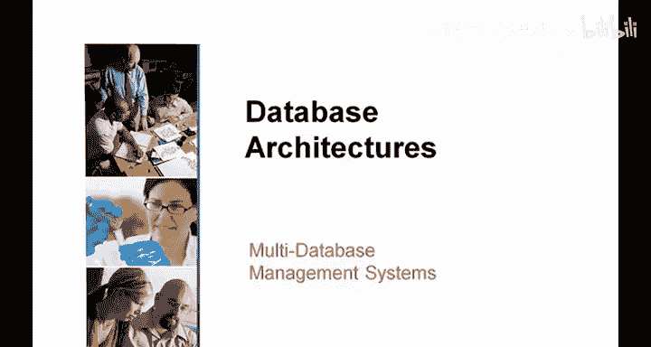
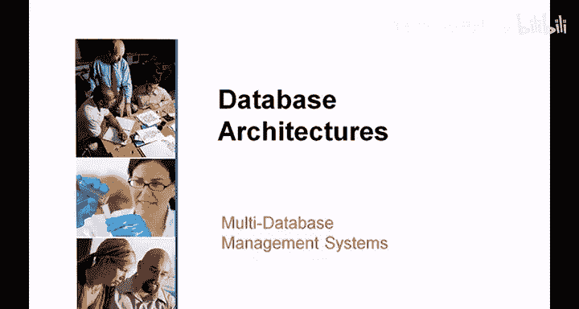
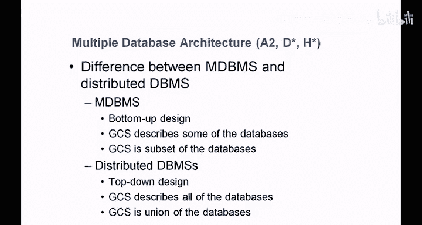
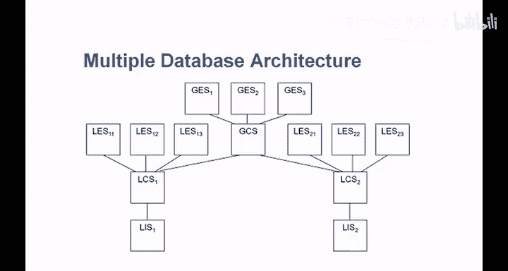
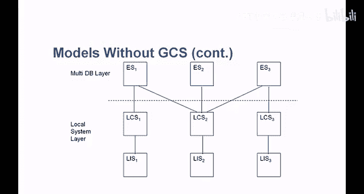

# 007：多数据库管理系统 🗃️

## 概述

在本节课中，我们将要学习多数据库管理系统的基本概念、架构及其与分布式数据库管理系统的关键区别。我们将探讨多数据库系统的设计挑战、集成方式以及不同用户群体如何与之交互。

---

## 多数据库管理系统介绍

欢迎来到第5单元，这是分布式数据库系统课程的一个模块。在本单元中，我将讨论多数据库管理系统。

实际上，在整个课程中我不会过多讨论这个话题。但为了完整描述不同的分布式数据库系统架构，有必要在此提及。我们注意到，这里讨论的是第二级自治性。这意味着您要集成的所有数据库系统都具有相当高的自治性。这些是已经存在的数据库系统，它们拥有自己的用户群体。现在有人来集成它们，形成一个分布式数据库系统的联邦。

要求是它们仍然必须自主运行。集成它们很困难。集成多数据库管理系统和分布式数据库管理系统之间的差异如下。

---

## 多数据库管理系统 vs. 分布式数据库管理系统

在多数据库管理系统中，您处理的是自底向上的设计。您已经拥有可访问的数据库，您的任务是集成它们。您对这些数据库的内部了解较少，对它们的设计方式、存放位置、使用方式以及如何集成的控制也较少。

您通常只有有限的能力来集成数据。通常会有一个全局概念模式，用于描述联邦中呈现的数据，并映射到各个数据库系统包含哪些数据。并非所有单个数据库系统都愿意共享其全部数据，它们可能只展示部分数据。因此，全局概念模式只描述它们共享的部分以及这些数据库之间的共性和关系。

分布式数据库管理系统是我们课程大部分时间将要讨论的内容，它是一种自顶向下的设计。您可以控制单个数据库的存放位置、这些数据库上存放哪些数据片段或表、如何控制全局概念模式。实际上，全局概念模式描述了所有数据库或这些数据库的并集，因为您设计了它们，您知道设计应该是什么样子，也知道如何布局。

因此，多数据库系统集成起来稍微困难一些。

---

## 多数据库系统架构示意图

在这个示意图中，请注意我们有两个本地数据库系统。它们的用户群体已经非常成熟。因此，您有本地内部模式1、本地内部模式2、本地概念模式1、本地概念模式2。这些都是两个独立的数据库系统及其概念模式。用户群体拥有它们的本地外部模式1.1、1.2、1.3，与本地概念模式1通信。这意味着已经存在一个预先建立的用户群体，通过外部模式访问数据库1。数据库2也有一个用户群体。

现在，您来定义一个全局概念模式，通过该模式以某种方式集成所有本地数据库。这个全局概念模式支持的是全局外部模式。因此，您现在有了一个新的用户群体，他们通过联邦与分布式数据库系统交互。实际上，您集成的是一个多数据库系统，它由两个预先存在的、拥有自己用户群体的数据库系统组成。

请注意，与这些数据库交互的用户是那些使用本地外部模式的人。他们不希望改变他们的接口，他们希望系统像往常一样运行。挑战在于，您作为多数据库架构师，必须将它们全部整合在一起，确保所有这些本地外部模式仍然能够以相同的方式访问它们原有的数据库，但同时您现在还必须支持全局外部模式。

---

## 多数据库系统的交互风格

与这些多数据库系统交互有不同的风格：单语言和多语言数据库。

*   **单语言** 意味着数据库系统只理解一种查询语言，具有一种数据库模型，这是最常见的情况。但这给用户带来了负担。用户自己可能已经考虑了不同的模型，用户群体有自己的外部模式，有自己的语言需求。因此，现在用户需要承担用多数据库系统的新单语言来制定新查询的负担，这种语言可能与他们原本使用的查询语言不同。
*   **多语言多数据库系统** 中，全局概念模式必须理解许多不同的查询语言。因此，每个用户实际上可以用自己的语言向该系统制定查询。现在，这真正成为了多数据库系统的负担，它需要解释每种查询语言，并向底层企业制定查询。这要困难得多，在多数据库系统中并不常见。首先，单语言多数据库管理系统要常见得多。

---

## 无全局概念模式的模型

有些模型根本没有全局概念模式。事实上，许多集成分布式数据库系统或多数据库系统的商业产品实际上并没有全局概念模式。因此，需要您在没有本地模式的情况下管理许多不同的数据库系统。

您基本上集成了数据库系统，现在您看到的不是单个表，而是所有表都呈现在您面前。由您来制定查询，由您来制定连接操作，将这些数据整合在一起是您的责任。每次制定查询时，您都必须理解外部模式（您的视图）和本地模式之间的映射。这需要您对所集成的所有数据库系统有更多的了解，您必须成为理解它们的语义、关系以及如何制定查询的专家。

这是一个没有全局概念模式的多数据库系统示意图。您会注意到，多个外部模式与许多不同的本地模式交互，实际上是由它们直接与这些本地模式交互。现在，集成系统可能提供了在本地模式之间执行连接操作的能力，这确实使外部用户更容易操作，但外部用户仍然需要了解所有可用的数据，并且必须了解如何将数据连接在一起以获得所需的结果。

---

## 总结

本节课中，我们一起学习了多数据库管理系统。我们了解了它与分布式数据库管理系统在设计和控制上的关键区别，即**自底向上集成现有自治系统**与**自顶向下设计可控系统**。我们探讨了多数据库系统的架构，包括支持新旧用户群体的全局和本地模式。我们还分析了单语言与多语言系统的不同交互风格及其对用户的负担。最后，我们认识到，即使在没有全局概念模式的模型中，集成工作依然存在，并且对用户的专业知识要求更高。理解这些概念有助于我们认识在现实世界中集成异构数据库系统所面临的挑战。