# 008：关系代数表示法 📚

在本节课中，我们将要学习关系代数的基本概念和核心操作。关系代数是数据库查询的理论基础，它定义了一系列对表（关系）进行操作的符号和方法。理解这些操作对于掌握SQL查询和数据库设计至关重要。

## 概述

关系代数包含一系列对表（关系）进行操作的运算。这些表可以视为具有行和列的集合。核心操作包括选择、投影、并集、差集和笛卡尔积。此外，还有一些派生操作，如交集、θ连接和自然连接，它们可以看作是基本操作的组合。

## 基本操作

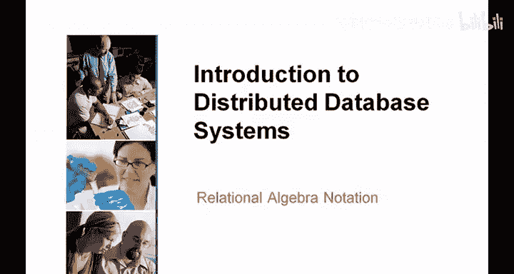

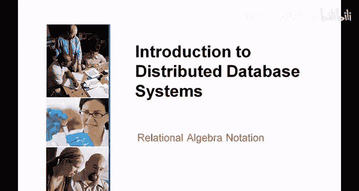

上一节我们介绍了关系代数的概述，本节中我们来看看其基本操作。这些是构成更复杂查询的基础。

### 选择 (Selection)

选择操作用于根据特定条件筛选表中的行。其符号表示为 **σ**。

**公式：** `σ<条件>(R)`

其中，`R` 是一个关系（表），`<条件>` 是一个逻辑表达式（例如，`cost = 3`）。该操作会返回 `R` 中所有满足条件的行。

以下是选择操作的示例：
*   假设有一个零件表 `Part`，包含零件号、零件名、成本和制造商。
*   执行 `σ<cost=3>(Part)` 会选择出成本等于3的所有行。
*   在SQL中，这等价于：`SELECT * FROM Part WHERE cost = 3;`

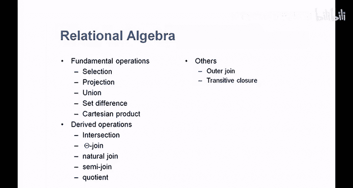

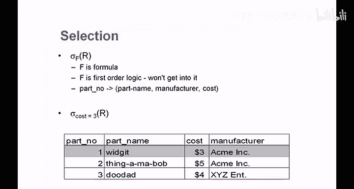

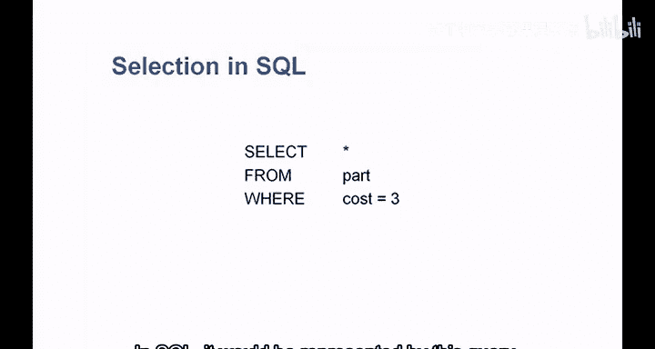

### 投影 (Projection)

投影操作用于选择表中的特定列。其符号表示为 **π**。

**公式：** `π<属性列表>(R)`

其中，`<属性列表>` 是你希望从关系 `R` 中提取的列名。

以下是投影操作的示例：
*   从 `Part` 表中，执行 `π<part_name, cost>(Part)` 会创建一个只包含 `part_name` 和 `cost` 两列的新表。
*   在SQL中，这等价于：`SELECT part_name, cost FROM Part;`

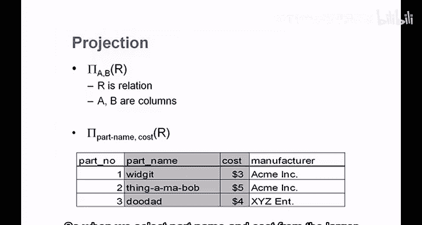

### 并集 (Union)

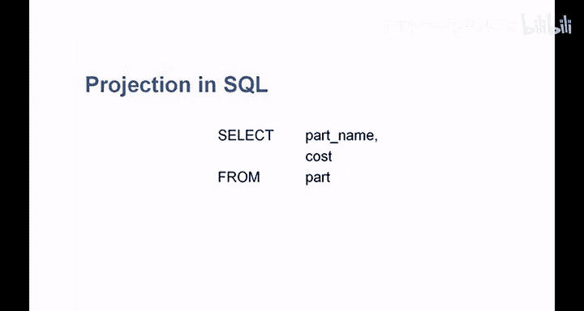

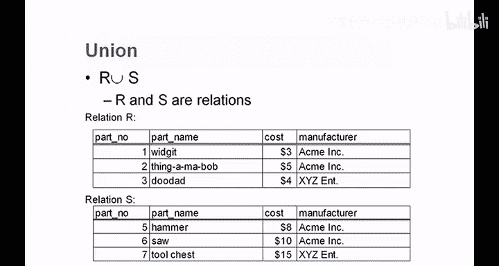

并集操作用于合并两个具有相同列结构（即相同模式）的表。其符号表示为 **∪**。

**公式：** `R ∪ S`

该操作返回一个包含 `R` 和 `S` 中所有不重复行的新关系。

以下是并集操作的示例：
*   假设 `R` 和 `S` 是两个结构相同的零件表。
*   `R ∪ S` 的结果是包含两个表中所有零件信息的一个表。
*   在SQL中，这等价于：`SELECT * FROM R UNION SELECT * FROM S;` （注意：`UNION` 会自动去重）。

### 差集 (Set Difference)

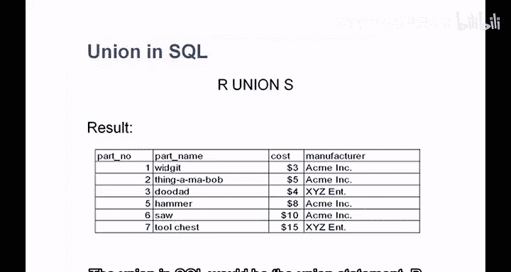

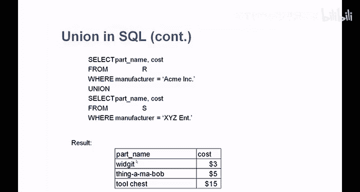

差集操作用于从一个表中移除也存在于另一个表中的行。其符号表示为 **-**。

**公式：** `R - S`

该操作返回所有属于 `R` 但不属于 `S` 的行。

以下是差集操作的示例：
*   `R - S` 的结果是仅存在于 `R` 表中的行。
*   在SQL中，可以使用 `EXCEPT` 或 `NOT IN` 子查询来实现。

### 笛卡尔积 (Cartesian Product)

笛卡尔积将两个表中的每一行进行两两组合。其符号表示为 **×**。

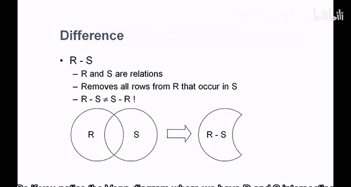

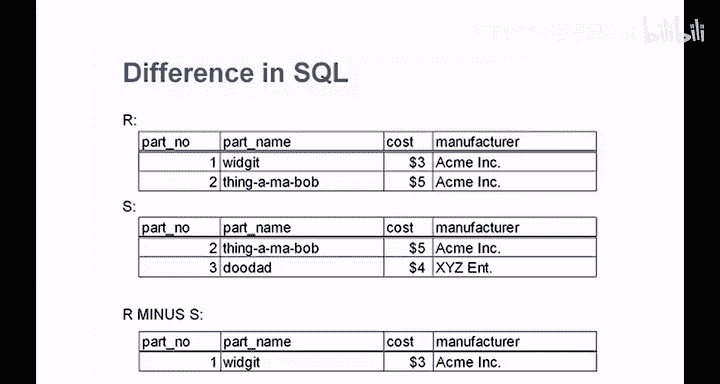

**公式：** `R × S`

如果 `R` 有 `m` 行，`S` 有 `n` 行，那么结果将有 `m × n` 行。

以下是笛卡尔积的示例：
*   结果表的每一行都是 `R` 的一行与 `S` 的一行的拼接。
*   在SQL中，这可以通过没有连接条件的 `FROM` 子句实现：`SELECT * FROM R, S;`

## 派生操作

上一节我们介绍了五种基本操作，本节中我们来看看由它们组合而成的派生操作。这些操作提供了更便捷的表达方式。

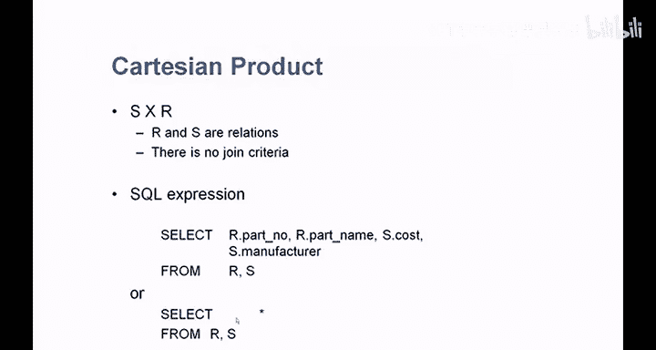

### 交集 (Intersection)

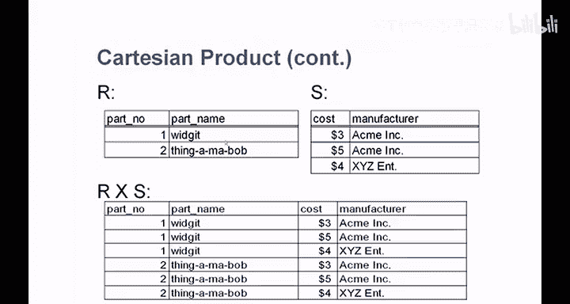

交集操作用于找出两个表中共同存在的行。其符号表示为 **∩**。

**公式：** `R ∩ S`

该操作返回同时属于 `R` 和 `S` 的所有行。值得注意的是，交集可以通过差集来定义：`R ∩ S = R - (R - S)`。

以下是交集操作的示例：
*   在SQL中，这等价于：`SELECT * FROM R INTERSECT SELECT * FROM S;`

### θ连接 (Theta Join)

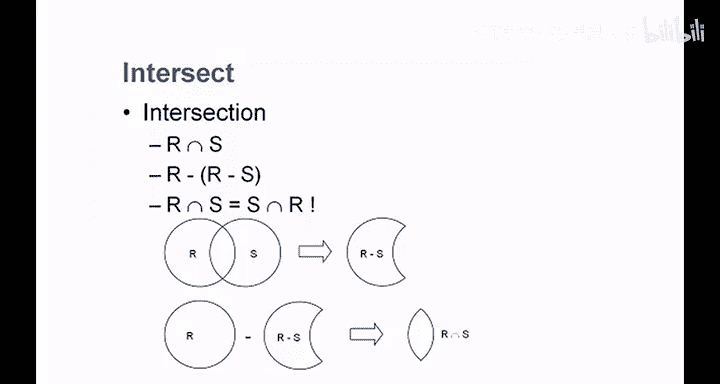

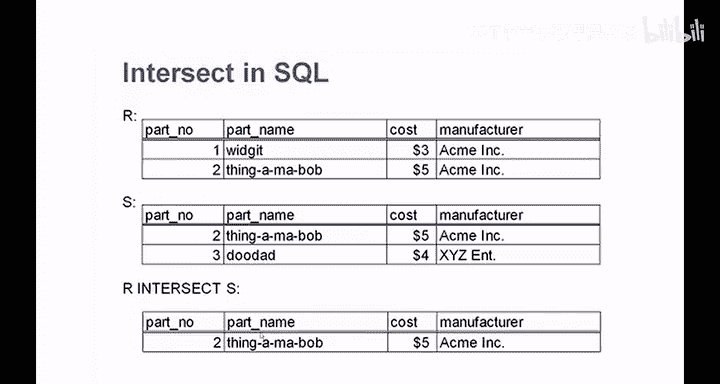

θ连接是笛卡尔积后接选择操作的组合。它根据两个表之间属性的某种条件（θ，如 =, <, >）进行连接。其符号表示为 **⋈<条件>**。

**公式：** `R ⋈<R.A θ S.B> S`

这等价于：`σ<R.A θ S.B>(R × S)`。

以下是θ连接操作的示例：
*   例如，可以根据“R.制造商编号 < S.制造商编号”这样的条件来连接两个表。
*   在SQL中，这等价于：`SELECT * FROM R JOIN S ON R.manufacturer_id < S.manufacturer_id;`

### 自然连接 (Natural Join)

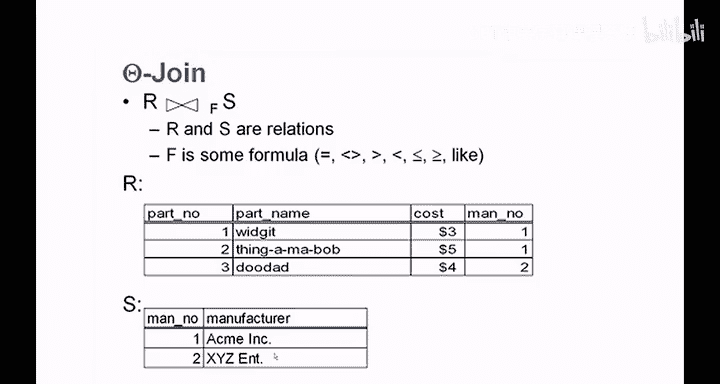

自然连接是一种特殊的等值连接，它自动根据两个表中所有同名的属性进行等值匹配，并在结果中合并这些同名列。其符号表示为 **⋈**。

**公式：** `R ⋈ S`

以下是自然连接操作的示例：
*   如果 `R` 表和 `S` 表都有一个名为 `manufacturer_id` 的列，那么 `R ⋈ S` 会基于 `manufacturer_id` 相等的条件连接两表，并且结果中只有一个 `manufacturer_id` 列。
*   在SQL中，可以近似表示为：`SELECT * FROM R NATURAL JOIN S;` 或者 `SELECT * FROM R JOIN S USING (manufacturer_id);`

## 总结

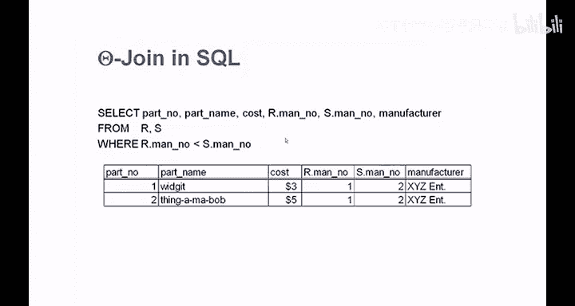

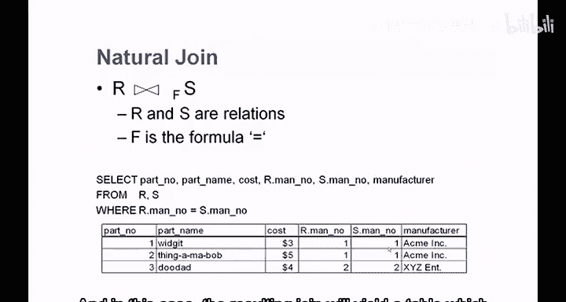

本节课中我们一起学习了关系代数的核心表示法。我们从**选择**、**投影**、**并集**、**差集**和**笛卡尔积**这五个基本操作开始，理解了它们如何对表进行筛选、列选择、合并和组合。接着，我们探讨了由基本操作派生出的**交集**、**θ连接**和**自然连接**，这些操作使得表达常见的表连接查询变得更加简洁和直观。掌握这些关系代数操作是深入理解SQL查询语言和数据库系统内部工作原理的关键一步。