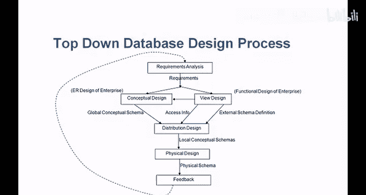

# 009：自顶向下的设计流程 🗺️

在本节课中，我们将学习数据库系统设计中的“自顶向下流程”。这是一种从宏观需求出发，逐步细化到具体物理实现的设计方法。我们将了解其核心步骤，以及每个步骤如何为构建一个高效、可扩展的分布式数据库系统奠定基础。

---

上一节我们介绍了课程背景，本节中我们来看看自顶向下设计流程的具体步骤。

该流程始于**需求分析**。需求分析涉及分析需要存储哪些数据、数据之间的关系、涉及哪些类型的表、表中将包含哪些类型的字段、谁将访问数据库以及这些用户将从何处访问数据库。所有这些需求都在需求分析过程中被收集起来。

在需求收集完毕后，工作实际上会分为两个不同的活动。

*   **概念设计**：这是从完美数据库和完美理解字段、实体及关系的角度出发，对整个数据库进行设计。我们为数据库提出一个完美的概念设计。这是将数据库作为一个整体来看待，就好像所有用户都在查看这个包含了所有人所需信息的数据库，并理解数据之间是如何关联的。这个过程实际上产生了一个良好的**全局概念模式**，它描述了整个系统如何表示以及这些表示之间的关系，最终生成一个全局ER图。
*   **视图设计**：这特别源自系统的用户。这些是系统的**外部模式视图**，描述了单个应用程序或单个用户希望如何使用数据。并非每个用户都需要使用概念设计的每个方面。一些用户可能对概念设计的某些部分有非常复杂的视图。这些因素在设计数据库系统的外部视图时都会被考虑进去。

因此，从全局设计的角度来看，全局概念模式是分布式设计的输入。同时，关于单个用户如何通过视图访问信息的信息，以及来自外部用户的外部模式定义，都会进入分布式设计的定义过程，并参与到在整个企业范围内布局分布式设计的过程中。

一旦我们根据概念设计的所有实体和关系，结合理解谁需要什么数据以及基于需求和访问信息将数据放置在何处，完成了在整个企业范围内的分布式设计布局，分布式设计就完成了。此时，所有的表都分布在数据库系统中。

在数据库系统完成分布式布局后，每个独立的数据库将根据其**本地概念模式**进行设计。每个作为这个更大分布式数据库系统成员的数据库上，都会有一个**物理设计**。这就是分布式数据库系统的初始布局。

在使用之后，我们将观察到使用模式，了解哪些是有效的、哪些是高效的、哪些是低效的。基于这些反馈，我们将能够将这些信息反馈给新的需求分析。这显然不是从头开始，但可能会修改概念设计、视图设计，并最终可能修改分布式设计和物理设计。这种反馈、需求分析和设计的循环过程将持续进行，直到我们拥有一个稳定的数据库系统。

---

本节课中，我们一起学习了自顶向下的数据库设计流程。我们了解到，该流程始于全面的**需求分析**，随后并行开展**概念设计**（定义全局数据模型）和**视图设计**（定义用户视角）。这两者的输出共同指导**分布式设计**，决定数据如何在系统中分布。最后，每个分布节点会进行**本地概念模式**和**物理设计**。整个过程是一个包含**反馈循环**的迭代过程，通过实际使用反馈不断优化设计，直至系统稳定。