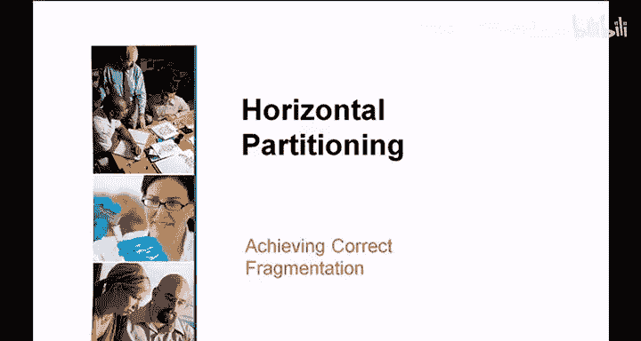
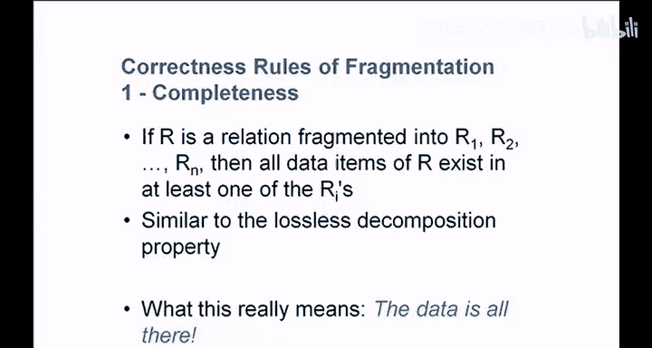
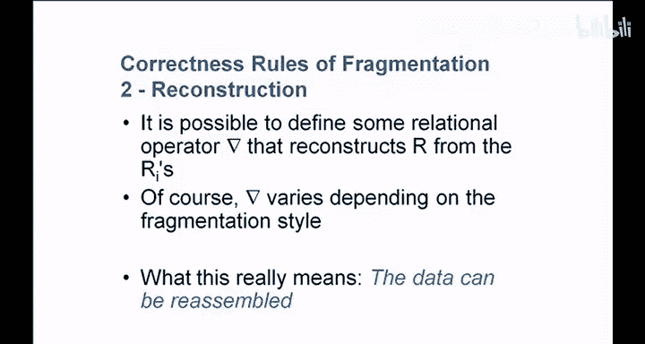
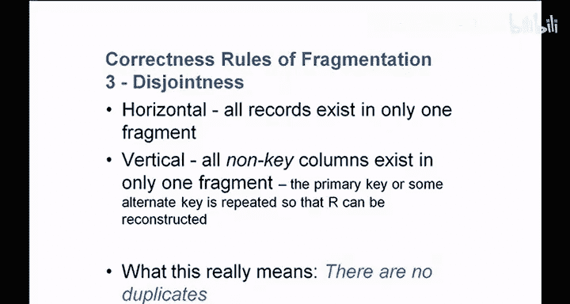

# 011：实现正确分片 📊

在本节课中，我们将学习如何确保对数据库表进行分片操作的正确性。分片是一种将大型数据库表拆分成更小、更易管理的部分的技术。为了确保分片后的数据依然完整、可重构且无冗余，我们需要遵循三个核心规则。

---

## 分片正确性三规则

上一节我们介绍了分片的基本概念，本节中我们来看看确保分片正确性的三个具体规则。

### 规则一：完整性 ✅

完整性规则要求，当一个关系（表）R被分片成n个关系（片段）时，必须确保R中的所有数据项都存在于这些片段中。这不仅包括当前已存在的数据，也包括未来可能插入的任何数据项，它们最终都会被分配到某个片段中。

**核心概念**：确保所有数据都被包含，且未来数据也能正确归位。

### 规则二：可重构性 🔄

在将关系拆分成多个片段后，我们必须确保存在某种关系运算符（记作∇），能够从这些片段中重构出原始关系。这个运算符的具体形式取决于分片的类型。

以下是不同分片类型对应的重构运算符：
*   对于水平分片，重构运算符是**并集（Union）**。
*   对于垂直分片，重构运算符是**连接（Join）**。

**核心概念**：`重构关系 R = 片段1 ∇ 片段2 ∇ ... ∇ 片段n`

### 规则三：不相交性 🚫

不相交性规则要求确保所有数据记录只存在于一个片段中，避免数据重复。

以下是针对不同分片类型的解释：
*   在水平分片中，每一行数据只能出现在一个片段里。
*   在垂直分片中，每一列（除了用于重构关系的关键列）也只能出现在一个片段里。

**核心概念**：确保在整个片段集合中没有重复的数据行或数据列（关键列除外）。

---

## 总结

本节课我们一起学习了实现正确分片必须遵循的三个核心规则：**完整性**、**可重构性**和**不相交性**。遵循这些规则能确保分片后的数据依然保持逻辑上的完整与一致，为后续的高效数据管理打下坚实基础。