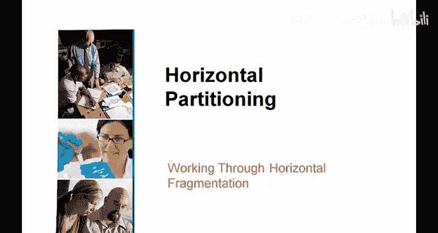
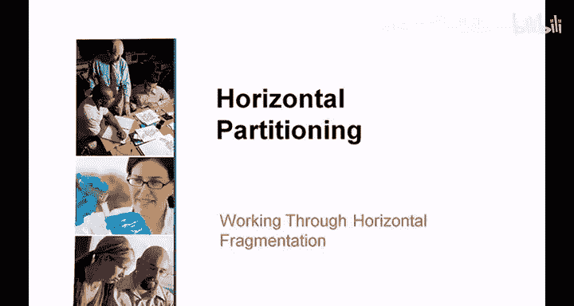
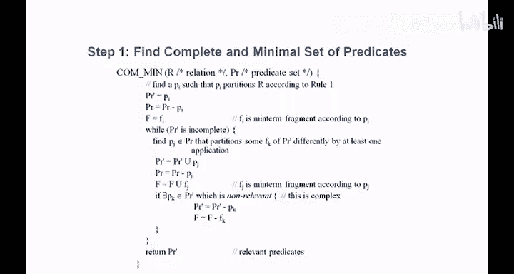
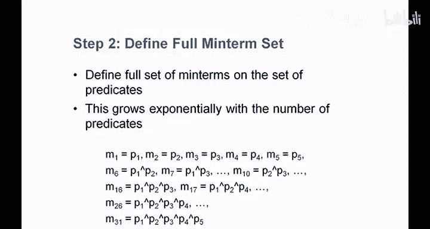
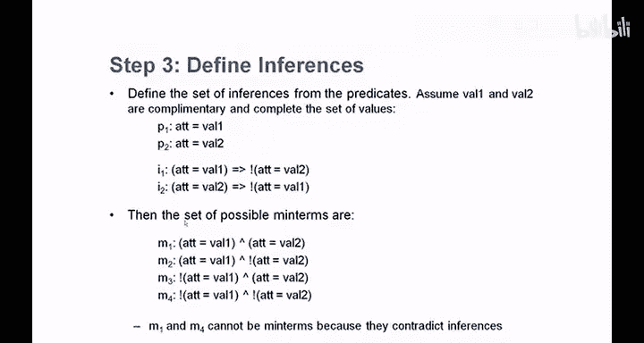
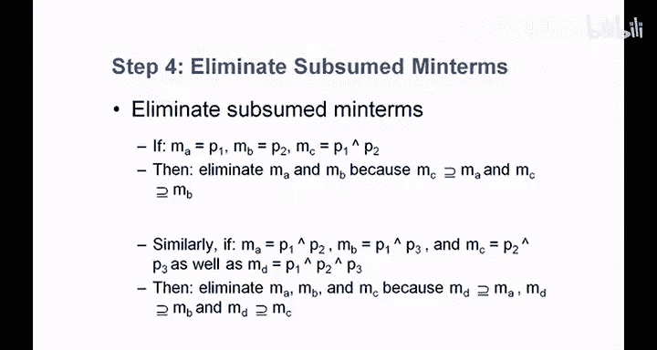
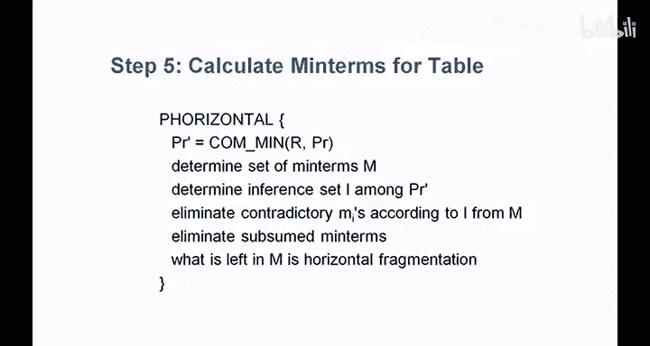

# 012：水平分片实践 🧩

## 概述

在本单元中，我们将学习水平分片的具体实践方法。我们将探讨如何通过算法确定合适的分片规则，以确保每个分片内的数据访问概率均匀，而不同分片间的访问概率存在差异，从而实现高效的数据分布。

---

## 水平分片的目标

上一节我们介绍了水平分片的基本概念，本节中我们来看看其核心目标。

水平分片的最终目标是创建不同的数据片段。每个片段应包含一组记录（行），并且对于访问该片段的每个应用程序（或至少一个应用程序）而言，该片段内的每个元组都具有**相等的访问概率**。

这意味着，当一个应用程序查看某个片段时，该片段内可能有20行不同的数据，但该应用程序访问其中任何一行的可能性应该是相同的。如果某些行的访问概率明显高于其他行，这就提示我们可能需要进一步细分该表，或者当前的分片方案不正确，需要重新调整。

反之，我们希望确保如果定义了两个不同的片段，那么每个片段中行的访问概率应该是**不同的**。也就是说，如果行A在一个片段中，行B在另一个片段中，那么不同应用程序（甚至是同一个应用程序）访问行A与行B的概率应有显著差异。

我们可以走向一个极端：将每一行都分到自己的片段中。虽然这在理论上可能正确，但在分布式数据库系统中不会带来任何效率提升。我们希望尽可能多地将行放在一起，同时又不违反上述关于不同访问概率的规则。因此，关键在于找到正确的行集合和分片规则。

此外，我们还需要保证**完整性**，即确保所有行都恰好归属于一个片段，且仅归属于一个片段。

---

## 分片的形式化定义与核心算法

理解了目标后，我们需要一个系统的方法来实现它。以下是水平分片的核心算法步骤。

### 算法概述

该算法旨在找到一组“谓词”，用于将原始关系划分成多个水平片段，使得不同片段具有不同的访问概率特征。以下是五个关键步骤：

1.  **寻找完整且最小的谓词集**
    首先，我们需要从所有可能的谓词中，筛选出那些能对数据访问模式产生显著影响的谓词。例如，对于一个包含`budget`列的表，谓词可以是`budget > 200000`和`budget <= 200000`，这可能区分了高预算和低预算项目，从而影响访问频率。算法会评估每个谓词，保留那些能导致不同访问概率的谓词，剔除无关紧要的谓词。

2.  **定义完整的极小项集**
    获得相关谓词集后，我们需要生成所有可能的谓词组合，即“极小项”。如果初始有 `n` 个谓词，那么极小项的数量是 `2^n - 1`（排除空组合）。例如，有5个谓词（P1, P2, P3, P4, P5），极小项包括单个谓词（如M1=P1）、两个谓词的合取（如M6=P1∧P2）、三个谓词的合取等，直到所有五个谓词的合取。

3.  **推导并消除矛盾**
    某些极小项可能是矛盾的，无法适用于任何数据行。例如，如果P1是`location = 'Montreal'`，P2是`location = 'New York City'`，那么极小项`P1 ∧ P2`就是矛盾的，因为一行数据不能同时位于两个城市。这一步需要识别并排除所有矛盾的极小项。

4.  **消除被包含的极小项**
    如果某个极小项的逻辑条件包含了另一个极小项的所有条件，则称前者“包含”后者。例如，如果极小项C是`P1 ∧ P2`，而极小项A是`P1`，那么C就包含了A。在这种情况下，更具体的极小项C会使得A变得冗余。因此，我们需要消除那些被其他极小项包含的冗余项，保留最具体、最明确的极小项来定义分片。

5.  **确定最终分片方案**
    经过以上步骤，我们得到了一组无矛盾、无冗余的极小项。每个极小项定义了一个逻辑条件，满足该条件的所有数据行将构成一个独立的水平片段。这些片段共同覆盖了原始关系的所有数据，且彼此互斥。

---

## 实践中的挑战与技巧

理论算法需要结合实际判断。在实践中，确定初始相关谓词集可能比想象中困难。

通常，分析应用程序的初始查询集是识别关键谓词的有效方法。但需要注意的是，一个最初看起来相关的谓词（如`location`），在深入分析后，可能会发现其影响实际上被另一个更根本的谓词（如`budget`）所掩盖（例如，高预算项目恰好都位于某个特定地点）。因此，算法过程是一个迭代和精炼的过程，需要经验和判断力。

---

## 总结

本节课中，我们一起学习了水平分片的实践方法。我们明确了分片的目标是创建访问概率均匀的片段，并介绍了实现这一目标的五步算法：1) 寻找最小完整谓词集，2) 生成极小项，3) 消除矛盾项，4) 消除冗余项，5) 确定最终分片。这个过程结合了形式化算法与对实际数据访问模式的理解，是设计高效分布式数据库的关键步骤。

在接下来的课程和配套网站示例中，你将看到一个具体的、简单的实例，来演示这个算法是如何实际运作的。

---
**第3模块第4单元结束。**