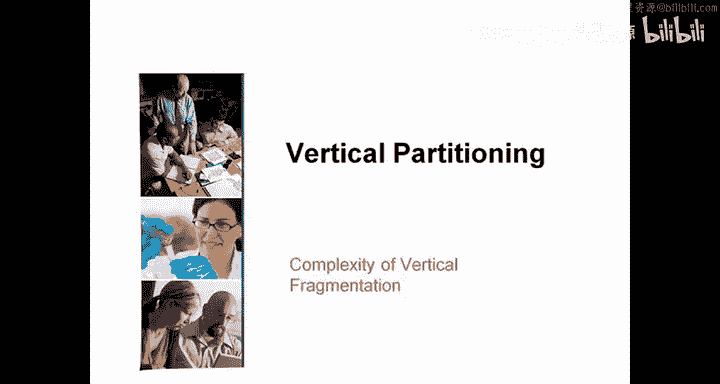
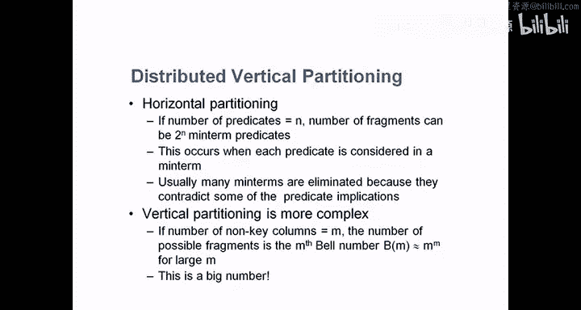
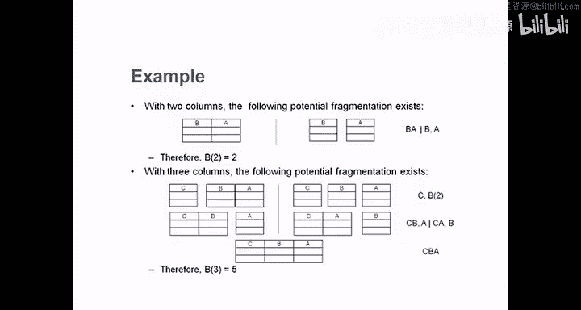
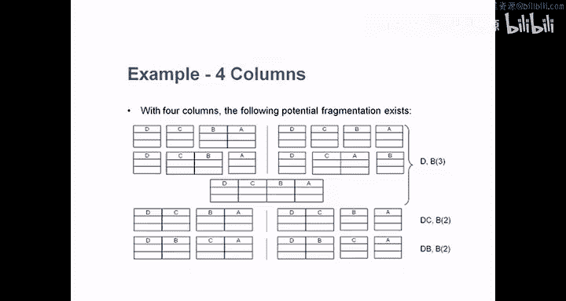
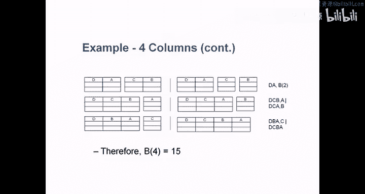
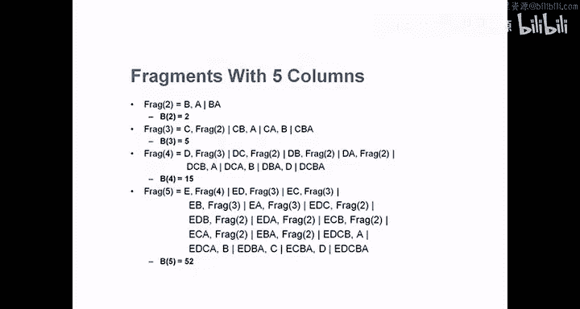
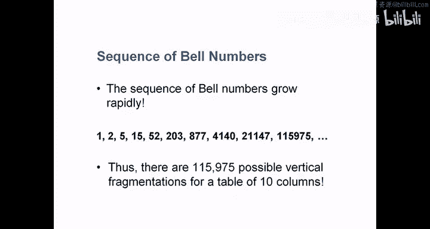

# 014：垂直分片的复杂性 🔍

在本节课中，我们将要学习垂直分片（Vertical Partitioning）的复杂性，特别是与水平分片（Horizontal Partitioning）相比，其可能的分片方案数量是如何急剧增长的。

---

## 水平分片与垂直分片的对比

上一节我们介绍了数据库分片的基本概念。本节中我们来看看两种主要分片方式的复杂性差异。

我们有两种分片选项：水平分片和垂直分片。水平分片很复杂，但垂直分片更为复杂。

让我们简要讨论一下水平分片。如果谓词（predicates）的数量等于 `n`，那么基于最小项谓词（minterm predicates），分片的数量可能是 `2^n`。当每个谓词都被考虑在一个最小项中时，就会发生这种情况。虽然通常许多最小项会因为与某些谓词含义矛盾而被消除，但 `2^n` 仍然是一个很大的数字。这就是为什么我们需要启发式方法，以便在合理的时间内将可能的分区数量减少到可管理的范围。

但是，如果水平分片的选项数量是 `2^n`，那么垂直分片的选项数量就是 `M^M`。如果关键列的数量是 `M`，那么可能的分片数量就是贝尔数（Bell number），我们称之为 `B(M)`。对于较大的 `M`，它约等于 `M^M`。这是一个非常庞大的数字。`M^M` 大于 `2^n`。

---

## 贝尔数示例

让我通过一个例子来说明为什么这个数字如此之大。

让我们检查两列的贝尔数。对于 `B(2)`，分片数量是 `2`。我们有两个选项：要么将列 `B` 和 `A` 放在一起形成一个分片，要么定义两个分片，一个包含列 `B`，另一个包含列 `A`。这非常简单，很容易检查，也很容易确定哪个更优。

对于三列来说就稍微复杂一些。观察这里的图示，你可以让 `C` 与 `B` 或 `A` 在一起，或者 `B` 和 `A` 在一起，或者 `C` 与 `B` 和 `A` 分开。这是第一行的图示。注意右边的符号，我的意思是取列 `C`，将其乘以 `B(2)`（即 `C` 单独存在时的情况）。这基本上就是 `C` 与 `B` 和 `A` 在一起，或者 `C` 与 `B` 和 `A` 分开。但这只是第一个选项。

我们还有将 `C` 与其他列组合的选项。例如，我们可以将 `C` 和 `B` 组合在一起，让 `A` 单独；或者将 `C` 和 `A` 组合在一起，让 `B` 单独；或者将 `C`、`B` 和 `A` 都放在一起。所以总共有五种不同的选项。这还不算太糟。

对于四列，情况变得更加复杂。我们想添加一列 `D`。首先，我们有 `D` 单独存在的五种选项（即 `B(3)` 的图示）。如果我们保持 `D` 单独，我们可以将其与 `A`、`B`、`C` 的三种组合中的每一种结合。我们可以有 `D` 和 `C` 在一起，列 `B` 和 `A` 在一起；`D` 和 `C` 在一起，列 `B` 和 `A` 分开；或者 `D` 和 `B` 在一起，`C` 和 `A` 在一起；`D` 和 `B` 在一起，`C` 和 `A` 分开；或者 `D` 和 `A` 在一起，`C` 和 `B` 在一起；`D` 和 `A` 在一起，`C` 和 `B` 分开。你注意到所有不同的组合了吗？因此，四列的贝尔数 `B(4)` 是 `15`。这里有15种不同的组合。

对于五列，情况就更复杂了。所以，包含两个元素的分片的贝尔数是 `2`，三个元素的是 `5`，四个元素的是 `15`，那么五个元素的就是 `52`。你可以观察我是如何将各列配对的。让我们看看五列的分片。我们说 `E` 与所有不同的四列分片组合在一起；或者 `E` 和 `D` 在一起，与 `C`、`B`、`A` 的所有不同三列组合；或者 `E` 和 `C` 在一起，与 `D`、`B`、`A` 的所有不同组合；或者 `E` 和 `B` 在一起，与 `D`、`C`、`A` 的所有组合，等等，直到我们开始映射所有三列在一起的情况：`E`、`D`、`C` 在一起，与 `A` 和 `B` 的所有组合；或者 `E`、`D`、`A` 在一起，与 `C` 和 `B` 的所有组合，等等。然后我们得到 `E` 作为四列之一参与的所有组合，或者将所有列放在一起。如果你数一下，加起来就是 `52`。

---

## 贝尔数的快速增长

贝尔数序列增长迅速。

以下是前10个贝尔数的值：
*   `B(1) = 1`
*   `B(2) = 2`
*   `B(3) = 5`
*   `B(4) = 15`
*   `B(5) = 52`
*   `B(6) = 203`
*   `B(7) = 877`
*   `B(8) = 4140`
*   `B(9) = 21147`
*   `B(10) = 115975`

超过这个数字，它会变得更大。因此，给定一个简单的10列表，有 `115975` 种不同的垂直分片组合可供选择。这需要检查的组合数量非常庞大。

显然，当列数超过10时，我们需要一些启发式方法，来帮助我们遍历所有选项，以确定理想的垂直分片方案。我们需要启发式方法。这将是本模块其余部分的讨论内容。

---

## 总结

本节课中我们一起学习了垂直分片的复杂性。我们了解到，对于一个包含 `M` 列的表，可能的垂直分片方案数量是贝尔数 `B(M)`，其值约等于 `M^M`，增长速度远快于水平分片的 `2^n`。例如，一个仅有10列的表就有超过11万种可能的分片方式。面对如此庞大的搜索空间，我们必须依赖启发式算法来在合理的时间内找到近似最优的分片方案，这将是后续课程的重点。