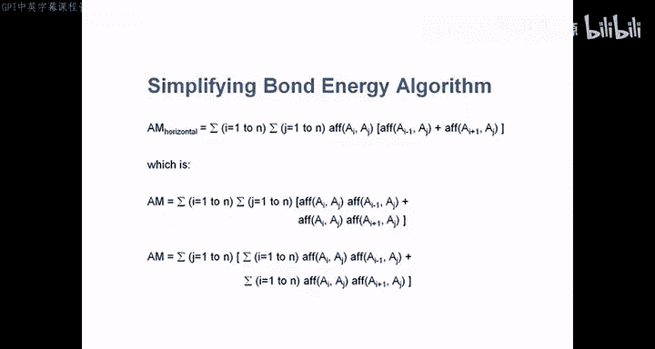
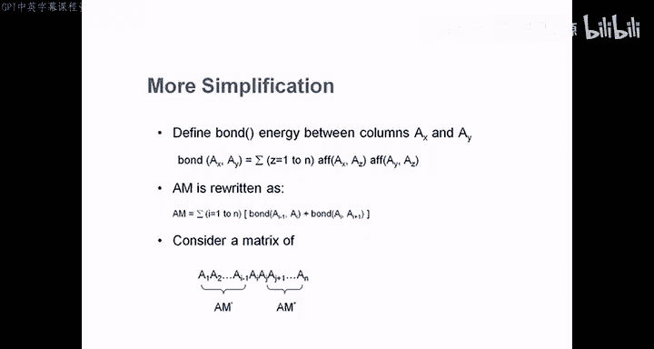
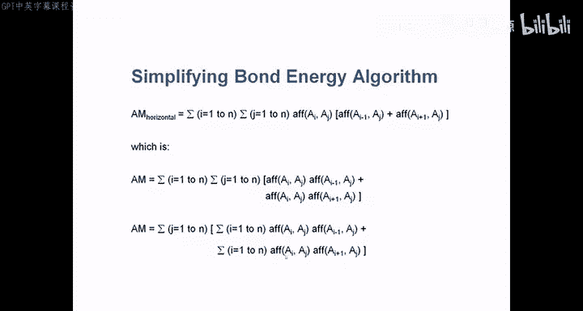
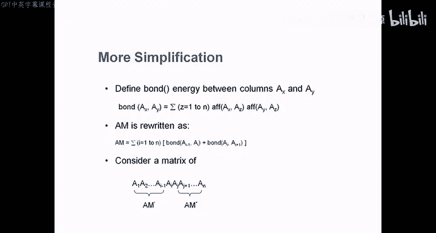
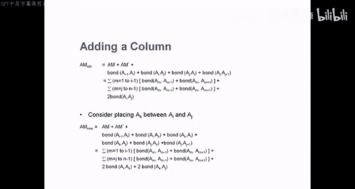
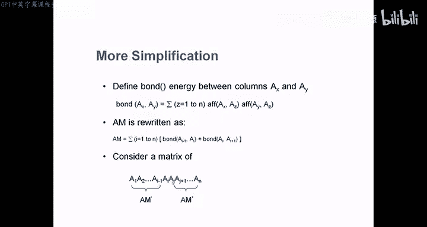
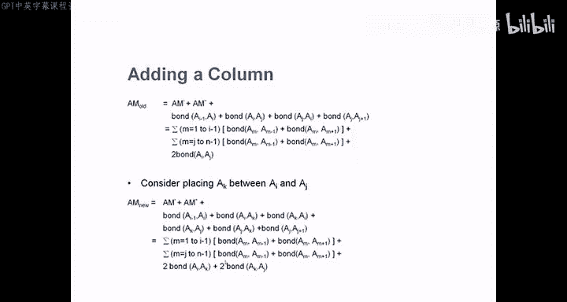

# 016：简化势能绑定算法 🧮


在本节课中，我们将学习如何简化势能绑定算法。我们将从回顾亲和力度量开始，逐步推导出计算势能变化的简化公式，这将大大降低算法的计算复杂度。

## 回顾亲和力度量

上一节我们介绍了整个矩阵的亲和力度量，即水平亲和力度量。现在，我们来具体看看这个度量是如何计算的。

亲和力度量公式如下：

**公式：**
```
亲和力(A_i, A_j) = Σ (亲和力(A_i, A_j) * (亲和力(A_{i-1}, A_j) + 亲和力(A_{i+1}, A_j)))
```
其中，我们对矩阵的所有行和列进行双重求和。

## 推导列间势能



为了简化计算，我们需要将上述对整个矩阵的求和，转化为对列之间关系的度量。以下是推导步骤：

1.  首先，我们将亲和力度量公式中的项进行重组，将每个单元格的亲和力与其西邻和东邻的亲和力相乘。
2.  接着，我们可以进一步操作这些求和。我们可以将对行 `i` 的求和，转化为计算两列之间所有行上亲和力值的乘积之和。



基于此，我们定义两列 `A_x` 和 `A_y` 之间的**势能**如下：



**公式：**
```
势能(A_x, A_y) = Σ_{z=1}^{n} [亲和力(A_z, A_x) * 亲和力(A_z, A_y)]
```
这个公式计算的是当两列相邻放置时，它们之间产生的“能量”总和。

利用这个新定义，原始的整个矩阵的亲和力度量可以重写为：

**公式：**
```
总亲和力 = Σ [势能(A_i, A_{i-1}) + 势能(A_i, A_{i+1})]
```



## 计算插入新列的影响





现在，考虑在一个由多列组成的矩阵中，在列 `A_i` 和 `A_j` 之间插入一个新列 `A_k`。我们的目标是计算插入操作前后，矩阵总势能的变化。

我们断言，插入操作不影响矩阵左侧部分（`A_1` 到 `A_{i-1}`）和右侧部分（`A_{j+1}` 到 `A_n`）的内部势能。因此，我们只需要关注插入点附近的势能变化。

以下是计算势能变化 `Δ势能` 的步骤：

1.  **计算旧势能**：在插入 `A_k` 之前，`A_i` 和 `A_j` 相邻。此时，插入点附近的势能贡献为 `2 * 势能(A_i, A_j)`。
2.  **计算新势能**：插入 `A_k` 后，`A_i` 和 `A_j` 不再相邻。新的相邻关系是 `A_i` 与 `A_k`，以及 `A_k` 与 `A_j`。此时，插入点附近的势能贡献变为 `2 * 势能(A_i, A_k) + 2 * 势能(A_k, A_j)`。
3.  **计算势能变化**：用新势能减去旧势能，得到插入操作导致的净势能变化。

**公式：**
```
Δ势能 = 2 * 势能(A_i, A_k) + 2 * 势能(A_k, A_j) - 2 * 势能(A_i, A_j)
```

这个公式的意义非常直观：**势能的变化量等于新创建的两个相邻关系（`A_i-A_k` 和 `A_k-A_j`）的势能之和，减去被拆开的原有相邻关系（`A_i-A_j`）的势能。**

## 简化算法的优势



通过上述推导，我们得到了计算势能变化的简化公式 `Δ势能`。与重新计算整个庞大矩阵的总亲和力相比，使用这个公式具有巨大优势：

*   **计算简单**：只需计算三个列对之间的势能，并进行一次加法和减法。
*   **效率极高**：在尝试将一个新列插入到矩阵的不同位置时，我们可以快速评估每个可能位置带来的势能增益，从而选择最优位置。
*   **易于理解**：算法核心变为寻找使 `Δ势能` 最大化的插入位置，这直接对应着最大化矩阵的全局聚类亲和力。

## 总结


本节课中，我们一起学习了如何简化势能绑定算法。我们从完整的矩阵亲和力度量公式出发，通过定义列间势能，最终推导出计算插入新列所引起势能变化的简化公式 `Δ势能`。这个公式使得算法无需在每次迭代中计算整个矩阵的势能，只需进行少量列对间的计算即可做出决策，极大地提升了算法的效率和实用性。